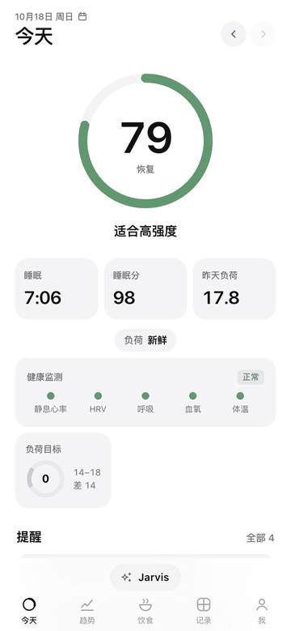

# Documentation

- [Overview](#overview): features, WHOOP-style metrics, architecture
- [Self-hosting](#self-hosting): running it on your own data
- [Design documents](#design-documents) (mostly Chinese)
- [Licences](LICENSES.md) · [Contributing](../CONTRIBUTING.md) · [Quick Start](../quickstart/README.md)

## Overview
AI models keep getting better and keep being replaced; what makes an AI useful *to you* is context. This project is the part that stays: a structured, self-hosted record of your body (watch data, food, training, weight, labs, supplements, symptoms, journal, goals and the AI's own long-term notes) exposed to whatever AI you use through MCP or an API key. A new model reads the full context once and knows you; switching models loses nothing.

Bring your own AI: Claude / ChatGPT / Codex / Gemini subscriptions through MCP, or an API key from Anthropic, OpenAI, Google, DeepSeek, Qwen, any OpenAI-compatible endpoint or a local Ollama. Family-ready (one server, an account per person, opt-in sharing), private by default, built on open source (Open Wearables, SparkyFitness, PostgreSQL, FastAPI, Flutter).

<p align="center"></p>

### Features
| Area | What you get |
|---|---|
| **Recovery** | Daily recovery score (0–100) from overnight HRV, resting heart rate, sleep performance and respiratory rate against your personal 60-day baseline; illness flags |
| **Strain** | Day strain (0–21, Edwards TRIMP from raw heart rate), muscular load from strength logs, CTL / ATL / TSB, **Strain Coach** (today's target strain) |
| **Sleep** | Sleep score, stages (hypnogram), need & debt, consistency, efficiency, latency, **Sleep Coach** and a gradual **bedtime goal** planner |
| **Healthspan** | **Body age** and **pace of aging** from 8 evidence-based markers (steps, active minutes, strength training, VO₂max, resting HR, body composition, sleep duration, sleep regularity) |
| **Health monitor** | Resting HR, HRV, respiratory rate, SpO₂ and wrist temperature vs. your normal range; daytime **stress** score |
| **Training** | Training calendar merging watch workouts (duration, calories, HR zones) with strength logs (sets × reps × weight); intensity per session |
| **Nutrition** | One-tap meal templates, recipe library with per-serving nutrition and health-constraint flags, meal suggestions for what's left of today's targets |
| **Rules & reminders** | Double-progression load suggestions, calorie adjustment from weekly weight trend, pre-workout fueling, weekly food caps, banned / caution exercises |
| **Health records** | Lab results with reference ranges and trends, supplements, symptoms / events, behaviour journal with next-day impact analysis |
| **Reports** | Weekly and monthly performance reports |
| **AI coach** | A personal body-management expert with long-term memory and a status card. **Bring your own AI**: use your Claude / ChatGPT / Gemini subscription through MCP in their official apps, or an API key (Anthropic, OpenAI, Gemini, OpenAI-compatible such as DeepSeek, Qwen, Ollama). Every user's AI and credentials are isolated |
| **Multi-user** | Accounts per person, per-user tokens, opt-in sharing between family members |

**WHOOP-style metrics, for reference** — the algorithm layer covers most body-data features of a WHOOP subscription (details and formulas: [docs/whoop-feature-map.md](whoop-feature-map.md)):

| Metric family | How it is computed here | |
|---|---|---|
| Recovery (0–100) | Overnight HRV, lowest sleeping HR, sleep performance, respiratory rate vs. a 60-day personal baseline | ✅ |
| Strain (0–21) and daily target | Edwards TRIMP from raw heart rate; target from recovery and training load (CTL / ATL / TSB) | ✅ |
| Sleep performance / need / debt, bedtime coach | Need = 8 h + weighted debt + strain bonus; gradual bedtime goal | ✅ |
| Sleep stages, consistency, efficiency | Watch stages, Sleep Regularity Index, awakenings | ✅ |
| Stress, health monitor | Daytime HR / HRV vs. calm baseline; vitals vs. personal normal range | ✅ |
| Body age / pace of aging | 8 evidence-based markers | ✅ |
| Journal insights, reports | Behaviour journal with next-day impact, weekly / monthly reports | ✅ |
| Strength load | Logged sets × reps × weight | 🟡 |
| ECG interpretation, blood pressure, smart alarm, haptics | Not possible with HealthKit data / without a watch app | ❌ |

**One place to look, one AI to talk to:** the Today page (PWA, also embedded in the iOS app) shows everything; recording happens in your AI conversation. Open-source back ends run behind it.

### Architecture
```
 iPhone + Apple Watch                    Your server (Mac mini / Linux VPS), reachable only via Tailscale
 ┌──────────────────────┐   HTTPS   ┌──────────────────────────────────────────────────────────────┐
 │ iOS app (this repo)   │─────────▶│ Open Wearables      raw wearable data (HealthKit, Garmin, …)  │
 │  · HealthKit sync     │          │ Body Engine         scores, insights, records, rules, AI tools│
 │  · Today page inside  │◀─────────│   FastAPI + PostgreSQL, Today page (PWA), MCP endpoint        │
 │ (or iOS Shortcuts)    │          │ SparkyFitness       food diary, recipes, strength logs        │
 └──────────────────────┘          │ Grafana (optional)  long-term charts for the owner            │
 AI client (Claude / Codex / …) ──MCP─▶ Body Engine tools                                           │
                                    └──────────────────────────────────────────────────────────────┘
```
- **One source of truth per data type:** raw wearable samples live in Open Wearables; food and strength logs in SparkyFitness; everything derived or personal (scores, journal, labs, memory) in Body Engine.
- **Private by default:** services bind to `127.0.0.1` and are exposed only inside your Tailscale tailnet; nothing is opened to the public internet. An example Tailscale ACL isolates the server from your other devices.
- **Built on open source:** [Open Wearables](https://github.com/the-momentum/open-wearables) (MIT), [SparkyFitness](https://github.com/CodeWithCJ/SparkyFitness) (run as a separate service under its own licence), [Grafana](https://github.com/grafana/grafana).

## Self-hosting
The Quick Start is a demo. For your own data, deploy each service with its production setup (pinned images, Tailscale-only access, backups, scheduled jobs):
1. Secrets: `deploy/open-wearables/init-secrets.py`, `deploy/sparkyfitness/init-secrets.py`, `secrets/body_db_password` (see [`secrets/README.md`](../secrets/README.md)).
2. Services: Body Engine (`docker compose up -d`), [Open Wearables](../deploy/open-wearables/README.md), [SparkyFitness](../deploy/sparkyfitness/README.md), optionally [Grafana](../deploy/grafana/README.md).
3. Your user and token: `cd body_engine && uv run body-engine user-add …` then `token-create` ([Body Engine README](../body_engine/README.md)).
4. Expose the Today page inside your tailnet with `tailscale serve`, open it on your phone.
5. Connect data: the [iOS app](../apps/watch2whoop/README.md), or the [iOS Shortcut](../shortcuts/README.md); optionally import your Apple Health history (`export.zip`) from the Today page.
6. Scheduling, encrypted backups and health checks: [`deploy/ops/`](../deploy/ops/README.md) (macOS LaunchAgents; a Linux / systemd guide is on the roadmap).

The production set-up of each service (ports, env vars, upgrades) is in its own README: [`body_engine/`](../body_engine/README.md), [`deploy/open-wearables/`](../deploy/open-wearables/README.md), [`deploy/sparkyfitness/`](../deploy/sparkyfitness/README.md), [`deploy/grafana/`](../deploy/grafana/README.md), [`deploy/ops/`](../deploy/ops/README.md), [Tailscale ACL example](../deploy/tailscale/policy.hujson).

## Design documents
Most design documents were written in Chinese while the project was built; they are kept as the detailed record.
English developer documentation lives next to the code: [`body_engine/README.md`](../body_engine/README.md) (API, CLI, scoring, Today page),
[`deploy/*/README.md`](../deploy) (deployment of each service) and [`apps/watch2whoop/README.md`](../apps/watch2whoop/README.md) (iOS app).

| Document | Language | What it covers |
|---|---|---|
| [system-design.md](system-design.md) | Chinese | Architecture, data ownership per component, table design, scoring algorithms, rules engine, Today page, training history, iOS app (§0 product principles, §16 training, §17 iOS app) |
| [oss-extraction-plan.md](oss-extraction-plan.md) | English | Open-source extraction: which pieces are split out (scoring library first, `packages/openbodyscore/`, Apache-2.0), licences, package / repository plan, release checklist |
| [apps.md](apps.md) | English + Chinese summary | Client apps: platform matrix (iOS, Android, HarmonyOS), shared client contract, `apps/` layout, app versioning and release tags, CI path filters |
| [ai-assistant-plan.md](ai-assistant-plan.md) | Chinese | The AI coach ("body butler"): tools, memory, multi-user / multi-provider AI access (§9) |
| [datalayer-design.md](datalayer-design.md) | Chinese | MCP "personal data layer" framework (#116, design awaiting review): the boundary between the generic layer (tool registry, per-user authorization hooks, audit and write log, tool groups, playbooks, MCP transports) and Watch2Whoop's health features, interfaces, phased migration, open-source checklist, risks |
| [ai-feedback-plan.md](ai-feedback-plan.md) | Chinese | AI self-reported feedback (design, awaiting the deployer's choice): a versioned root rule layer every AI receives, the `report_feedback` tool with server-side sanitisation / dedupe / rate limits, delivery options (public issues, private triage queue, e-mail digest, Discussions) |
| [self-signup-plan.md](self-signup-plan.md) | Chinese | Self-service sign-up (e-mail code / Sign in with Apple) gated by batch invite codes; automatic provisioning, in-app account deletion, mail provider and DNS setup |
| [whoop-feature-map.md](whoop-feature-map.md) | Chinese | Every WHOOP body-data feature → our implementation and API |
| [scoring-methodology.md](scoring-methodology.md) · [English](scoring-methodology.en.md) | Chinese + English | **Scoring methodology** (#118): inputs, formulas and every parameter of sleep, recovery, strain, muscle load, stress and body age, each labelled literature / ported spec / design choice / personal calibration, with verified references and known limits |
| [scoring-validation.md](scoring-validation.md) | Chinese | **Scoring validation** (#118): pre-registered metrics (stability, construct validity, sensitivity, HRV-kind agreement), results on synthetic data (`python -m body_engine.validation`), conclusions from real data without personal values, and the WHOOP comparison plan awaiting decisions |
| [training-v2-plan.md](training-v2-plan.md) | Chinese | Training module v2 (deferred): exercise library, splits, weekly plans, AI-built plans, data sources and their licences |
| [friends-social-plan.md](friends-social-plan.md) | Chinese | Friends page (in development): circles and invites, per-scope sharing, today + 7-day member cards, baseline-relative leaderboards, data model and API |
| [hevy-benchmark.md](hevy-benchmark.md) | Chinese | Benchmark against Hevy (#161): its workout logging and social features vs ours, gap table, P0–P2 priorities, what we skip and why, wireframes, phased plan, the Hevy CSV export format |
| [raw-data-plan.md](raw-data-plan.md) | Chinese | Getting more raw Apple Watch data (heartbeat series, ECG, iOS 27 RMSSD, watchOS app) and what it unlocks (awaiting confirmation) |
| [apple-sync-engine.md](apple-sync-engine.md) | Chinese | **Own Apple Health sync engine** (#219, design awaiting review): how the Open Wearables path works today and every place Body Engine reads OW, how the OW iOS SDK syncs in the background (what to copy, its pitfalls), the new Swift engine (type registry, per-type anchors, background wake, 90-day backfill, range resync, workouts / sleep) and server side (`hk_samples`, derivation, `app` source priority, scoring right after upload), shadow comparison, cutover / rollback / OW decommission, PR breakdown with estimates, tests, risks |
| [shortcut-sync-spec.md](shortcut-sync-spec.md) | Chinese | The iOS Shortcut upload format (`cols-v1`) and how the server parses it — the single source of truth for the Shortcut |
| [shortcut-raw-heart-rate.md](shortcut-raw-heart-rate.md) | Chinese | Historical: why the Shortcut uploads raw heart-rate samples |
| [ow-ios-app-testflight-guide.md](ow-ios-app-testflight-guide.md) | Chinese | Superseded by the Watch2Whoop iOS app |
| [tester-handbook.md](tester-handbook.md) | Chinese | **Tester handbook** for the iOS app (one generic edition, rendered to `/app/handbook/` by the deployer's `handbook.py`): table of contents, how to use it (everything goes through your AI: example requests per area), install from TestFlight, the personal reusable activation link, Health permission, one-tap start, connecting an AI (Jarvis fallback / own API key / Claude or ChatGPT subscription via MCP), talking to Jarvis (photos, video, voice, cards), a tour of the pages, the sync center, friends and circles, troubleshooting in three steps (ask Jarvis, check the sync center, send feedback), FAQ; features still behind a rollout flag are marked "内测中" |
| [tester-handbook.en.md](tester-handbook.en.md) | English | English edition of the tester handbook, section by section the same as the Chinese one (`/app/handbook/en/`; the Today page's 我 → 使用手册 and the activation page open the edition in the page language; each edition links to the other; screenshots still show the Chinese UI until English ones are taken, #42). `tests/test_handbook.py` keeps the two in step |
| [rollout.md](rollout.md) | Chinese | **Gradual rollout and A/B tests**: feature flags (off / cohort / percent / all), the beta cohort, consent versions that follow the flags, experiments with stable buckets and exposure counts, and the standard release flow (deploy dark → beta → online acceptance → all, or off) |
| [offline-plan.md](offline-plan.md) | Chinese | **Offline use** (flag `offline_mode`, #77): what works offline, the device's read cache and write queue (order, idempotency, conflicts), storage and privacy, why the iOS app has no service worker |
| [admin-guide.md](admin-guide.md) | Chinese | **Admin guide** for whoever runs the server: open accounts, activation links / login codes / tokens, family shares, AI tokens and the fallback AI, history import, recomputing scores, backups and doctor, where secrets live, troubleshooting |
| [archive/tester-handbook-web-shortcut.md](archive/tester-handbook-web-shortcut.md) | Chinese | Archived handbook for the interim web + iOS Shortcut setup (before the app; served at `/app/handbook/web/`) |
| [family-consent.md](family-consent.md) | Chinese | The consent text testers accept in the app (must stay byte-identical to `body_engine/src/body_engine/profile/consent.md`) |
