# Watch2Whoop 使用手册（旧版：网页 + 快捷指令）

> **已停用（2026-10-22）**：iPhone 只用 Watch2Whoop App，「添加到主屏幕」的网页版不再支持。请按新版 [使用手册](../tester-handbook.md) 装 App。这一版只留作存档。

<!-- W2W:HELLO -->

**Watch2Whoop 是给你的 AI 用的身体数据库。** Apple Watch 的数据自动进来，算出恢复分、睡眠分、负荷；你说过的每一顿饭、每一次训练、每一张化验单都存下来，AI 随时调出来帮你分析。

**你必须有一个 AI。** 这里没有输入框，也没有记录按钮：吃了什么、练了什么、体重、化验单、哪里不舒服，都是**跟 AI 说**，打字、截图、拍照都行，AI 帮你记进去。页面只负责看图表和分数。

## 开始前准备

- **账号信息**：管理员单独发给你的一小段文字（手机登录码、电脑登录链接、快捷指令的上传地址和上传 token）。只给你本人，不要转发。
- **快捷指令文件**「Watch2Whoop Health Sync」：大家用同一个。
- **一个 AI**：见下一节「连接你的 AI」。

## 连接你的 AI（核心）

登录以后（步骤在下面），点底部「我」→ 最下面的「AI 设置」。三种方式选一种。

 

「AI 设置」最上面的「Jarvis 用」选当前用哪个（托底 AI 一直在里面），对话框顶部的名字也能点开切换；自己的 AI 停用或删除后会自动回到托底。

### 方式 1：Jarvis 托底 AI（最省事）

不用申请任何账号，开通后直接用。底层是 DeepSeek，每月约 ¥3。第一次使用时会问你是否同意把你的身体数据发给 DeepSeek 处理，同意后才能用。

> 📷 截图稍后补（托底 AI 正在上线）

### 方式 2：填你自己的 API key

「AI 设置」→「添加」→「来源」选你有 key 的那家（DeepSeek、通义千问选「OpenAI 兼容接口」）→ 填模型、接口地址、API key、每月预算 →「保存」。

 

key 只上传一次，之后只显示末 4 位；超过每月预算会自动停。

### 方式 3：用你的 Claude / ChatGPT 订阅

适合在电脑上用 Claude 桌面版 / Claude Code、Codex 的人。「AI 设置」→「添加」→ 选「Claude 订阅」或「ChatGPT 订阅」→「保存」→「连接客户端（MCP）」→ 选客户端 →「生成 token」，按屏幕上的 3 步在电脑上配置。

token 只显示一次；不用了在同一个地方「吊销」。

### 怎么用

点任何页面底部的「Jarvis」开始对话。还没设置 AI 时会提示「去 AI 设置」。

> 你：（拍一张午饭的照片）记一下午饭
> AI：识别出米饭约 150g、清蒸鱼约 120g、炒青菜……一共约 620 kcal、蛋白质 38g。确认记到今天午餐吗？
> 你：（化验单截图）帮我录入
> AI：读到 12 项：尿酸 430 μmol/L（偏高）、ALT 45 U/L……确认录入 10 月 18 日的化验吗？
> 你：今天练腿 50 分钟，深蹲 5×5 100kg
> 你：我今天恢复怎么样，适合练吗？

AI 要写入数据前都会先问你「确认吗」，你点确认才会记。

输入框旁边三个按钮：

| 按钮 | 用法 |
|---|---|
| 📷 照片 | 拍照或从相册选，一次最多 8 张（饭、体重秤、化验单、手表截图） |
| 🎬 视频 | 选一段视频，自动抽最多 8 张画面；视频里有人说话会先转成文字放进输入框 |
| 🎤 按住说话 | 按住说、松开识别（最长 60 秒），文字先放进输入框，你看一眼、改错字再发；手指上滑取消 |

语音在服务器上转文字，不发给第三方，录音转完就删。**在 Watch2Whoop app 里按 🎤 没反应、或提示「这里不能录音」时**：点输入框，用键盘上的 🎤 听写，效果一样。

<!-- W2W:ONLY web -->
## 网页版设置（现在）

### ① 加到主屏幕

Safari 打开 `body.example.com/app`，点「…」。

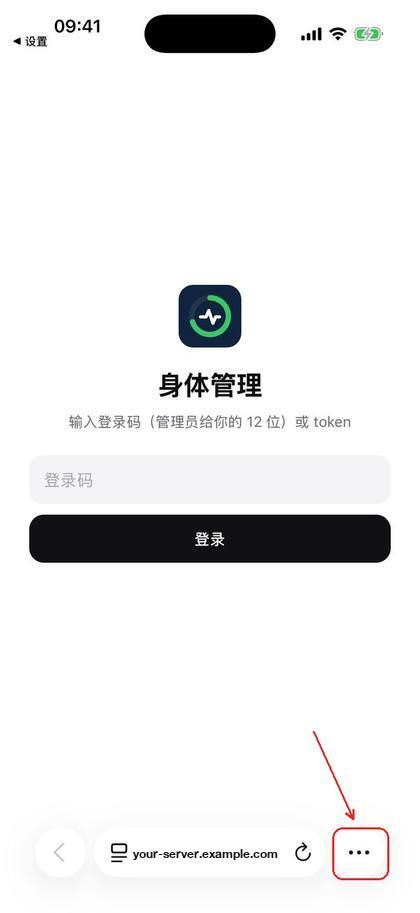 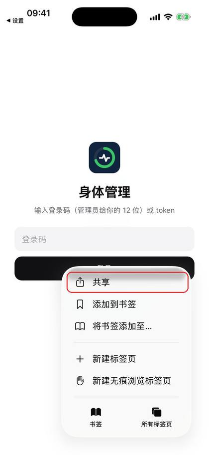

「添加到主屏幕」→「添加」。

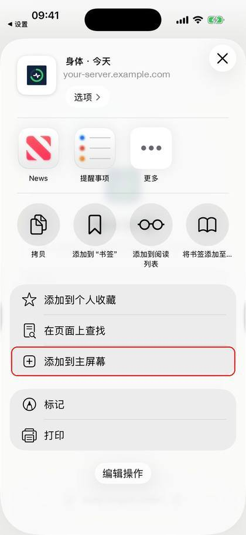 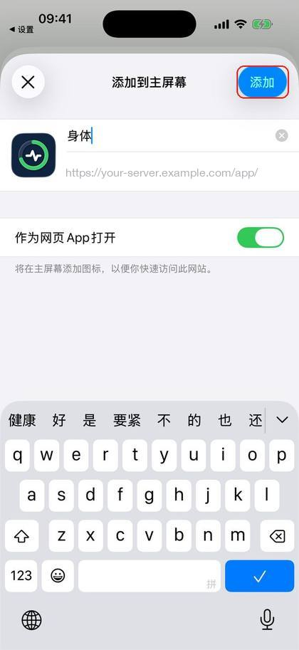

### ② 登录

从主屏幕打开「身体」，粘贴账号信息里的**手机登录码**，点「登录」。账号信息里写「✓ 手机已登录」的跳过这一步。

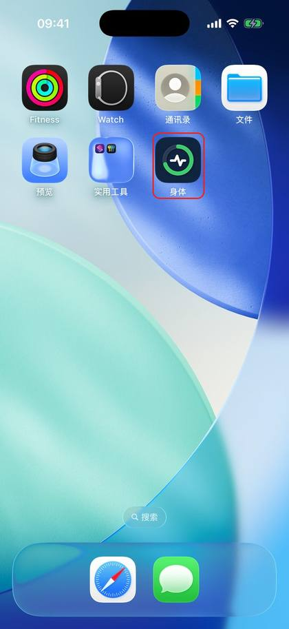 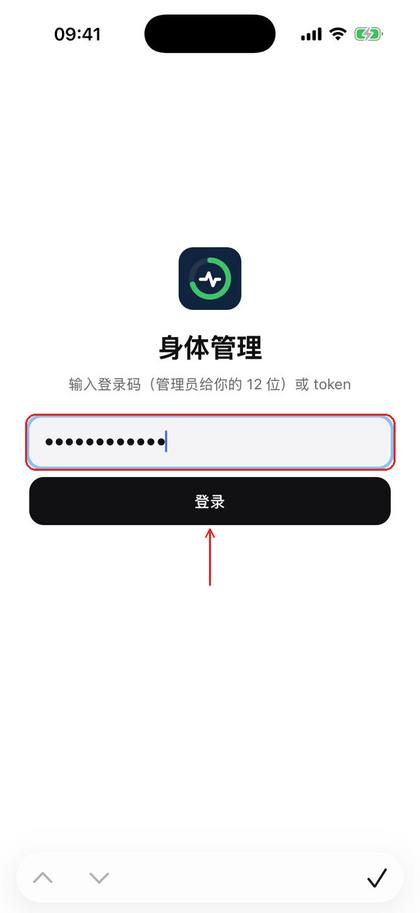

### ③ 同意

勾选同意 →「同意并继续」→ 填资料 →「保存」。

 

### ④ 连接你的 AI

按上面「连接你的 AI」选一种方式。

### ⑤ 装快捷指令

点开「Watch2Whoop Health Sync」文件 →「设置快捷指令」。

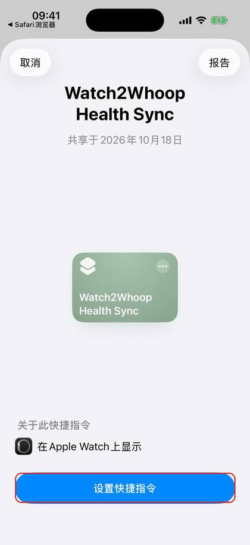

第 1 题粘贴账号信息里的**上传地址**；第 2 题把 `YOUR-UPLOAD-TOKEN` 换成账号信息里的**上传 token** →「添加快捷指令」。

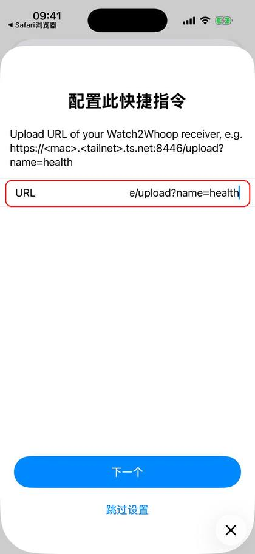 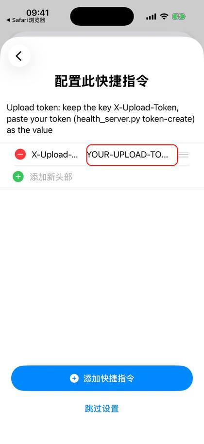

### ⑥ 打开权限

设置 → App → 健康 → 数据访问与设备 → 快捷指令 →「全部打开」。

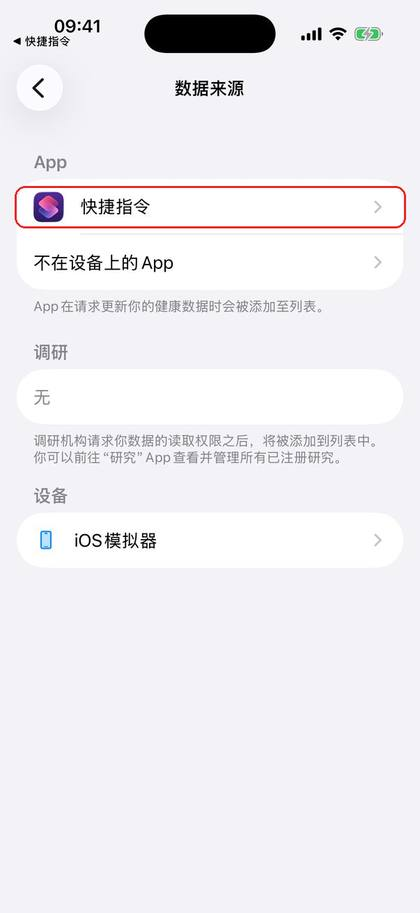 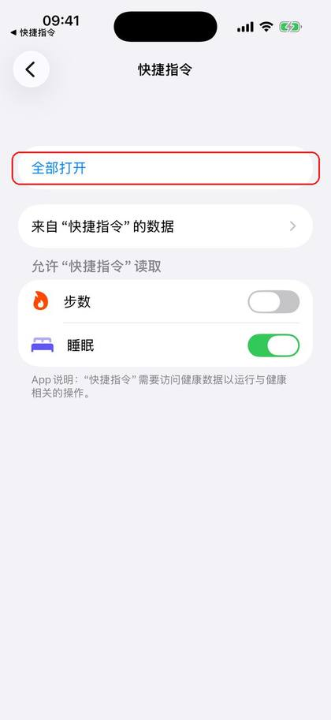

解锁手机，点一下运行。问「允许发送健康样本」时选「始终允许」。

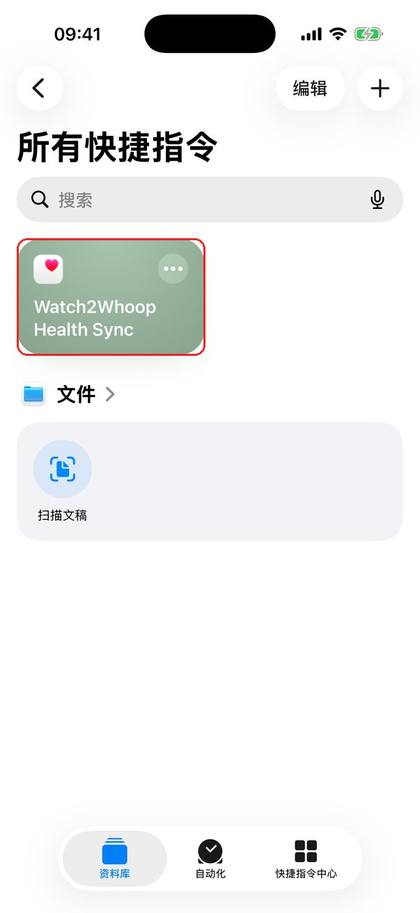

### ⑦ 自动同步

「自动化」→「新建自动化」→「特定时间」（12:00、18:00、22:00 各一条）、「睡眠」（醒来时）、「App」（打开微信时）。

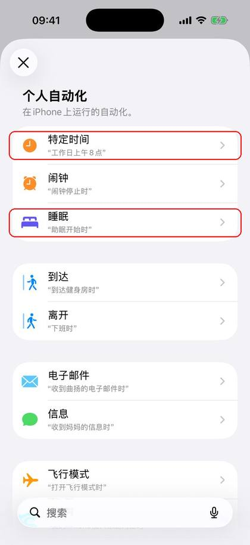 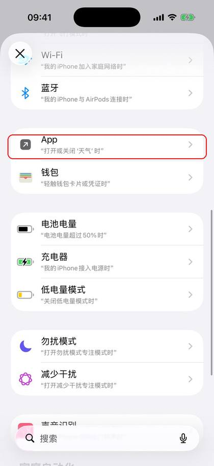

选「立即运行」、关「运行时通知」→「下一步」→ 选「Watch2Whoop Health Sync」。

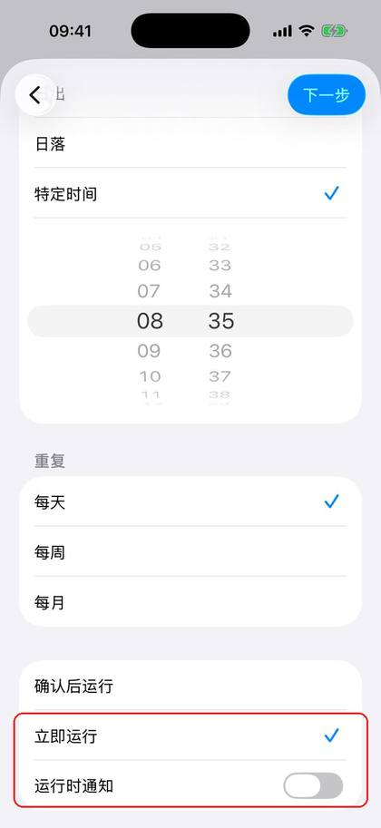 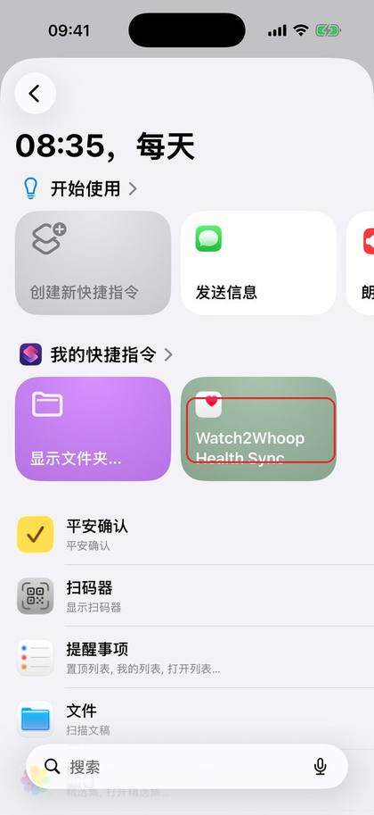

### ⑧ 导入历史

「健康」→ 头像 →「导出所有健康数据」→ 存到「文件」。今天页「我」→「导入健康历史」→「选择文件」。

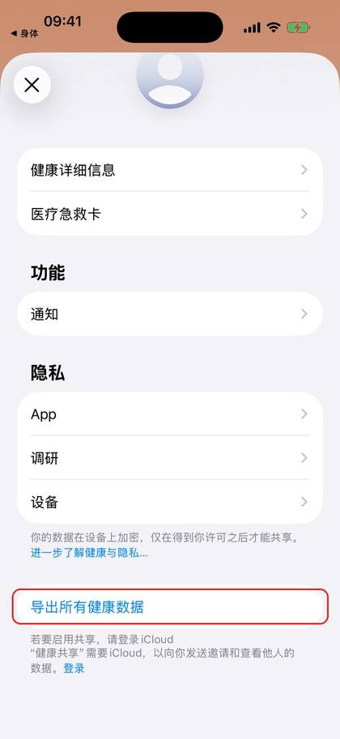 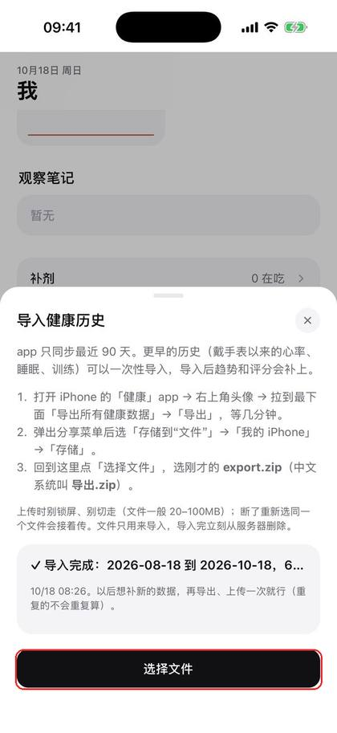

### 电脑上看

电脑浏览器打开账号信息里的**电脑登录链接**（只能用一次）。

### 装了 app 以后

管理员会发新的账号信息（带设置二维码）。app 同步正常后，「自动化」里删掉快捷指令的自动化。

<!-- W2W:ONLY end -->
<!-- W2W:ONLY app -->
## App 版设置

### ① 装 app

TestFlight 邮件 →「查看测试」→ App Store 装 TestFlight →「接受」→「安装」。

### ② 扫码

iPhone 相机扫账号信息里的设置二维码 →「在 Watch2Whoop 中打开」。

<!-- W2W:SETUP -->

### ③ 授权健康

「全部打开」→「允许」。

### ④ 同意

勾选同意 →「同意并继续」→ 填资料 →「保存」。

 

### ⑤ 连接你的 AI

按上面「连接你的 AI」选一种方式。

### ⑥ 同步

首次同步 90 天：app 留在前台、手机解锁。

### ⑦ 导入历史

「健康」→ 头像 →「导出所有健康数据」→ 存到「文件」。「我」→「导入健康历史」→「选择文件」。

 

<!-- W2W:ONLY end -->
## 常见问题

**怎么记录？** 跟 AI 说，见「连接你的 AI → 怎么用」。页面上没有输入框是故意的。

**同步失败**：「快捷指令」没有健康权限，上传是空的（服务器回 `400 bad size`）。设置 → App → 健康 → 数据访问与设备 → 快捷指令 →「全部打开」，然后解锁手机手动运行一次。

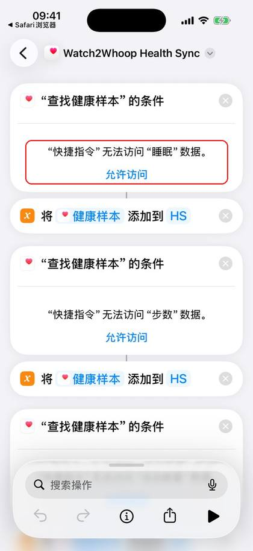 

**锁屏时不同步**：锁屏时读不到健康数据，解锁后下一次会补上。

**登录码无效**：只能用一次、有效期见账号信息，找管理员要新的。

**激活链接**：管理员给的 `…/app/activate.html#…` 链接可以重复用（换手机、重装 app），在手机上打开、点「打开 App 完成设置」就行。

**换手机**：重做设置步骤，同意和资料不用重填。

**隐私**：数据只有你自己能看，详见登录后的同意书。用 AI 时，对话内容会发给你选的那家 AI 服务。

**导出 / 删除数据**：找管理员。

<!-- W2W:FOOTER -->
