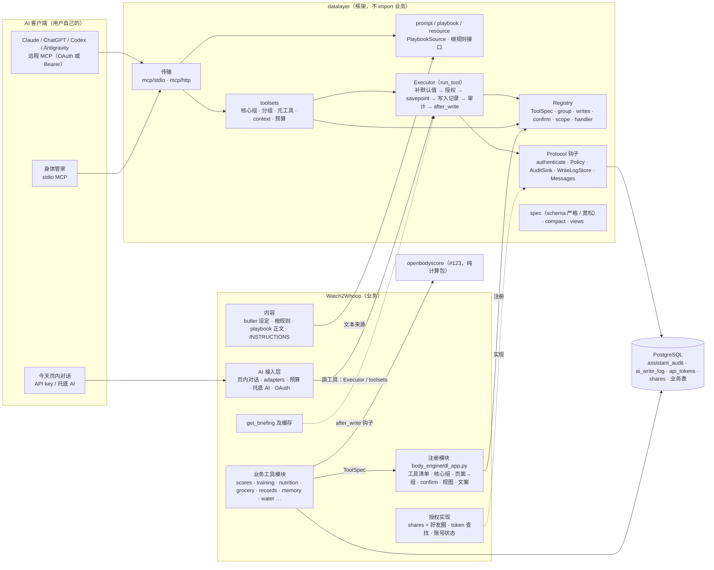
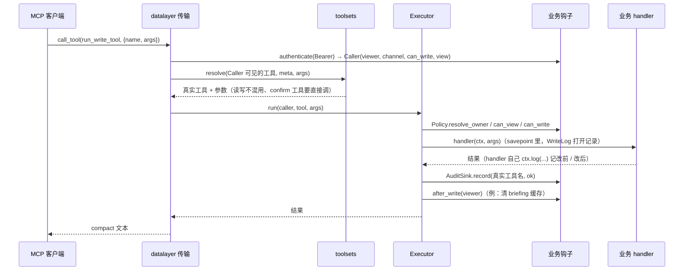

# MCP「个人数据层」框架设计（datalayer，#116）

> 状态：**设计稿，等负责人审阅**（2026-10-22，基于 `main` @ `f715223`，并参考还没合并的 #107 / #109 / #123）。这一轮只有文档，不改代码。
> 工作名 `datalayer`，正式名字由负责人定（见第 9 节）。
> 相关：#116（本设计）、#115 / #123（评分包 openbodyscore）、#78 / #99 / #107（工具分组）、#100 / #109（场景脚手架和 playbook）、[ai-assistant-plan.md](ai-assistant-plan.md) 9.13、9.16–9.18。

## 0. 目标和不做的事
**目标**：把「任何 AI 通过 MCP / API key 安全地读写某个用户的个人数据」这套机制，从 Watch2Whoop 的健康业务里剥出来，做成一个边界清楚的内部模块。先在本项目里用顺，再拆出去用 Apache-2.0 开源。
- 框架负责：工具怎么定义、怎么注册、怎么发给模型（分组、按需加载、预算）；谁在调用、能不能看、能不能写；写之前要不要确认、写了什么、怎么回滚；MCP 协议（stdio / Streamable HTTP、prompt、以后的 resource）。
- 业务负责：有哪些数据、哪些工具、哪些 scope、谁和谁共享、AI 的角色设定和根规则写什么。

**这一轮不做**：改代码、改数据库、改 `tools/list`、部署。框架第一期的验收标准是「**行为完全不变**」：全部测试通过，`tools/list` 的内容和顺序不变（#116 验收）。

## 1. 现状盘点：通用机制在哪里、和业务缠在哪里
`main` 上一共 109 个工具，其中 55 个写工具，来自 14 个模块；#107 / #109 合并后，再加上元工具、2 个 context 工具和 `get_playbook`。下表列出 #116 点名要并进框架的机制，以及**它现在 import 了哪些业务模块**。这些耦合点就是迁移时要切开的地方。

| 机制 | 现在的位置 | 和业务的耦合 | 迁移时怎么切 |
|---|---|---|---|
| 工具定义、严格 / 宽松 schema、补默认值 | `toolspec.py` | 不 import 业务；只有 `USER` 的说明「me 或授权给你的家人 ID」是业务文案 | 原样搬进框架；文案改成可配置 |
| 压缩输出 | `assistant/compact.py` | 无 | 原样搬 |
| `Tool` 和注册表 | `assistant/tools.py` | **最重**：文件里直接写着 8 个健康工具，并在模块级把 13 个业务模块的 `TOOL_SPECS` 拼起来 | 拆成框架的 `Registry` 和业务侧的注册模块（第 3.2 节） |
| 执行 `run_tool` | `assistant/tools.py` | `use_lang("zh")`（项目的 i18n）、`briefing.invalidate`（业务缓存）、`auth.can_view`；把 `_viewer_id` / `_channel` 塞进 args 传给 handler | 框架的 `Executor`，用钩子替代：`call_context`、`after_write`、`Policy` |
| 审计 | `run_tool._audit` → 表 `assistant_audit` | 无（只是表名、列 `provider_id / model` 是页内对话加的） | 框架的 `AuditSink`，Postgres 实现沿用这张表 |
| AI 写入记录和回滚 | `assistant/writelog.py` → 表 `ai_write_log` | `capture / record` 通用；`rollback()` 按 kind 分派到 `sparky_write`、`food_combine`、`lab_catalog`、`training.overrides`、`water.store` | 回滚处理按 kind 注册（谁写的谁注册回滚函数）；`get_write_log` / `rollback_write` 变成框架自带的工具 |
| 工具分组、元工具、换页上限 | #107：`assistant/toolsets.py` + `ai/params.py` | `toolsets.py` 本身通用；`ai/params.py` 里的核心组、组说明、「今天页页面 id → 组」、预算都是业务配置 | `toolsets` 搬进框架；配置变成 `ToolsetConfig` 由业务传入；「页面」在框架里叫 **context**（第 3.6 节） |
| playbook | #109：`ai/playbooks/__init__.py` + `*.md` | 加载方式通用；`FALLBACK`、`OPTIONAL_TOOLS`、`FIND_LINE`、`TOOL_RE` 的动词表是配置 / 文案；4 份 playbook 的内容是业务 | 框架提供 `PlaybookSource`（目录加载、提到的工具名检查）；内容和标记留在业务 |
| 只读 token、AI 专用 token | `auth.py`、`ai/tokens.py`（表 `api_tokens`，scope `mcp` / `read` / `write`） | `ai/tokens.py` 通用；`auth.py` 里混着 ingest token、share 授权、圈子的功能开关（`rollout.flags`）和 OAuth 吊销 | 框架只认一个钩子 `authenticate(token) → Caller`；token 表和发放先留在业务（第 3.3 节） |
| 按 scope 的共享授权 | `auth.can_view` / `granted_scopes`（表 `shares`，加上好友圈 `circle_scopes`） | 好友圈、`IMPLIED_BY`（营养 → 营养达标）是业务规则 | 框架只定义 `Policy.can_view(conn, viewer, owner, scope)`，业务实现 |
| 写入审批 `ALWAYS_CONFIRM` | `ai/chat.py`（#107 挪到 `ai/params.py`），和 `assistant/.claude/settings.json` 的 ask 列表同步 | 名单本身是业务决定 | 变成工具定义上的 `confirm=True`；名单由注册表推出来，现有一致性测试照留 |
| 托底 AI 白名单 | `ai/fallback.py` `TOOL_NAMES`，去掉 `user` 参数、强制只读自己 | 白名单内容、同意书版本、额度是业务 | 通用化成「**视图**（view）」：一组工具 + schema 变换 + 强制 owner = 自己（第 3.7 节） |
| 根规则 | `ai/root_rules.py` + `root_rules.md`，注入 MCP instructions、`butler` prompt、`get_briefing` | 加载机制通用，内容是业务 | 框架提供「带版本号的规则文本」接口，内容留在业务 |
| MCP 两种传输 | `mcp_server.py`（stdio + `build_server`）、`ai/mcp_http.py`（`/mcp`） | `INSTRUCTIONS` 是健康文案；`butler` prompt 来自 `ai/prompt.py`；stdio 默认读 `secrets/body_engine_token_owner`；HTTP 懒加载 `api.pool`、检查 `users.status` | `build_server` 搬进框架，文案、prompt、连接池、身份查找都由业务注入 |
| MCP OAuth 2.1 | `ai/oauth*.py`（迁移 440） | `oauth_http` 用 `web.login_limit.Limiter`，同意页是今天页的静态文件，登录用今天页 cookie | **第一期不动**，单独决定（第 9 节问题 3） |

另外两个**不属于**框架、但会被问到的：
- **`get_briefing`**（`assistant/briefing.py`）：内容完全是健康业务。框架只提供「写入后清缓存」的钩子（`after_write`），以及「开局摘要工具」这种约定的文档。
- **页内对话**（`ai/chat.py`、`adapters/`、预算、`ai_usage`、托底 AI 的额度）：这是「AI 接入层」，是框架的**一个调用方**，和 MCP 传输地位相同。第一期留在 Watch2Whoop，通过框架的 `Executor` 和 `toolsets` 调工具（第 9 节问题 2）。

## 2. 模块边界
### 2.1 原则
1. **`datalayer/` 不 import 任何 `body_engine.*` 业务模块**（包括函数里的懒加载）。允许的只有标准库、`datalayer` 自己和白名单里的第三方库（`mcp`、`anyio`、`starlette`、`psycopg`）。有测试保证（第 4 期 2a）。
2. **依赖方向只有一个**：业务 → 框架。业务通过注册接口把工具、分组、playbook、scope、回滚处理、钩子交给框架；框架通过 Protocol 回调业务（身份、授权、审计存储），从不反过来 import。
3. **框架不定义任何数据的含义**：它不知道什么是睡眠、营养、家人。scope 只是字符串，由业务登记；共享关系是业务的表。
4. **安全护栏在框架里，而且是默认值**：写只能写给自己、只读调用方看不到写工具、`confirm` 工具一定先确认、审计记真实工具名、视图出不了白名单。业务能收紧，不能悄悄放宽（放宽要显式传参，测试里能看到）。
5. **配置和文案可注入**：核心组、预算、对 AI 的说明文字都由业务传入。框架自带英文默认文案，Watch2Whoop 传中文文案，保持现有行为。

### 2.2 边界图


读图：实线箭头是调用或注册，虚线是「业务实现框架定义的钩子」。框架里没有任何指向 `w2w` 的箭头；`openbodyscore` 和 `datalayer` 之间也没有箭头，两者只在 Watch2Whoop 里相遇（第 5 节）。

### 2.3 一次工具调用经过哪些钩子


### 2.4 目录（第一期在 Body Engine 里面）
```
body_engine/src/body_engine/datalayer/
  __init__.py      公开接口（只从这里 import）
  spec.py          ToolSpec、schema / nullable / relaxed / fill_defaults（来自 toolspec.py）
  compact.py       （来自 assistant/compact.py）
  registry.py      Registry：工具、组、scope、confirm、视图、prompt、回滚处理，冻结后只读
  policy.py        Caller、Policy Protocol、默认策略（只能写给自己）
  execute.py       Executor（来自 run_tool）
  audit.py         AuditSink Protocol + Postgres 实现（表名可配）
  writelog.py      capture / record / list / rollback 分派（来自 assistant/writelog.py 的通用部分）
  toolsets.py      分组、元工具、context、预算（来自 #107）
  playbooks.py     PlaybookSource（来自 #109 的加载部分）
  views.py         受限调用方（托底 AI 那种）
  messages.py      框架报错和给 AI 的固定文案（默认英文）
  mcp/server.py    build_server（tools、prompts、以后的 resources）
  mcp/stdio.py
  mcp/http.py      ASGI app：Bearer → authenticate 钩子 → SDK 的 StreamableHTTPSessionManager
  testing.py       给接入方用的契约测试：import 边界、预算、playbook 工具名、快照
body_engine/src/body_engine/dl_app.py   Watch2Whoop 的注册模块（业务侧，唯一组装点）
```
旧路径（`toolspec`、`assistant.compact`、`assistant.tools`、`assistant.writelog`、`assistant.toolsets`、`mcp_server`、`ai.mcp_http`）在整个第一阶段都保留，做法照 #123：整文件搬走的用 `sys.modules` 别名，其余重新导出。进行中的分支一行都不用改。

## 3. 对外接口
接口都用 Python 写成 `dataclass` / `Protocol`，下面是草案，名字可以再定。

### 3.1 工具定义 `ToolSpec`
| 字段 | 含义 | 现在对应 |
|---|---|---|
| `name` | 工具名，全局唯一，注册后不能改（客户端的审批规则、审计按名字） | `Tool.name` |
| `description` | 给模型看的说明，越短越好（有预算） | 同 |
| `input_schema` | **严格形式**（全部 required，可选的写成 nullable）；MCP 发宽松版，`fill_defaults` 补回 | 同 |
| `handler` | `handler(ctx, args) -> 结果`；`ctx` 带 `conn`、`owner_id`、`viewer_id`、`channel`、`log(...)`（写入记录） | 现在是 `(conn, owner_id, args)`，`_viewer_id` / `_channel` 塞在 args 里。第一期用 `legacy=True` 适配器包住旧签名，109 个 handler 不用改 |
| `scope` | 看别人的数据要哪个**数据 scope**；`""` = 不涉及别人的数据（元工具） | `Tool.scope` |
| `writes` | 是否写；决定 `read_only_hint`、只读调用方看不看得到 | 同 |
| `confirm` | 写之前一定先让用户确认（删除 / 撤销） | `ALWAYS_CONFIRM` 集合 |
| `group` | 领域组 | #107 的 `group` |
| `strict` | 页内对话是否用 Claude strict tools | #107 的 `strict` |
| `owner_arg` | 哪个参数表示「看谁的」（默认 `user`，`None` = 只能是自己） | 现在固定是 `user` |
| `result_max_chars` | 摘要档返回的字数上限（测试用） | #107 的 `READ_RESULT_MAX_CHARS_BY_TOOL` |

不变的规定：工具顺序 = 注册顺序（缓存前缀稳定）；注册表冻结之后不能再加（避免运行中 `tools/list` 变化）。

### 3.2 注册接口
业务侧只有一个组装点 `dl_app.py`，按现在 `assistant/tools.py` 的顺序显式登记，**不用 entry point 之类的自动发现**（顺序要确定，`tools/list` 才不变）：
```python
reg = Registry(messages=ZH_MESSAGES)
reg.scope("nutrition"); reg.scope("nutrition_summary", implied_by=("nutrition",)); reg.scope("ecg", sensitive=True)
reg.group("body", about="身体数据和评分：…", budget=12000)
reg.tools(CORE_HEALTH_SPECS, module="assistant.tools")      # 顺序 = 现在 TOOLS 的顺序
reg.tools(datalayer.builtin.WRITE_LOG_TOOLS)                # get_write_log / rollback_write，放回原来的位置
reg.rollback("water", water_store.rollback)                 # 谁写的 kind 谁注册回滚
reg.prompt("butler", title="身体管家", text=prompt.base_prompt)
reg.playbooks(PlaybookSource.directory(resources.files("body_engine.ai.playbooks")))
reg.view("fallback", tools=fallback.TOOL_NAMES, force_self=True, playbooks=playbooks.FALLBACK)
reg.toolset(ToolsetConfig(core=CORE_TOOLS, contexts=PAGE_GROUPS, budgets=…))
reg.after_write(briefing.invalidate)
reg.call_context(lambda: use_lang("zh"))
app = reg.freeze(policy=W2WPolicy(), audit=PgAudit("assistant_audit"), writelog=PgWriteLog("ai_write_log"))
```
`app` 提供 `app.executor`、`app.toolsets`、`app.mcp_server(identity_of, connect_fn, instructions=…)`、`app.mcp_http(authenticate=…, pool=…)`。

### 3.3 身份和授权钩子
- **`Caller`**：`viewer_id`、`channel`（审计里的渠道，例 `mcp:claude-code`、`butler`、`api:anthropic_api`）、`can_write`、`view`（可选，受限视图名）。身份只从服务端可信的东西来（token、stdio 进程配置），不信客户端自报。
- **`authenticate(token) -> Caller | None`**（HTTP 传输用）：Watch2Whoop 的实现 = `ai/tokens.user_for_mcp_token` + 账号状态检查，和现在 `mcp_http._lookup` 一样。
- **`Policy`**：
  - `resolve_owner(caller, tool, args) -> owner_id`：默认 `"me"` → 自己，数字 → 那个人；
  - `can_view(conn, viewer_id, owner_id, scope) -> bool`：Watch2Whoop = `auth.can_view`（shares + 好友圈 + `IMPLIED_BY`）；
  - `can_write(conn, caller, owner_id, tool) -> bool`：**默认只能写给自己且 `caller.can_write`**，Watch2Whoop 沿用默认。
- 两种「scope」要分清：
  - **数据 scope**（`profile`、`nutrition`、`ecg` …，现在 15 个）：工具上的 `scope`，用于「能不能看别人的」。业务登记，框架只当字符串；`sensitive=True` 的（心电图）不会被「全部共享」之类的便捷授权带上，这条规则由业务的 `Policy` 实现，框架只把标记传过去。
  - **调用能力**（token 的 `read` / `write` / `mcp`）：只决定 `Caller.can_write` 和能不能进 `/mcp`，在 `authenticate` 里处理。

### 3.4 审计和回滚钩子
- **`AuditSink.record(caller, tool_name, args, ok, error, extra)`**：每次调用写一条，失败也写（现在靠「出错后 commit」保证，框架里写成明确的规则）；`extra` 放页内对话的 `provider_id` / `model`。Postgres 实现沿用 `assistant_audit`，表名可配。
- **`WriteLog`**：`Executor` 对每个写工具打开记录；handler 用 `ctx.log(kind, action, target, before, after)` 记改前 / 改后；什么都没记的写工具自动记一条 `kind=other`（不能自动回滚），和现在一样。
- **回滚**：`reg.rollback(kind, fn, only_action=None)`。`rollback_write` 按 kind 找处理函数，找不到就报「没有可自动回滚的前值」。现在 `writelog.rollback` 里的 6 个分支拆给各自的模块注册。

### 3.5 MCP prompt / resource / instructions
- **instructions**：业务文本 + 根规则（由 `RootRules` 接口给出：`text()`、`version()`），框架负责拼接，Watch2Whoop 的 `INSTRUCTIONS` 原样传入。
- **prompt**：`reg.prompt(name, title, text_fn, description)`；playbook 自动变成同名 prompt，和 `butler` 并列，`get_playbook(name)` 返回同一份文本（#109 的约定变成框架的保证）。
- **resource（第 4 期，可选）**：很多客户端不显示 resource，所以只做补充，工具仍然是主通道。候选：`datalayer://playbooks/{name}`、`datalayer://rules/root`、`datalayer://scopes`（有哪些数据 scope、各自是什么）。**不**把用户数据做成 resource（resource 没有工具那样的审批和审计路径）。
- 不依赖 `tools/list_changed`：按需加载继续靠元工具（#107 的设计）。

### 3.6 工具集和预算
- `ToolsetConfig`：`core`（常驻核心组）、`groups`（组 → 说明 + 预算）、`contexts`（context id → 额外的组；Watch2Whoop 的 context id 就是今天页的页面 id，`<tab>.<sub>` 找不到退回 `<tab>` 的规则也做成配置）、`budgets`（核心组、元工具、MCP 列表、单个 context、累积上限、视图的累积上限）、`find_max`、`read_result_max`。
- 框架提供：`for_mcp(caller)`、`for_context(caller, contexts)`、`visit_context(...)`（换页累积 + 超预算从最早的去掉）、三个元工具 `find_tools` / `run_read_tool` / `run_write_tool` 和 `resolve` 的全部护栏（读写不混用、只读不能写、`confirm` 工具在 MCP 里要直接调、视图出不了白名单、先查必填参数再弹确认）。
- `testing.check_budgets(app)`：现有 `test_tool_groups.py` 的预算检查变成框架自带、接入方一行调用。

### 3.7 视图（受限调用方）
托底 AI 的做法通用化：`reg.view(name, tools, force_self=True, schema_transform=drop("user"), playbooks=…)`。`Caller.view` 有值时：
- 工具集、`find_tools`、`resolve` 都只看视图里的工具（心电图出不去）；
- `force_self=True`：schema 里去掉 owner 参数，`resolve_owner` 强制是自己，不走 shares；
- playbook 按视图的标记返回正文或「需要用户自己的 AI」。
视图的**内容**（哪些工具、同意书版本、额度）留在业务。

### 3.8 文案和语言
框架里给 AI 的固定文字（「没有这个工具」「这个 token 是只读的」「没有查看用户 X 的 Y 的授权」、元工具说明、`FIND_LINE`）集中在 `messages.py`，默认英文；Watch2Whoop 传入现在的中文，所以第一期行为不变。这和项目「给 AI 的文字用中文」的约定不冲突：约定管的是 Watch2Whoop 的文案，框架的默认值是给其他项目用的。

### 3.9 存储
第一期框架**不建表、不加迁移**：`assistant_audit`、`ai_write_log`、`api_tokens`、`shares` 都留在 Watch2Whoop 的迁移里，框架的 Postgres 实现通过表名配置用它们。开源前再决定框架要不要自带一套参考迁移（例 `dl_audit`、`dl_write_log`），并给一个内存 / SQLite 实现给示例和测试用。

## 4. 迁移步骤
排期按 #116：**#107 和 #109 合并以后开始**（它们改的正是 `toolsets`、`params`、`mcp_server`、playbook，先合可以避免大面积冲突）。#123 和这件事互不依赖，谁先合都行；两边都改 `pyproject.toml` / `uv.lock` 时按 #123 写的规则处理（两边都留，再跑 `uv lock`）。

每一期都：单独一个 PR、单独可以合并；**不加迁移、不改 API、不改 `tools/list`**（第 4 期的 resource 除外，它是新增的、默认关）；部署就是普通的推代码，回退就是 revert。

| 期 | 内容 | 验收 | 规模 |
|---|---|---|---|
| **0** | 本设计（只有文档） | 负责人审阅、回答第 9 节的问题 | — |
| **1 快照护栏**（只加测试） | 在**任何搬动之前**存下行为快照：MCP `tools/list`（可写 / 只读 token，名字、顺序、宽松 schema、注解）、`prompts/list`、每个页面 id 和托底 AI 的工具集、`find_tools` 不带参数的返回、几条护栏的报错原文（只读、跨用户、读写混用、confirm 要直接调）、一次读 / 写 / 失败调用留下的审计行和写入记录行。思路和 #123 的 golden 一样 | 快照测试在 `main` 上通过 | 小 |
| **2a 搬纯工具件** | `spec`、`compact`、`toolsets`（逻辑）、`playbooks`（加载）、`messages` 进 `datalayer/`，配置从参数传入；旧路径做别名 / 重新导出；**加 import 边界测试**（AST 扫描 `datalayer/` 的全部 import，含函数里的，碰到 `body_engine.` 下非 `datalayer` 的模块或白名单外的第三方库就失败） | 快照不变、全部测试通过、边界测试通过 | 中 |
| **2b 搬执行和传输** | `Executor`、`policy`、`audit`、`writelog`（通用部分）、`mcp/server`、`mcp/stdio`、`mcp/http` 进 `datalayer/`；`run_tool` 里的 `use_lang`、`briefing.invalidate`、`auth.can_view` 变成钩子；`mcp_http` 的连接池、身份查找变成注入；`writelog.rollback` 的分派改成按 kind 注册。在 `docs/oss-extraction-plan.md`（#123 新建的）第 1 节第 2 行补上这块的计划 | 同上；**#116 第一阶段验收到这里完成** | 中 |
| **3 注册接口** | `assistant/tools.py` 里的拼接改到 `dl_app.py`；工具定义加 `confirm`（`ALWAYS_CONFIRM` 由注册表推出来，和管家 `settings.json` 的一致性测试保留）；托底白名单改成视图；新 handler 签名 `(ctx, args)`，旧的继续用 `legacy` 适配器（不要求一次改完）。`CONTRIBUTING.md` 加一句：新工具一律通过注册接口接入 | 同上；新功能（例：#78-C 之后的工具）走注册接口 | 中 |
| **4 通用化** | 框架默认文案换成英文（Watch2Whoop 传中文，行为不变）；可选的 MCP resource；`examples/reading-notes/`（读书笔记，约 200 行，SQLite 或内存存储，两种传输都能跑，CI 里跑）证明框架不只适用于健康数据；框架自己的英文 README 和接口参考 | 示例在 CI 里跑通；Watch2Whoop 快照不变 | 中 |
| **5 试用期** | 本项目继续开发，新功能都走注册接口；记录每次接口改动 | **接口 2–4 周没有大改**（#116 第 5 点） | — |
| **6 拆包** | 搬到 `packages/<正式名>/`（Apache-2.0，做法照 #123：路径依赖、Docker `additional_contexts`、CI 加一步）；Body Engine 改成依赖这个包；旧路径的别名保留一个版本再删。是否建独立仓库、发 PyPI 由负责人另定 | 包能独立安装、独立测试（不装 Body Engine）；第 7 节清单全部勾上 | 中 |

OAuth 2.1 授权服务器（`ai/oauth*.py`）**不在上面任何一期里**：它是通用的，但和今天页的登录、同意页、限流绑得很紧。建议在第 6 期之后、看有没有外部用户需要时再单独做一期，期间框架只认 `authenticate(token)`，OAuth 签出来的 token 和静态 token 走同一个钩子（现在就是这样）。

## 5. 和 #123 openbodyscore 的关系
- **两块独立、互不 import**：openbodyscore 是纯计算（零依赖，输入时间序列 → 分数和依据）；datalayer 是运行时框架（依赖 `mcp`、`anyio`，Postgres 实现依赖 `psycopg`）。拆出去以后，别人可以只用其中一个。
- **只在 Watch2Whoop 里相遇**：评分相关的工具（`get_scores`、`get_healthspan`、`get_stress` …）的 handler 在 Watch2Whoop 里，读数据库、调 openbodyscore 的函数，再通过 datalayer 注册给 AI。datalayer 永远不知道「恢复分」是什么。
- **共用的做法**（#123 已经铺好，这里照抄）：
  - 先在主仓库里做成独立的包，再考虑独立仓库；
  - 旧导入路径用别名 / 重新导出保持可用，进行中的分支不用改；
  - 「搬之前先存行为快照，搬之后完全一致」：#123 是分数的 golden，这里是 `tools/list` 和护栏的快照；
  - 参数 / 配置在调用时传入，不传就是现在的默认值；
  - 放 `packages/`，Docker 用命名的 build context，CI 在 Body Engine job 里加一步，必需检查的名字不变；
  - Apache-2.0、`NOTICE`、`Private :: Do Not Upload` 分类防误发布。
- **文档**：`docs/oss-extraction-plan.md` 的「拆哪几块」表里第 2 行就是这一块；第 2b 期在那里补上计划，并链接到本文。
- 以后可以做的（**不承诺**）：一个「自带手表 CSV → openbodyscore 算分 → datalayer 给 AI 读」的最小组合示例，展示两块怎么拼起来。

## 6. 开源前要满足的条件
**许可证**
- 框架用 Apache-2.0，主服务端仍是 AGPL-3.0。要改许可证的代码，必须核对 git 记录里的每一个作者。现在要搬的 7 个核心文件里，14 次提交是负责人本人，另有 1 次的作者是「Watch2Whoop contributors」（公开仓库的导出提交）；拆包前要确认那一次也是负责人本人的代码，并对第 2–4 期的新提交再核对一次。
- 第三方依赖：`mcp`（MIT）、`anyio`（MIT）、`starlette`（BSD-3）和 Apache-2.0 兼容；`psycopg` 是 **LGPL-3.0**，作为依赖使用没问题，但建议做成可选依赖（`datalayer[postgres]`），核心不依赖它。
- `NOTICE` 写明来源；每个文件要不要加 SPDX 头，和 #123 的待定第 6 条一起定。

**文档**（英文）
- README：是什么、不是什么、最小示例（就是 `examples/reading-notes/`）；
- 概念：工具定义、数据 scope 和调用能力、视图、确认、写入记录和回滚、context 和预算、playbook；
- **安全模型**：身份从哪来、谁能看谁、为什么写只能写给自己、confirm 的保证、视图的保证，以及框架**不**负责的部分（token 的发放和存储、OAuth、传输层加密）；
- 接口参考、版本策略（0.x 期间可能有破坏性改动，写进 CHANGELOG）。

**测试**
- 包能独立安装、独立测试，不装 Body Engine、不连真实数据库（内存实现 + 可选的 Postgres 测试）；
- 护栏测试从 Watch2Whoop 的测试里提炼出来进包：跨用户、只读、confirm、视图、读写混用、预算、审计记真实名字、失败也审计；
- `examples/` 在 CI 里跑；
- Watch2Whoop 这边的快照测试一直保留。

**去掉私有内容**
- 包里不能有：健康业务的文案（`INSTRUCTIONS`、`USER` 的说明「授权给你的家人」）、butler 设定、根规则正文、playbook 正文、个人信息、域名、主机名、`secrets/body_engine_token_owner` 这类默认路径（stdio 的 token 路径改成必须显式传入）；
- 现有的 `.git/hooks/pre-push` 扫描和 `shortcuts/check_shortcut.py` 的禁用词思路，加一个对 `packages/<名字>/` 的扫描；
- 名字：不用 WHOOP，也不要让人以为是 MCP 官方的项目（例如不要叫 `mcp-core`）。

## 7. 风险
| 风险 | 后果 | 对策 |
|---|---|---|
| 搬动时 `tools/list` 的内容或顺序悄悄变了 | 提示缓存全部失效；客户端按工具名设的审批规则失效 | 第 1 期先存快照；注册顺序 = 现在的顺序；注册表冻结 |
| 授权路径在搬动中出错 | 跨用户读到数据、只读 token 能写 | 第 2b 期 `run_tool` 的逻辑原样搬、不重写；护栏快照（报错原文）；审阅清单里专门一项 |
| 和进行中的 PR 冲突（今天页对话、Jarvis、工具新增） | 返工 | #107 / #109 先合；旧路径别名一直保留；每期开 PR 前对 open 分支做 `git merge-tree` 试合并（#123 的做法） |
| 只有一个使用者就抽象，接口设计偏 | 拆出去以后别人用不顺，或者频繁破坏性改动 | 接口只收现在真的在用的东西；第 4 期用非健康示例做第二个使用者；第 5 期 2–4 周不大改才拆 |
| 隐藏的耦合：ContextVar（`writelog._ctx`、`use_lang`）、懒加载（`api.pool`、`ai.oauth`） | 边界测试漏掉，或者拆包后运行时才报错 | 边界测试扫函数内的 import；ContextVar 只留在框架内部，业务通过 `ctx` 和钩子拿；懒加载全部改成注入 |
| 同一份名单两处维护（confirm 和管家 `settings.json` 的 ask、托底白名单和同意书） | 改一处忘一处 | 名单只从注册表推出；现有一致性测试保留并改成读注册表 |
| 框架默认英文、Watch2Whoop 给 AI 的文字是中文 | 混用、漏传导致 AI 看到英文报错 | 第 1 期快照里含报错原文；`Messages` 缺键直接报错，不静默回落 |
| 改许可证的合规问题 | 拆出去的代码许可证有争议 | 第 6 节的核对；新提交继续只由负责人或签了同意的贡献者写这些文件 |
| 页内对话留在业务里，和 MCP 走两条路 | 两边的护栏慢慢不一致 | 页内对话也只能通过 `Executor` 和 `toolsets` 调工具（第 2b 期起），不能直接调 handler |
| 工作量被低估，和产品功能抢时间 | 拖着不完成，留下半新半旧的两套 | 每期可以单独合并、单独停；停在任何一期都是完整可用的状态 |

## 8. 第一阶段（第 1–2b 期）验收
对齐 #116：
- `datalayer/` 不 import 业务模块，有测试保证；
- 现有的 MCP 和页内对话行为不变：全部测试通过，`tools/list` 的内容和顺序不变（快照测试）；
- `docs/oss-extraction-plan.md` 里补上这块的计划。

## 8.1 第 2b 期之后还剩的耦合点（2026-10-27 盘点）
第 2b 期以后，`datalayer/` 里有：`spec`、`compact`、`toolsets`、`playbooks`、`messages`、`execute`、`policy`、`audit`、`writelog`、`mcp/{server,stdio,http}`、`testing`。下表是 Watch2Whoop 一侧**还把框架和业务绑在一起的地方**，按拆的顺序排（风险从低到高）。「接口不变」= 旧 import 路径、`tools/list`、#201 快照都不动。

| # | 耦合点 | 现在在哪 | 怎么拆 | 期 |
|---|---|---|---|---|
| 1 | 工具集预算和配置一致性检查 | 只在 `tests/test_tool_groups.py` 里手写断言，常量在 `ai/params.py` | **已做（本期）**：框架 `toolsets.Budgets`、`config_problems`、`budget_problems`，`testing.check_toolset(cfg, tools, budgets)` 一行调用；Watch2Whoop 的 `assistant/toolsets.budgets()` / `problems()` 从 `ai/params` 读，原来的断言照留 | 3.6 节 |
| 2 | 「只看自己」的 schema 变换（去掉 `user` 参数） | `ai/fallback._own_schema`（托底白名单），#326 起页内对话的 own_only 对话也用它 | 框架 `views.py`：`View(tools, schema 变换, 强制 owner = 自己)`；托底白名单、own_only 都变成视图 | 3 |
| 3 | 写前确认名单三份 | `ai/params.ALWAYS_CONFIRM`、管家 `assistant/.claude/settings.json` 的 ask、`ai/chat.CONFIRM_EN`（英文确认卡） | `Tool.confirm=True` + 英文摘要放在工具定义上，三份由注册表推出来，一致性测试照留 | 3 |
| 4 | 工具注册表的拼接 | `assistant/tools.py`：文件里 8 个健康工具 + 模块级把 17 个模块的 `TOOL_SPECS` 拼起来（records、rules、goals、training、insights、cardio、butler、grocery、diet_profile ×2、friends、water、ui、feedback、scene、sparky） | `dl_app.py` 里 `Registry` 按顺序登记，`TOOLS` 顺序不变（快照保证） | 3 |
| 5 | 回滚处理登记在一个文件 | `assistant/writelog.py` 给 13 个 kind 登记处理函数，import 了 sparky_write、food_combine、lab、training、water、grocery、memory | 谁写的谁登记：挪到各模块的注册函数里 | 3 |
| 6 | handler 旧签名 | `(conn, owner_id, args)`，viewer 和 channel 塞在 `args["_viewer_id"]` / `["_channel"]` | 新签名 `(ctx, args)`，旧的用 legacy 适配器（第 9 节问题 5） | 3 |
| 7 | 执行器的业务钩子 | `assistant/tools.EXECUTOR`：`Policy` = `auth.can_view`（shares + 好友圈 + `IMPLIED_BY`）、`call_context` = `use_lang("zh")`、`after_write` = `briefing.invalidate`、`OPTIONAL_DEFAULTS`（`toolspec.py`） | 已经是注入，不用拆；第 4 期给默认值 | — |
| 8 | 给 AI 的固定文字 | `ai/datalayer_texts.py`（中文） | 框架自带英文默认，Watch2Whoop 传中文 | 4 |
| 9 | MCP 的业务部分 | `mcp_server.INSTRUCTIONS` + 根规则、`butler` prompt（`ai/prompt.base_prompt`）、token 查找（`auth`）、`ai/mcp_http` 的连接池和 `users.status`、`ai/web/mcp.py` 往 grocery 组加联网工具 | 已经是注入；联网工具改成注册一个「附加组」 | 3–4 |
| 10 | MCP OAuth | `ai/oauth*.py`，绑今天页登录、同意页、限流 | 第 6 期之后单独决定（第 9 节问题 3） | — |
| 11 | 页内对话 | `ai/chat.py` 直接调 `run_tool`、`_audit`（服务器联网工具）、`toolsets.resolve / find`；确认循环、预算、历史折叠、#326 的省 token | 第 9 节问题 2：目前算框架的**调用方**，不拆 | — |
| 12 | 开局摘要 | `assistant/briefing.py`：内容是业务，只靠 `after_write` 清缓存 | 不进框架，只写进文档当约定 | — |

**这一期为什么先做第 1 项**：它是设计 3.6 节点名的框架件，纯函数、只加不改，Watch2Whoop 的预算常量和原有测试一行不动，同时让第 4 期的非健康示例有现成的契约测试可用（`tests/test_datalayer_boundary.py` 用一个三工具的读书笔记工具集验证过）。

## 9. 需要负责人决定的问题
1. **框架的名字和位置**：工作名 `datalayer`。第一期放 `body_engine/src/body_engine/datalayer/`（#116 的建议），拆包时再定正式名（例 `openbodydata`、`personal-datalayer`）。要不要现在就定名字，免得第 6 期再改一轮？
2. **页内对话（工具循环、确认卡、adapters、预算）算不算框架**：本设计建议第一阶段**不算**，它是框架的调用方，留在 Watch2Whoop；以后如果有外部需求，再做成可选模块 `datalayer.chat`。
3. **OAuth 2.1 授权服务器什么时候进框架**：本设计建议拆包之后、有外部需要时再单独做，期间框架只认 `authenticate(token)`。还是希望第一次开源就带上（别人接 Claude / ChatGPT 连接器必须有 OAuth）？
4. **非健康示例做哪个**：读书笔记（本设计默认）还是个人记账？示例用 SQLite / 内存存储，意味着框架的存储接口要真正抽象。如果只想支持 Postgres，示例也用 Postgres，存储接口可以简单很多。
5. **handler 新签名 `(ctx, args)` 要不要全部改**：本设计是旧签名长期兼容、新工具用新签名。全部改一遍的好处是统一，代价是一个触及 14 个模块的大 PR。

---
_Refs #116。本文只是设计，接口名字和细节以负责人审阅后的版本为准。_
