# iOS 原生 app（SwiftUI）：架构和开发约定

> 状态：#340 N0（架构文档 + 工程骨架），2026-10-29；N2 服务器接口已实现（第 5.2、5.3、6.3、7.2、7.3 节）；N2b 本机算分全链路已打通（第 6.1、9.1 节）；本机完整历史（第 4、9.1 节「本机完整历史」）；N9 发布前回归和上线顺序（第 12 节，`ios-native-1.0.9-regression.md`）。这份文档是 N1–N9 各个 agent 的共同依据：改约定先改这里，在 PR 里说明。
> 相关：#340（总纲）、#337（本地优先的决定）、#219（自建同步引擎，`apple-sync-engine.md`、`apple-sync-engine-app-contract.md`）、`ios-native-plan.md`（测量和分期）、`apps.md`（版本号和发版）。
> 文中的数字都是示例，不是任何真人的数据。

## 0. 一句话

`apps/ios/` 是纯 SwiftUI 的新 app，替换 Flutter 版（`apps/watch2whoop/` 停在 1.0.8，之后只修 bug）。Bundle ID 和 Team 不变，TestFlight 上覆盖安装就能升级，第一次启动把 Flutter 版的 token 和服务器地址迁过来。

- **页面只读本地库**：每个账号一个 SQLite 库（GRDB）。
- **同步层负责收发**：后台和服务器双向同步，写操作先落本地，再经离线队列上传。
- **算法在手机上算**：评分算法是服务器下发、带版本号的 JS 包，用 JavaScriptCore 运行，不用 WebView。

## 1. 已定的约定

| # | 约定 | 说明 |
|---|---|---|
| C1 | **最低 iOS 16** | #340 N0 的要求。`ios-native-plan.md` D8 原来建议 17。因为要支持 16：状态用 `ObservableObject` / `@Published`，不用 Observation（`@Observable` 要 17）；图表用 Swift Charts（16 起就有）。负责人改成 17 时，只需改 `project.yml` 的 `deploymentTarget`，代码不用跟着改 |
| C2 | **纯 SwiftUI，没有 WebView** | 系统组件只在 SwiftUI 没有对应能力时用 UIKit，例如 `UITabBarAppearance`、扫码的 `DataScannerViewController` |
| C3 | **工程用 XcodeGen 2.46.0 生成** | `project.yml` 是唯一来源；`.xcodeproj`、`Info.plist`、`.entitlements` 都是生成出来的，不进 git |
| C4 | **依赖只用 SPM，第三方只有 GRDB 7.11.1**（MIT，精确版本） | 需要新依赖时先在 #340 说明。系统框架随便用（Charts、JavaScriptCore、CryptoKit、HealthKit、AVFoundation、Speech、BackgroundTasks） |
| C5 | **双语** | 用户能看到的文字一律写 `tr("中文", "English")`（`Localization/I18n.swift`）。`scripts/check_sources.py` 在 CI 里检查：`tr()` 以外不能有中文，英文那一半不能有中文。服务器返回的文字靠请求头 `X-Body-Lang` 选语言 |
| C6 | **视觉沿用今天页** | 颜色 token 和 `app.css` 一一对应（`DesignSystem/Palette.swift`，CI 比对）；三环并排、恢复在中间；界面只放数字、图表和短标签，长段文字留给 AI |
| C7 | **图标只用 Lucide** | 由 `scripts/lucide_assets.py` 转成 asset，许可证写在 `THIRD_PARTY_NOTICES.md`。不自己画图标；app 界面元素也不混用 SF Symbols |
| C8 | **公开仓库** | 不写个人信息、域名、真实 Team ID；测试和示例只用明显虚构的数值 |
| C9 | **Swift 5 语言模式，并发检查设为 `minimal`** | 先保证拷进来的同步代码能编译。N9 之前评估要不要切到 Swift 6 |

## 2. 模块划分

### 2.1 目录（`apps/ios/`）

| 目录 | 内容 | 谁来改 |
|---|---|---|
| `project.yml`、`Config/` | 工程定义；签名占位 `Watch2Whoop.xcconfig`（自己的值写在不进 git 的 `Watch2Whoop.local.xcconfig`）；版本号 `W2W_MARKETING_VERSION`、`W2W_BUILD_NUMBER` | N0 / N9 |
| `Watch2Whoop/App/` | 入口 `Watch2WhoopApp`、`AppDelegate`（后台任务、后台 URLSession）、`AppModel`（启动 → 登录 / 连接中 / 已登录）、`AccountSession`（一个账号的 API + 库 + 同步）、`MainTabView`（底栏） | N0；N8 管登录流程 |
| `Watch2Whoop/DesignSystem/` | `Palette`（颜色）、`Typo`（字号）、`Metrics`（圆角、边距）、`Icon`（Lucide）、`Card`、`SectionHeader`、`ListRow`、`MetricTile`、`Chip`、`RingView`、`PrimaryButton`、`PageScaffold`、`.w2wSheet` 弹层、`PressScale` | 谁需要谁加；只加通用组件 |
| `Watch2Whoop/Networking/` | `APIClient`（Bearer、401、重试）、`APIError`、`Endpoint`（所有路径） | N0；页面加路径常量 |
| `Watch2Whoop/Auth/` | `KeychainStore`、`CredentialStore`（token、服务器地址、user id）、`FlutterMigration` | N0 / N8 |
| `Watch2Whoop/Storage/` | `AppDatabase`（每账号一个库）、`Schema`（迁移）、`Records`（GRDB 记录类型） | 页面在 `Schema` 末尾**追加**迁移 |
| `Watch2Whoop/Sync/` | `SyncCoordinator`、`RemoteSync`（`LegacyRemote` / `DeltaRemote`）、`OfflineQueue`、`DocKey`；本机算分（N2b）：`ScoringSync`、`LocalScoring`、`LocalRawStore`、`AlgoBundles` | N0 / N2 / N2b |
| `Watch2Whoop/Algorithms/` | `OpenBodyScoreRuntime`（JavaScriptCore，第 6.1 节）、`BundleVerifier`、`AlgoSigningKeys` | N1 / N2 |
| `Watch2Whoop/HealthSync/` | 从 Flutter 拷来的 `SyncEngine.swift`、`RawSync.swift`、`Backfill.swift`（逐字节相同），加上 `HealthSyncBridge`（async 包装）；注册表 `Resources/healthkit_types.json` 也由脚本拷贝 | 拷贝件用脚本同步；宿主一侧在 `Features/Sync/`（N8） |
| `Watch2Whoop/Features/<页面>/` | 每个页面一个目录：`Today/`（N3）、`Trends/`（N4）、`Record/`、`Food/`（N5）、`Jarvis/`（N6）、`Circles/`（N7）、`Onboarding/`（登录、同意书、资料、健康权限）、`Me/`、`Sync/`（同步中心和同步宿主）（N8）；`Placeholders/` 是还没做的 tab | 各页面 agent |
| `Watch2Whoop/Localization/` | `tr()`、`Lang` | — |
| `Watch2Whoop/Resources/` | `Assets.xcassets`（AppIcon、`LaunchBackground`、`Icons/lucide.*`）；`licenses.json`（「我 → 关于 → 开源许可」，和 `THIRD_PARTY_NOTICES.md`、`project.yml` 的 SPM 版本一致，`check_sources.py` 检查）；`zh-Hans.lproj` / `en.lproj` 的 `InfoPlist.strings`（权限说明，英文同时写在 `project.yml`） | — |
| `Watch2Whoop/PrivacyInfo.xcprivacy` | 隐私清单：用到的 required-reason API（UserDefaults CA92.1、文件时间戳 C617.1）、收集的数据类型（和 `docs/legal/privacy.md` 第 1 节、App Store Connect 的隐私标签一致）、不跟踪。新用到 required-reason API（磁盘空间、开机时间等）时要加进来 | 上架包 A |
| `Watch2WhoopTests/` | XCTest 单元测试，在模拟器上跑 | 每个 PR 都要加测试 |
| `Packages/FlutterShim/` | 本地 SPM 包，模块名就叫 `Flutter`：只有 `FlutterMethodCall`、`FlutterResult`、`FlutterError` 三个类型，让拷进来的文件不改一个字节也能编译。N8 之后只剩 `RawSync.swift` 用它 | Flutter 原文件的 RawSync 拆出原生接口后删掉 |
| `scripts/` | `sync_flutter_sources.sh`（拷贝 / `--check`）、`lucide_assets.py`（生成图标 / `--check`）、`check_sources.py`（双语和颜色 token） | — |

### 2.2 依赖方向

`Features → (Sync, Storage, DesignSystem, Localization)`；`Sync → (Networking, Storage, Algorithms)`；`Networking / Storage / DesignSystem` 互相不依赖。

- **页面不直接请求接口拿要显示的数据**：读本地库，需要新数据就调 `session.sync.refresh(...)`。
- **页面的写操作**：先改本地行，再 `session.sync.enqueue(...)`。只有在线功能（第 5.5 节）可以直接 `session.api.send(...)`。
- 页面之间不互相 import 内部类型，要共享就放进 `DesignSystem` 或 `Storage`。

### 2.3 拷进来的同步代码

- `SyncEngine.swift`、`RawSync.swift`、`Backfill.swift` 和 `apps/watch2whoop/ios/Runner/` 里的原文件逐字节相同。A2–A4（#219）还在原文件上改，所以这里不改拷贝件。
- 原文件更新后跑 `apps/ios/scripts/sync_flutter_sources.sh`；CI 里的 `--check` 发现不一致只给警告，不让 job 失败。
- 拷贝件仍然是 method channel 的形状：`handle(FlutterMethodCall, result)`。`HealthSyncBridge.call(.engine, "engineRead", args)` 把它包成 `await`。
- Dart 那一侧的逻辑（`lib/src/sync_engine.dart`、`raw_sync.dart`、`backfill.dart`、`resync_flow.dart`）N8 已改写成 Swift，在 `Features/Sync/`：`HealthSyncService`（交给引擎服务器、token、注册表和 engine 块，前台轮次、补全历史、重新同步的手机部分、状态）、`RawUploadPass`（心跳序列 / 心电图 / 喝水，200 之后才提交锚点）、`SyncDiagnosis`（卡在哪里、怎么自救）。`SyncEngine.swift`、`Backfill.swift` 从 #344 起就是原生接口；`RawSync.swift` 还是 method channel 的形状，经 `HealthSyncBridge.raw` 调用，等 Flutter 原文件拆出原生接口后再删 `FlutterShim`。
- 1.0.9 只走引擎（`app` 模式）：不调 `ow-invitation`，设置链接里的 `ow` / `code` 读到也不用（契约第 7.1 节）。注册表里的数量类型全由引擎读，RawSync 在原生 app 里只管心跳序列、心电图和喝水。
- 后台：`AppDelegate` 在启动结束前 `SyncEngine.register()`（BGAppRefresh `watch2whoop.sync.refresh`、BGProcessing `watch2whoop.sync.process`、HealthKit 观察者和后台送达）和 `Backfill.register()`；回到前台时 `HealthSyncService.syncOnOpen()`（至少隔 3 分钟）。引擎自己存配置（服务器、Keychain 里的 token、注册表、模式），没有页面也能在后台跑。
- 锚点和 backfill 状态存在 `UserDefaults` 里，键不带 `flutter.` 前缀（`w2w.sync.anchor.*`、`w2w.raw.anchor.*`、`w2w.backfill.state.v1`）；backfill 的上传 token 在 Keychain 的 `w2w.backfill` / `token`。这些和 Flutter 版是同一份，升级后直接接着用，不用迁移。
- `AppDelegate` 已经注册了 `watch2whoop.sync.backfill` 后台任务，并在每次启动时重新挂上后台 URLSession。`BGTaskSchedulerPermittedIdentifiers` 里还预留了 `watch2whoop.sync.refresh`，给 N8 的定时刷新用。

## 3. 启动和账号

```
启动 → FlutterMigration.run（只跑一次）→ 有 token + 服务器？
  否 → OnboardingView（N8：通过 Apple 登录、邮箱验证码、设置二维码 / watch2whoop://setup 链接、激活码；高级：token）
  是 → 已经知道 user id？
        是 → 立刻打开本地库，显示 tab（先画缓存）→ 后台调 /v1/web/me 更新 flags 和名字
        否 → 「正在连接」→ /v1/web/me → 记下 user id → 打开本地库
任何请求 401 → APIClient.onUnauthorized → 清掉 token → 登录页（不重试）
退出登录 → 删掉这个账号的库目录 + Keychain（原生项和 Flutter 项都删）→ 通知服务器 /v1/account/logout
```

- 登录方式都换成一个设备 token（Keychain）：Apple / 邮箱是 `client: app`；设置链接的一次性登录码走 `POST /v1/web/login-code {code, client: "app"}`（N8 加的：不设 cookie，回答里带 token）；16 位激活码先 `POST /v1/web/activate {web: true}` 换成设置链接，再兑换其中的登录码；还没激活的账号（pending）再填邀请码（`/v1/account/redeem-invite`，别的账号的码会切到那个账号并给它的 token）。
- 登录后只在需要时依次出现（`SignedInFlows`）：同意书（`GET /v1/consent` 的文本和版本，`required` 不能跳过，`reconfirm` 是新版本）→ 资料（缺生日 / 性别 / 身高时，可以「以后再说」，每个账号只问一次）→ 健康权限（一个弹窗问全部类型）→ 首次同步。
- `AccountSession`（`@MainActor ObservableObject`）通过 `environmentObject` 注入，里面有 `config`、`api`、`db`、`sync` 和 `flags`。页面用 `@EnvironmentObject var session: AccountSession` 拿。
- 功能开关来自 `/v1/web/me` 的 `flags`，本机缓存在 `w2w.native.flags.v1`。每个原生页面如果需要服务器开关，就读 `session.flags`。
- Debug 版可以用启动环境变量自动登录，给模拟器和截图用：`SIMCTL_CHILD_W2W_DEV_SERVER`、`SIMCTL_CHILD_W2W_DEV_TOKEN`、`SIMCTL_CHILD_W2W_DEV_LANG=zh|en`。

## 4. 本地数据库

### 4.1 文件

- 路径：`Application Support/W2W/accounts/<key>/body.sqlite`，`key` = sha256(`服务器|user id`) 的前 16 位十六进制。同一台手机登录不同账号或不同服务器，数据互不相见。
- 文件保护级别 `completeUntilFirstUserAuthentication`：后台同步要读。
- 不进 iCloud / 设备备份：服务器有全量备份；Keychain 是「仅本机」，换机恢复后本来就要重新登录、从云端重新拉。账号目录、`W2W/` 根目录和三个 SQLite 文件都设了 `isExcludedFromBackup`。
- 新库是 `auto_vacuum = INCREMENTAL`，定期 `incremental_vacuum` / `VACUUM`；「我 → 数据状态」显示占用并能清除本机缓存（`Storage/LocalStorage.swift`，第 9.1 节「本机完整历史」）。
- GRDB `DatabasePool`（WAL）：读不会挡写。
- 退出登录时删掉整个目录。删之前，离线队列里没发出去的写操作先问用户（N8 的弹窗，规则同 `offline-plan.md` 第 4 节）。

### 4.2 表（迁移 `v1_initial`，定义在 `Storage/Schema.swift`）

时间用 UTC 秒（REAL）；日期是用户本地的 `YYYY-MM-DD`（TEXT）；单位和服务器一致（kg、kcal、ms、bpm）；JSON 存 BLOB。

| 表 | 主键 | 用途 | 谁写 / 谁读 |
|---|---|---|---|
| `meta` | `key` | 零碎信息（全量恢复时间、当前算法版本……） | 同步层 |
| `docs` | `key` | 服务器算好的视图，**原样存**：`today:<日期>`、`today:current`、`trends:<天数>`、`circles:overview`……；带 `version`（N2）和 `fetched_at` | 同步层写；还没有专门表的页面读 |
| `sync_cursors` | `stream` | N2 每个拉取流的游标 | 同步层 |
| `outbox` | `id` | 离线队列（第 5.4 节）；`client_id` 唯一；`group_key` 决定顺序；`state` 取 pending / sending / failed / conflict | `OfflineQueue` |
| `hk_sources` | `id` | HealthKit 来源表（bundle、设备、型号、系统版本） | 同步引擎（N8） |
| `hk_samples` | `uuid` | 数量型和分类型样本（分类的值是 HealthKit 的整数），注册表单位，带 `uploaded` 标记 | 同步引擎写；算法输入 |
| `hk_stat_buckets` | `type, start` | 累计型的 900 秒统计桶（按 UTC 对齐） | 同步引擎 |
| `hk_workouts` | `uuid` | 训练（统计、事件、元数据存 JSON） | 同步引擎 |
| `hk_deleted` | `uuid` | HealthKit 删掉的样本，等着上传 | 同步引擎 |
| `daily_metrics` | `date, metric` | 每天的汇总（长表，指标键和服务器一致），带来源和 flags | 算法 / 同步层 |
| `sleep_sessions` | `id` | 睡眠段，`date` = 醒来那天（结束时间减 4 小时），阶段存 JSON | 算法 / 同步层 |
| `daily_scores` | `date` | 每天的评分：圆环要用的数字是列，整行存在 `payload`；`algo_version`；`origin` 取 server / app；`uploaded` | 算法写（N1 / N3），同步层上传 |
| `records` | `kind, id` | 用户自己的记录（饮食 / 体重 / 喝水 / 日记 / 补剂 / 化验 / 训练）：`date`、`server_id`、`client_id`、`payload`、`version`、`deleted`、`pending`；还没收到服务器回答的行 `id` = `c:<client_id>` | N5 |
| `algo_bundles` | `version` | 已安装的算法包（sha256、api、文件路径、来源 builtin / download、`active`） | N1 / N2b |
| `heartbeat_series` | `uuid` | 逐拍心跳读数（RMSSD 用户算分用）：`start`（整秒）、`end`、`rmssd`、`sdnn`；手机自己的读数先存 `beats`，包算完 RMSSD 后删掉；`origin` 取 phone / server | N2b（迁移 `v2_local_scoring`） |
| `hr_day_hist` | `date` | 每天的心率直方图 `{bpm: 次数}`（365 天最大心率窗口）：原始样本删掉以后还留着；`source` 取 phone / server | N2b |
| `score_dirty` | `date, kind` | 输入变了、还要重算的本地日期；`kind` 取 `scores`（算分，N2b）/ `derive`（2.0.0 M1 派生） | N2b；`v4_derive_tables` 加 `kind` |
| `hist_samples` | `kind, t` | 热区之前的全部算分原始输入（服务器合并好的，或热区移出的），WITHOUT ROWID，一行约 20 字节；`kind` 是 `LocalHistoryParams.Kind`（2.0.0 M1 加了 `steps`：15 分钟步数桶，给压力 / 身体年龄用） | 本机完整历史（迁移 `v3_local_history`） |
| `hist_segments` | `start, stage` | 历史区的睡眠阶段段，`date` = 这一晚醒来那天 | 同上 |
| `hist_days` | `date` | 历史区有哪些天、来源（server / phone）、`complete` | 同上 |
| `daily_metric_sources` | `date, metric, source, origin` | 每个来源当天的值（服务器 `daily_metric_sources` 的副本）：`origin` = server（拉下来的 `daily.sources`）/ phone（手机自己派生的 app 行） | 2.0.0 M1（`v4_derive_tables`，`DeriveStage`） |
| `derived_rows` | `kind, date` | 手机算好、要上传的行（`daily` / `sleep`），带 `algo_version`、`bundle_version`、`uploaded` | 同上 |

`sleep_sessions` 在 `v2_local_scoring` 里加了 `payload`（睡眠 stream 的整段 session：入睡 / 各阶段分钟、设备），算分用。`v3_local_history` 给 `heartbeat_series` 加了 `analyzed`：逐拍数据不再在算完后删掉。`v4_derive_tables`（2.0.0 M1）：上面两张新表；`score_dirty` 以 `(date, kind)` 重建（本机自己的队列，原有的行搬成 `kind = scores`）；`hk_samples` 按 `source_id` 加索引（手机读 HealthKit 时记下来源，和服务器一样按来源分组睡眠和累计值）。

**不存在本地的**：别人的数据（只存圈子动态的缓存文档）、AI 对话全文、心电图波形、AI 设置里的 key。

### 4.3 迁移规则

- 只在 `Schema.migrator` 末尾**追加** `vN_<名字>`（例如 `v2_records_training_sets`），一个 PR 一个。已经发出去的迁移不能改、不能改名、不能调顺序。`SchemaTests.testMigrationOrder` 把列表钉死，加迁移时同时改这个测试。
- Debug 版开了 `eraseDatabaseOnSchemaChange`：开发时改了迁移，本地库直接清空重建，反正只是缓存。Release 版没有这个开关。
- 本地库只是服务器的缓存，加上还没发出去的队列。要做破坏性改动（比如改主键），就新建表并从服务器重新拉，不在手机上搬数据。
- 迁移列表：`v1_initial`（N0）、`v2_local_scoring`（N2b）、`v3_local_history`（本机完整历史）、`v4_derive_tables`（2.0.0 M1，`Storage/Migrations/DeriveSchema.swift`）。

## 5. 同步层

### 5.1 页面怎么用

```swift
// 读：订阅本地库，数据一变就重画
for try await doc in session.db.observeDoc(DocKey.todayCurrent) { … }
// 要新数据：拉取（N0：GET 原接口写进 docs；N2：增量）
await session.sync.refresh(.today(date: nil))      // 或 .changes
// 写：先改本地行，再排队（立刻尝试发送）
session.sync.enqueue(kind: "water", group: "water", method: .post, path: "/v1/users/me/water", body: json)
```

`SyncCoordinator.status`（idle / syncing / offline / failed）给页面显示一行小字（`SyncStatusLine`）。有缓存的时候永远先显示缓存，不出现阻塞式的加载遮罩。

### 5.2 拉取

- **N0（现在）**：`LegacyRemote` 调原有的 GET 接口，把结果原样存进 `docs`；`.changes` 目前只拉今天的文档。各页面在 N2 之前照这个做法：在 `LegacyRemote` 里加自己的 scope，把接口结果存进 `docs`。
  - 一个页面要好几份文档时（N3 起），用 `Sync/DocPull.swift` 的 `DocPuller`：`[DocFetch(文档键, 请求)]` 并行拉、原样存；断网保留缓存，403 / 404（没有共享、开关没开）删掉那份文档，页面就隐藏那一块。主文档仍走 `session.sync.refresh`（状态行和离线队列在那里）。
- **N2（服务器已实现，`body_engine/src/body_engine/nativesync/`；app 一侧 N2b 实现了算分要的几个 stream，`Sync/DeltaRemote.swift`）**：`DeltaRemote` 调 `POST /v1/sync/pull`：
  - app 现在拉 `scores`、`daily`、`sleep`；`raw` 只在第一次全量恢复时拉，并且带 `raw_since`（今天往前 `LocalRawStore.keepDays` = 60 天），恢复完就不再拉：手机自己从 HealthKit 读（第 9.1 节），再拉回自己上传的样本只会让流量翻倍。
  - `records`、`docs` 两个 stream 留给 N5；今天的文档照旧走 `LegacyRemote`。
  - 开关 `native_sync` 打开时，`refresh(.changes)` 先增量拉，再拉今天的文档，最后在后台算分（`ScoringSync`）。

  ```json
  // 请求：只拉 cursors 里列出的 stream；"" = 这个 stream 从头全量恢复
  {"cursors": {"scores": "…", "daily": "…", "sleep": "…", "records": "…", "docs": "…", "raw": "…"},
   "limit": 500, "raw_days": ["2026-01-02"]}
  // 回答
  {"changes": [{"stream": "records", "op": "upsert|delete|stale", "kind": "water", "key": "2026-01-02",
                "date": "2026-01-02", "version": 7, "body": {"items": […]}}],
   "cursors": {"records": "c.812.40"}, "more": false, "data_version": 40,
   "algo": {"version": "0.1.0", "sha256": "…", "algo_versions": {…}}}
  ```

  - 每一页在一个事务里写进对应的表（`records`、`daily_scores`、`daily_metrics`、`sleep_sessions`、`docs`、`hk_*`），然后保存游标。`more` 为 true 就接着拉。`daily`、`sleep`、`raw` 改到的日期同时记进 `score_dirty`。
  - 游标对 app 是不透明的字符串，原样存、原样发回。服务器回 422 `bad_cursor` 时把这个 stream 的游标清空，重新全量恢复。
  - 可选 `kinds: {"records": ["workout"]}`：只要这些 kind（只有 records 有 kind；没有 = 全部）。带过滤的游标被服务器盖上 kind 集合的章（`c.812.40~workout`），章和请求的 kinds 对不上就是 422 `bad_cursor`，所以过滤游标不会被拿去做不过滤的拉取（否则会漏掉其他 kind）；app 对每个（stream, kind 集合）单独存一个游标。空游标对任何 kind 集合都有效。未知 kind 是 422 `bad_kinds`。
  - 游标为空就是**全量恢复**：删了 app 重装、换手机都走这一条。按天分页，**最新的一天在最前**，所以前一两页就是最近两周。
  - `raw`（HealthKit 原始样本）也能拉回来，这样删掉 app 重装后可以在本地重算。规则是：全量恢复时拉（同样按天、从新到旧，每页 ≤ 20000 行）；某几天要重算时用 `raw_days` 指定（每次 ≤ 7 天，不动游标）。
  - 更早的全部历史走 `raw_history`（单独拉、服务器限速、Wi‑Fi 加充电或用户允许蜂窝时才拉），内容是服务器算分时合并好的输入，见第 9.1 节「本机完整历史」。
  - 每种 stream 的 `body` 形状、各 kind 的含义，见第 7.3 节。
- **什么时候拉**：冷启动、回到前台、自己的写操作提交之后、同步引擎上传完一轮之后（`POST /v1/ingest/healthkit` 的回答里有 `dirty_days`，只拉那几天）、静默推送（`content-available`）、下拉刷新。
- 服务器有没有 N2 接口，看 `/v1/web/me` 的 `flags` 里有没有 **`native_sync`**；有的话，回答里还会带 `data_version`。没有就继续走 Legacy，所以 N2 上线前后 app 都能用。`data_version` 和本机记的不一样时再去拉。

### 5.3 推送（上传）

- **记录**：走离线队列。两种发法，都按 `client_id` 去重：
  - 现有接口带 `client_id`：喝水、体重原来就支持；N2 给日记 `PUT /journal/{day}/{key}`（body 的 `client_id` 或请求头 `X-Client-Id`）、`DELETE /journal/{day}/{key}`（请求头 `X-Client-Id`）、快捷记餐 `POST /meal-templates/{id}/log`、食谱 `POST /recipes/{id}/log`、训练 `PUT /training/session/{day}` 和 `POST …/submit` 都加上了。补剂打卡就是日记接口（补剂的 `journal_key`）。同一个 `client_id` 重发时，服务器回第一次的回答（同样的状态码，加请求头 `X-Duplicate: 1`），不会再写一次。只保存成功的回答，所以 4xx / 409 之后可以用同一个 id 重发。保留 30 天。同一个 `client_id` 用在另一种写操作上会得到 422。
  - 也可以合并成 `POST /v1/sync/push`：

  ```json
  {"mutations": [{"client_id": "…", "kind": "journal", "op": "upsert|delete", "key": "2026-01-02/sauna",
                  "base_version": 6, "body": {…}}]}
  // 回答：每条一个结果，顺序和请求一样
  {"results": [{"client_id": "…", "kind": "journal", "key": "…", "status": "applied|duplicate|conflict|rejected|error",
                "date": "2026-01-02", "version": 7, "body": {…}, "detail": …}], "data_version": 41}
  ```

  每条 mutation 走它对应的那个接口，检查和回答都一样，每条一个事务，最多 100 条。`error` 表示 5xx，或者饮食记录暂时连不上，留在队列里稍后重发。`kind`、`key` 和冲突规则见第 7.3 节。
- **HealthKit 原始数据**：继续用 `POST /v1/ingest/healthkit`，协议见 `apple-sync-engine-app-contract.md`。改动是先写进本地 `hk_*` 表，再上传，200 之后打 `uploaded` 标记、提交锚点。回答里多了 **`dirty_days`**：这一批改动到的本地日期，app 只需要再拉这几天。重发的批次（`duplicate_batch`）回 `null`，意思是不知道，照常增量拉。服务器之后派生出的日值、睡眠和分数，通过变更记录和静默推送送到 app。
- **app 算的分数**：`PUT /v1/users/me/scores/app`，格式 `{"algo_version": "…", "bundle_version": "0.1.0", "days": [{"date": "…", "row": {daily_scores 的列}}]}`，一次最多 400 天。规则见第 7.3 节：服务器先抽一天用 Python 校验，不一致就以服务器的结果为准；这个用户由 app 算分期间，每小时任务只补算 app 没管的「脏」天。

### 5.4 离线队列（`Sync/OfflineQueue.swift`，已实现并有测试）

- 每个 `group_key` 内部先进先出，同时只发一条；不同组互不阻塞。组的划分：`water`、`weight`、`journal:<日期>`、`training:<日期>`、`meal`……
- 结果分几种：
  - 2xx：删掉这一条。
  - 网络错误 / 5xx / 408 / 429：留在 `pending`，退避 2、4、8……秒，最长 5 分钟，加 ±20% 抖动；429 按 `Retry-After` 等。
  - 401：整个队列停下，不丢任何一条，重新登录后接着发。
  - 409：标成 `conflict`。
  - 其他 4xx：标成 `failed`。
- `failed` 和 `conflict` 会挡住同组后面的条目，保证顺序；由用户在「没提交」列表里选重试或丢弃（`needsAttention` / `retry` / `discard`，界面由 N8 做）。
- **冲突规则**：
  - 只追加的记录（喝水、饮食条目、体重、训练逐组）：靠 `client_id` 幂等，没有冲突。
  - 可以编辑的记录（日记的某一项、补剂打卡、个人资料）：以最后一次写为准（服务器时间），删除优先。
  - 整份覆盖的（当天训练、计划）：带 `base_version`，不一致就 409，让用户选。
  - 快捷记餐同一天记了两次：沿用现在的 409 + 「仍要记 / 丢弃」。
  - 计算结果（分数、趋势）：不在队列里。同一算法版本以服务器为准；算法包更新后在手机上重算，再上传。
- 已经提交的写操作，撤销要联网；只有本机还没发出去的可以直接撤销（删掉队列里那一条，再改回本地行）。

### 5.5 只在线的功能（不进队列，不进本地库，最多存一份缓存文档）

Jarvis / AI 对话、圈子的写操作（邀请、建圈、加入等；点赞和评论例外，走离线队列，见第 9.2 节）、账号和 AI 设置、化验录入、建食谱 / 快捷记餐模板、看别人的数据。离线时这些入口显示为灰色，点了提示「需要联网」。

### 5.6 同步中心的同步结果（HealthKit 同步，2026-10-31）

负责人反馈「同步按钮显示已最新，但仍提示部分数据未同步」。根因：手机对比用的是「本机 HealthKit 最新一条」对「服务器上引擎收到的最新一条」（`hk_samples`）。引擎首次只读近 14 天（之后按锚点增量），手机上最新一条比这还早的类型（体重、身高这类很久前记的，或只在导出里有的）引擎永远不会读，服务器的引擎样本里也没有，于是同一时刻「没有新数据」（锚点已追平）和「N 类没同步」（对比）同时成立；另外「后台同步碰上锁屏」「后台 App 刷新关着」和「数据状态」的「很久没收到」各说各的，分不清是没采集还是没送到。

现在：
- `GET /v1/ingest/sync-status` 的 `types[]` 多 `latest_day`（服务器经任何渠道有这一类的最新一天，见 `docs/apple-sync-engine-app-contract.md` 第 6 节）。`TypeVerdict`（`Features/Sync/SyncModels.swift`）：手机样本 ≤ 服务器最新样本 + 30 分钟 = 已同步；手机样本是今天以前、服务器有那一天或更新 = 已同步；比同步读取范围（`HealthSyncService.uploadedSince`：首次窗口或补历史到的位置）还早 = **历史没补**（`outsideRange`，按钮「补全历史」，超过 90 天就补全部）；其余才是**没同步**。
- `SyncResult`（`Features/Sync/SyncResult.swift`，纯函数有测试）是同步完唯一的回答：没有问题时标题「已同步 · 时间」；否则标题「N 项没同步」，下面每行「类型 → 原因 → 一个按钮」：没同步（刚同步过就「重新同步」近 7 天，否则「立即同步」）、历史没补、可能没开读取（服务器 `reason=no_permission`：手表天天记的类型从没收到；按钮打开「健康」）、没传上来（`not_delivered`；刚同步完、手机上也没有更新的就改算「没有新记录」）。手机这边的两条提醒也在这里：上一轮碰上锁屏、「后台 App 刷新」关着（按钮「怎么打开」弹出在 iOS 设置里自己打开的步骤，app 只打开自己的设置页，从不替用户改设置）。服务器说 `not_recorded` / `on_demand` / `logged_elsewhere` 的类型合成一行「手机上没有新记录」，不算同步问题，长的说明只在 i 弹层里。
- 「没有新数据」那行提示去掉了（上传了才显示「已上传 N 条」），同步中心的「后台刷新」「锁屏」「N 类没同步」横幅也合进了同步结果。
- 服务器的 `data-status` 每类多 `reason` / `action` / `alarm`、回答多 `delivery`（`sync/data_status.py`，阈值和出处在 `sync/params.py`），1.0.8 不读这些新字段；体重算上本人记的（`body_measurements`），这一点 1.0.8 的「数据状态」现在就能看到（不再显示体重很久没收到）。

## 6. 算法包（JavaScriptCore）

### 6.1 调用约定（N2b 定下：用包自带的入口）

**只有一种**：包自带的入口，全局 `OpenBodyScore`（`packages/openbodyscore-js/README.md` 的「Entry points」）。N0 占位的 `OBS.call(name, json)`（`AlgorithmRuntime`、`algo-builtin.js`）已删掉。

**包的形状**

- 一个普通脚本（ES2020）：不用 module，没有 DOM、计时器、网络，结果不能依赖 `Date.now()`。
- 求值后全局有 `OpenBodyScore`：`VERSION`、`ALGO_VERSIONS`，和各个入口 `buildInputs`、`computeDays`、`computeDay`、`analyzeHrv`、`stressDays`、`healthspanSnapshot`、`trend`……
- 入口是同步的纯函数：同样的输入，在每台手机和服务器上都得到同样的输出（跨语言 golden 测试）。
- 输入输出沿用服务器的约定：日期是用户时区的 `YYYY-MM-DD`，时刻是毫秒或带时区的 ISO 字符串，单位 kg / kcal / ms / bpm，缺的值写 `null`。每个结果都带 `algo_version` 和 `bundle_version`。

**Swift 一侧**（`Algorithms/OpenBodyScoreRuntime.swift`）

- `runtime.invoke("analyzeHrv", [beats, gaps])`：任意入口，参数和结果都走 JSON。
- `runtime.scoreDays(source:first:last:today:origin:)`：`computeDays(buildInputs(src), opts)`，本机算分用。
- JS 里出错（抛异常、没有这个入口）一律变成 `AlgorithmError`，不会让 app 崩。
- 每个包版本一个 `JSContext`，所有调用在它自己的串行队列上执行。
- `OpenBodyScoreRuntime.apiVersion = 1` 是这套入口的版本。manifest 里带了 `api` 而且不是 1，就不下载（`BundleVerifier`）。服务器的 manifest 现在不带 `api`，表示 1。

### 6.2 下发和启用（N2b 实现：`Sync/AlgoBundles.swift`）

1. **内置包**：`packages/openbodyscore-js/dist/openbodyscore.js` 由 `project.yml` 作为资源打进 app，第一次启动、没有下载过、下载的包加载失败时用。
2. **检查新版本**：每次算分前（至少隔 6 小时一次；服务器回 `stale_algo` 或算法版本对不上时立刻）请求 `GET /v1/algo/manifest`，返回 `{version, sha256, url, signature, key_id, algo_versions}`。版本比正在用的新，就下载 `url`（`GET /v1/algo/openbodyscore-<version>.js`）。
3. **校验**：`BundleVerifier` 先比 sha256，再验 Ed25519 签名（第 6.3 节），然后在 JavaScriptCore 里试加载一次，版本号也要对上。都通过，才写进 `Application Support/W2W/algo/openbodyscore-<version>.js` 和表 `algo_bundles`，标成 `active`。
4. **用哪个**：`active` 的下载包和内置包，谁新用谁（app 升级后不会退回更老的下载包）。下载的包加载失败，就取消 `active`，退回内置包。
5. **重算**：换了包，就把最近 `AlgoBundles.rescoreDays`（14）天标成要重算（`score_dirty`），下一次算分时用新包重算并上传。

### 6.3 签名（N2）

- **算法**：Ed25519，签的是 `dist/openbodyscore.js` 文件本身的字节。`GET /v1/algo/manifest` 多了两个字段：`signature`（base64，没签时是 `null`）和 `key_id`（原始公钥 sha256 的前 16 位十六进制，只用来看是哪把钥匙签的）。签名变了，manifest 的 ETag 也会变。
- **私钥**：只放在部署者本机的 `secrets/algo_signing_key`（PEM，权限 0600）。不进 git，不上服务器，也不进 CI。
- **发布算法包的步骤**（都在部署者本机做，不需要数据库）：
  1. 第一次先生成钥匙：`body-engine algo-keygen --out secrets/algo_signing_key`。命令会打印 `{key_id, public_key}`，不会覆盖已有的钥匙。
  2. 打包：`node packages/openbodyscore-js/build.js`。包的内容变了，旧签名会自动去掉；内容没变，签名会保留，所以 `build.js --check` 照样通过。
  3. 签名：`body-engine algo-sign --key secrets/algo_signing_key`。签名和 `key_id` 写进 `dist/manifest.json`。
  4. 提交 `dist/`，部署。
- **app 内置的公钥**：放在 `apps/ios/Watch2Whoop/Algorithms/AlgoSigningKeys.swift`，有 `current` 和 `next` 两个位置，值是 `algo-keygen` 打印的 base64。仓库里的 `packages/openbodyscore-js/signing-keys.json` 必须和它一字不差，`body_engine/tests/test_native_sync.py` 的 `test_repository_keys_match_the_app` 会比对两边，还会检查仓库里的 `dist/` 要么没签名，要么是这两把钥匙之一签的。两把钥匙已经生成并填上（`current` 签当前的包，`next` 留给轮换）。
- **轮换**：先发一版 app，把新钥匙放进 `next`。等大多数人更新以后，开始用新钥匙签名。再下一版 app 把它挪到 `current`，`next` 留空或放再下一把。`BundleVerifier` 会两把都试。
- **没有签名时**：Debug 版接受，方便本地开发直接用没签名的 `dist/`。Release 版（TestFlight / App Store）拒绝（`AlgorithmError.verification("unsigned")`），继续用内置包或上一个 `active` 版本。签名不对时两种版本都拒绝。

### 6.4 包在 app 里怎么用

- `dist/openbodyscore.js` 由 `project.yml` 作为资源打进 app，仓库里只有 `packages/` 下那一份。
- 加载一次要解析约 145 kB 的 JS，所以只在后台、确实要算的时候才建（`AlgoBundles.runtime()` 按版本缓存一份）。
- 0.2.0（N2b）给 `computeDays` 加了**带种子的算法**（seeded run，第 9.1 节）：`buildInputs` 多收 `hr_hist`、`seed_rows`，`computeDays` 多收 `origin`。服务器不传这些，结果和以前一字不差（golden 测试照旧）。包的内容变了，`dist/` 的签名被 `build.js` 去掉了：**部署者要在本机重新跑一次 `body-engine algo-sign`**（第 6.3 节），否则 Release 版的 app 不会下载它（内置包照常用）。

## 7. 和服务器的接口

`{user}` 一律写 `me`。看别人的数据时（共享或圈子）换成对方的 id。

### 7.1 现有接口，直接用

| 页面 | 接口 |
|---|---|
| 账号 / 启动（N0、N8） | `GET /v1/web/me`（id、名字、flags、用户的今天）、`GET /v1/auth/methods`、`POST /v1/auth/email/start`、`/verify`、`POST /v1/auth/apple`、`GET /v1/account`、`POST /v1/account/logout`、`DELETE /v1/account`、`POST /v1/account/redeem-invite`、`GET /v1/consent`、`POST /v1/users/me/consent`、`GET/PATCH /v1/users/me/profile`、`PUT /v1/users/me/intro` |
| 今天 / 睡眠 / 讲解（N3） | `GET /v1/users/me/today`（N0 已接）、`/sleep/nights`、`/sleep/night`、`/sleep/details`、`/days?month=`、`/health-monitor`、`/strain-coach`、`/sleep-coach`、`/stress`、`/healthspan`、`/hr-zones`、`/vo2max`、`/reminders`（`PATCH /reminders/{id}`）、`/explain/metric/{key}`、`/explain/status/{key}`、`/explain/lab/{key}`、`GET /v1/explain/glossary`、`/goals/sleep` |
| 趋势 / 报告（N4） | `GET /v1/users/me/trends?days=&end=`、`/reports`、`/journal/analysis`、`/cardio`、`/labs/{key}/history`、`/weight/recent` |
| 记录（N5） | 喝水 `GET/POST /water`、`DELETE /water/{id}`；体重 `POST /weight`（`client_id`）、`/weight/recent`；日记 `GET /journal`、`/journal/items`、`/journal/frequent`、`PUT/DELETE /journal/{day}/{key}`；饮食 `GET /meal-templates`、`POST /meal-templates/{id}/log`、`DELETE /meal-logs/{id}`、`/nutrition/combine`、`PATCH / DELETE /nutrition/entries/{id}`（PATCH 是 N5 加的「改份量」：绝对份数 `quantity`，带 `client_id`）、`/recipes…`、`/diet-profile`、`/goals/nutrition`、`/grocery/…`；训练 `/training/calendar`、`/training/day/{day}`、`/training/week`、`/training/plan…`、`/training/session…`、`/training/muscle-load…`、`/training/exercises…`、`/training/custom-exercises…`、`/training/goals`；补剂 `/supplements…`；化验 `/labs…`；事件 `/events…`；动作限制 `/exercises…` |
| Jarvis（N6） | `POST /v1/assistant/chat`（SSE）、`/chat/confirm`、`GET /chat/{id}/events`、`/conversations…`、`POST /v1/assistant/transcribe`、`/voice-fix`、`GET /v1/users/me/ai-cards`、`/ai-choice`、`/ai-fallback…` |
| 圈子（N7） | `GET /v1/friends`、`/overview`、`/leaderboard`、`/referral`、`/invite`、`POST /v1/friends/join`、`/circles…`、`/nudges`、`/remarks…`、`/v1/friends/feed…`（动态、点赞、评论、未读）、`/v1/avatars…` |
| 我 / 设置 / 同步中心（N8） | `/memory…`、`/ai-providers…`、`/ai-tokens…`、`/ai-connections…`、`/notification-settings`、`/notifications…`、`POST/DELETE /push-devices`、`GET /v1/whats-new`、`/notices…`、`/feedback…`、`/data-status`、`/history-import…`、`/appearance`、`/flags`；同步：`GET/POST /v1/ingest/healthkit`、`GET /v1/ingest/sync-status`、`/v1/ingest/resync`、`PUT /v1/ingest/sync-device`、`/sync/engine/status`、`/sync/overview`、`/sync/history…`、`/health-history`、`POST /v1/web/ingest-token` |

### 7.2 N2 新加的接口（已实现，开关 `native_sync`，关着时都是 404）

| 接口 | 作用 |
|---|---|
| `POST /v1/sync/pull` | 增量拉取 / 全量恢复（第 5.2、7.3 节），只拉自己的数据，读权限的 token 就可以 |
| `POST /v1/sync/push` | 批量写记录（第 5.3、7.3 节），按 `client_id` 幂等，需要写权限 |
| 各写接口补上 `client_id` | 日记、补剂打卡（= 日记）、快捷记餐、食谱、训练日（草稿 / 提交）（第 5.3 节） |
| `PUT /v1/users/me/scores/app` | 接收 app 算好的分数（第 7.3 节）；管理命令 `body-engine app-scores status / server / app --user-id N` |
| 按用户的数据版本 | 表 `sync_changes`（迁移 970），由触发器写；`data_version` 出现在 `/v1/web/me`、pull、push 和分数上传的回答里 |
| `dirty_days` | `POST /v1/ingest/healthkit` 的回答里 |
| flag `native_sync` | `/v1/web/me` 的 `flags` 里 |
| `GET /v1/algo/manifest` | N1 的接口，N2 加了 `signature`、`key_id`（第 6.3 节） |
| 静默推送 | `notify/silent.py`：设备登记 `POST /push-devices` 时带 `"silent": true` 的（只有原生 app 这样登记），数据一变就收到 `content-available` |
| `GET /v1/sync/scoring`（N2b） | 手机自己算分要的、只有服务器有的输入（`nativesync/scoring.py`）：`hrv_kind`、`sync_mode`、`scoring_origin`、生日、时区、服务器的算法版本、`app_scoring`（服务器现在是否让 app 算、最近一次抽查）；`?from=&to=` 再给这几天的肌肉负荷（≤ 120 天），`?hist_from=&hist_to=` 再给每天的心率直方图（≤ 430 天，要读这么长的历史，只在装好后要一次） |
| `raw_history` stream（本机完整历史） | `{"cursors": {"raw_history": ""}, "history_before": 日期}`，必须单独拉；按天倒序，每页 ≤ 14 天 / 60,000 行，body 是那天合并好的算分输入、醒来那晚的阶段段、带逐拍数据的心跳读数和 `complete`；第一页带 `history: {days, oldest}`；下完以后只发变过的天。每个用户 3 秒一页、每个进程同时 2 页，超了 429 + `Retry-After`（`nativesync/history.py`、`throttle.py`、`params.HISTORY_*`） |
| pull 的 N2b 补充 | `raw_since`（全量恢复 raw 到这一天为止）；`raw` 的 body 多了 `beats`（逐拍读数的 RMSSD / SDNN，不带逐拍数据本身）；`sleep` 的 body 多了 `segments`（最近 `SEGMENT_DAYS` 天：服务器算分用的阶段段）；`heartbeat_series` 的写入记进 `raw` stream（迁移 980） |
| 圈子评论带 `client_id`（N2b） | `POST /v1/friends/feed/posts/{id}/comments` 的 body `client_id` 或请求头 `X-Client-Id`：超时重发回第一次的评论（`X-Duplicate: 1`），不会多一条 |

### 7.3 N2 细则

**数据版本和变更记录**（`nativesync/store.py`，迁移 970）

- 每张 app 会镜像的表都挂了语句级触发器，任何写入都会往 `sync_changes` 追加一行 `(user, stream, kind, 日期)`，所以导入、`compute-scores`、记录接口、AI 写工具、命令行都算在内，不需要在 Python 里记得调用什么。只改了时间戳（`updated_at`、`computed_at` 等）的 UPDATE 不算变化。
- 用户的数据版本 `data_version` 就是他的最大 `seq`，每次变化都会变大。
- 拉取只返回比「还在运行的最老事务」更早的事务（`xid < snapshot xmin`），按 `(xid, seq)` 排序。这样一个先开始、后提交的事务，不会落在已经发出去的游标后面。代价是：遇到很长的事务时，拉取会晚一点看到变化。
- 每小时任务会压缩变更记录，每个 key 只留最新一行。全量恢复不读变更记录，直接读数据表。

**各 stream 的 body**（时间是 UTC 秒，日期是用户本地的 `YYYY-MM-DD`）

| stream | kind / key | body |
|---|---|---|
| `scores` | `""` / 日期 | `daily_scores` 一行：各列 + `origin`（server / app）、`bundle_version`、`computed_at` |
| `daily` | `""` / 日期 | `{"metrics": {指标: {value, unit, agg, n, min, max, source}}}` |
| `sleep` | `""` / 日期（醒来那天） | `{"sessions": [{id, start, end, asleep_min, core_min, deep_min, rem_min, awake_min, unspecified_min, is_main, source, device}], "segments": [[start, end, stage], …]}`；`segments` 只在最近 `params.SEGMENT_DAYS` 天有：服务器算分时用的阶段段（`scores/inputs.night_segments`，和 `load()` 同样的来源和顺序），从这天第一段睡眠前 3 小时到最后一段结束 |
| `records` | `water` / `journal` / `food` / `weight` / `strength`（力量训练，套着动作和组）/ `training_session` / `meal_log` / `lab` / `workout`（手表训练）/ 日期；`supplements` / `journal_items` / `meal_templates` / `all` | `{"items": [表里的行…]}`：这个 kind 在这一天的全部条目，app 整组替换 |
| `docs` | `""` / `today:<日期>` | op 是 `stale`，body 为 `null`：这天服务器算的视图变了，如果正在显示就重新取（全量恢复时不发） |
| `raw` | `""` / 日期 | `{"samples": {"cols": [uuid, type, start, end, value, value_text, source, tz, meta], "rows": […]}, "stats": {"cols": [type, start, value], "rows": […]}, "beats": {"cols": [uuid, start, end, rmssd, sdnn, origin], "rows": […]}}` |

- `op = "delete"` 表示这一天（或这个 kind）已经没有数据了。全量恢复只发有数据的。
- `version` 就是这个 key 最近一次变化的 `seq`，push 里的 `base_version` 跟它比较。

**push 的 kind 和冲突规则**（`nativesync/push.py`）

| kind | key | 规则 |
|---|---|---|
| `water` | upsert 不用 key；delete 用条目 id | 只追加，按 `client_id` 幂等 |
| `weight` | 日期 | 后写的为准（`overwrite` 默认 true） |
| `journal`（含补剂打卡） | `日期/日记项` | 后写的为准。删除优先：带着 `base_version` 去改一项，而服务器上这一项在那之后已经被删了，就回 `conflict`（`detail.conflict = "deleted"`）。不带 `base_version` 就当作新建 |
| `meal_log` | upsert body 带 `template_id`；delete 用记餐 id | 当天已经记过同一个模板 → `conflict`（和现在的 409 一样，用户选择「仍要记」，就带上 `allow_duplicates`） |
| `recipe_log` | body 带 `recipe_id` | 同上 |
| `training_session` | 日期 | 整天覆盖：带的 `base_version` 和服务器当前版本不同 → `conflict`（`detail.version` 是当前版本）；`submit: true` 表示保存后直接提交 |

**app 算的分数**（`nativesync/appscores.py`）

- 只收**和服务器同一个算法版本**（`scores/params.ALGO_VERSION`）的行。版本不同时回 `stale_algo`，什么都不存，服务器照常算分，app 应该先去更新算法包。
- **抽查**：每个 `bundle_version` 第一次上传时抽查一次，之后最多每 6 小时一次。抽的是上传里最近 14 天内最新的一天（不含今天）。服务器用 Python 把这一天重算一遍，逐项比较，容差在 `nativesync/params.CHECK_TOLERANCE`，每次结果记进 `app_score_checks`。
  - 一致：这次上传的行全部存进 `daily_scores`，标 `origin = app`、`bundle_version`。
  - 超出容差：这一天存服务器自己的结果，这次上传的其他天都不存；这个用户标记为「不可信」，每小时任务重新给他全量算分，并且马上排队重算上传的这段日期。以后哪次抽查通过了，再恢复由 app 算。
- **服务器什么时候停算**：同时满足下面四条，就算「由 app 算分」：最近 3 天内上传过、算法版本和服务器一致、最近一次抽查通过、管理员没有强制让服务器算。这期间：
  - 每小时任务、每晚的全量任务、上传之后的 `sync-refresh-run`，都不再给他做全量算分。
  - 它们只补算「脏天」：最近 30 天里，算分输入（`daily`、`sleep`、`raw`，以及记录里的 `workout` / `strength`）在这天分数的 `computed_at` 之后变过，而且最后一次变化已经超过 2 小时，app 却一直没有重新上传这一天。
- `body-engine app-scores server --user-id N` 让服务器重新给这个用户算分；`app-scores app --user-id N` 恢复由 app 算；`app-scores status` 查看状态、最近的抽查结果和下一次每小时任务会怎么做。
- AI、MCP、今天页读的始终是 `daily_scores` 里存的分数，不管是谁算的。
- 2.0.0 的其他包（每日数值、睡眠、训练、压力、身体年龄、提醒）按同样的思路逐包停算：包被 `body-engine app-compute primary`（先看抽查通过率，`--force` 记审计）授权成「主模式」以后，每小时 / 每晚任务和 `sync-refresh-run` 不再给这个人算这个包，读的都是手机上传的行；手机还没传的部分由接口临时算、不存、记一次 fallback。见 [ios-native-2.0.md](ios-native-2.0.md) 第 4 节 S9。

**静默推送**（`notify/silent.py`）

- API 进程每 20 秒看一次：哪些用户有登记了 `silent` 的设备，而且最近 60 分钟里有还没通知过的变化。给这些用户发一条 `apns-push-type: background` 推送，内容是 `{"aps": {"content-available": 1}, "w2w": {"type": "data_changed", "data_version": N}}`，不带任何健康数据。每个用户每分钟最多一条。
- 没有配置 APNs 时完全不运行：不起循环，也不查库。

## 8. 从 Flutter 版升级：凭据迁移（`Auth/FlutterMigration.swift`，已实现并有测试）

同一个 Bundle ID 和 Team ID，所以是同一个 Keychain 访问组、同一个 `UserDefaults`。迁移只在第一次启动跑一次，标记是 `w2w.native.migrated.v1`。

| Flutter 版存的 | 存在哪里 | 原生版怎么处理 |
|---|---|---|
| 账号 token | Keychain，通用密码项：service `flutter_secure_storage_service`、account `w2w.account.token.v1`，值是 UTF-8（flutter_secure_storage 11 / darwin 0.4.3） | 复制到 service `org.watch2whoop.native` / account `account.token`，访问级别「首次解锁后、仅本机」 |
| 只能上传的 token | 同上，account `w2w.ingest.token.v1` | 复制到 `ingest.token` |
| 服务器地址等 | `UserDefaults` 的 `flutter.w2w.config.v1`（JSON：`todayUrl`、`owHost`、`onboardingDone`…） | `todayUrl` 只取 origin，存进 `w2w.native.account.v1` |
| 界面语言 | `flutter.w2w.lang.v1` | 写进 `w2w.native.lang.v1` |
| 同步锚点、backfill 状态和 token | `w2w.sync.anchor.*`、`w2w.raw.anchor.*`、`w2w.backfill.state.v1`、Keychain `w2w.backfill` | 不用动：拷进来的代码读的就是同一批键 |
| 原生今天页缓存、同步日志 | `flutter.w2w.nativeToday.v1`、`flutter.w2w.syncLog.v1`… | 不迁，第一次拉取后自然就有了 |

- **Flutter 项不删**：TestFlight 还能退回 1.0.8。原生版退出登录时，Flutter 项会一起删掉，避免退回 1.0.8 后又出现一个已经吊销的会话。迁移代码保留两个版本（到 1.1.x），之后删掉。
- **只有 token 没有地址，或者只有地址没有 token**：显示登录页，不删旧数据。
- **测试**：单元测试（`FlutterMigrationTests`）用内存 Keychain 和独立的 UserDefaults 模拟 Flutter 版存的东西。**真机覆盖升级要在 N9 测**：先装 1.0.8 的 TestFlight 包并登录，再装 1.0.9，确认不用重新登录、同步锚点能接上。
- **模拟器验证（N8，2026-10-29，合成数据）**：装 `app-ios-v1.0.8` 的 Flutter 模拟器构建，邮箱登录、给权限、写测试数据，1.0.8 上传了 347 条；再覆盖装原生版（同 bundle ID，`FAKETEAMID` 签名，见 `apps/ios/README.md`）：
  - 不用重新登录（Keychain 里的账号 token、`flutter.w2w.config.v1` 的服务器都接上了）；
  - 引擎沿用 1.0.8 的 `w2w.sync.anchor.*` / `w2w.raw.anchor.*`：第一轮只把 1.0.8 已传过的样本里「最近 48 小时」那部分重发一次（拷贝来的引擎在 A1 → A2 时的 `recent` 阶段，348 条，服务器按 UUID 全部跳过），没有重传历史；之后的轮次只传新数据，没有新数据时不发请求；
  - 1.0.8 在 `app` 模式下只问了一部分类型（契约 7.1 的缺口），升级后的一个弹窗补问全部类型，补上的类型照常上传。
  - 注意：迁移只跑一次，`incomplete`（没读到 token）也会记成已跑；1.0.8 里用设置链接登录的人没有账号 token，升级后要重新登录一次（邮箱 / Apple / 新的登录码），锚点不受影响。

## 9. 页面清单（N3–N8）

底栏和今天页的规则一致：`今天 · 趋势 · 饮食 · 记录 · 我`；flag `friends` 打开时，`朋友`（圈子）取代 `饮食`，饮食并进 `记录`（`app.js` 的 `applyTabs()`）。圈子永远是一级入口。每个 tab 在 `MainTabView.screen(_:)` 里替换自己的占位页，这是唯一一个多个 PR 都会改的地方，冲突时各保留各的那一行。

| 块 | 页面 | 主要数据 |
|---|---|---|
| **N3 今天** | 三环（睡眠分 / 恢复 / 昨天负荷）+ 恢复词 + 负荷状态 + 核心指标（HRV、静息心率、睡眠、需要、欠债、步数、能量、锻炼分钟）+ 健康监测 + 负荷目标 + 状态卡 + 提醒 + 训练卡 + 饮食卡；顶部日期 → 月历回看；睡眠详情（阶段图用 Swift Charts）；每个指标的讲解弹层 | `docs today:*`，之后改读 `daily_scores` / `daily_metrics` / `sleep_sessions`；讲解来自 `explain/*`，词条放静态包 |
| **N4 趋势** | 全部指标的序列（7 / 30 / 90 / 365 天、和上期比较）、状态卡（HRV 状态、训练状态、韧性……）、最近 14 晚、周报 / 月报 | `docs trends:*`；状态卡能在本机算的用算法包 `trend(...)`（第 9.3 节） |
| **N5 记录** | 日记、喝水、体重（带测量情况标签）、饮食（今天吃了 / 快捷记餐 / 食谱 / 合并）、训练（计划 / 当天逐组 / 肌肉负荷）、补剂、化验 | `records` + 离线队列；饮食 tab 也归 N5 |
| **N6 Jarvis** | 原生按键和菜单（拿 1.0.9 的 `NativeJarvis.swift`、`VoiceInput.swift` 来用）+ 对话（URLSession 字节流读 SSE，Markdown 用 `AttributedString`）+ 语音 / 拍照 / 快记 + 卡片 + 确认 | 只在线；会话列表可以缓存成文档 |
| **N7 圈子** | 动态、点赞评论、排行、邀请、圈子管理、头像 | 只在线；`docs circles:*` 当缓存 |
| **N8 我 / 设置 / 引导 / 同步中心** | 登录（设置二维码 / 链接、邮箱、Apple）、同意书、资料引导、同步中心（权限、补全历史、重新同步、状态面板）、设置、AI 设置、通知、更新记录、数据状态、「没提交」列表、退出登录；把同步引擎的 Dart 部分改写成 Swift，删掉 FlutterShim | `/v1/ingest/*`、`/sync/*`、`hk_*` 表 |

**新页面的做法**

1. 在 `Features/<页面>/` 下写 View 和一个 `@MainActor ObservableObject` 的 ViewModel。
2. 读：订阅本地库（`ValueObservation` / `observeDoc`）。
3. 刷新：调 `session.sync.refresh`。
4. 写：先改本地行，再 `enqueue`。
5. 界面用 `DesignSystem` 里的组件，文字写 `tr("中文", "English")`，图标用 `Icon(.xxx)`。新图标先加进 `lucide_assets.py`，再加进 `Icon.Name` 和 `THIRD_PARTY_NOTICES.md`。
6. 需要新表就在 `Schema` 末尾追加迁移。
7. 测试：解析服务器 JSON 的模型、本地读写、队列行为，至少各有一个单元测试。用虚构的数据。

### 9.1 N3 今天：数据从哪来；本机算分（N2b）

**文档键**（表 `docs`，`Features/Today/TodayStore.swift` 的 `TodayDocs`）

| 键 | 接口 | 用在 |
|---|---|---|
| `today:current` / `today:<日期>` | `/today[?date=]`（N0） | 三环、恢复词、睡眠时长 / 需求 / 睡眠债、HRV、静息心率、负荷状态、提醒 |
| `today.activity:<日期>` | `/training/day/{日期}` → `daily` | 步数、活动、锻炼 |
| `today.coach:<日期>`、`today.monitor:<日期>` | `/strain-coach`、`/health-monitor` | 负荷目标、健康监测 |
| `memory:me` | `/memory` → `status` | 身体状态卡（点体重 = 记体重） |
| `sync:overview` | `/sync/overview?in_app=1` | 同步卡 |
| `circles:overview` | `/v1/friends/overview`（`friends` 开关） | 只用来决定显不显示圈子卡；卡片本身是 N7 的 `CircleSummaryCard()`（N2b 换上） |
| `days:<年-月>` | `/days?month=` | 顶部日期 → 月历回看 |
| `sleep:night:<日期>` / `latest` | `/sleep/night`（`sleep_detail` 开关） | 睡眠详情 |
| `explain:<kind>:<键>:<日期>` | `/explain/metric/…`、`/explain/status/…` | 讲解弹层 |
| `weight:recent` | `/weight/recent` | 记体重弹层 |
| `trends:61` / `trends:61:<日期>`、`trends.local:<日期>` | `/trends?days=61[&end=]`、本机算（`TrendsLocal`） | 「需要注意」「今日核心」（#357）；和趋势页「今天」共用同一份文档 |

**需要注意、今日核心、全部指标（#357）**

- 三环（和恢复词）下面：
  - 「需要注意」：只在当天有异常时出现，最多 3 项，只有数字和短标签（标签、基线或范围、当天值 + 箭头），点开是对应的讲解弹层或状态卡弹层。
  - 「今日核心」：两列卡片，依次是负荷 / 目标（实时，原来的「负荷目标」卡并进来了，不再单独显示）、恢复 vs 负荷（7 天均）、压力、生病风险、身体电量、HRV 状态、训练状态；没数据的卡不显示，颜色和趋势页状态卡一致。
  - 原有的三组数字、健康监测、身体状态、提醒、同步、圈子不变；健康监测卡下面是「全部指标 →」，切到趋势页「指标 · 今天」，结束日期就是今天页正在看的那天（回看时带日期，`TrendsLink`）。
- 数据全部从本机读：`/trends?days=61` 的缓存文档（当天 + 前 60 天基线窗口）加上本机算的状态卡 `trends.local:<日期>`。刷新时和其他文档一起并行拉，第一帧不等网络；本机状态卡在后台算（`TrendsStore.computeLocal`，和趋势页共用）。缓存的文档不是当天的（比如过了午夜）时这两块不显示，不会把昨天的异常当成今天的。
- 异常规则（`Features/Today/TodayParams.swift`，每个阈值都写了出处，可配置；全部是和用户自己比，不写死任何人的数字）：
  - 指标偏离个人基线，而且是坏的方向：HRV 低、静息心率高、呼吸频率高、血氧低，|z| ≥ 1.5 且差值超过各自的下限（5 ms / 3 bpm / 1 次每分 / 1.5 个百分点，避免基线很稳时把噪声当异常）；手腕温度（本身就是对 60 天均值的偏差）≥ +0.5 °C。基线优先用服务器的基线带（60 天均值 ± 1 SD），没有基线带的指标在手机上用同一个 60 天窗口算（≥ 14 个读数，`DayBaseline`）。
  - 状态卡变黄 / 红：生病风险（留意 / 高）、HRV 状态（偏低 / 差）、训练状态（吃力 / 无效 / 退步 / 过度）；韧性、身体电量、最低心率出现、运动后心率恢复只在红的时候算。
  - 健康监测超出服务器给的范围。
  - 排序按严重程度（统一换算成 z 的单位：指标 = |z|，红色状态卡 3.0，黄色 1.6，健康监测超范围 2.0），同一个指标只留最严重的一条。

- 一次读库（`TodaySnapshot.read`）拿齐当天要的全部文档，再加上本机算的分数行。`ValueObservation` 用 `.immediate`，`TodayStore` 在 `TodayView` 初始化时就读第一份，所以第一帧就有缓存的数字。
- 写操作：
  - 提醒的「已看 / 不再提醒」：先改本地的 `today:*` 文档，再排队 `PATCH /reminders/{id}`。
  - 记体重：先写 `records`（kind `weight`，`pending`），再排队 `POST /weight`（带 `client_id`）。409 时提示「用这次的覆盖」。
- 「问 AI」：`DesignSystem/AskAI.swift` 的环境值 `\.askAI`，默认把问题复制到剪贴板；N6 在 `MainTabView` 上把它设成 `JarvisRouter.ask`（第 9.2 节）。

**本机算分**（N2b，`Sync/ScoringSync.swift`、`LocalScoring.swift`、`LocalRawStore.swift`、`DeltaRemote.swift`、`AlgoBundles.swift`）

负责人的要求：计算在手机上做，云端以备份和同步为主，算法以云端版本为准。开关 `native_sync` 打开、而且同步模式是 `app`（`GET /v1/sync/scoring` 的 `sync_mode`）的用户，由手机自己算分。其他用户的算分输入来自 Open Wearables / 快捷指令，手机上没有，照旧由服务器算。

*一次算分*（`ScoringSync.run`，同一时间只跑一个）。触发时机：每轮同步结束（`HealthSyncService.onRoundDone` → `refresh(.changes)`）、打开今天页、第一次知道有 `native_sync` 的时候。

1. **读 HealthKit**（`Features/Sync/HealthKitScoringReader.swift`）：只读算分要的 7 类（心率、HRV SDNN、呼吸、血氧、手腕温度、静息心率、睡眠阶段），只读最近 60 天。每类一个 anchored query，锚点存在账号库里，也读删除。读到的写进 `hk_samples`，同时更新改到那天的心率直方图，并把那天记进 `score_dirty`。
   - 为什么不在同步引擎上传时顺手写：`SyncEngine.swift` 是 Flutter 版的逐字节拷贝（第 2.3 节），没有挂钩。
   - 逐拍心跳是在上传时顺手写的：`RawUploadPass` 的 `stored` 回调 → `LocalRawStore.ingestBeats`。包算完 RMSSD（`analyzeHrv`，和服务器的 rr-v1 同一套）以后，逐拍数据本身删掉。
2. **增量拉取**（第 5.2 节）：`scores`、`daily`、`sleep`。`sleep` 带服务器算分时用的阶段段（`segments`）。改到的日期也记进 `score_dirty`。
3. **算法包**：最多每 6 小时查一次新包（第 6.2 节）。换了包就把最近 14 天标成要重算。
4. **`GET /v1/sync/scoring?from=F&to=今天`**：拿 hrv_kind、同步模式、算分起点、生日、这几天的肌肉负荷。装好后第一次还带 `hist_from` / `hist_to`，拿原始样本窗口之前一年的每日心率直方图。
5. **算**：`F` = 最早要重算的那天，但不早于原始样本窗口的第 3 天。算 `[F, 今天]`，写进 `daily_scores`（origin `app`，`uploaded = 0`），用的是**带种子的算法**（下面）。
6. **上传**：`PUT /v1/users/me/scores/app`（第 7.3 节），只传「定了」的天。
   - 某一晚服务器还没派生出睡眠（本地没有那天的 `sleep_sessions`），就用手机自己的阶段样本先算出来显示，但这一天和之后的天先不传。
   - 手机从 HealthKit 读到过数据时，要等 `HealthSyncService.uploadedEverything`：没有正在跑的同步、上一轮完整跑完、首次同步已完成。这样服务器抽查时看到的输入和手机一样。不满足时状态是 `waiting_sync`，等这一轮同步结束再传。
   - 回答 `ok` / `mismatch` 都标成已上传：`mismatch` 时服务器存的是它自己那天的结果，下次拉取会拉回来。回答 `stale_algo` 就立刻去更新算法包。
7. **服务器停算**：N2 的逻辑没变。抽查通过后，`app_score_state` 变成 active，每小时任务 / 每晚任务 / `sync-refresh-run` 对这个用户只补算 app 两小时还没传的「脏天」（`appscores.plan` → `{"mode": "app", "days": []}`）。

上一次的结果存在 `meta` 的 `scoring.last`（`SyncCoordinator.lastScoring`），给同步中心和排查用。

*带种子的算法*（`packages/openbodyscore-js` 0.2.0）：服务器每次都从算分起点（第一次有静息心率的那天）一路算到今天。手机只留 60 天原始样本，所以从后面的 `first` 开始算，历史通过输入带进来：

- `seed_rows`：`first` 之前 62 天已存的 `daily_scores` 行，服务器算的或手机算的都行。用来算 60 天基线（HRV、静息心率、呼吸、手腕温度、睡眠表现）、前一天负荷（睡眠需求），以及 CTL / ATL 的起点。手机算的行在 `details.load_state` 里带不四舍五入的 CTL / ATL，连着算也不会越积越偏。
- `hr_hist`：原始样本窗口之前每天的心率直方图（365 天最大心率窗口）。
- 睡眠债按晚重新从 `sleep_sessions` 算（这张表保留全部历史）。
- 存下来的值是四舍五入过的，所以结果最多差一个舍入步长（CTL 0.1、恢复 1 分），正好在服务器的抽查容差 `CHECK_TOLERANCE` 以内。
- 测试：Node 端 `golden.test.js` 的 seeded run（三个切点加一次连续接力），和 Swift 端 `SeededScoringTests`（JavaScriptCore 跑 70 天虚构数据），都和从起点全量算的结果比。

*删掉重装 / 换手机*：所有 stream 的游标都是空的，就是全量恢复。

- `scores`、`daily`、`sleep` 全部历史都拉（都很小）。
- `raw` 先只拉最近 60 天（`raw_since`），拉完就能算分，几秒钟。
- 心率直方图从 `GET /v1/sync/scoring?hist_from=` 拉一次（历史还没下完时 HRmax 窗口用它）。
- 更早的原始历史在后台续传（下面「本机完整历史」）。

*本机完整历史*（#340 后续，`LocalHistoryParams.swift`、`LocalHistoryStore.swift`、`HistoryDownload.swift`、`LocalHistoryRunner.swift`，服务器 `nativesync/history.py`、`throttle.py`）

负责人的方向：服务器负载尽量搬到手机上，每个账号在手机上占 200–300 MB 是理想状态。所以手机保留**全部历史**的原始输入，自己就能重算全部历史；算法升级时在本机重算，不再只算最近 14 天。

- **两层存储**：
  - 热区 `hk_samples`：最近 `hotDays`（60）天，手机自己从 HealthKit 读的，按 uuid 存，能处理删除。
  - 历史区 `hist_samples`（WITHOUT ROWID，主键 `(kind, t)`，一行约 20 字节）、`hist_segments`（睡眠阶段段，按醒来那天）、`hist_days`（哪些天、来源、`complete`）。
  - 分界是 `meta` 的 `history.hot_from`：第一次恢复时等于 `raw_since`，之后每次 `prune` 往后挪；热区移出的天先搬进历史区（`rollOver`），服务器历史里已有的天不搬。
  - 逐拍心跳 `heartbeat_series` 现在保留逐拍数据本身（`analyzed` 标记 RMSSD / SDNN 是不是最新），HRV 算法改了可以重算。心率直方图、睡眠、分数也全部保留。
  - 每种数据保留多久在 `LocalHistoryParams.keepDays`（按类型，`nil` = 全部），现在全是 `nil`。
- **服务器给什么**：`raw` stream 只有同步引擎上传的样本。可大多数人的头几年来自 Open Wearables（在线或已归档）、快捷指令、export.zip。所以新加 `raw_history` stream：每天给的是**服务器算分时合并好的输入**（`scores/inputs.load`：所有来源，同一时刻只留一条，在线来源优先于 export.xml），加上这天醒来的那几晚的阶段段（`night_segments`，按会话归到醒来那天）和带逐拍数据的心跳读数。`complete = false` 表示有来源读不到（OW 没归档又连不上），这样的天手机不会拿来重算上传。
  - 请求：`{"cursors": {"raw_history": ""}, "history_before": "<热区第一天>"}`，按天倒序分页，每页 ≤ 14 天、≤ 60,000 行；第一页回答里带 `history: {days, oldest}`，用来算进度。
  - 下完以后游标变成增量：`history_before` 之前哪天的算分输入变了（`daily` / `sleep` / `raw` 的变更记录，例如导入了 export.zip），就再发那一天。
  - **步数**（2.0.0 M1，`ios-native-2.0.md` 决定 3）：每天的 `inputs.steps` = 15 分钟步数桶 `[dt, 步数]`（同步引擎的统计桶；没有的天用服务器存的 Open Wearables 步数样本，按来源加到 15 分钟桶，取当天总数最大的那个来源）。手机存成 `hist_samples` 的 `steps`（6）；热区移出时，`hk_stat_buckets` 里的步数桶也搬进去。给压力（M2）和身体年龄（M4）用，不是算分输入。
  - **限速**（`nativesync/params.HISTORY_*`、`throttle.py`，每个 API 进程各自计）：同一个用户每 3 秒最多一页；整个进程同时最多算 2 页；超了马上回 429 + `Retry-After`，不做任何计算。`raw_history` 必须单独拉，普通拉取不受影响。一页（14 天）的代价约等于这个用户 14 天的 `compute-scores`；本机实测 2 年的虚构用户一页约 230 KB、0.23 秒。
- **手机怎么下**（`HistoryDownload`）：
  - 条件：第一次恢复已完成，而且这个用户是 `app` 模式（别的用户的分数手机本来就不算）。
  - 只在 Wi‑Fi 并且在充电时下；用户在同步中心打开了「用蜂窝数据补历史」（和上传补历史共用一个开关）时任何网络都下；低数据模式下不下。
  - 每一页和它的游标在同一个事务里写，随时可以中断再续。前台每次同步后最多下 12 页，剩下的交给 `BGProcessingTask`（`watch2whoop.history.download`，`requiresExternalPower`，允许蜂窝时不要求充电）。`Retry-After` 不超过 30 秒就等，更长就这次先停。
  - 进度在同步中心「本机历史数据」（`LocalHistoryCard`）和「我 → 数据状态」显示。
- **本机完整重算**（`ScoringSync`）：
  - 历史下完（`HistoryDownload.isComplete`：`done`、没有 `complete = false` 的天）以后，换算法包就从算分起点开始全部重算；没下完时还是只重算最近 14 天（带种子）。
  - 按 `scoreChunkDays`（14）天一块算，每块用上一块刚写的行当种子（带种子的算法本来就支持连续接力），进度存在 `meta` 的 `scoring.full_next`，被打断（后台任务到时间、前台 20 秒）下次接着算。
  - 上传按 120 天一批，**最新的一批先传**，这样服务器的抽查（只看最近 14 天）第一次就能看到新包的结果。服务器的抽查逻辑没改。
  - 平常的同步还是只从最早的脏天算到今天，不会因为历史在本机就每次都从头算。
  - 测试：`FullRecomputeTests` 150 天分块算和一次算完的结果在抽查容差内，分批上传顺序对；`testFullRecomputeResumes` 中断后接着算。
- **存储卫生**（`Storage/LocalStorage.swift`）：
  - 账号目录、`W2W/` 根目录和 SQLite 的三个文件都设了 `isExcludedFromBackup`，不进 iCloud 备份。
  - 新库建库时就是 `auto_vacuum = INCREMENTAL`，老库在第一次完整 `VACUUM` 时切过去；每次同步后 `PRAGMA incremental_vacuum`，后台任务里接电时最多每 7 天、空闲页超过 20% 才做一次完整 `VACUUM`；之后都把 WAL 截短。
  - 「我 → 数据状态 → 本机存储」：合计、近 60 天原始数据、历史数据、分数和每日汇总、其他（`dbstat` 按表算），和「清除本机缓存」：服务器能重新给的全部清掉，还没上传的记录（`outbox` 和它们的 `records`）和算法包保留，然后完整 `VACUUM`，再从服务器全量恢复。

*本机占多少*（`LocalHistoryMeasureTests`，iPhone 17 模拟器，虚构的高密度 Apple Watch 日：约 2,000 条心率、8 次 HRV、110 次呼吸、30 次血氧、1 次手腕温度、32 段睡眠、8 次逐拍读数）：

| 部分 | 每天 | 1 年 | 2 年 | 3 年 |
|---|---|---|---|---|
| 历史区（含逐拍心跳、直方图） | 约 45 KB | 约 16 MB | 约 31 MB | 约 47 MB |
| 热区 `hk_samples`（按 uuid，60 天固定） | 约 450 KB | 26 MB | 26 MB | 26 MB |
| 分数、日汇总、睡眠 | 约 0.4 KB | 0.1 MB | 0.3 MB | 0.4 MB |
| **合计** | | **约 42 MB** | **约 58 MB** | **约 74 MB** |

- 所以全部历史都留，3 年也只用到 200–300 MB 预算的三分之一左右，`keepDays` 不设上限；以后要在本机存更多类型（步数、能量、训练）也有余量。
- 实测 1,095 天：历史写入 239 万行，14.6 秒。

*内存*（`phys_footprint`，`MemoryProbe`；运行时每次前台 / 后台任务的峰值存在 `meta` 的 `perf.peak.foreground` / `perf.peak.background`）：

- 分块是关键：JavaScriptCore 的堆会停在用过的最高点。一次算 180 天高密度数据要 +490 MB，3 年一次算完会到 GB 级。
- 14 天一块、3 年高密度数据（测试进程，模拟器）：峰值 181 MB（开始时 43 MB，增加约 140 MB），每块之后基本持平，**不随历史长度增长**（730 天和 1,095 天一样）。块大小 7 / 14 / 30 天分别是 +113 / +136 / +176 MB，选 14 天是时间和内存的折中。
- 每块整个包在 `autoreleasepool` 里，块之间 `JSGarbageCollect`；不这样做的话内存会随块数慢慢涨。
- 端到端（模拟器里的 app，本地服务器，2 年虚构数据，每天约 1,100 条）：前台一次同步（带种子算分 + 12 页历史）峰值 54 MB（开始 48 MB）；前台接着全部重算（20 秒一段）峰值 150 MB（开始 119 MB，是前面留下的 JavaScriptCore 堆）。后台（同一段代码，见下）只下历史 55 MB（开始 52 MB），下完历史接着全部重算 137 MB（开始 55 MB）。

*模拟器 + 本地服务器走通*（2026-10-29，iPhone 17 模拟器，一次性库 `body_test_*`，虚构用户）：

- 服务器端：120 天「同步引擎上传的」样本，派生后由服务器算分。用户切到 `app` 模式，打开 `native_sync`。
- app 端：重新安装后用 Debug 登录。
  - 全量恢复只要一页：120 天的分数、日汇总、睡眠，加 60 天原始样本。
  - 拉一次直方图，带种子算 58 天，上传。
  - 抽查当天全部字段一致，`app_score_state` 变成 active / trusted，`app-scores status` 的计划是 `{"mode": "app", "days": []}`，服务器不再给他算分。
- 第一次试的时候，app 一边从 HealthKit 读，同步引擎一边在上传。服务器抽查时少了后半批样本，CTL 差了 1.4，抽查不通过。等样本全部到了服务器，它重算出的 CTL 和手机的一样。所以才加了上面「等同步传完再上传」那一条。

*模拟器 + 本地服务器走通（本机完整历史，2026-10-29）*：一次性库 `body_test_lhdd_e2e`，虚构用户 2 年「同步引擎上传的」样本，服务器派生并算分，`app` 模式，`native_sync` 打开。

- app 重新安装、Debug 登录：全量恢复（60 天原始样本）→ 带种子算 58 天并上传，抽查通过、`app_scoring` 变成 true → 历史前台下了 11 页（中间遇到 429 就等 `Retry-After`）→ 排了后台任务。
- 模拟器里没有 `BGTaskScheduler`（提交会失败），所以 Debug 版加了 `SIMCTL_CHILD_W2W_DEV_BG=1`：app 每次进后台就在一个后台任务断言里跑后台任务的同一段代码（`HistoryBackground.start()`，约 30 秒后被系统结束）。前后台切了几轮：后台把剩下的历史下完（670 / 670 天），接着全部重算，30 秒到时停在中间；回到前台接着算完，730 天分批上传，抽查通过，`app-scores` 的计划是 `{"mode": "app", "days": []}`。
- 再用服务器的 Python 把这 730 天全部重算一遍，和手机算的逐天比：0 天超出抽查容差。
- 历史没下完时手动塞进去的「全部重算」会被跳过（`ScoringSync` 的保护）：缺原始数据的天不能当成手机算的结果上传。
- 真机上的 `BGProcessingTask`（接电、空闲时由系统安排）要在 N9 的真机清单里验证。

*N9 回归后补的三条规则*（`ios-native-1.0.9-regression.md` 第 3 节 B1–B4；之前的走通用的是服务器合成、再全量恢复到手机的数据，没有覆盖「真的新用户」）

- **只读服务器已经有的那段「健康」数据**：`HealthKitScoringReader` 的起点 = max(60 天前, `HealthSyncService.uploadedSince`)。`uploadedSince` 是首次同步窗口的起点（账号连上时由 `SyncSettings.pinFirstWindow` 定下，比引擎自己的「现在 − 14 天」晚一小时，补全历史也以它为终点，两边不再有空档），补全历史进行中时是它的游标。补得更早时清掉锚点重读。
- **服务器没有评分起点时不上传**（`/v1/sync/scoring` 的 `scoring_origin` 为空：还没派生出静息心率）。有了起点以后，手机删掉起点之前的本机行，从起点重算。
- **头两个月每轮都从起点全量算**：评分起点还在原始样本窗口里时（新用户），`first` = 起点，不用种子。CTL / ATL 的起点是「前 14 个有 TRIMP 的天的平均值」，种子会把天数还少时的起点一路带下去。服务器的抽查也改成算到今天（`appscores.server_rows(…, end=today)`），和每小时任务、手机一致。
- 模拟器验证：新开户、首次同步 14 天、派生后手机全量算 14 天上传，抽查通过，`app-scores status` 计划 `{"mode": "app", "days": []}`；服务器逐天重算 13 天，全部在容差内。

*还没做 / 风险*

- 同时用快捷指令、export.zip 补历史的人：热区（最近 60 天）只有同步引擎上传的样本，服务器还会合并别的来源。不一致时抽查不通过，服务器接着算（自动兜底）。历史区（`raw_history`）已经是合并好的输入，没有这个问题。
- 力量训练的肌肉负荷要联网拿。离线时先不算这一项，等联网后重算再上传。
- 趋势、压力、身体年龄还是服务器算（N4 再搬）。

**性能**：`PerfProbe` 打 `W2W_PERF` 日志和 signpost（`today data`、`today rings`）。

- 启动环境变量 `W2W_PERF=1` 时开帧计数器；`W2W_PERF_SCROLL=1` 时今天页自己上下滚三次，并报告掉帧。看结果：`xcrun simctl launch --console-pty … | grep W2W_PERF`。
- 今天页用 `LazyVStack`，首帧只建屏幕上的部分。
- Debug 版截图用的环境变量：`W2W_DEV_SHEET`、`W2W_DEV_SLEEP`、`W2W_DEV_DATE`、`W2W_DEV_SCROLL`（`TodayView.swift` 的 `DevShot`）。

### 9.2 N7 圈子：数据从哪来、写怎么走

- **读**：圈子数据只在服务器上（别人的数据不进本地表），`CirclesStore` 先读本地缓存、再请求接口，回答原样或合并后存进 `docs`：`circles:list`（`GET /v1/friends`）、`circles:overview:<all|圈子 id>`、`circles:feed:<all|圈子 id>`（`FeedCache`：已经看过的帖子 + 下一页游标，最多 120 条）、`circles:board:<榜>:<圈子>`、`circles:comments:<帖子>`、`circles:unread`。打开就是上次的样子，离线也一样；顶部标「离线 · 显示上次的内容」。
- **增量刷新**：下拉刷新 / 回到前台 / 打开 tab（最多 20 秒一次）只拉第一页，`FeedLogic.mergeHead` 合并：新帖替换旧副本，第一页范围内服务器已经没有的帖子删掉（对方退圈、训练被删），更早的缓存保留；往下滚到倒数第 3 条时拉下一页。红点 `GET /feed/unread` 每分钟一次。
- **写**：点赞 / 取消、评论走离线队列（kind `circle.like` / `circle.comment`，每个帖子一个组）。点赞是「最后一次为准」：入队前 `OfflineQueue.supersede` 删掉同组还没发出的旧状态；界面上立刻变（缓存同时改），队列里还没发出的点赞和评论由 `FeedLogic.overlay` 叠在服务器的数据上（评论显示时钟，被拒的显示「没发出去 · 重试 / 删掉」）。评论带上队列条目的 `client_id`（N2b 给评论接口加上了），超时后重发不会多一条。其他写（建圈、加入、邀请、退出、共享范围、鼓励、头像）只在线（第 5.5 节）。
- **队列的改动**（共享，N7 加的）：`drain` 先原子地「领取」一条（`UPDATE … WHERE state = 'pending'`），两个 drain 同时跑也不会重复发送；`sending` 带 120 秒租约，app 发送中被杀掉后会再发。
- **隐私**：只显示接口给的内容，服务器每次读都按对方的共享范围判断；切到某个圈子时成员、动态、排行榜只含这个圈子里的人和他们在这里勾选的内容。
- **通知**：`AppDelegate` 设 `UNUserNotificationCenter` 的 delegate（`App/NotificationTaps.swift`），点通知把 payload 的 `url`（`/app/?tab=friends&feed=<id>`）交给 `AppModel.handle(link:)` → `Route.circles(post:)` → `MainTabView` 的 `.circleRouting` 切到朋友 tab → 动态滚到这条、打开评论。app 在前台时 `circle.*` 通知也弹横幅。`watch2whoop://circle?code=…` 和今天页的邀请链接 `/app/?circle=…` 打开加入页。
- **给别的页面用**：`CircleSummaryCard()`（`Features/Circles/CircleSummaryCard.swift`）：头像、几位朋友、今天几人练了、最新一条动态、红点；点了默认切到朋友 tab，也可以传 `onOpen`。和朋友 tab 共用一个 store，`friends` 开关关着时不显示。
- **开关**：`friends`（tab）、`circle_feed`（动态）、`circles_by_circle`（圈子切换条、排行榜只在选了圈子时有）、`circle_prefs`（置顶 / 静音 / 归档）、`avatars`（上传头像）、`member_remarks`（备注名）、`circle_join_trail`（圈主看到每人怎么进来的）。关着的接口回 404，那一块不显示。
- **模拟器截图**（Debug 版）：`SIMCTL_CHILD_W2W_DEV_LINK=/app/?tab=friends&feed=<id>`（等于点了通知）、`SIMCTL_CHILD_W2W_DEV_CIRCLES=members|board|feed[:圈子 id]`、`SIMCTL_CHILD_W2W_DEV_SKIP_HEALTH=1`（跳过健康权限弹层）。
### 9.2 N6 Jarvis（`Features/Jarvis/`）

**挂在哪里**：`MainTabView` 只加了两行：`.overlay { JarvisLayer(tab: $selection) }` 和 `\.askAI` 环境值。Jarvis 键在底部正中、底栏上方；其他页面不用管它。

**其他页面怎么调 Jarvis**：`JarvisRouter.ask(prompt:)`（静态方法，任何地方都能调），行为和今天页的 `askAI` 一致：

| 用户选的 AI（`/ai-choice` → `ai.mode`） | `ask` 做什么 |
|---|---|
| `api`（自己的 API key）、`fallback`（托底 Jarvis） | 打开对话，问题放进输入框，由用户发送；托底 AI 没同意过时先弹同意 |
| `butler`（身体管家链接） | 复制问题，打开管家链接 |
| `mcp`（订阅类，在它自己的 app 里用）、`none` | 复制问题，提示去哪里粘贴 |

`MainTabView` 已经把 N3 的环境值 `\.askAI` 设成交给 `JarvisRouter.ask(prompt:)` 的 `AskAIAction`，讲解弹层的「问 AI」直接走这里。页面想让快捷问题更准，可以设 `JarvisRouter.current?.page = "record.training"`（默认是当前 tab）。

**Jarvis 键**（`JarvisLayer.swift`）

- 点一下（AI 在 app 内对话时）：菜单像 Mission 仪表盘那样展开。四个键（对话 / 语音 / 拍照 / 快记）先向两边滑出，再升到弧上、放大到略小于 Jarvis 键（58 / 50 pt）。弧的圆心在键中心下方 22 pt。没有刻度线和连接线。
- 颜色只用一种墨色（`Palette.text`），动画只改 transform 和 opacity，弹簧曲线；系统打开「减弱动态效果」时直接出现。
- iOS 26：键是系统 Liquid Glass，放在一个 `GlassEffectContainer` 里，四个键从 Jarvis 键的玻璃里流出来。iOS 16–25：`.ultraThinMaterial` 圆片加一条细描边。
  - 菜单收起时，四个键不在视图树里。停在中心的玻璃键也会参与合成，会把面板上的文字折射到键边上。
  - 录音时 Jarvis 键是实心墨色，不用着色玻璃，原因同上。
  - 遮罩是纯色，不用全屏模糊：玻璃键移动时，全屏模糊会掉帧。
- 按住 0.35 秒：开始说话。往左上滑是取消，往右上滑是锁定（之后可以松手，点「完成」或「发送」）。直接松开就是结束。
  - 识别：`JarvisVoice` 用系统的本机识别（`requiresOnDeviceRecognition`，声音不发给 Apple）。中文另外在内存里留一份 16 kHz 录音，交给服务器的 `/transcribe?fix=1` 定稿；英文用手机自己的文字，再经 `/voice-fix` 按用户自己的词纠正。录音不落盘。
  - 发出去：flag `jarvis_voice_direct` 打开时直接发（消息带 ［语音］ 标记）；没打开时放进输入框，用户确认后再发（同意书的约定）。
  - 音频会话和 AVAudioEngine 在专用串行队列上启停。第一次碰麦克风输入要几百毫秒，放在主线程会卡住动画。
- AI 不在 app 内（管家链接 / 订阅 / 没设置）：点一下和今天页的键一样（`JarvisRouter.tapKey`），没有菜单，也不能按住说话。

**对话**（`JarvisChat.swift` 模型，`JarvisChatView.swift` 界面）

- 接口：`POST /v1/assistant/chat`（`{message, images, conversation_id, page}`）和 `/chat/confirm`，都用 `APIClient.eventStream` 按字节读 SSE（`SSEParser`：`URLSession.AsyncBytes.lines` 会吞掉空行，而空行正是事件的分隔）。
- 文字最多每秒重画 30 次。Markdown 由 `MDBlock` 分块：标题、段落、列表、引用、代码、表格；行内格式用 `AttributedString(markdown:)`。
- 断线：已经收到事件的一轮，回到前台或者断开时，用 `GET /chat/{id}/events?after=<seq>` 接着读；服务器回 `resync` 时重新读会话。
- 新消息遇到 502–504（部署重启）时，等 3 秒、6 秒各重发一次；连不上时消息下面有「重试」。
- 写操作：只有删除 / 撤销会等确认（`confirm` 事件）。确认卡片上有「不要 / 确认」，确认后同一个流接着回答。
- 多轮对话靠 `conversation_id`。历史对话来自 `/conversations`，可以打开、删除。
- 顶部 AI 切换：选项来自 `/ai-choice`，选了立即生效。
  - 选托底 AI 但还没同意过：先弹同意书（`/ai-fallback`，要点由服务器给），同意后接着做刚才的事。
  - 改成链接 / 订阅类：关掉对话，键改走那边。
- 快捷问题按当前页面给（`JarvisRouter.quick(for:)`，和 `ai.js quickList` 同一套）。第一条消息之前排在问候下面，之后变成输入框上方的一行。
- 照片：拍照用 `UIImagePickerController`；相册用 `PhotosPicker`（照片和视频都可以）。
  - 照片长边 ≤ 1600 px，JPEG 0.85。
  - 视频抽 ≤ 8 帧（长边 1024），给模型的消息前加 ［视频 n 帧，约 s 秒］。临时文件读完就删。
- 拍照键：拍完连同「拍照记一餐」一起发。快记键：常用的 3 个快捷记餐、喝水（flag `water`）、训练按计划完成、体重，点一下就发一句话给 Jarvis。

**卡片**（`JarvisCards.swift`，`show_card` 的类型）

- 原生：`training`、`meal`（点一行出 ×0.5 / ×1.5 / ×2 / 删除）、`metric`（小折线图）、`sleep`、`actions`（快捷按钮）、`product`（商品卡）、`recovery`、`water`、`supplements`。
- 其余类型（`muscle`、`goals`、`suggest`、`recipe`、`recipes`、`templates`、`shopping`、`strain`、`stress`、`healthspan`、`trend`、`weight`、`lab`、`journal`、`report`、`hr_zones`、`vo2max`、`monitor`、`data_status`）先用通用卡片：标题、日期、顶层的数字和短词，加上按钮。
- 按钮：`send` 发 app 自己的一句话（`JarvisCards.send`，和 `ai.js SEND` 一致）；`open` 切到对应的 tab（`JarvisRouter.open(page:)`）。卡片里从不渲染模型写的标记。

**测试和演示**

- 单元测试 `JarvisTests`：SSE 分帧，以及一轮对话的各种情况（文字、卡片、额度、语音和视频标记、确认、托底同意后重发、502 重试、断线续读、重开会话），还有 AI 选项、`ask`、快捷问题、Markdown、卡片、媒体、帧率统计。服务器全部用 `StubProtocol` 假的 SSE 回答，不调付费 AI。
- 模拟器演示：`python3 apps/ios/scripts/fake_jarvis_server.py` 是一个假的 Body Engine（只有 Jarvis 用到的接口，数字都是编的）。配合第 3 节的 Debug 登录，再加上 `SIMCTL_CHILD_W2W_JARVIS_DEMO`：
  - `dial`：展开 / 收起各 5 次，再按住说话 3 次，打印帧率汇总；
  - `open`、`hold`、`chat`：停在对应的画面；
  - `script`：只用脚本化的识别器，给 UI 测试用。
  - `W2W_JARVIS_MATERIAL=1`：在 iOS 26 上也画毛玻璃键，方便对比。
- 帧率：`W2W_PERF=1` 时 `JarvisPerf` 用 CADisplayLink 统计每次展开 / 收起 / 开始说话，写日志 `W2W_PERF jarvis-open fps=… worst=…ms dropped=…`。看结果用 `log stream --predicate 'category == "perf"'`。
- 2026-10-29 实测：iPhone 17 Pro Max 模拟器，iOS 26.2，60 Hz，Liquid Glass。
  - 展开 / 收起：稳定后都是 60 fps，0 掉帧。冷启动后第一次展开 55–57 fps，掉 2–3 帧。
  - 按住说话：开始的那一下 51–60 fps，最差 66 ms。
  - 毛玻璃键：展开 / 收起 60 fps，偶尔掉 1–2 帧。

### 9.3 N5 饮食 / 记录 / 健康档案：数据从哪来、写怎么走

- **页面**：`Features/Food/`（饮食 tab：今天吃了的四个进度环和按餐的每条记录、改份量 / 删除、喝水、快捷记餐、食谱列表和详情、采购清单）、`Features/Record/`（记录 tab：训练 · 日记，`friends` 开关打开时多一个「饮食」分段；训练里有肌肉负荷图、今天的计划和逐组记录、本周、动作限制、训练历史月历）、`Features/Health/`（「我」→ 补剂 / 化验 / 身体事件）。
- **读**：每个页面一个 `LocalPageStore` 子类（`Sync/LocalPageStore.swift`）：订阅 `docs` 里自己的文档 + `records` 里还没被服务器视图包含的行（`LocalView`，`.immediate`，第一帧就有缓存），刷新时 `RecordsPuller` 并行拉、在**一个事务**里存文档并删掉「已经发出去、服务器视图里已经有了」的本地行，所以同一条不会同时出现两次。文档键：`today:<日期>`（N3 的今天文档，用它的 `nutrition` 块）、`water:<日期>`、`food:templates`、`food:recipes`、`food:recipe:<id>`、`grocery:list:<周一>`、`journal:items`、`journal:frequent`、`journal:<日期>`、`training:session:<日期>`、`training:week:<周一>`、`training:calendar:<年-月>`、`training:day:<日期>`、`training:muscle`、`exercise:rules`、`health:supplements`、`health:labs`、`health:lab:<化验项>`、`health:events`。
- **写**（`Sync/LocalRecords.swift`）：一次写 = `records` 一行（`id = c:<client_id>`，`pending`，`payload` 是页面叠加要用的内容）+ 离线队列一条（同一个 `client_id`），同一个事务。页面把这些行叠在服务器文档上（`NutritionDay.applying`、`WaterDay.build`、`JournalDay.build`、`TrainingSession.build`、`GroceryList.build`、`Supplement.build`），钟表 = 等待提交，红色感叹号 = 被拒（在「我 → 没提交的修改」里重试 / 丢弃）。
  - 只追加：喝水 `POST /water`、快捷记餐 `POST /meal-templates/{id}/log`、食谱 `POST /recipes/{id}/log`（`client_id` 在 body）。当天已记过 = 409 → 冲突，页面提示「再记一份」（丢掉这条，带 `allow_duplicates` 重记）。
  - 后写的为准（`LocalRecords.supersede` 先删同组还没发出的旧状态）：日记一项 `PUT/DELETE /journal/{day}/{key}`（补剂打卡就是它）、改份量 `PATCH /nutrition/entries/{id}`、采购勾选 `PATCH /grocery/list/items/{id}`、当天训练草稿 `PUT /training/session/{day}`。草稿改了而「提交」还在队列里时，提交重新排到新草稿后面。
  - 删除一条饮食：`DELETE /nutrition/entries/{id}?date=`（排队，叠加时隐藏）。
  - 撤销（第 5.4 节）：还在队列里的直接删掉那一条和本地行（`LocalRecords.cancel`）；已经提交的要联网（`DELETE /water/{id}`、`DELETE /meal-logs/{id}`）。
  - 只在线（第 5.5 节）：收藏 / 现在能做（`PATCH /recipes/{id}`）、记身体事件（`POST /events`，没有 `client_id`）；化验录入、补剂增改仍交给用户自己的 AI。
- **禁用 / 注意的动作**：今天的计划卡里禁用动作划掉、写「不要做」、不能记组，注意动作带标签；展开后显示用户自己的原因 / 要点。「动作限制」一节列出 `/exercises`（exercise_meta）里禁用 / 注意的动作，加上本周计划的 `cautions`。
- **肌肉负荷图**（开关 `muscle_load`）：人体图是原生绘制的。`project.yml` 把今天页的 `web/static/muscle-body-data.js` 当资源打进 app（仓库里只有这一份），`MuscleBodies` 解析出 JSON，`SVGPath` 把 SVG path（M L H V C S Q T A Z，含相对坐标和弧线）转成 SwiftUI `Path`，`Canvas` 按区域着色（没练 / 偏少 / 合适 / 偏多，今天练的描边），点区域打开那块肌肉。区域归属和今天页一样（`MuscleLoad.bodyRegions` = muscle-map.js 的 `BODY_REGIONS`）。
- **服务器改动**：新加 `PATCH /v1/users/{user}/nutrition/entries/{id}`（`assistant/memory_api.py`，`{date, quantity, client_id}`，只能改自己的，同一个份数再发不改，测试 `tests/test_ownstore.py::test_only_mode_change_portion_api`）。
- **模拟器截图**（Debug 版，`Features/Record/RecordDevShot.swift`）：`SIMCTL_CHILD_W2W_DEV_TAB=food|record`、`W2W_DEV_RECORD=training|journal|food`、`W2W_DEV_HEALTH=supplements|labs|events[:化验项]`、`W2W_DEV_SCROLL=n5.today|n5.week|n5.limits|n5.calendar|n5.water|n5.templates`。模拟器里要写 Keychain，构建时用 `CODE_SIGN_IDENTITY=- CODE_SIGN_STYLE=Manual W2W_TEAM_ID=FAKETEAMID`（`apps/ios/README.md`）。
- **还没做的**（网页版有、这次没搬）：饮食多选合并 / 存成模板、每餐推荐、饮食档案弹层、采购的商品库 / 家里存货 / 超市链接；训练的切换分化、动作库、移除 / 恢复动作、动作指导图；肌肉详情里的推荐动作和「让 Jarvis 分析」；日记的「行为影响」（在趋势页，归 N4）。
### 9.3 N4 趋势和报告：哪些在本机算

**文档键**（`Features/Trends/TrendsStore.swift` 的 `TrendsDocs`、`Features/Reports/ReportModel.swift` 的 `ReportDocs`；结束日期是今天时键里不带日期，所以第二天打开也先画缓存）

| 键 | 接口 | 用在 |
|---|---|---|
| `trends:<天数>` / `trends:<天数>:<结束日>` | `/trends?days=&end=` | 「今天」用 61 天（`TodayParams.trendsDays`）；全部序列（`values`、`avg7`、`mean`、`prev_mean`、基线带、恢复颜色和贡献项、负荷目标带）、心率区间、每周有氧分钟、服务器的状态卡 |
| `trends.local:<结束日>` | 本机算（`TrendsLocal`） | 本机算出的状态卡，盖在服务器的同名卡上 |
| `trends.vo2max:<结束日>` | `/vo2max?days=365` | VO₂max 卡的「体能 良好」 |
| `trends.sleepdetails:<结束日>` | `/sleep/details` | 睡眠规律性卡（7 / 30 天、最近几晚的入睡到醒来） |
| `trends.nights:<结束日>` | `/sleep/nights?days=14` | 「睡眠」：平均睡眠 / 入睡 / 醒来、阶段图、作息图、每晚列表（点开是 N3 的睡眠详情） |
| `report:<week\|month>:<结束日>` | `/reports?period=&end=` | 「报告」的数字块和变化、日记发现 |
| `journal.analysis:<结束日>` | `/journal/analysis?days=90` | 「行为影响 · 次日恢复」 |

**范围和口径（#357）**

- 范围是「今天 / 7 天 / 30 天 / 90 天 / 365 天」，默认「今天」。这次运行里选过的范围会记住（`TrendsStore.sessionRange`，只在内存里），重新打开 app 回到「今天」。
- 「今天」= 结束日当天的全部指标清单（`Features/Trends/TrendsDay.swift`）：分组和范围视图一样（恢复 / 睡眠 / 负荷 / 压力 / 长期），每个指标一行：当天值和单位、相对个人基线的方向（箭头 + 颜色，按每个指标的 `better`；在 0.5 SD 以内算持平）、基线均值、7 天小走势线。不画单点趋势图；当天没值显示「—」，可选指标最近 7 天都没值就不显示；体重、VO₂max 这类只看最新的指标显示最近一次和它的日期。状态卡放在最上面。点一行打开当天的讲解弹层。
- 7 天及以上：卡片标题旁写明大数字的口径（「7 天均」，体重 / VO₂max / 训练负荷是「最新」）；点开的弹层同时给「7 天均」和「10/29 当天」两个数（`RangeFigures`），不会再出现卡片 12、弹层 31 却看不出为什么的情况。

**状态卡：本机算还是用接口**（`Features/Trends/TrendsLocal.swift`）

| 卡 | 在哪算 | 输入（本地表） |
|---|---|---|
| HRV 状态 | 本机 `trend("hrv_status")` | `daily_metrics` 的 `heart_rate_variability_sdnn`（7 天里 ≥ 3 晚，前 60 天 ≥ 14 晚） |
| 训练状态 | 本机 `trend("training_status")` | `daily_scores.payload` 的 `trimp`、`ctl`（28 天里 ≥ 21 天有 TRIMP），`vo2_max`，HRV 状态 |
| 负荷重点 | 本机 `trend("load_focus")` | `payload.details.load.zone_minutes`（28 天里 ≥ 21 天） |
| 生病风险 | 本机 `trend("illness_risk")` | 当天 `details.recovery` 的 `z`、`spo2_night`，手腕温度对自己前 60 天均值的偏差（≥ 3 晚） |
| 最低心率出现 | 本机 `trend("recovery_index")` | `details.recovery.rhr_low_offset_min`、`details.sleep.asleep_min` |
| 恢复时间 | 本机 `trend("recovery_time")` | `strain`、`tsb`、当天恢复的颜色 |
| 生物钟 | 本机 `trend("chronotype")` | `sleep_sessions` 最近 60 天的主睡眠（≥ 10 晚） |
| 韧性、身体电量 | 接口 | 要压力分（`stress_daily`），本地没有这张表 |
| 运动后心率恢复 | 接口 | 要训练后的原始心率（`workouts`） |

- 本地历史不够某张卡的窗口时不算，这张卡用服务器的。窗口和服务器 `trends/calc.py` 一样，所以同样的输入两边结果相同：`TrendsTests.testLocalStatusMatchesTheServer` 用 80 天虚构数据和 Python 算出的值逐项对比。
- 算法包在后台建（约 140 kB JS），只有本地有 `daily_scores` 或 HRV 日值时才建。本地这些表由 N2b 的全量恢复填；在那之前全部状态卡都是服务器的，页面看起来和以前一样。
- 序列（`values`、`avg7`、`prev_mean`、基线带）：2.0.0 M3 起本机也能算（`Features/Trends/TrendsSeriesLocal.swift`，算法包 `trendsSeries` 等，见 [ios-native-2.0.md](ios-native-2.0.md) 第 4 节 M3）。开关 `native_series` 关着时和以前一样只用 `/trends`；shadow 时本机算出来存成 `trends.local.series:<天数>[:<结束日>]`、`days.local:<月>`、`sleep.local:nights:<结束日>`、`sleep.local:details:<结束日>`、`trends.local.vo2max:<结束日>`，和服务器的同一页对比（只记字段名，meta `series.compare`），页面仍画服务器的；primary 时页面画本机的（还没算出来时画服务器的）。压力、韧性、身体电量、身体年龄、运动后心率恢复、月历的训练日在本地还没有对应表时继续用服务器文档里的。界面不变。

**图表**（`Features/Trends/TrendChart.swift`，Swift Charts）

- x 轴是格子序号（一天一格，每周的柱子一周一格），柱子、基线带、目标带和线共用一个轴；y 范围的算法和网页的 `chartRange` 一样（参考带在数据外面时露出一条边）。
- 点一下看那一天，长按后滑动连续看（不挡页面滚动，换天时轻触反馈）；读数和竖线画在叠加层里，手指移动时不重建图表。
- 半年以上或跨年的范围，日期标签和读数带年份（`2025/11/3`）。
- 线超过 140 个点时用 LTTB 抽稀（保留峰谷，断档仍是断档），基线带每隔几天取一个点；柱子一年内每天一根。
- 图表内部不画坐标轴，日期是三个普通文字，触摸层自己按宽度换算：这样每张卡第一次出现时的开销少了一截。

**性能**（iPhone 17 模拟器，60 Hz，Release 构建，合成数据，`W2W_PERF=1 W2W_PERF_SCROLL_TRENDS=1 W2W_PERF_TRENDS_DAYS=365` 时趋势页自己上下滚三次）：

| 范围 | 平均帧率 | 最长一帧 | 卡顿 |
|---|---|---|---|
| 30 天 | 57.9 fps | 67 ms | 36 ms/s |
| 365 天 | 56.8 fps | 93 ms | 53 ms/s |
| 365 天，不画图表（对照） | 59.2 fps | 122 ms | 13 ms/s |

一年和一个月差不多，掉的帧主要是卡片第一次进屏时建 Swift Charts 的固定开销（快速连续滚过三十多张卡）。抽稀之前 365 天 Debug 构建最长一帧 1375 ms，现在 232 ms。真机（ProMotion）待 N9 用 Instruments 复测。

- Debug 版截图用的环境变量：`W2W_DEV_TRENDS=<metrics|sleep|report>[,<天数>][,<结束日>]`（天数 1 = 今天）、`W2W_DEV_TRENDS_SHEET=explain:<键>|status:<键>|card:<卡片 id>|recovery|calendar`（`card:` 打开范围卡片自己的弹层，带两个数）、`W2W_DEV_TRENDS_SCROLL=<锚点>`（`status`、`card.<键>`、`day.<分组>`）（`TrendsView.swift` 的 `TrendsDevShot`）；今天页 `W2W_DEV_SCROLL=attention|core|allMetrics|bottom`。
- 内测组开着 `ui_ai_first` 时顶部有「问 Jarvis」输入条，回车把问题交给 `\.askAI`（N6 接上之前是复制到剪贴板）。

## 10. 测试和发布

**本地**

- 先 `df -h /`，少于 15G 不要构建。
- 生成工程：`cd apps/ios && xcodegen generate`。
- 测试：`DEVELOPER_DIR=/Applications/Xcode.app/Contents/Developer xcodebuild -project Watch2Whoop.xcodeproj -scheme Watch2Whoop -destination 'platform=iOS Simulator,name=iPhone 17' test`。
- 不用 Xcode 的检查：`python3 apps/ios/scripts/check_sources.py`、`lucide_assets.py --check`、`sync_flutter_sources.sh --check`。

**CI**（`.github/workflows/ci.yml` 的「iOS native」job）

- 只在 `apps/ios/**` 有改动时跑（push 到 main、改了 workflow 时全跑）。
- macOS runner：选最新的 Xcode → 装 XcodeGen 2.46.0 → 源码检查 → `xcodegen generate` → 在模拟器上 `xcodebuild build` 和单元测试（`CODE_SIGNING_ALLOWED=NO`）。
- 不是 `main` 的必需检查（和 `iOS Podfile.lock` 一样），稳定之后再由负责人决定加不加。

**模拟器演示**

- 起一个一次性的 Postgres。
- 用 `quickstart/demo_data.py` 生成合成数据，再用 `body-engine import-apple-zip` 导入。
- 跑 `uvicorn body_engine.api:app`。
- 用 Debug 环境变量登录（第 3 节）。不碰任何真实的库。

N5 的饮食、记录、健康档案（iPhone 17 模拟器，合成数据）：

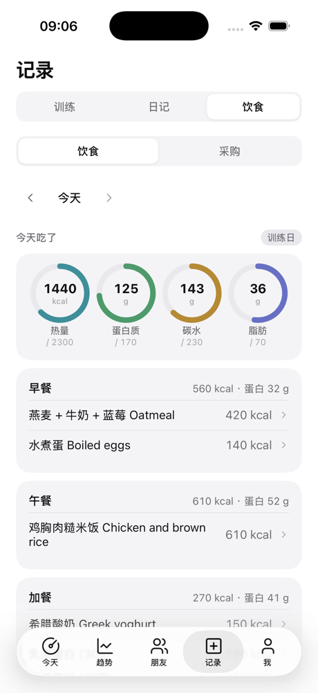 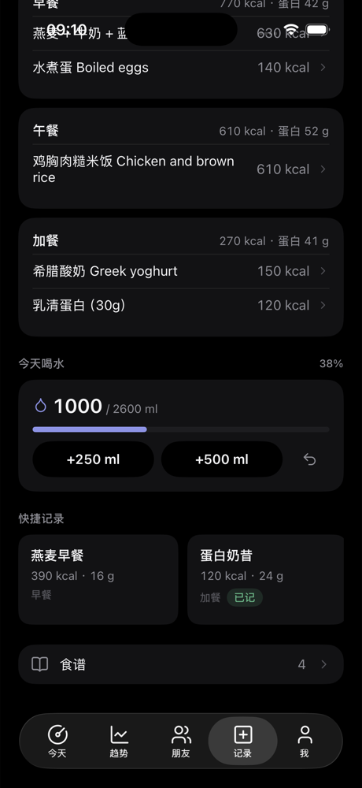 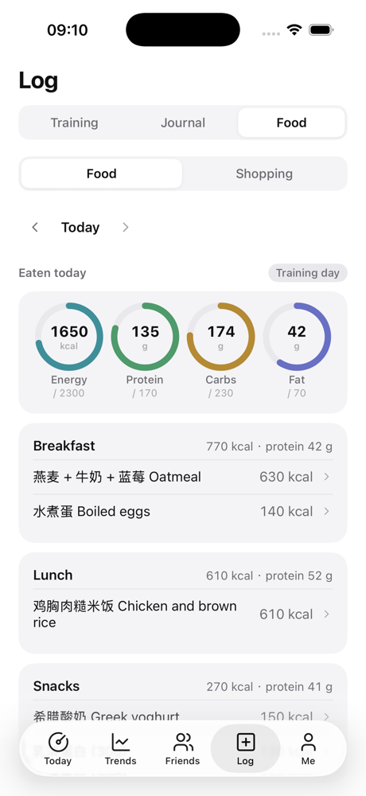 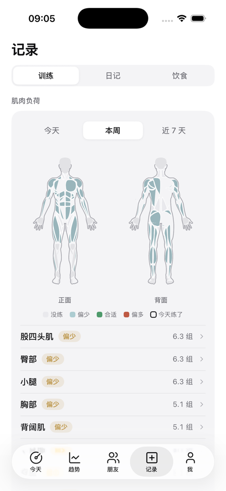 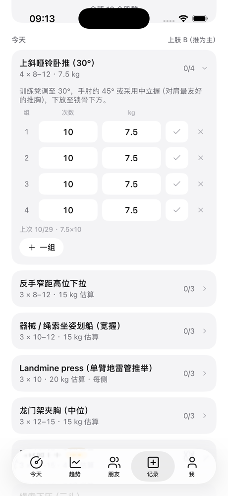 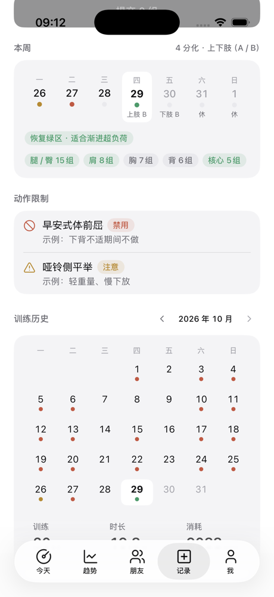 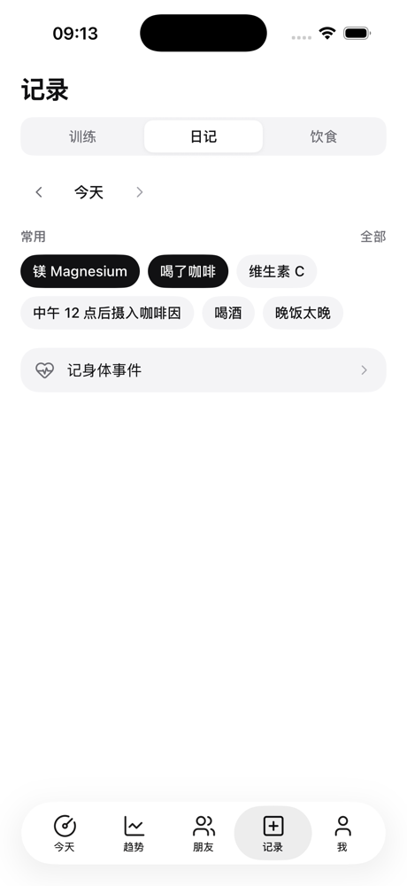 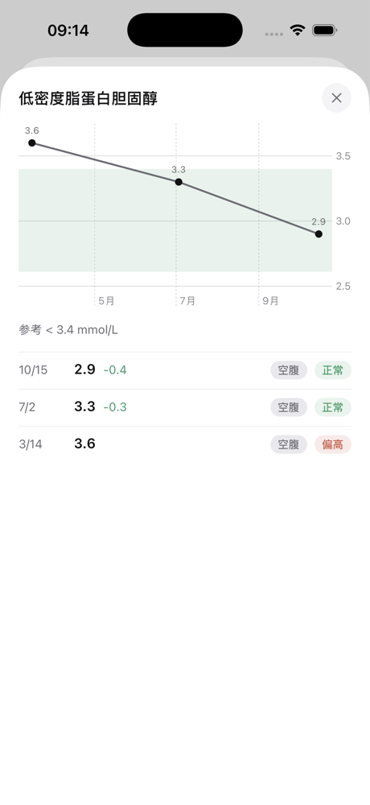 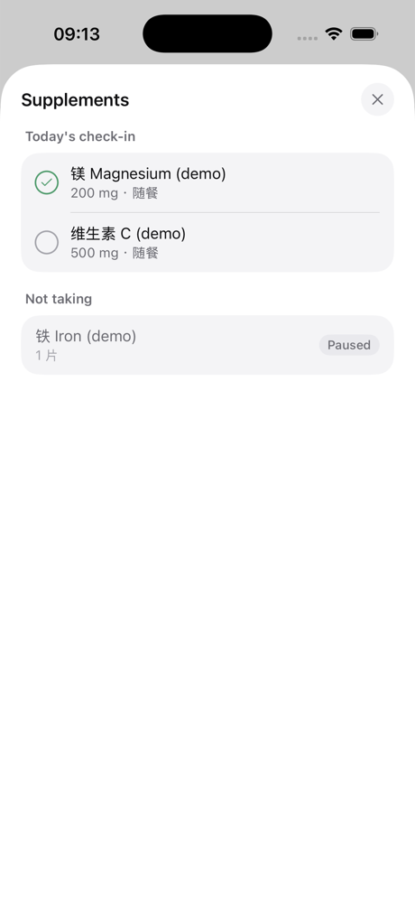

N7 的朋友 tab：动态、评论（从通知进来）、成员、排行榜（深色）、加入圈子、英文（iPhone 17 模拟器，虚构的用户和合成数据）：

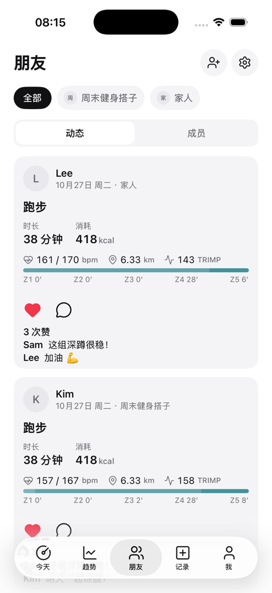 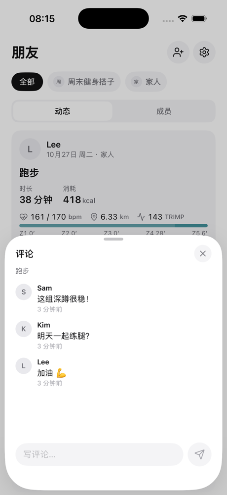 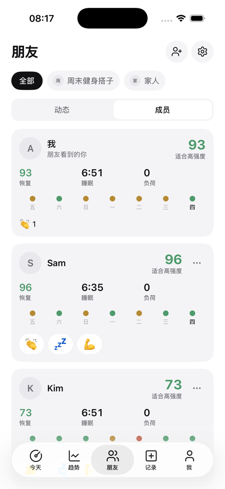 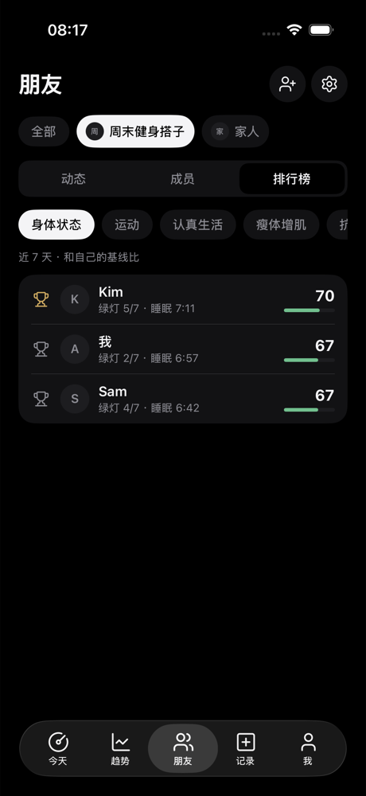 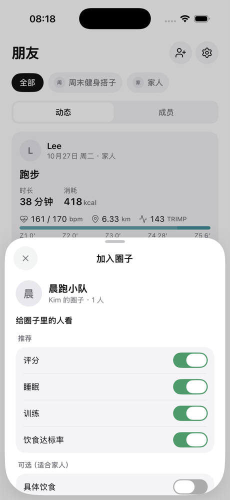 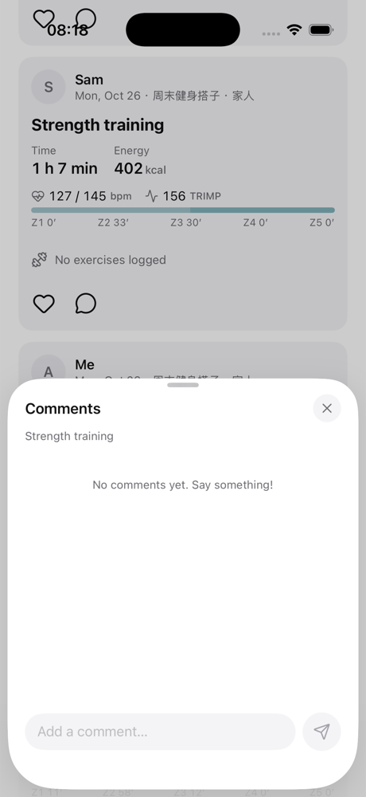

N8 的登录、同意书、我、同步中心（iPhone 17 模拟器，合成数据）：

   

N6 的 Jarvis：菜单（浅色 / 深色）、按住说话、对话（浅色 / 深色）（iPhone 17 Pro Max 模拟器，iOS 26，假服务器，合成数据）：

    

N0 的今天 tab（iPhone 17 模拟器，合成数据，浅色 / 深色）：

 

N3 的今天页、睡眠详情、讲解弹层（同样是合成数据）：

    

N4 的趋势页、一年范围的读数、状态卡和弹层、报告、最近 14 晚（合成数据）：

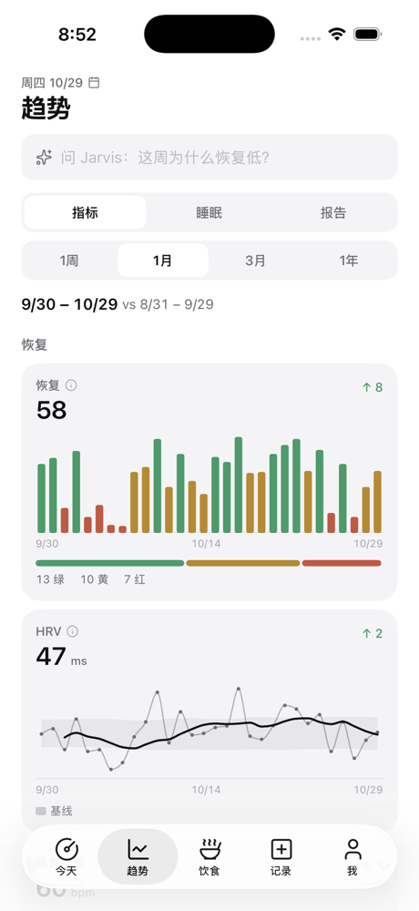 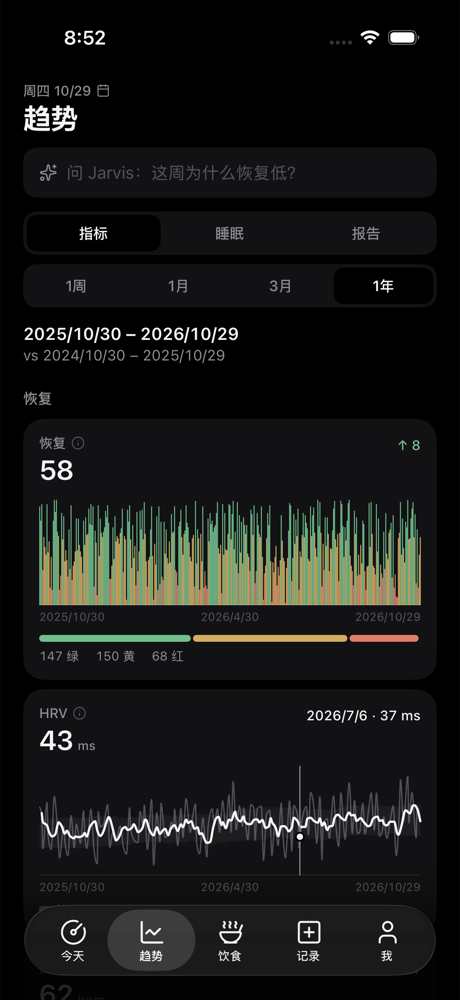 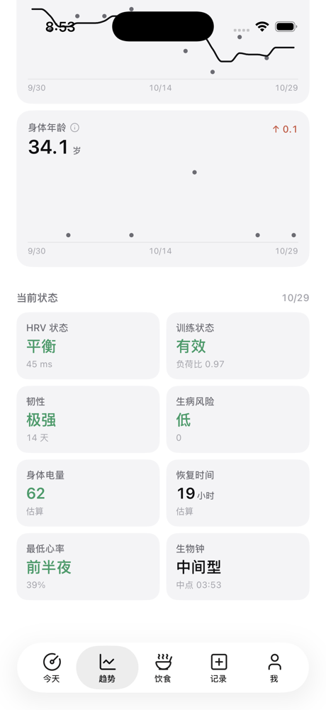 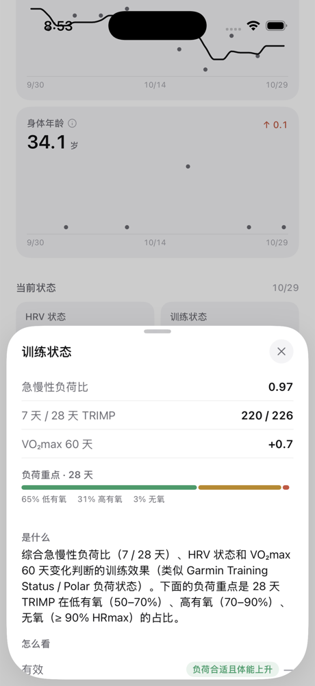 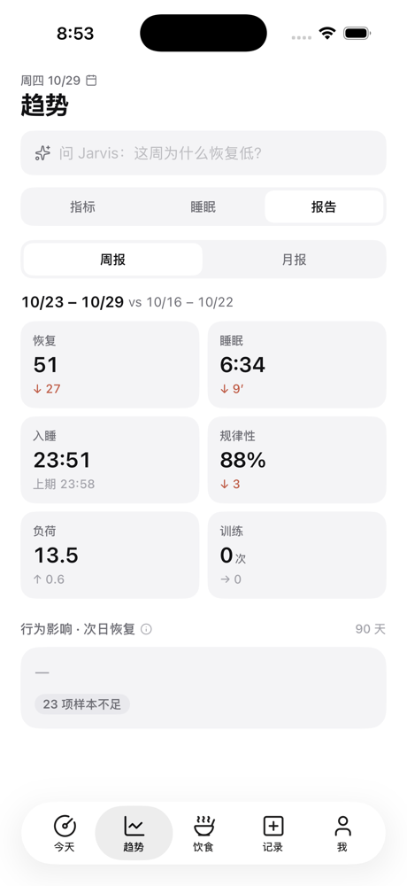 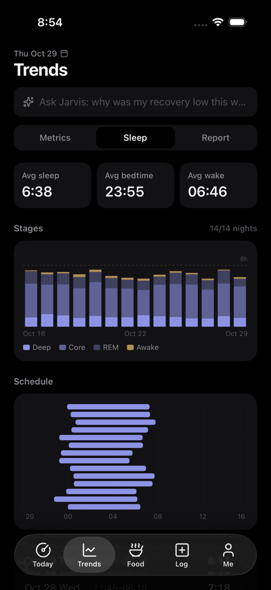

**发布**（`apps.md` 第 4 节）

- 版本号 1.0.9，构建号 10（`W2W_BUILD_NUMBER`；作废的 Flutter 1.0.9 是 9）。和 Flutter 版一样，改版本号走 PR，打包的人不改。
- 签名值写在本地的 `Watch2Whoop.local.xcconfig`，和 Flutter 版一样。
- Xcode → Archive → 上传到 App Store Connect 的**同一条 app 记录**。
- 先给 TestFlight 内部组用一周，再给外部测试用户。
- 发布当天先删掉旧的 1.0.9 tag 和 Release，再在新提交上打 `app-ios-v1.0.9`（步骤见第 12.1 节）。`tools/app_release.sh ios` 从 N9 起认原生工程：版本号读 `Config/Watch2Whoop.xcconfig`，更新记录读 `apps/ios/CHANGELOG.md`，源码 zip 带上 `project.yml` 从外面打进 app 的文件。
- 交接单模板：`ios-native-1.0.9-handover-template.md`；只能真机验证的清单：`ios-native-1.0.9-device-checklist.md`。

**回退**：TestFlight 装回 1.0.8。Flutter 项还在，不用重新登录。

## 11. 还没定 / 风险

1. ~~**OW SDK**~~：已定（#340 中控）：1.0.9 不带 Open Wearables SDK，发布前把所有用户切到 `app` 模式。顺序见第 12 节。
2. **iOS 16 还是 17**（C1）。要看测试用户的系统版本；决定之后只改一行配置。
3. **Swift 6 严格并发**（C9）：N8 改写完同步代码之后再评估。
4. ~~算法包签名的私钥~~：已定（#340 中控），放在部署者本机，实现见第 6.3 节；两把公钥已填进 `AlgoSigningKeys.swift` 和 `signing-keys.json`。
5. ~~全量恢复的流量~~：已定（N2）。每页最多 500 条变化，原始数据每页最多 20000 行，都按天、从新到旧。更早的历史走 `raw_history`，只在 Wi‑Fi 加充电或用户允许蜂窝时拉（第 9.1 节「本机完整历史」）。
6. **长事务会让拉取变慢**：拉取要等「还在运行的最老事务」结束，才能看到它之后的变化。几分钟的大导入期间，别人的拉取也会晚几分钟看到变化。这是为了不丢变化，故意这样设计的。

## 12. 上线顺序（N9）

前提：N9 的 PR 已合并、服务器已部署（抽查改成算到今天，第 9.1 节），全量回归见 `ios-native-1.0.9-regression.md`。命令都在部署机上跑；开关用 `body-engine flags set <开关> --state …`。

**现在的状态**（10-29）：`apple_sync_engine` 全员（影子模式，1.0.8 的前台引擎在传），`apple_sync_primary`、`apple_sync_new_accounts`、`native_sync` 都关着；测试用户都在 TestFlight 1.0.8（Flutter，带 OW SDK）。1.0.9 **没有 OW SDK**：装了 1.0.9 还停在 `shadow` 模式的人，OW 那条链路断了，引擎传的数据又只用来对比，分数会停住。所以**先切 app 模式，再发 1.0.9**。

| 步 | 什么时候 | 做什么 | 看什么 |
|---|---|---|---|
| 1 | N9 合并、部署后 | 作废旧 1.0.9 tag，打新 tag（第 12.1 节），朋友上传，先只给 TestFlight **内部组** | Release 的 zip 和 sha256；TestFlight 显示 1.0.9 (10) |
| 2 | 同一天 | 负责人自己：`sync-mode switch --user-id <自己>`（过门槛）→ `flags set native_sync --state cohort --cohort inner`（内测组 `inner`：负责人和最活跃的几位；1.0.8 不调这些接口，组里还没升级的人不受影响）→ 手机从 1.0.8 升级到 1.0.9，按真机清单 A、C7 验 | `app-scores status --user-id <自己>`：`active`、`trusted`、计划 `{"mode": "app", "days": []}`；今天页「本机计算」 |
| 3 | 内部组用满 3–7 天、真机清单 A–D 没有阻塞问题 | **把所有人切到 app 模式**：`sync-mode readiness` 看每个人；能切的逐个 `sync-mode switch --user-id N`（也可以 `flags set apple_sync_primary --state cohort --cohort sync_app` + 每小时 `sync-mode apply`）。切的时候大家还在 1.0.8：app 模式下引擎的数据优先、1.0.8 的 OW SDK 照常在后台补缺，所以先切不会断数据 | `sync-mode readiness` 里没有「还不能切」；每人第一次重算后 `sync-mode apply` 的切换后检查（快照 vs 新分数）不超阈值。门槛不过的人（影子对比不一致、覆盖率不够）先看报告；确认只是 OW 的问题时用 `sync-mode switch --force --user-id N`（只跳过影子和分数门槛） |
| 4 | 第 3 步做完当天 | 1.0.9 加到**外部组**（公开链接）；`flags set native_sync --state all`。1.0.8 不调这些接口，开着对它没有影响 | 一天内 `rawdata_uploads` 里大多数人的 `app_version` 变成 `1.0.9+10`；`app-scores status` 陆续变成 app 算分 |
| 5 | TestFlight 上只剩 1.0.9 能装以后（1.0.8 的构建在 App Store Connect 里设为过期，或者 90 天自然过期） | `flags set apple_sync_new_accounts --state all`：新开户不再建 OW 用户，一开就是 app 模式 | 先开一个测试账号确认设置链接只有 `today` 和 `login`，1.0.9 扫码就能同步。**不能早开**：1.0.8 登录这种账号会显示「服务器出错（409）」，连不上同步（回归报告 O4） |
| 6 | 所有有 OW 账号的人都已在 app 模式、都装了 1.0.9（`sync-mode readiness`、`rawdata_uploads.app_version`），1.0.9 外部组稳定一周 | **OW 停写**：每人 `ow-archive --user-id N` 补完存档、`ow-archive --check` 全部完整 → 定时任务里去掉 `import-ow` 和 OW 备份，OW 只读（#219 S7，`apple-sync-engine.md` 第 5.3 节） | 回退期 14 天（有本地存档）里分数不漂；之后 OW 下线（S8 删代码，`apple-sync-engine.md` 第 10 节） |

**回退**（从轻到重）

- **一个人的分数不对**：`app-scores server --user-id N`，服务器重新给他算分（app 上传的照收，但不再用）；查清后 `app-scores app --user-id N`。抽查不一致时服务器本来就会自动接手。
- **本机算分 / 增量同步整体有问题**：`flags set native_sync --state off`。接口全部 404，1.0.9 退回旧接口拉数据，服务器照常每小时算分；已经上传的 app 分数留在库里。
- **一个人的同步模式**：`sync-mode rollback --user-id N` 回到 `shadow`，用 OW 的数据（只在 OW 还在写的时候有用，所以第 6 步之前一直保留 OW）。没有 OW 账号的人不能回退（`no_ow`）。
- **1.0.9 本身有问题**：TestFlight 里把 1.0.9 的构建设为过期，测试用户在 TestFlight app 里装回 1.0.8。Flutter 的钥匙串项一直留着，不用重新登录；在 app 模式下 1.0.8 用前台引擎 + OW SDK 照常同步（所以第 6 步 OW 停写之前，这条路一直可用）。
- **新开户出问题**：`flags set apple_sync_new_accounts --state off`，只影响之后的开户；已经按引擎开好的账号留在 app 模式。

### 12.1 作废旧的 `app-ios-v1.0.9`

旧 tag 指向 `8640be1`（#332，Flutter 1.0.9+9：只多了原生今天页 / Jarvis，开关关着），Release「iOS app 1.0.9」是 pre-release，从没发给测试用户。原生 1.0.9 的构建号是 10，比它和 1.0.8（8）都大，所以即使 build 9 曾经上传过 App Store Connect 也不冲突。**发布当天**由维护者在自己的 clone 里做（N9 没有删、没有打）：

```bash
git fetch --tags origin
git rev-parse 'app-ios-v1.0.9^{commit}'            # 确认是 8640be1ea0099d22c814d6fab565587dea7aa62d，不是就停下
gh release view app-ios-v1.0.9 --json name,isPrerelease,createdAt
gh release delete app-ios-v1.0.9 --cleanup-tag --yes  # 删 Release 和远端 tag
git tag -d app-ios-v1.0.9                            # 删本地 tag（每个 clone 都要）
tools/app_release.sh ios                             # 预演：App apps/ios、1.0.9 build 10，全部 ✓
tools/app_release.sh ios --push                      # 打新 tag 并推送，workflow「App release」发布 pre-release
```

- 预演里还出现「version 1.0.9 has no ios tag yet (already: app-ios-v1.0.9)」，说明旧 tag 没删干净（本地或远端）。
- 朋友手上如果有旧 1.0.9 的 zip，作废，只用新的 Release。私有的旧交接单 `dist/交接单-iOS-1.0.9.md` 换成按 `ios-native-1.0.9-handover-template.md` 填的新版。
- Flutter 的 `CHANGELOG.md` 里旧的 1.0.9 一节已标「作废」，留作记录；iOS 的更新记录从 1.0.9 起在 `apps/ios/CHANGELOG.md`。

---

## English summary

`apps/ios/` is the new pure-SwiftUI iOS app (#340), replacing the Flutter app. The Flutter app stays at 1.0.8 and gets bug fixes only. The native app keeps the same bundle ID and team, so TestFlight upgrades it in place.

**Decisions**
- iOS 16+, using ObservableObject (not Observation).
- XcodeGen 2.46.0 generates the project; the `.xcodeproj` is not committed.
- SPM dependencies: GRDB 7.11.1 only.
- Bilingual UI: every user-facing string is written `tr("中文", "English")`.
- Colour tokens mirror `app.css`, and CI compares the two.
- Icons are Lucide only, generated by a script.

**Modules**
- App: entry point, account session, tab bar (Friends replaces Food while the `friends` flag is on).
- DesignSystem.
- Networking: Bearer token, 401 means sign in again, retries with backoff for idempotent requests.
- Auth: Keychain, plus migration from the Flutter app.
- Storage: one GRDB database per account, with append-only migrations.
- Sync: coordinator, legacy and delta remotes, and an offline queue that is FIFO per group, idempotent by `client_id`, and keeps failed or conflicting writes for the user to resolve.
- Algorithms: `OpenBodyScoreRuntime` runs the bundle's own entry points (`OpenBodyScore.buildInputs`, `computeDays`, `analyzeHrv` …) in JavaScriptCore; this is the one calling convention (N2b dropped N0's `OBS.call` placeholder). Downloaded bundles are checked by sha256 and an Ed25519 signature and a test load before use (`AlgoBundles`); the newer of the download and the built-in copy runs.
- HealthSync: byte-for-byte copies of the Flutter app's SyncEngine, RawSync and Backfill, compiled against a tiny `Flutter` shim package.
- Features: one folder per page.

**Local database**
- Tables: `meta`, `docs` (server views as they came), `sync_cursors`, `outbox`, raw HealthKit tables (`hk_*`), `daily_metrics`, `sleep_sessions`, `daily_scores` (with `algo_version` and `origin`), `records` (every user-record kind), `algo_bundles`.
- Excluded from backups, readable after first unlock, deleted on sign-out.

**Sync**
- Pages read only the local database, call `sync.refresh` for fresh data, and write locally first, then enqueue.
- N0 pulls through the existing endpoints.
- N2 (implemented, behind the flag `native_sync`; section 7.3) adds:
  - A per-user change log, `sync_changes` (migration 970). Triggers on every mirrored table write to it, so imports, scoring, the record endpoints and the AI's writes all count. `data_version` is the user's newest seq.
  - `POST /v1/sync/pull`. Streams are `scores`, `daily`, `sleep`, `records`, `docs` (only "stale" notices) and `raw`. A full restore runs newest day first. Incremental pages only include transactions older than the oldest one still running, so a late commit is never skipped.
  - `POST /v1/sync/push`. It goes through each record endpoint's own code, with one transaction per mutation, and is idempotent by `client_id`.
  - `client_id` on the journal, meal template, recipe and training day endpoints.
  - `dirty_days` in the HealthKit upload's answer.
  - Silent pushes to devices registered with `silent: true`. Nothing runs when APNs is not configured.
  - `PUT /v1/users/me/scores/app`:
    - Rows are only accepted when they use the server's own algorithm version.
    - A Python spot check runs for the first upload of each bundle version, then at most every 6 hours. If it finds a difference, the server's row is stored, the user goes back to server scoring, and a recompute is queued.
    - While the app scores a user, the hourly and nightly jobs only fill in days whose inputs changed more than 2 hours ago that the app has not uploaded since.
    - The admin command is `body-engine app-scores status|server|app`.
  - N2b additions:
    - `GET /v1/sync/scoring`: the scoring context the phone cannot work out itself (hrv_kind, sync mode, origin, birth date, app scoring state, muscle load of `from..to`, per-day heart-rate histograms of `hist_from..hist_to`).
    - Pull: `raw_since` bounds a raw restore. The raw body carries `beats` (RMSSD / SDNN of beat-to-beat readings). Recent sleep bodies carry the scores' stage `segments`. Writes to `heartbeat_series` count as raw changes (migration 980).
    - Circle comments take a `client_id` (body or `X-Client-Id`).
- N1 adds `GET /v1/algo/manifest` and the bundle download. N2 adds an Ed25519 `signature` and `key_id` to the manifest (section 6.3):
  - The maintainer signs on their own machine with `body-engine algo-sign --key secrets/algo_signing_key`.
  - The app has two public keys built in (`AlgoSigningKeys.swift`, current and next).
  - Release builds refuse unsigned bundles.

**Migration from the Flutter app**
- Copies the account and ingest tokens from the `flutter_secure_storage_service` Keychain items.
- Takes the server origin from `flutter.w2w.config.v1` and the language from `flutter.w2w.lang.v1`.
- Sync anchors are shared as they are.
- Flutter items are kept so a rollback to 1.0.8 still works; native sign-out removes them.

**Pages**
- N3: Today, sleep and explain sheets. A page that needs several documents pulls them in parallel with `DocPuller`. The N1 bundle runs through `OpenBodyScoreRuntime` (its own `OpenBodyScore` entry points).
- N2b: the phone scores app-mode users itself (`native_sync` on, sync mode `app`; section 9.1).
  - After every sync round, `ScoringSync` reads the seven scoring types from HealthKit into `hk_samples` (60 days, own anchors; the copied engine has no hook). Beat-to-beat readings are stored as they upload.
  - It pulls `scores` / `daily` / `sleep` (sleep with the server's stage segments) and gets `GET /v1/sync/scoring` (hrv_kind, sync mode, origin, muscle load, once the per-day heart-rate histograms).
  - It runs a seeded `computeDays` (bundle 0.2.0: stored rows + day histograms stand in for the history before the raw window; within the server's check tolerance) and uploads the settled days with `PUT /scores/app`, only once the sync round's samples are all on the server.
  - A reinstall restores the full history of scores, daily values and sleep, plus 60 days of raw data (`raw_since`).
  - Local database: see "local history" below (N2b alone kept 60 days, 15–30 MB).
- Local history (after N2b): the phone keeps the whole history of the scores' raw inputs and recomputes all of it itself when the algorithm bundle changes.
  - Two tiers: `hk_samples` (last 60 days, uuid-keyed, from HealthKit) and a compact history (`hist_samples` WITHOUT ROWID, `hist_segments`, `hist_days`; migration `v3_local_history`); beats are kept. Retention per kind in `LocalHistoryParams` (all = everything).
  - The server's new stream `raw_history` sends, per day before `history_before`, the inputs as its own scoring merges them (OW, Shortcut, export.zip, the app's uploads), whole nights' stage segments and beat-to-beat readings; pulled alone, ≤ 14 days a page, throttled (one page per user every 3 s, two pages per process at once, 429 + Retry-After).
  - Downloaded newest first after the 60-day restore, on Wi-Fi while charging (or cellular if allowed), resumable, a few pages in the foreground, the rest in a `BGProcessingTask`; progress in the sync center and under Me → Data status.
  - Full recompute in 14-day chunks seeded by the previous chunk, resumable, uploads in 120-day batches newest first; the server's spot check is unchanged. In the simulator e2e all 730 days matched the server's Python recompute within the check tolerance.
  - Measured (dense made-up days): history ≈45 KB a day (1 / 2 / 3 years ≈ 16 / 31 / 47 MB) plus ≈26 MB for the 60 hot days; peak memory of a 3-year recompute ≈+140 MB and flat over the history length (one call over 180 days would be +490 MB).
  - Storage: excluded from backups, incremental auto-vacuum, a local "clear cache".
  - Simulator + local server: a fresh install restored, scored 58 days, uploaded them; the spot check passed; the server's plan became `app` with no days to score.
- N4: Trends and reports.
- N5: all records and the Food tab (section 9.3). Each page store observes its documents plus the pending `records` rows (`LocalView`); `RecordsPuller` saves the server's views and prunes the rows the server now has in one transaction. Writes are a `records` row plus an outbox entry with the same `client_id`; last-write-wins groups drop older unsent states. Undo of a queued write is local, of a sent one online. The muscle map draws the Today page's own `muscle-body-data.js` (bundled) as SwiftUI paths. Server: `PATCH /nutrition/entries/{id}` sets an absolute portion.
- N4: Trends and reports. Series come from `/trends` (cached as documents); seven status cards (HRV status, training status, load focus, illness risk, lowest-HR timing, recovery time, chronotype) are computed on the phone with the bundle's `trend(...)` when the local history covers their window, resilience / body battery / heart-rate recovery stay the server's. Swift Charts with a tap / press-and-slide read-out, LTTB-thinned lines above 140 points, year labels on long ranges.
- #357 (1.0.9): Trends' range control is Today / 7 / 30 / 90 / 365 d, Today by default (kept for the app's run, a fresh launch starts on Today). Today = the end day's full metric list (value, arrow and colour against the personal 60-day baseline, 7-day spark line, status cards first), read from a 61-day `/trends` document. Range cards label their headline ("7-day mean" / "Latest") and their sheet shows the range mean and the end day's value side by side. The Today tab adds "Needs attention" (only when something is off, at most 3: metrics ≥ 1.5 SD off the baseline in the bad direction, yellow/red status cards, health-monitor vitals out of range; thresholds with sources in `TodayParams.swift`), a "Today's core" card grid (strain vs target, recovery vs strain, stress, illness risk, body battery, HRV status, training status) and "All metrics →" (Trends, Today, same day). Both blocks read the cached 61-day document and the phone's own status cards; no blocking network call.
- N5: all records and the Food tab.
- N6: Jarvis.
- N7: Circles (section 9.2). Feed, likes and comments, member cards, leaderboards, invites (code, link, picture card), circle management, avatars. Server answers are cached in `docs` (`circles:*`) and the feed's first page is merged on refresh; likes and comments go through the offline queue and are laid over the cached posts. The queue now claims an entry atomically (two drains never send it twice) with a 120 s lease. Notification taps open the post (`App/NotificationTaps.swift`). `CircleSummaryCard` is there for other pages.
- N6: Jarvis (section 9.2).
  - `JarvisLayer` sits over the tabs (one line in MainTabView). Its key opens a Mission-style dial: the keys slide out to both sides, then rise onto an arc centred below the key. The keys are Liquid Glass on iOS 26 and material discs before that.
  - Holding the key starts on-device speech recognition: slide up-left to cancel, up-right to lock.
  - `JarvisChat` streams `POST /v1/assistant/chat` as SSE through `APIClient.eventStream`. It resumes dropped turns from `/events?after=`, waits for confirmation on deletes, keeps conversations, switches the AI and asks for the fallback consent.
  - Cards are native views by `show_card` type, with a generic fallback.
  - Other pages call `JarvisRouter.ask(prompt:)`.
  - Tests use a fake SSE server (StubProtocol). `scripts/fake_jarvis_server.py` serves simulator demos.
- N7: Circles.
- N8: Me, settings, onboarding, the sync center, and porting the sync engine's Dart side to Swift.
  - Sign-in: Apple, e-mail code, setup QR code / link (`POST /v1/web/login-code` with `client: app` returns a device token), activation code.
  - The consent, profile and Health access steps follow once.
  - The sync host (`Features/Sync/`) drives the copied engine, backfill and RawSync. BGTasks and observers are registered at launch. No Open Wearables SDK.
  - A simulator upgrade from 1.0.8 kept the sign-in and the anchors. Only the engine's one-time "recent 48 hours" pass resent samples, and the server skipped them by UUID.

**Testing and CI**
- XCTest unit tests run on the simulator in the CI job "iOS native", which runs only when `apps/ios/**` changes.
- Simulator demos use a throwaway database with synthetic data.

**N9: release regression and rollout** (section 12, `ios-native-1.0.9-regression.md`)
- A simulator run end to end with synthetic data (fresh install, setup link, consent, profile, Health, first sync,
  on-device scoring, trends, logging, Jarvis on a fake SSE server, circles, sign-out, reinstall restore, upgrade from
  Flutter 1.0.8) found five bugs, all fixed: the phone scored from Health history the server never got (the first sync
  sends 14 days, the phone read 60), a gap between the first-sync window and the backfill, uploads before the server had
  a scoring origin, a CTL / ATL start that depended on where a run ended (the phone now recomputes from the origin while
  the history fits its raw window; the server's spot check computes through today), and a setup link lost behind a
  sign-in step.
- Rollout: switch every user to the `app` sync mode while they are still on 1.0.8 (OW keeps filling gaps), then ship
  1.0.9 and turn `native_sync` on; `apple_sync_new_accounts` only once TestFlight offers nothing older than 1.0.9; OW
  stops writing last. Each step has its rollback. The voided `app-ios-v1.0.9` tag is deleted and re-made on release day
  (section 12.1); `tools/app_release.sh` now releases `apps/ios` (version from its xcconfig, build 10).

**Open questions**
- The OW SDK is not included: every user moves to engine `app` mode before 1.0.9 (decided; section 12).
- iOS 16 or 17.
- Swift 6 strict concurrency.
- The signing keys are generated and built into the app (current and next).
- Full-restore traffic is decided: pages of 500 changes or 20,000 raw rows; older history comes through `raw_history` (Wi-Fi + power, or cellular if allowed).
- A long transaction delays what pulls can see until it ends. This is on purpose, so that no change is lost.
