# iOS 原生 app（SwiftUI）：架构和开发约定

> 状态：#340 N0（架构文档 + 工程骨架），2026-10-29；N2 服务器接口已实现（第 5.2、5.3、6.3、7.2、7.3 节）。这份文档是 N1–N9 各个 agent 的共同依据：改约定先改这里，在 PR 里说明。
> 相关：#340（总纲）、#337（本地优先的决定）、#219（自建同步引擎，`apple-sync-engine.md`、`apple-sync-engine-app-contract.md`）、`ios-native-plan.md`（测量和分期）、`apps.md`（版本号和发版）。
> 文中的数字都是示例，不是任何真人的数据。

## 0. 一句话

`apps/ios/` 是纯 SwiftUI 的新 app，替换 Flutter 版（`apps/watch2whoop/` 停在 1.0.8，之后只修 bug）。Bundle ID 和 Team 不变，TestFlight 上覆盖安装就能升级，第一次启动把 Flutter 版的 token 和服务器地址迁过来。

- **页面只读本地库**：每个账号一个 SQLite 库（GRDB）。
- **同步层负责收发**：后台和服务器双向同步，写操作先落本地，再经离线队列上传。
- **算法在手机上算**：评分算法是服务器下发、带版本号的 JS 包，用 JavaScriptCore 运行，不用 WebView。

## 1. 已定的约定

| # | 约定 | 说明 |
|---|---|---|
| C1 | **最低 iOS 16** | #340 N0 的要求。`ios-native-plan.md` D8 原来建议 17。因为要支持 16：状态用 `ObservableObject` / `@Published`，不用 Observation（`@Observable` 要 17）；图表用 Swift Charts（16 起就有）。负责人改成 17 时，只需改 `project.yml` 的 `deploymentTarget`，代码不用跟着改 |
| C2 | **纯 SwiftUI，没有 WebView** | 系统组件只在 SwiftUI 没有对应能力时用 UIKit，例如 `UITabBarAppearance`、扫码的 `DataScannerViewController` |
| C3 | **工程用 XcodeGen 2.46.0 生成** | `project.yml` 是唯一来源；`.xcodeproj`、`Info.plist`、`.entitlements` 都是生成出来的，不进 git |
| C4 | **依赖只用 SPM，第三方只有 GRDB 7.11.1**（MIT，精确版本） | 需要新依赖时先在 #340 说明。系统框架随便用（Charts、JavaScriptCore、CryptoKit、HealthKit、AVFoundation、Speech、BackgroundTasks） |
| C5 | **双语** | 用户能看到的文字一律写 `tr("中文", "English")`（`Localization/I18n.swift`）。`scripts/check_sources.py` 在 CI 里检查：`tr()` 以外不能有中文，英文那一半不能有中文。服务器返回的文字靠请求头 `X-Body-Lang` 选语言 |
| C6 | **视觉沿用今天页** | 颜色 token 和 `app.css` 一一对应（`DesignSystem/Palette.swift`，CI 比对）；三环并排、恢复在中间；界面只放数字、图表和短标签，长段文字留给 AI |
| C7 | **图标只用 Lucide** | 由 `scripts/lucide_assets.py` 转成 asset，许可证写在 `THIRD_PARTY_NOTICES.md`。不自己画图标；app 界面元素也不混用 SF Symbols |
| C8 | **公开仓库** | 不写个人信息、域名、真实 Team ID；测试和示例只用明显虚构的数值 |
| C9 | **Swift 5 语言模式，并发检查设为 `minimal`** | 先保证拷进来的同步代码能编译。N9 之前评估要不要切到 Swift 6 |

## 2. 模块划分

### 2.1 目录（`apps/ios/`）

| 目录 | 内容 | 谁来改 |
|---|---|---|
| `project.yml`、`Config/` | 工程定义；签名占位 `Watch2Whoop.xcconfig`（自己的值写在不进 git 的 `Watch2Whoop.local.xcconfig`）；版本号 `W2W_MARKETING_VERSION`、`W2W_BUILD_NUMBER` | N0 / N9 |
| `Watch2Whoop/App/` | 入口 `Watch2WhoopApp`、`AppDelegate`（后台任务、后台 URLSession）、`AppModel`（启动 → 登录 / 连接中 / 已登录）、`AccountSession`（一个账号的 API + 库 + 同步）、`MainTabView`（底栏） | N0；N8 管登录流程 |
| `Watch2Whoop/DesignSystem/` | `Palette`（颜色）、`Typo`（字号）、`Metrics`（圆角、边距）、`Icon`（Lucide）、`Card`、`SectionHeader`、`ListRow`、`MetricTile`、`Chip`、`RingView`、`PrimaryButton`、`PageScaffold`、`.w2wSheet` 弹层、`PressScale` | 谁需要谁加；只加通用组件 |
| `Watch2Whoop/Networking/` | `APIClient`（Bearer、401、重试）、`APIError`、`Endpoint`（所有路径） | N0；页面加路径常量 |
| `Watch2Whoop/Auth/` | `KeychainStore`、`CredentialStore`（token、服务器地址、user id）、`FlutterMigration` | N0 / N8 |
| `Watch2Whoop/Storage/` | `AppDatabase`（每账号一个库）、`Schema`（迁移）、`Records`（GRDB 记录类型） | 页面在 `Schema` 末尾**追加**迁移 |
| `Watch2Whoop/Sync/` | `SyncCoordinator`、`RemoteSync`（`LegacyRemote` / `DeltaRemote`）、`OfflineQueue`、`DocKey` | N0 / N2 客户端 |
| `Watch2Whoop/Algorithms/` | `AlgorithmRuntime`（JavaScriptCore）、`BundleVerifier`、`algo-builtin.js`（目前是占位） | N1 |
| `Watch2Whoop/HealthSync/` | 从 Flutter 拷来的 `SyncEngine.swift`、`RawSync.swift`、`Backfill.swift`（逐字节相同），加上 `HealthSyncBridge`（async 包装）；注册表 `Resources/healthkit_types.json` 也由脚本拷贝 | 拷贝件用脚本同步；宿主一侧在 `Features/Sync/`（N8） |
| `Watch2Whoop/Features/<页面>/` | 每个页面一个目录：`Today/`（N3）、`Trends/`（N4）、`Record/`、`Food/`（N5）、`Jarvis/`（N6）、`Circles/`（N7）、`Onboarding/`（登录、同意书、资料、健康权限）、`Me/`、`Sync/`（同步中心和同步宿主）（N8）；`Placeholders/` 是还没做的 tab | 各页面 agent |
| `Watch2Whoop/Localization/` | `tr()`、`Lang` | — |
| `Watch2Whoop/Resources/` | `Assets.xcassets`（AppIcon、`LaunchBackground`、`Icons/lucide.*`） | — |
| `Watch2WhoopTests/` | XCTest 单元测试，在模拟器上跑 | 每个 PR 都要加测试 |
| `Packages/FlutterShim/` | 本地 SPM 包，模块名就叫 `Flutter`：只有 `FlutterMethodCall`、`FlutterResult`、`FlutterError` 三个类型，让拷进来的文件不改一个字节也能编译。N8 之后只剩 `RawSync.swift` 用它 | Flutter 原文件的 RawSync 拆出原生接口后删掉 |
| `scripts/` | `sync_flutter_sources.sh`（拷贝 / `--check`）、`lucide_assets.py`（生成图标 / `--check`）、`check_sources.py`（双语和颜色 token） | — |

### 2.2 依赖方向

`Features → (Sync, Storage, DesignSystem, Localization)`；`Sync → (Networking, Storage, Algorithms)`；`Networking / Storage / DesignSystem` 互相不依赖。

- **页面不直接请求接口拿要显示的数据**：读本地库，需要新数据就调 `session.sync.refresh(...)`。
- **页面的写操作**：先改本地行，再 `session.sync.enqueue(...)`。只有在线功能（第 5.5 节）可以直接 `session.api.send(...)`。
- 页面之间不互相 import 内部类型，要共享就放进 `DesignSystem` 或 `Storage`。

### 2.3 拷进来的同步代码

- `SyncEngine.swift`、`RawSync.swift`、`Backfill.swift` 和 `apps/watch2whoop/ios/Runner/` 里的原文件逐字节相同。A2–A4（#219）还在原文件上改，所以这里不改拷贝件。
- 原文件更新后跑 `apps/ios/scripts/sync_flutter_sources.sh`；CI 里的 `--check` 发现不一致只给警告，不让 job 失败。
- 拷贝件仍然是 method channel 的形状：`handle(FlutterMethodCall, result)`。`HealthSyncBridge.call(.engine, "engineRead", args)` 把它包成 `await`。
- Dart 那一侧的逻辑（`lib/src/sync_engine.dart`、`raw_sync.dart`、`backfill.dart`、`resync_flow.dart`）N8 已改写成 Swift，在 `Features/Sync/`：`HealthSyncService`（交给引擎服务器、token、注册表和 engine 块，前台轮次、补全历史、重新同步的手机部分、状态）、`RawUploadPass`（心跳序列 / 心电图 / 喝水，200 之后才提交锚点）、`SyncDiagnosis`（卡在哪里、怎么自救）。`SyncEngine.swift`、`Backfill.swift` 从 #344 起就是原生接口；`RawSync.swift` 还是 method channel 的形状，经 `HealthSyncBridge.raw` 调用，等 Flutter 原文件拆出原生接口后再删 `FlutterShim`。
- 1.0.9 只走引擎（`app` 模式）：不调 `ow-invitation`，设置链接里的 `ow` / `code` 读到也不用（契约第 7.1 节）。注册表里的数量类型全由引擎读，RawSync 在原生 app 里只管心跳序列、心电图和喝水。
- 后台：`AppDelegate` 在启动结束前 `SyncEngine.register()`（BGAppRefresh `watch2whoop.sync.refresh`、BGProcessing `watch2whoop.sync.process`、HealthKit 观察者和后台送达）和 `Backfill.register()`；回到前台时 `HealthSyncService.syncOnOpen()`（至少隔 3 分钟）。引擎自己存配置（服务器、Keychain 里的 token、注册表、模式），没有页面也能在后台跑。
- 锚点和 backfill 状态存在 `UserDefaults` 里，键不带 `flutter.` 前缀（`w2w.sync.anchor.*`、`w2w.raw.anchor.*`、`w2w.backfill.state.v1`）；backfill 的上传 token 在 Keychain 的 `w2w.backfill` / `token`。这些和 Flutter 版是同一份，升级后直接接着用，不用迁移。
- `AppDelegate` 已经注册了 `watch2whoop.sync.backfill` 后台任务，并在每次启动时重新挂上后台 URLSession。`BGTaskSchedulerPermittedIdentifiers` 里还预留了 `watch2whoop.sync.refresh`，给 N8 的定时刷新用。

## 3. 启动和账号

```
启动 → FlutterMigration.run（只跑一次）→ 有 token + 服务器？
  否 → OnboardingView（N8：通过 Apple 登录、邮箱验证码、设置二维码 / watch2whoop://setup 链接、激活码；高级：token）
  是 → 已经知道 user id？
        是 → 立刻打开本地库，显示 tab（先画缓存）→ 后台调 /v1/web/me 更新 flags 和名字
        否 → 「正在连接」→ /v1/web/me → 记下 user id → 打开本地库
任何请求 401 → APIClient.onUnauthorized → 清掉 token → 登录页（不重试）
退出登录 → 删掉这个账号的库目录 + Keychain（原生项和 Flutter 项都删）→ 通知服务器 /v1/account/logout
```

- 登录方式都换成一个设备 token（Keychain）：Apple / 邮箱是 `client: app`；设置链接的一次性登录码走 `POST /v1/web/login-code {code, client: "app"}`（N8 加的：不设 cookie，回答里带 token）；16 位激活码先 `POST /v1/web/activate {web: true}` 换成设置链接，再兑换其中的登录码；还没激活的账号（pending）再填邀请码（`/v1/account/redeem-invite`，别的账号的码会切到那个账号并给它的 token）。
- 登录后只在需要时依次出现（`SignedInFlows`）：同意书（`GET /v1/consent` 的文本和版本，`required` 不能跳过，`reconfirm` 是新版本）→ 资料（缺生日 / 性别 / 身高时，可以「以后再说」，每个账号只问一次）→ 健康权限（一个弹窗问全部类型）→ 首次同步。
- `AccountSession`（`@MainActor ObservableObject`）通过 `environmentObject` 注入，里面有 `config`、`api`、`db`、`sync` 和 `flags`。页面用 `@EnvironmentObject var session: AccountSession` 拿。
- 功能开关来自 `/v1/web/me` 的 `flags`，本机缓存在 `w2w.native.flags.v1`。每个原生页面如果需要服务器开关，就读 `session.flags`。
- Debug 版可以用启动环境变量自动登录，给模拟器和截图用：`SIMCTL_CHILD_W2W_DEV_SERVER`、`SIMCTL_CHILD_W2W_DEV_TOKEN`、`SIMCTL_CHILD_W2W_DEV_LANG=zh|en`。

## 4. 本地数据库

### 4.1 文件

- 路径：`Application Support/W2W/accounts/<key>/body.sqlite`，`key` = sha256(`服务器|user id`) 的前 16 位十六进制。同一台手机登录不同账号或不同服务器，数据互不相见。
- 文件保护级别 `completeUntilFirstUserAuthentication`：后台同步要读。
- 不进 iCloud / 设备备份：服务器有全量备份；Keychain 是「仅本机」，换机恢复后本来就要重新登录、从云端重新拉。
- GRDB `DatabasePool`（WAL）：读不会挡写。
- 退出登录时删掉整个目录。删之前，离线队列里没发出去的写操作先问用户（N8 的弹窗，规则同 `offline-plan.md` 第 4 节）。

### 4.2 表（迁移 `v1_initial`，定义在 `Storage/Schema.swift`）

时间用 UTC 秒（REAL）；日期是用户本地的 `YYYY-MM-DD`（TEXT）；单位和服务器一致（kg、kcal、ms、bpm）；JSON 存 BLOB。

| 表 | 主键 | 用途 | 谁写 / 谁读 |
|---|---|---|---|
| `meta` | `key` | 零碎信息（全量恢复时间、当前算法版本……） | 同步层 |
| `docs` | `key` | 服务器算好的视图，**原样存**：`today:<日期>`、`today:current`、`trends:<天数>`、`circles:overview`……；带 `version`（N2）和 `fetched_at` | 同步层写；还没有专门表的页面读 |
| `sync_cursors` | `stream` | N2 每个拉取流的游标 | 同步层 |
| `outbox` | `id` | 离线队列（第 5.4 节）；`client_id` 唯一；`group_key` 决定顺序；`state` 取 pending / sending / failed / conflict | `OfflineQueue` |
| `hk_sources` | `id` | HealthKit 来源表（bundle、设备、型号、系统版本） | 同步引擎（N8） |
| `hk_samples` | `uuid` | 数量型和分类型样本（分类的值是 HealthKit 的整数），注册表单位，带 `uploaded` 标记 | 同步引擎写；算法输入 |
| `hk_stat_buckets` | `type, start` | 累计型的 900 秒统计桶（按 UTC 对齐） | 同步引擎 |
| `hk_workouts` | `uuid` | 训练（统计、事件、元数据存 JSON） | 同步引擎 |
| `hk_deleted` | `uuid` | HealthKit 删掉的样本，等着上传 | 同步引擎 |
| `daily_metrics` | `date, metric` | 每天的汇总（长表，指标键和服务器一致），带来源和 flags | 算法 / 同步层 |
| `sleep_sessions` | `id` | 睡眠段，`date` = 醒来那天（结束时间减 4 小时），阶段存 JSON | 算法 / 同步层 |
| `daily_scores` | `date` | 每天的评分：圆环要用的数字是列，整行存在 `payload`；`algo_version`；`origin` 取 server / app；`uploaded` | 算法写（N1 / N3），同步层上传 |
| `records` | `kind, id` | 用户自己的记录（饮食 / 体重 / 喝水 / 日记 / 补剂 / 化验 / 训练）：`date`、`server_id`、`client_id`、`payload`、`version`、`deleted`、`pending`；还没收到服务器回答的行 `id` = `c:<client_id>` | N5 |
| `algo_bundles` | `version` | 已安装的算法包（sha256、api、文件路径、来源 builtin / download、`active`） | N1 |

**不存在本地的**：别人的数据（只存圈子动态的缓存文档）、AI 对话全文、心电图波形、AI 设置里的 key。

### 4.3 迁移规则

- 只在 `Schema.migrator` 末尾**追加** `vN_<名字>`（例如 `v2_records_training_sets`），一个 PR 一个。已经发出去的迁移不能改、不能改名、不能调顺序。`SchemaTests.testMigrationOrder` 把列表钉死，加迁移时同时改这个测试。
- Debug 版开了 `eraseDatabaseOnSchemaChange`：开发时改了迁移，本地库直接清空重建，反正只是缓存。Release 版没有这个开关。
- 本地库只是服务器的缓存，加上还没发出去的队列。要做破坏性改动（比如改主键），就新建表并从服务器重新拉，不在手机上搬数据。

## 5. 同步层

### 5.1 页面怎么用

```swift
// 读：订阅本地库，数据一变就重画
for try await doc in session.db.observeDoc(DocKey.todayCurrent) { … }
// 要新数据：拉取（N0：GET 原接口写进 docs；N2：增量）
await session.sync.refresh(.today(date: nil))      // 或 .changes
// 写：先改本地行，再排队（立刻尝试发送）
session.sync.enqueue(kind: "water", group: "water", method: .post, path: "/v1/users/me/water", body: json)
```

`SyncCoordinator.status`（idle / syncing / offline / failed）给页面显示一行小字（`SyncStatusLine`）。有缓存的时候永远先显示缓存，不出现阻塞式的加载遮罩。

### 5.2 拉取

- **N0（现在）**：`LegacyRemote` 调原有的 GET 接口，把结果原样存进 `docs`；`.changes` 目前只拉今天的文档。各页面在 N2 之前照这个做法：在 `LegacyRemote` 里加自己的 scope，把接口结果存进 `docs`。
  - 一个页面要好几份文档时（N3 起），用 `Sync/DocPull.swift` 的 `DocPuller`：`[DocFetch(文档键, 请求)]` 并行拉、原样存；断网保留缓存，403 / 404（没有共享、开关没开）删掉那份文档，页面就隐藏那一块。主文档仍走 `session.sync.refresh`（状态行和离线队列在那里）。
- **N2（服务器已实现，`body_engine/src/body_engine/nativesync/`）**：`DeltaRemote` 调 `POST /v1/sync/pull`：

  ```json
  // 请求：只拉 cursors 里列出的 stream；"" = 这个 stream 从头全量恢复
  {"cursors": {"scores": "…", "daily": "…", "sleep": "…", "records": "…", "docs": "…", "raw": "…"},
   "limit": 500, "raw_days": ["2026-01-02"]}
  // 回答
  {"changes": [{"stream": "records", "op": "upsert|delete|stale", "kind": "water", "key": "2026-01-02",
                "date": "2026-01-02", "version": 7, "body": {"items": […]}}],
   "cursors": {"records": "c.812.40"}, "more": false, "data_version": 40,
   "algo": {"version": "0.1.0", "sha256": "…", "algo_versions": {…}}}
  ```

  - 每一页在一个事务里写进对应的表（`records`、`daily_scores`、`daily_metrics`、`sleep_sessions`、`docs`、`hk_*`），然后保存游标。`more` 为 true 就接着拉。
  - 游标对 app 是不透明的字符串，原样存、原样发回。服务器回 422 `bad_cursor` 时把这个 stream 的游标清空，重新全量恢复。
  - 游标为空就是**全量恢复**：删了 app 重装、换手机都走这一条。按天分页，**最新的一天在最前**，所以前一两页就是最近两周。
  - `raw`（HealthKit 原始样本）也能拉回来，这样删掉 app 重装后可以在本地重算。规则是：全量恢复时拉（同样按天、从新到旧，每页 ≤ 20000 行）；某几天要重算时用 `raw_days` 指定（每次 ≤ 7 天，不动游标）。90 天以前的原始数据，app 只在 Wi-Fi 下继续拉（`params.RAW_CELLULAR_DAYS`，由 app 判断）。
  - 每种 stream 的 `body` 形状、各 kind 的含义，见第 7.3 节。
- **什么时候拉**：冷启动、回到前台、自己的写操作提交之后、同步引擎上传完一轮之后（`POST /v1/ingest/healthkit` 的回答里有 `dirty_days`，只拉那几天）、静默推送（`content-available`）、下拉刷新。
- 服务器有没有 N2 接口，看 `/v1/web/me` 的 `flags` 里有没有 **`native_sync`**；有的话，回答里还会带 `data_version`。没有就继续走 Legacy，所以 N2 上线前后 app 都能用。`data_version` 和本机记的不一样时再去拉。

### 5.3 推送（上传）

- **记录**：走离线队列。两种发法，都按 `client_id` 去重：
  - 现有接口带 `client_id`：喝水、体重原来就支持；N2 给日记 `PUT /journal/{day}/{key}`（body 的 `client_id` 或请求头 `X-Client-Id`）、`DELETE /journal/{day}/{key}`（请求头 `X-Client-Id`）、快捷记餐 `POST /meal-templates/{id}/log`、食谱 `POST /recipes/{id}/log`、训练 `PUT /training/session/{day}` 和 `POST …/submit` 都加上了。补剂打卡就是日记接口（补剂的 `journal_key`）。同一个 `client_id` 重发时，服务器回第一次的回答（同样的状态码，加请求头 `X-Duplicate: 1`），不会再写一次。只保存成功的回答，所以 4xx / 409 之后可以用同一个 id 重发。保留 30 天。同一个 `client_id` 用在另一种写操作上会得到 422。
  - 也可以合并成 `POST /v1/sync/push`：

  ```json
  {"mutations": [{"client_id": "…", "kind": "journal", "op": "upsert|delete", "key": "2026-01-02/sauna",
                  "base_version": 6, "body": {…}}]}
  // 回答：每条一个结果，顺序和请求一样
  {"results": [{"client_id": "…", "kind": "journal", "key": "…", "status": "applied|duplicate|conflict|rejected|error",
                "date": "2026-01-02", "version": 7, "body": {…}, "detail": …}], "data_version": 41}
  ```

  每条 mutation 走它对应的那个接口，检查和回答都一样，每条一个事务，最多 100 条。`error` 表示 5xx，或者饮食记录暂时连不上，留在队列里稍后重发。`kind`、`key` 和冲突规则见第 7.3 节。
- **HealthKit 原始数据**：继续用 `POST /v1/ingest/healthkit`，协议见 `apple-sync-engine-app-contract.md`。改动是先写进本地 `hk_*` 表，再上传，200 之后打 `uploaded` 标记、提交锚点。回答里多了 **`dirty_days`**：这一批改动到的本地日期，app 只需要再拉这几天。重发的批次（`duplicate_batch`）回 `null`，意思是不知道，照常增量拉。服务器之后派生出的日值、睡眠和分数，通过变更记录和静默推送送到 app。
- **app 算的分数**：`PUT /v1/users/me/scores/app`，格式 `{"algo_version": "…", "bundle_version": "0.1.0", "days": [{"date": "…", "row": {daily_scores 的列}}]}`，一次最多 400 天。规则见第 7.3 节：服务器先抽一天用 Python 校验，不一致就以服务器的结果为准；这个用户由 app 算分期间，每小时任务只补算 app 没管的「脏」天。

### 5.4 离线队列（`Sync/OfflineQueue.swift`，已实现并有测试）

- 每个 `group_key` 内部先进先出，同时只发一条；不同组互不阻塞。组的划分：`water`、`weight`、`journal:<日期>`、`training:<日期>`、`meal`……
- 结果分几种：
  - 2xx：删掉这一条。
  - 网络错误 / 5xx / 408 / 429：留在 `pending`，退避 2、4、8……秒，最长 5 分钟，加 ±20% 抖动；429 按 `Retry-After` 等。
  - 401：整个队列停下，不丢任何一条，重新登录后接着发。
  - 409：标成 `conflict`。
  - 其他 4xx：标成 `failed`。
- `failed` 和 `conflict` 会挡住同组后面的条目，保证顺序；由用户在「没提交」列表里选重试或丢弃（`needsAttention` / `retry` / `discard`，界面由 N8 做）。
- **冲突规则**：
  - 只追加的记录（喝水、饮食条目、体重、训练逐组）：靠 `client_id` 幂等，没有冲突。
  - 可以编辑的记录（日记的某一项、补剂打卡、个人资料）：以最后一次写为准（服务器时间），删除优先。
  - 整份覆盖的（当天训练、计划）：带 `base_version`，不一致就 409，让用户选。
  - 快捷记餐同一天记了两次：沿用现在的 409 + 「仍要记 / 丢弃」。
  - 计算结果（分数、趋势）：不在队列里。同一算法版本以服务器为准；算法包更新后在手机上重算，再上传。
- 已经提交的写操作，撤销要联网；只有本机还没发出去的可以直接撤销（删掉队列里那一条，再改回本地行）。

### 5.5 只在线的功能（不进队列，不进本地库，最多存一份缓存文档）

Jarvis / AI 对话、圈子的写操作（点赞、评论、邀请）、账号和 AI 设置、化验录入、建食谱 / 快捷记餐模板、看别人的数据。离线时这些入口显示为灰色，点了提示「需要联网」。

## 6. 算法包（JavaScriptCore）

### 6.1 调用约定（api 1，已在 `Algorithms/AlgorithmRuntime.swift` 定下）

**包的形状**

- 一个普通脚本（ES2020）：不用 module，没有 DOM、计时器、网络，结果不能依赖 `Date.now()`。
- 脚本里定义：

  ```js
  globalThis.OBS = {
    apiVersion: 1,
    version: "x.y.z",
    functions: ["…"],
    call(name, inputJson) { … }   // 返回 JSON 字符串
  }
  ```

**`call` 的规则**

- `call` 是同步的纯函数：同样的输入，在每台手机和服务器上都得到同样的输出（golden 测试）。
- 出错返回 `{"error": {"code": "…", "message": "…"}}`，不抛异常（抛了 runtime 也会接住）。
- 输入输出沿用服务器的约定：日期是用户时区的 `YYYY-MM-DD`，时间是 UTC 秒，单位 kg / kcal / ms / bpm，缺的值写 `null`。

**Swift 一侧**

- `try runtime.call("scores.day", input, as: Output.self)`；也可以用 `callJSON`。
- 每个包版本一个 `JSContext`，所有调用在它自己的串行队列上执行。
- 函数清单和输入输出的结构由 N1 定，命名建议 `<模块>.<函数>`（`scores.day`、`trends.series`、`rules.evaluate`）。

### 6.2 下发和启用（N1 实现）

1. **内置包**：`algo-builtin.js` 打进 app，第一次启动和校验失败时用。N0 放的是占位文件，只有 `echo` 和 `about`。
2. **检查新版本**：冷启动时（至少隔 6 小时一次）请求 `GET /v1/algo/manifest`，返回 `{version, api, sha256, signature, min_app}`。如果版本比本机新、`api` 和 app 支持的一致、app 版本 ≥ `min_app`，就下载 `GET /v1/algo/bundle/<version>.js`。
3. **校验**：`BundleVerifier` 先比 sha256，再验 Ed25519 签名（CryptoKit `Curve25519.Signing`；公钥编译进 app，私钥只在维护者手里，不在服务器上）。两项都通过，才写进 `Application Support/W2W/algo/<version>.js` 和表 `algo_bundles`，然后标成 `active`。
4. **重算和回滚**：切换版本后，在后台重算最近 N 天（N 由 N1 定），写进 `daily_scores` 时带上 `algo_version`，再上传。新包加载失败或调用报错，就退回上一个 `active` 版本，并上报。

### 6.3 签名（N2）

- **算法**：Ed25519，签的是 `dist/openbodyscore.js` 文件本身的字节。`GET /v1/algo/manifest` 多了两个字段：`signature`（base64，没签时是 `null`）和 `key_id`（原始公钥 sha256 的前 16 位十六进制，只用来看是哪把钥匙签的）。签名变了，manifest 的 ETag 也会变。
- **私钥**：只放在部署者本机的 `secrets/algo_signing_key`（PEM，权限 0600）。不进 git，不上服务器，也不进 CI。
- **发布算法包的步骤**（都在部署者本机做，不需要数据库）：
  1. 第一次先生成钥匙：`body-engine algo-keygen --out secrets/algo_signing_key`。命令会打印 `{key_id, public_key}`，不会覆盖已有的钥匙。
  2. 打包：`node packages/openbodyscore-js/build.js`。包的内容变了，旧签名会自动去掉；内容没变，签名会保留，所以 `build.js --check` 照样通过。
  3. 签名：`body-engine algo-sign --key secrets/algo_signing_key`。签名和 `key_id` 写进 `dist/manifest.json`。
  4. 提交 `dist/`，部署。
- **app 内置的公钥**：放在 `apps/ios/Watch2Whoop/Algorithms/AlgoSigningKeys.swift`，有 `current` 和 `next` 两个位置，值是 `algo-keygen` 打印的 base64。仓库里的 `packages/openbodyscore-js/signing-keys.json` 必须和它一字不差，`body_engine/tests/test_native_sync.py` 的 `test_repository_keys_match_the_app` 会比对两边，还会检查仓库里的 `dist/` 要么没签名，要么是这两把钥匙之一签的。现在两把都还是 `nil`，等部署者生成钥匙后，在同一个 PR 里两处一起填上。
- **轮换**：先发一版 app，把新钥匙放进 `next`。等大多数人更新以后，开始用新钥匙签名。再下一版 app 把它挪到 `current`，`next` 留空或放再下一把。`BundleVerifier` 会两把都试。
- **没有签名时**：Debug 版接受，方便本地开发直接用没签名的 `dist/`。Release 版（TestFlight / App Store）拒绝（`AlgorithmError.verification("unsigned")`），继续用内置包或上一个 `active` 版本。签名不对时两种版本都拒绝。

### 6.4 N1 的包在 app 里怎么接（N3）

- N1 交付的 `packages/openbodyscore-js/dist/openbodyscore.js` 用的是自己的入口（全局 `OpenBodyScore`：`buildInputs`、`computeDays`、`stressDays`、`trend`……），不是 6.1 的 `OBS.call(name, json)`。`Algorithms/OpenBodyScoreRuntime.swift` 直接调这些入口：一个 JS 胶水函数，JSON 进、JSON 出，在串行队列上执行。`AlgorithmRuntime`（api 1）和 `algo-builtin.js` 占位先留着，给 N2 的下载 / 签名流程用；N2 统一调用约定时二选一。
- 这个文件由 `project.yml` 作为资源打进 app，仓库里只有 `packages/` 下那一份。
- 加载一次要解析约 140 kB 的 JS，所以只在后台、确实要算的时候才建。

## 7. 和服务器的接口

`{user}` 一律写 `me`。看别人的数据时（共享或圈子）换成对方的 id。

### 7.1 现有接口，直接用

| 页面 | 接口 |
|---|---|
| 账号 / 启动（N0、N8） | `GET /v1/web/me`（id、名字、flags、用户的今天）、`GET /v1/auth/methods`、`POST /v1/auth/email/start`、`/verify`、`POST /v1/auth/apple`、`GET /v1/account`、`POST /v1/account/logout`、`DELETE /v1/account`、`POST /v1/account/redeem-invite`、`GET /v1/consent`、`POST /v1/users/me/consent`、`GET/PATCH /v1/users/me/profile`、`PUT /v1/users/me/intro` |
| 今天 / 睡眠 / 讲解（N3） | `GET /v1/users/me/today`（N0 已接）、`/sleep/nights`、`/sleep/night`、`/sleep/details`、`/days?month=`、`/health-monitor`、`/strain-coach`、`/sleep-coach`、`/stress`、`/healthspan`、`/hr-zones`、`/vo2max`、`/reminders`（`PATCH /reminders/{id}`）、`/explain/metric/{key}`、`/explain/status/{key}`、`/explain/lab/{key}`、`GET /v1/explain/glossary`、`/goals/sleep` |
| 趋势 / 报告（N4） | `GET /v1/users/me/trends?days=&end=`、`/reports`、`/journal/analysis`、`/cardio`、`/labs/{key}/history`、`/weight/recent` |
| 记录（N5） | 喝水 `GET/POST /water`、`DELETE /water/{id}`；体重 `POST /weight`（`client_id`）、`/weight/recent`；日记 `GET /journal`、`/journal/items`、`/journal/frequent`、`PUT/DELETE /journal/{day}/{key}`；饮食 `GET /meal-templates`、`POST /meal-templates/{id}/log`、`DELETE /meal-logs/{id}`、`/nutrition/combine`、`DELETE /nutrition/entries/{id}`、`/recipes…`、`/diet-profile`、`/goals/nutrition`、`/grocery/…`；训练 `/training/calendar`、`/training/day/{day}`、`/training/week`、`/training/plan…`、`/training/session…`、`/training/muscle-load…`、`/training/exercises…`、`/training/custom-exercises…`、`/training/goals`；补剂 `/supplements…`；化验 `/labs…`；事件 `/events…`；动作限制 `/exercises…` |
| Jarvis（N6） | `POST /v1/assistant/chat`（SSE）、`/chat/confirm`、`GET /chat/{id}/events`、`/conversations…`、`POST /v1/assistant/transcribe`、`/voice-fix`、`GET /v1/users/me/ai-cards`、`/ai-choice`、`/ai-fallback…` |
| 圈子（N7） | `GET /v1/friends`、`/overview`、`/leaderboard`、`/referral`、`/invite`、`POST /v1/friends/join`、`/circles…`、`/nudges`、`/remarks…`、`/v1/friends/feed…`（动态、点赞、评论、未读）、`/v1/avatars…` |
| 我 / 设置 / 同步中心（N8） | `/memory…`、`/ai-providers…`、`/ai-tokens…`、`/ai-connections…`、`/notification-settings`、`/notifications…`、`POST/DELETE /push-devices`、`GET /v1/whats-new`、`/notices…`、`/feedback…`、`/data-status`、`/history-import…`、`/appearance`、`/flags`；同步：`GET/POST /v1/ingest/healthkit`、`GET /v1/ingest/sync-status`、`/v1/ingest/resync`、`PUT /v1/ingest/sync-device`、`/sync/engine/status`、`/sync/overview`、`/sync/history…`、`/health-history`、`POST /v1/web/ingest-token` |

### 7.2 N2 新加的接口（已实现，开关 `native_sync`，关着时都是 404）

| 接口 | 作用 |
|---|---|
| `POST /v1/sync/pull` | 增量拉取 / 全量恢复（第 5.2、7.3 节），只拉自己的数据，读权限的 token 就可以 |
| `POST /v1/sync/push` | 批量写记录（第 5.3、7.3 节），按 `client_id` 幂等，需要写权限 |
| 各写接口补上 `client_id` | 日记、补剂打卡（= 日记）、快捷记餐、食谱、训练日（草稿 / 提交）（第 5.3 节） |
| `PUT /v1/users/me/scores/app` | 接收 app 算好的分数（第 7.3 节）；管理命令 `body-engine app-scores status / server / app --user-id N` |
| 按用户的数据版本 | 表 `sync_changes`（迁移 970），由触发器写；`data_version` 出现在 `/v1/web/me`、pull、push 和分数上传的回答里 |
| `dirty_days` | `POST /v1/ingest/healthkit` 的回答里 |
| flag `native_sync` | `/v1/web/me` 的 `flags` 里 |
| `GET /v1/algo/manifest` | N1 的接口，N2 加了 `signature`、`key_id`（第 6.3 节） |
| 静默推送 | `notify/silent.py`：设备登记 `POST /push-devices` 时带 `"silent": true` 的（只有原生 app 这样登记），数据一变就收到 `content-available` |

### 7.3 N2 细则

**数据版本和变更记录**（`nativesync/store.py`，迁移 970）

- 每张 app 会镜像的表都挂了语句级触发器，任何写入都会往 `sync_changes` 追加一行 `(user, stream, kind, 日期)`，所以导入、`compute-scores`、记录接口、AI 写工具、命令行都算在内，不需要在 Python 里记得调用什么。只改了时间戳（`updated_at`、`computed_at` 等）的 UPDATE 不算变化。
- 用户的数据版本 `data_version` 就是他的最大 `seq`，每次变化都会变大。
- 拉取只返回比「还在运行的最老事务」更早的事务（`xid < snapshot xmin`），按 `(xid, seq)` 排序。这样一个先开始、后提交的事务，不会落在已经发出去的游标后面。代价是：遇到很长的事务时，拉取会晚一点看到变化。
- 每小时任务会压缩变更记录，每个 key 只留最新一行。全量恢复不读变更记录，直接读数据表。

**各 stream 的 body**（时间是 UTC 秒，日期是用户本地的 `YYYY-MM-DD`）

| stream | kind / key | body |
|---|---|---|
| `scores` | `""` / 日期 | `daily_scores` 一行：各列 + `origin`（server / app）、`bundle_version`、`computed_at` |
| `daily` | `""` / 日期 | `{"metrics": {指标: {value, unit, agg, n, min, max, source}}}` |
| `sleep` | `""` / 日期（醒来那天） | `{"sessions": [{id, start, end, asleep_min, core_min, deep_min, rem_min, awake_min, unspecified_min, is_main, source, device}]}` |
| `records` | `water` / `journal` / `food` / `weight` / `strength`（力量训练，套着动作和组）/ `training_session` / `meal_log` / `lab` / `workout`（手表训练）/ 日期；`supplements` / `journal_items` / `meal_templates` / `all` | `{"items": [表里的行…]}`：这个 kind 在这一天的全部条目，app 整组替换 |
| `docs` | `""` / `today:<日期>` | op 是 `stale`，body 为 `null`：这天服务器算的视图变了，如果正在显示就重新取（全量恢复时不发） |
| `raw` | `""` / 日期 | `{"samples": {"cols": [uuid, type, start, end, value, value_text, source, tz, meta], "rows": […]}, "stats": {"cols": [type, start, value], "rows": […]}}` |

- `op = "delete"` 表示这一天（或这个 kind）已经没有数据了。全量恢复只发有数据的。
- `version` 就是这个 key 最近一次变化的 `seq`，push 里的 `base_version` 跟它比较。

**push 的 kind 和冲突规则**（`nativesync/push.py`）

| kind | key | 规则 |
|---|---|---|
| `water` | upsert 不用 key；delete 用条目 id | 只追加，按 `client_id` 幂等 |
| `weight` | 日期 | 后写的为准（`overwrite` 默认 true） |
| `journal`（含补剂打卡） | `日期/日记项` | 后写的为准。删除优先：带着 `base_version` 去改一项，而服务器上这一项在那之后已经被删了，就回 `conflict`（`detail.conflict = "deleted"`）。不带 `base_version` 就当作新建 |
| `meal_log` | upsert body 带 `template_id`；delete 用记餐 id | 当天已经记过同一个模板 → `conflict`（和现在的 409 一样，用户选择「仍要记」，就带上 `allow_duplicates`） |
| `recipe_log` | body 带 `recipe_id` | 同上 |
| `training_session` | 日期 | 整天覆盖：带的 `base_version` 和服务器当前版本不同 → `conflict`（`detail.version` 是当前版本）；`submit: true` 表示保存后直接提交 |

**app 算的分数**（`nativesync/appscores.py`）

- 只收**和服务器同一个算法版本**（`scores/params.ALGO_VERSION`）的行。版本不同时回 `stale_algo`，什么都不存，服务器照常算分，app 应该先去更新算法包。
- **抽查**：每个 `bundle_version` 第一次上传时抽查一次，之后最多每 6 小时一次。抽的是上传里最近 14 天内最新的一天（不含今天）。服务器用 Python 把这一天重算一遍，逐项比较，容差在 `nativesync/params.CHECK_TOLERANCE`，每次结果记进 `app_score_checks`。
  - 一致：这次上传的行全部存进 `daily_scores`，标 `origin = app`、`bundle_version`。
  - 超出容差：这一天存服务器自己的结果，这次上传的其他天都不存；这个用户标记为「不可信」，每小时任务重新给他全量算分，并且马上排队重算上传的这段日期。以后哪次抽查通过了，再恢复由 app 算。
- **服务器什么时候停算**：同时满足下面四条，就算「由 app 算分」：最近 3 天内上传过、算法版本和服务器一致、最近一次抽查通过、管理员没有强制让服务器算。这期间：
  - 每小时任务、每晚的全量任务、上传之后的 `sync-refresh-run`，都不再给他做全量算分。
  - 它们只补算「脏天」：最近 30 天里，算分输入（`daily`、`sleep`、`raw`，以及记录里的 `workout` / `strength`）在这天分数的 `computed_at` 之后变过，而且最后一次变化已经超过 2 小时，app 却一直没有重新上传这一天。
- `body-engine app-scores server --user-id N` 让服务器重新给这个用户算分；`app-scores app --user-id N` 恢复由 app 算；`app-scores status` 查看状态、最近的抽查结果和下一次每小时任务会怎么做。
- AI、MCP、今天页读的始终是 `daily_scores` 里存的分数，不管是谁算的。

**静默推送**（`notify/silent.py`）

- API 进程每 20 秒看一次：哪些用户有登记了 `silent` 的设备，而且最近 60 分钟里有还没通知过的变化。给这些用户发一条 `apns-push-type: background` 推送，内容是 `{"aps": {"content-available": 1}, "w2w": {"type": "data_changed", "data_version": N}}`，不带任何健康数据。每个用户每分钟最多一条。
- 没有配置 APNs 时完全不运行：不起循环，也不查库。

## 8. 从 Flutter 版升级：凭据迁移（`Auth/FlutterMigration.swift`，已实现并有测试）

同一个 Bundle ID 和 Team ID，所以是同一个 Keychain 访问组、同一个 `UserDefaults`。迁移只在第一次启动跑一次，标记是 `w2w.native.migrated.v1`。

| Flutter 版存的 | 存在哪里 | 原生版怎么处理 |
|---|---|---|
| 账号 token | Keychain，通用密码项：service `flutter_secure_storage_service`、account `w2w.account.token.v1`，值是 UTF-8（flutter_secure_storage 11 / darwin 0.4.3） | 复制到 service `org.watch2whoop.native` / account `account.token`，访问级别「首次解锁后、仅本机」 |
| 只能上传的 token | 同上，account `w2w.ingest.token.v1` | 复制到 `ingest.token` |
| 服务器地址等 | `UserDefaults` 的 `flutter.w2w.config.v1`（JSON：`todayUrl`、`owHost`、`onboardingDone`…） | `todayUrl` 只取 origin，存进 `w2w.native.account.v1` |
| 界面语言 | `flutter.w2w.lang.v1` | 写进 `w2w.native.lang.v1` |
| 同步锚点、backfill 状态和 token | `w2w.sync.anchor.*`、`w2w.raw.anchor.*`、`w2w.backfill.state.v1`、Keychain `w2w.backfill` | 不用动：拷进来的代码读的就是同一批键 |
| 原生今天页缓存、同步日志 | `flutter.w2w.nativeToday.v1`、`flutter.w2w.syncLog.v1`… | 不迁，第一次拉取后自然就有了 |

- **Flutter 项不删**：TestFlight 还能退回 1.0.8。原生版退出登录时，Flutter 项会一起删掉，避免退回 1.0.8 后又出现一个已经吊销的会话。迁移代码保留两个版本（到 1.1.x），之后删掉。
- **只有 token 没有地址，或者只有地址没有 token**：显示登录页，不删旧数据。
- **测试**：单元测试（`FlutterMigrationTests`）用内存 Keychain 和独立的 UserDefaults 模拟 Flutter 版存的东西。**真机覆盖升级要在 N9 测**：先装 1.0.8 的 TestFlight 包并登录，再装 1.0.9，确认不用重新登录、同步锚点能接上。
- **模拟器验证（N8，2026-10-29，合成数据）**：装 `app-ios-v1.0.8` 的 Flutter 模拟器构建，邮箱登录、给权限、写测试数据，1.0.8 上传了 347 条；再覆盖装原生版（同 bundle ID，`FAKETEAMID` 签名，见 `apps/ios/README.md`）：
  - 不用重新登录（Keychain 里的账号 token、`flutter.w2w.config.v1` 的服务器都接上了）；
  - 引擎沿用 1.0.8 的 `w2w.sync.anchor.*` / `w2w.raw.anchor.*`：第一轮只把 1.0.8 已传过的样本里「最近 48 小时」那部分重发一次（拷贝来的引擎在 A1 → A2 时的 `recent` 阶段，348 条，服务器按 UUID 全部跳过），没有重传历史；之后的轮次只传新数据，没有新数据时不发请求；
  - 1.0.8 在 `app` 模式下只问了一部分类型（契约 7.1 的缺口），升级后的一个弹窗补问全部类型，补上的类型照常上传。
  - 注意：迁移只跑一次，`incomplete`（没读到 token）也会记成已跑；1.0.8 里用设置链接登录的人没有账号 token，升级后要重新登录一次（邮箱 / Apple / 新的登录码），锚点不受影响。

## 9. 页面清单（N3–N8）

底栏和今天页的规则一致：`今天 · 趋势 · 饮食 · 记录 · 我`；flag `friends` 打开时，`朋友`（圈子）取代 `饮食`，饮食并进 `记录`（`app.js` 的 `applyTabs()`）。圈子永远是一级入口。每个 tab 在 `MainTabView.screen(_:)` 里替换自己的占位页，这是唯一一个多个 PR 都会改的地方，冲突时各保留各的那一行。

| 块 | 页面 | 主要数据 |
|---|---|---|
| **N3 今天** | 三环（睡眠分 / 恢复 / 昨天负荷）+ 恢复词 + 负荷状态 + 核心指标（HRV、静息心率、睡眠、需要、欠债、步数、能量、锻炼分钟）+ 健康监测 + 负荷目标 + 状态卡 + 提醒 + 训练卡 + 饮食卡；顶部日期 → 月历回看；睡眠详情（阶段图用 Swift Charts）；每个指标的讲解弹层 | `docs today:*`，之后改读 `daily_scores` / `daily_metrics` / `sleep_sessions`；讲解来自 `explain/*`，词条放静态包 |
| **N4 趋势** | 全部指标的序列（7–365 天、和上期比较）、状态卡（HRV 状态、训练状态、韧性……）、周报 / 月报 | `docs trends:*` → 本地算法 `trends.series` |
| **N5 记录** | 日记、喝水、体重（带测量情况标签）、饮食（今天吃了 / 快捷记餐 / 食谱 / 合并）、训练（计划 / 当天逐组 / 肌肉负荷）、补剂、化验 | `records` + 离线队列；饮食 tab 也归 N5 |
| **N6 Jarvis** | 原生按键和菜单（拿 1.0.9 的 `NativeJarvis.swift`、`VoiceInput.swift` 来用）+ 对话（URLSession 字节流读 SSE，Markdown 用 `AttributedString`）+ 语音 / 拍照 / 快记 + 卡片 + 确认 | 只在线；会话列表可以缓存成文档 |
| **N7 圈子** | 动态、点赞评论、排行、邀请、圈子管理、头像 | 只在线；`docs circles:*` 当缓存 |
| **N8 我 / 设置 / 引导 / 同步中心** | 登录（设置二维码 / 链接、邮箱、Apple）、同意书、资料引导、同步中心（权限、补全历史、重新同步、状态面板）、设置、AI 设置、通知、更新记录、数据状态、「没提交」列表、退出登录；把同步引擎的 Dart 部分改写成 Swift，删掉 FlutterShim | `/v1/ingest/*`、`/sync/*`、`hk_*` 表 |

**新页面的做法**

1. 在 `Features/<页面>/` 下写 View 和一个 `@MainActor ObservableObject` 的 ViewModel。
2. 读：订阅本地库（`ValueObservation` / `observeDoc`）。
3. 刷新：调 `session.sync.refresh`。
4. 写：先改本地行，再 `enqueue`。
5. 界面用 `DesignSystem` 里的组件，文字写 `tr("中文", "English")`，图标用 `Icon(.xxx)`。新图标先加进 `lucide_assets.py`，再加进 `Icon.Name` 和 `THIRD_PARTY_NOTICES.md`。
6. 需要新表就在 `Schema` 末尾追加迁移。
7. 测试：解析服务器 JSON 的模型、本地读写、队列行为，至少各有一个单元测试。用虚构的数据。

### 9.1 N3 今天：数据从哪来，本机算分还缺什么

**文档键**（表 `docs`，`Features/Today/TodayStore.swift` 的 `TodayDocs`）

| 键 | 接口 | 用在 |
|---|---|---|
| `today:current` / `today:<日期>` | `/today[?date=]`（N0） | 三环、恢复词、睡眠时长 / 需求 / 睡眠债、HRV、静息心率、负荷状态、提醒 |
| `today.activity:<日期>` | `/training/day/{日期}` → `daily` | 步数、活动、锻炼 |
| `today.coach:<日期>`、`today.monitor:<日期>` | `/strain-coach`、`/health-monitor` | 负荷目标、健康监测 |
| `memory:me` | `/memory` → `status` | 身体状态卡（点体重 = 记体重） |
| `sync:overview` | `/sync/overview?in_app=1` | 同步卡 |
| `circles:overview` | `/v1/friends/overview`（`friends` 开关） | 圈子入口卡（页面由 N7 做） |
| `days:<年-月>` | `/days?month=` | 顶部日期 → 月历回看 |
| `sleep:night:<日期>` / `latest` | `/sleep/night`（`sleep_detail` 开关） | 睡眠详情 |
| `explain:<kind>:<键>:<日期>` | `/explain/metric/…`、`/explain/status/…` | 讲解弹层 |
| `weight:recent` | `/weight/recent` | 记体重弹层 |

- 一次读库（`TodaySnapshot.read`）拿齐当天要的全部文档，再加上本机算的分数行。`ValueObservation` 用 `.immediate`，`TodayStore` 在 `TodayView` 初始化时就读第一份，所以第一帧就有缓存的数字。
- 写操作：
  - 提醒的「已看 / 不再提醒」：先改本地的 `today:*` 文档，再排队 `PATCH /reminders/{id}`。
  - 记体重：先写 `records`（kind `weight`，`pending`），再排队 `POST /weight`（带 `client_id`）。409 时提示「用这次的覆盖」。
- 「问 AI」：`DesignSystem/AskAI.swift` 的环境值 `\.askAI`，默认把问题复制到剪贴板；N6 在 `MainTabView` 上把它设成 `JarvisRouter.ask`（第 9.2 节）。

**本机算分**（`Features/Today/LocalScoring.swift`）：已经接上，测试里用 40 天虚构数据跑通。

- 流程：本地 `hk_samples`（心率、HRV SDNN、呼吸、血氧、手腕温度、静息心率、睡眠阶段）+ `sleep_sessions` + `daily_metrics` → `buildInputs` → `computeDays` → 写进 `daily_scores`（origin `app`，带 `algo_version`）。
- 只填服务器没有分数的那一天（离线、还没同步），不覆盖服务器的行。

现在实际上不会跑，因为还缺：

1. **本地原始数据**：同步引擎写 `hk_samples` 是 N8 的事；删掉重装后的全量恢复（`raw` stream）是 N2 的事。在那之前这些表是空的，`hasRawData` 为假，页面照旧显示服务器的分数。
2. **足够长的历史**：恢复分要 60 天基线（≥ 14 晚），CTL / ATL 从算分起点算，HRmax 看 365 天。本机历史短的时候，算出来和服务器不一样，所以只当兜底。
3. **`hrv_kind = rmssd` 的用户**：要逐拍心跳序列（`heartbeat_series`），本地还没有这张表。现在只有 `sdnn` 的人能在本机算。
4. **只有服务器有的输入**：多设备、多来源的合并，力量训练记录（肌肉负荷），个人资料（生日）等，见 `packages/openbodyscore-js/README.md` 的「Inputs only the server can provide」。
5. **上传**：`PUT /v1/users/me/scores/app`（N2）还没有，本机算的行不上传。

**性能**：`PerfProbe` 打 `W2W_PERF` 日志和 signpost（`today data`、`today rings`）。

- 启动环境变量 `W2W_PERF=1` 时开帧计数器；`W2W_PERF_SCROLL=1` 时今天页自己上下滚三次，并报告掉帧。看结果：`xcrun simctl launch --console-pty … | grep W2W_PERF`。
- 今天页用 `LazyVStack`，首帧只建屏幕上的部分。
- Debug 版截图用的环境变量：`W2W_DEV_SHEET`、`W2W_DEV_SLEEP`、`W2W_DEV_DATE`、`W2W_DEV_SCROLL`（`TodayView.swift` 的 `DevShot`）。

### 9.2 N6 Jarvis（`Features/Jarvis/`）

**挂在哪里**：`MainTabView` 只加了两行：`.overlay { JarvisLayer(tab: $selection) }` 和 `\.askAI` 环境值。Jarvis 键在底部正中、底栏上方；其他页面不用管它。

**其他页面怎么调 Jarvis**：`JarvisRouter.ask(prompt:)`（静态方法，任何地方都能调），行为和今天页的 `askAI` 一致：

| 用户选的 AI（`/ai-choice` → `ai.mode`） | `ask` 做什么 |
|---|---|
| `api`（自己的 API key）、`fallback`（托底 Jarvis） | 打开对话，问题放进输入框，由用户发送；托底 AI 没同意过时先弹同意 |
| `butler`（身体管家链接） | 复制问题，打开管家链接 |
| `mcp`（订阅类，在它自己的 app 里用）、`none` | 复制问题，提示去哪里粘贴 |

`MainTabView` 已经把 N3 的环境值 `\.askAI` 设成交给 `JarvisRouter.ask(prompt:)` 的 `AskAIAction`，讲解弹层的「问 AI」直接走这里。页面想让快捷问题更准，可以设 `JarvisRouter.current?.page = "record.training"`（默认是当前 tab）。

**Jarvis 键**（`JarvisLayer.swift`）

- 点一下（AI 在 app 内对话时）：菜单像 Mission 仪表盘那样展开。四个键（对话 / 语音 / 拍照 / 快记）先向两边滑出，再升到弧上、放大到略小于 Jarvis 键（58 / 50 pt）。弧的圆心在键中心下方 22 pt。没有刻度线和连接线。
- 颜色只用一种墨色（`Palette.text`），动画只改 transform 和 opacity，弹簧曲线；系统打开「减弱动态效果」时直接出现。
- iOS 26：键是系统 Liquid Glass，放在一个 `GlassEffectContainer` 里，四个键从 Jarvis 键的玻璃里流出来。iOS 16–25：`.ultraThinMaterial` 圆片加一条细描边。
  - 菜单收起时，四个键不在视图树里。停在中心的玻璃键也会参与合成，会把面板上的文字折射到键边上。
  - 录音时 Jarvis 键是实心墨色，不用着色玻璃，原因同上。
  - 遮罩是纯色，不用全屏模糊：玻璃键移动时，全屏模糊会掉帧。
- 按住 0.35 秒：开始说话。往左上滑是取消，往右上滑是锁定（之后可以松手，点「完成」或「发送」）。直接松开就是结束。
  - 识别：`JarvisVoice` 用系统的本机识别（`requiresOnDeviceRecognition`，声音不发给 Apple）。中文另外在内存里留一份 16 kHz 录音，交给服务器的 `/transcribe?fix=1` 定稿；英文用手机自己的文字，再经 `/voice-fix` 按用户自己的词纠正。录音不落盘。
  - 发出去：flag `jarvis_voice_direct` 打开时直接发（消息带 ［语音］ 标记）；没打开时放进输入框，用户确认后再发（同意书的约定）。
  - 音频会话和 AVAudioEngine 在专用串行队列上启停。第一次碰麦克风输入要几百毫秒，放在主线程会卡住动画。
- AI 不在 app 内（管家链接 / 订阅 / 没设置）：点一下和今天页的键一样（`JarvisRouter.tapKey`），没有菜单，也不能按住说话。

**对话**（`JarvisChat.swift` 模型，`JarvisChatView.swift` 界面）

- 接口：`POST /v1/assistant/chat`（`{message, images, conversation_id, page}`）和 `/chat/confirm`，都用 `APIClient.eventStream` 按字节读 SSE（`SSEParser`：`URLSession.AsyncBytes.lines` 会吞掉空行，而空行正是事件的分隔）。
- 文字最多每秒重画 30 次。Markdown 由 `MDBlock` 分块：标题、段落、列表、引用、代码、表格；行内格式用 `AttributedString(markdown:)`。
- 断线：已经收到事件的一轮，回到前台或者断开时，用 `GET /chat/{id}/events?after=<seq>` 接着读；服务器回 `resync` 时重新读会话。
- 新消息遇到 502–504（部署重启）时，等 3 秒、6 秒各重发一次；连不上时消息下面有「重试」。
- 写操作：只有删除 / 撤销会等确认（`confirm` 事件）。确认卡片上有「不要 / 确认」，确认后同一个流接着回答。
- 多轮对话靠 `conversation_id`。历史对话来自 `/conversations`，可以打开、删除。
- 顶部 AI 切换：选项来自 `/ai-choice`，选了立即生效。
  - 选托底 AI 但还没同意过：先弹同意书（`/ai-fallback`，要点由服务器给），同意后接着做刚才的事。
  - 改成链接 / 订阅类：关掉对话，键改走那边。
- 快捷问题按当前页面给（`JarvisRouter.quick(for:)`，和 `ai.js quickList` 同一套）。第一条消息之前排在问候下面，之后变成输入框上方的一行。
- 照片：拍照用 `UIImagePickerController`；相册用 `PhotosPicker`（照片和视频都可以）。
  - 照片长边 ≤ 1600 px，JPEG 0.85。
  - 视频抽 ≤ 8 帧（长边 1024），给模型的消息前加 ［视频 n 帧，约 s 秒］。临时文件读完就删。
- 拍照键：拍完连同「拍照记一餐」一起发。快记键：常用的 3 个快捷记餐、喝水（flag `water`）、训练按计划完成、体重，点一下就发一句话给 Jarvis。

**卡片**（`JarvisCards.swift`，`show_card` 的类型）

- 原生：`training`、`meal`（点一行出 ×0.5 / ×1.5 / ×2 / 删除）、`metric`（小折线图）、`sleep`、`actions`（快捷按钮）、`product`（商品卡）、`recovery`、`water`、`supplements`。
- 其余类型（`muscle`、`goals`、`suggest`、`recipe`、`recipes`、`templates`、`shopping`、`strain`、`stress`、`healthspan`、`trend`、`weight`、`lab`、`journal`、`report`、`hr_zones`、`vo2max`、`monitor`、`data_status`）先用通用卡片：标题、日期、顶层的数字和短词，加上按钮。
- 按钮：`send` 发 app 自己的一句话（`JarvisCards.send`，和 `ai.js SEND` 一致）；`open` 切到对应的 tab（`JarvisRouter.open(page:)`）。卡片里从不渲染模型写的标记。

**测试和演示**

- 单元测试 `JarvisTests`：SSE 分帧，以及一轮对话的各种情况（文字、卡片、额度、语音和视频标记、确认、托底同意后重发、502 重试、断线续读、重开会话），还有 AI 选项、`ask`、快捷问题、Markdown、卡片、媒体、帧率统计。服务器全部用 `StubProtocol` 假的 SSE 回答，不调付费 AI。
- 模拟器演示：`python3 apps/ios/scripts/fake_jarvis_server.py` 是一个假的 Body Engine（只有 Jarvis 用到的接口，数字都是编的）。配合第 3 节的 Debug 登录，再加上 `SIMCTL_CHILD_W2W_JARVIS_DEMO`：
  - `dial`：展开 / 收起各 5 次，再按住说话 3 次，打印帧率汇总；
  - `open`、`hold`、`chat`：停在对应的画面；
  - `script`：只用脚本化的识别器，给 UI 测试用。
  - `W2W_JARVIS_MATERIAL=1`：在 iOS 26 上也画毛玻璃键，方便对比。
- 帧率：`W2W_PERF=1` 时 `JarvisPerf` 用 CADisplayLink 统计每次展开 / 收起 / 开始说话，写日志 `W2W_PERF jarvis-open fps=… worst=…ms dropped=…`。看结果用 `log stream --predicate 'category == "perf"'`。
- 2026-10-29 实测：iPhone 17 Pro Max 模拟器，iOS 26.2，60 Hz，Liquid Glass。
  - 展开 / 收起：稳定后都是 60 fps，0 掉帧。冷启动后第一次展开 55–57 fps，掉 2–3 帧。
  - 按住说话：开始的那一下 51–60 fps，最差 66 ms。
  - 毛玻璃键：展开 / 收起 60 fps，偶尔掉 1–2 帧。

## 10. 测试和发布

**本地**

- 先 `df -h /`，少于 15G 不要构建。
- 生成工程：`cd apps/ios && xcodegen generate`。
- 测试：`DEVELOPER_DIR=/Applications/Xcode.app/Contents/Developer xcodebuild -project Watch2Whoop.xcodeproj -scheme Watch2Whoop -destination 'platform=iOS Simulator,name=iPhone 17' test`。
- 不用 Xcode 的检查：`python3 apps/ios/scripts/check_sources.py`、`lucide_assets.py --check`、`sync_flutter_sources.sh --check`。

**CI**（`.github/workflows/ci.yml` 的「iOS native」job）

- 只在 `apps/ios/**` 有改动时跑（push 到 main、改了 workflow 时全跑）。
- macOS runner：选最新的 Xcode → 装 XcodeGen 2.46.0 → 源码检查 → `xcodegen generate` → 在模拟器上 `xcodebuild build` 和单元测试（`CODE_SIGNING_ALLOWED=NO`）。
- 不是 `main` 的必需检查（和 `iOS Podfile.lock` 一样），稳定之后再由负责人决定加不加。

**模拟器演示**

- 起一个一次性的 Postgres。
- 用 `quickstart/demo_data.py` 生成合成数据，再用 `body-engine import-apple-zip` 导入。
- 跑 `uvicorn body_engine.api:app`。
- 用 Debug 环境变量登录（第 3 节）。不碰任何真实的库。

N8 的登录、同意书、我、同步中心（iPhone 17 模拟器，合成数据）：

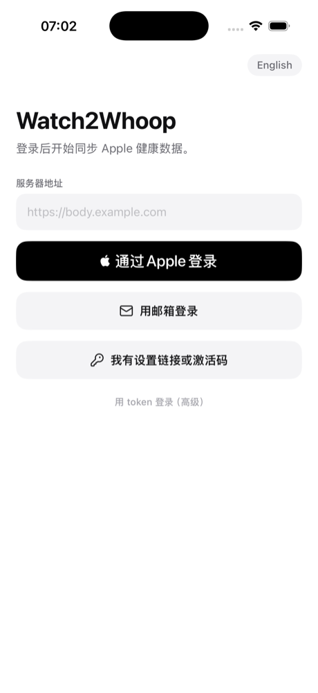 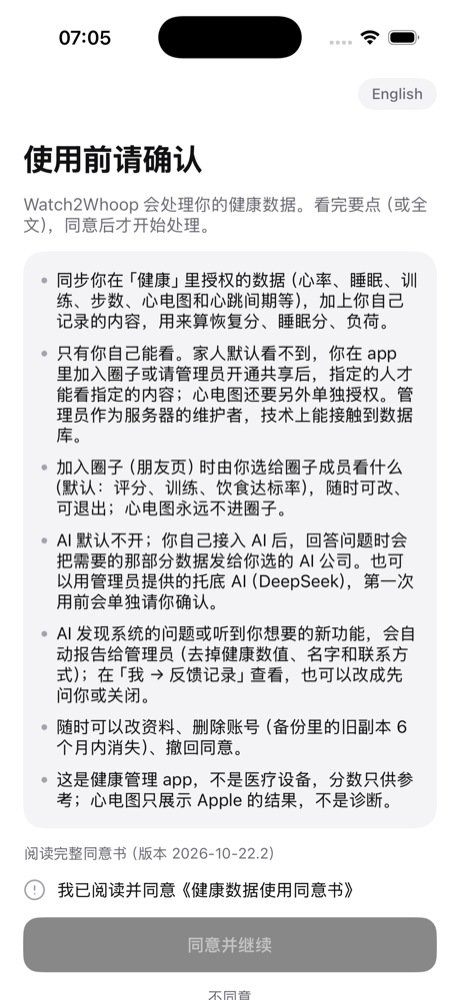 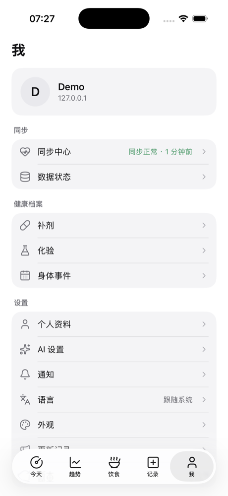 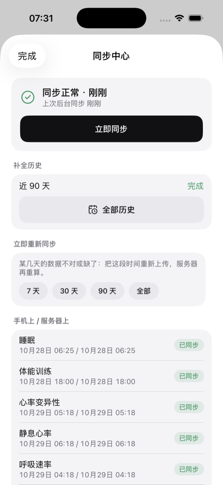

N6 的 Jarvis：菜单（浅色 / 深色）、按住说话、对话（浅色 / 深色）（iPhone 17 Pro Max 模拟器，iOS 26，假服务器，合成数据）：

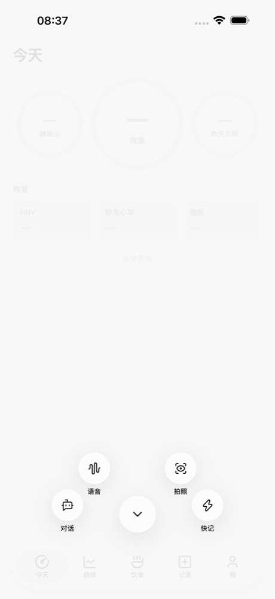 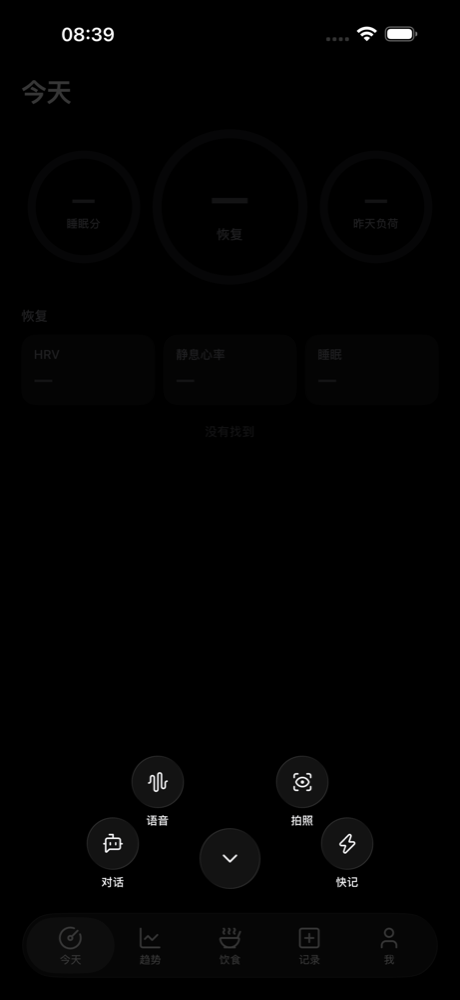 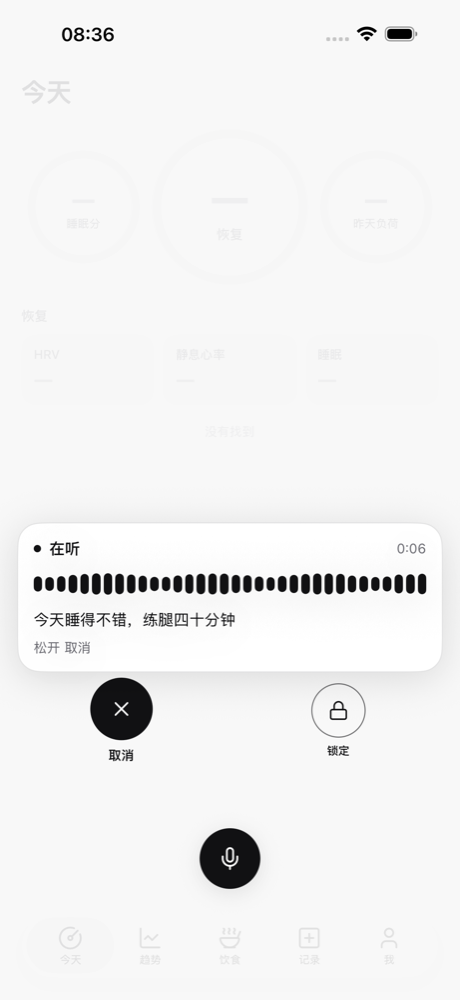 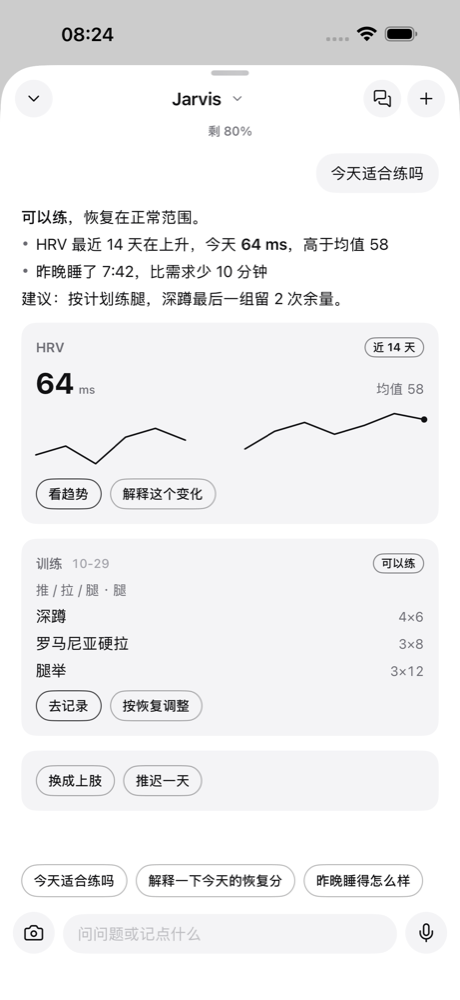 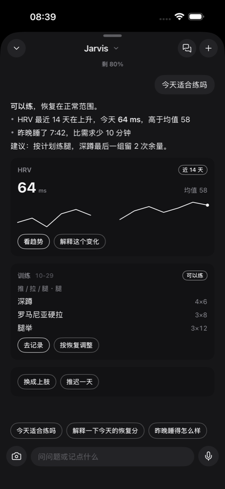

N0 的今天 tab（iPhone 17 模拟器，合成数据，浅色 / 深色）：

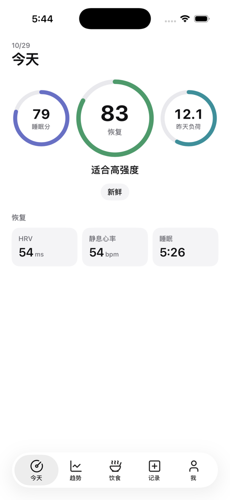 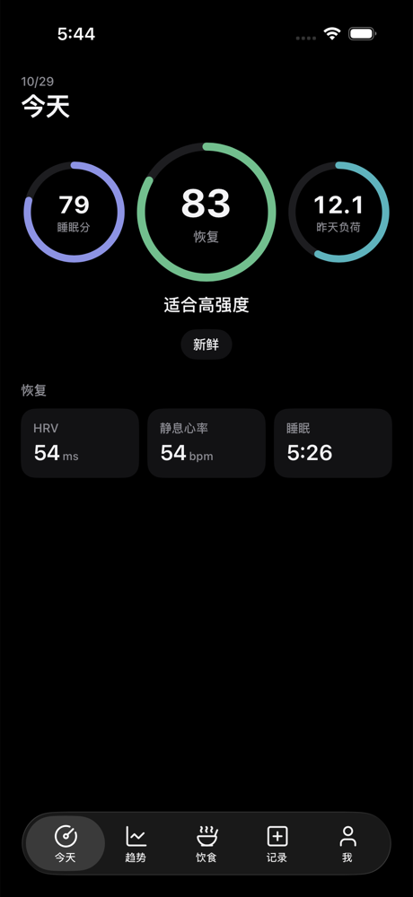

N3 的今天页、睡眠详情、讲解弹层（同样是合成数据）：

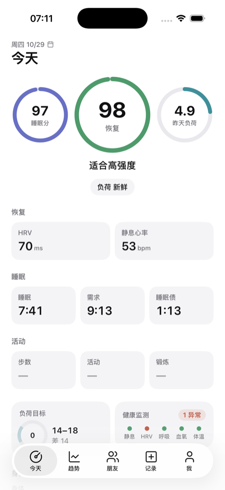 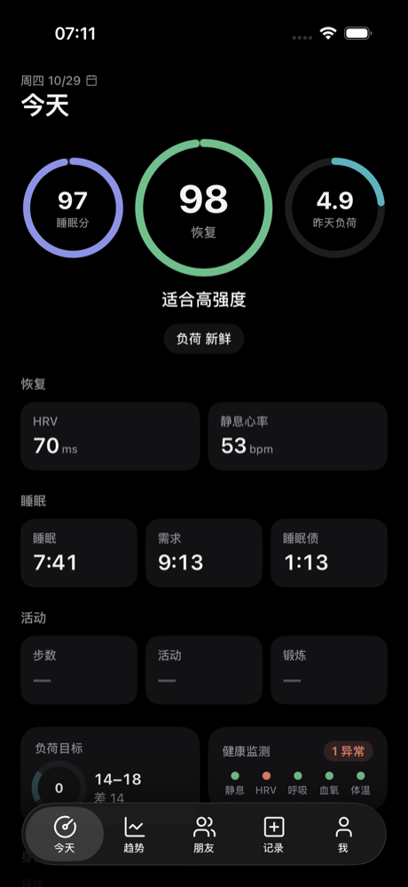 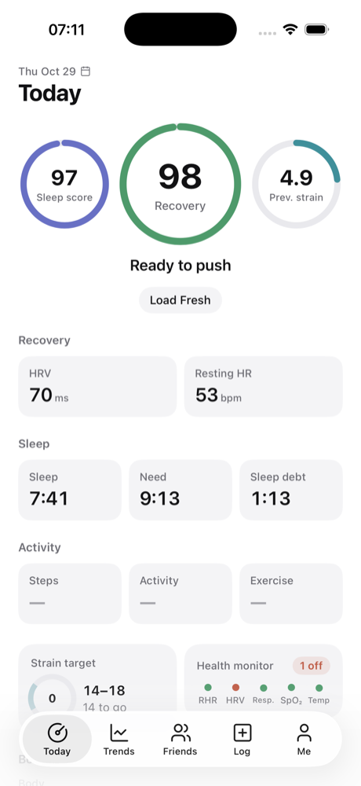 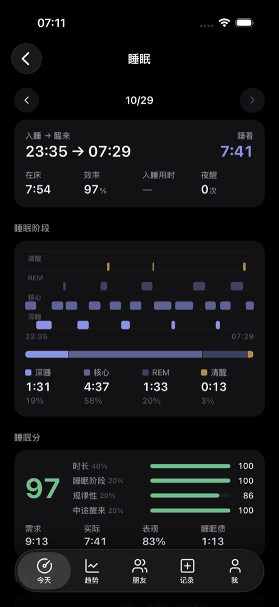 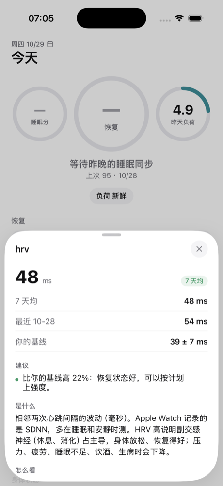

**发布**（`apps.md` 第 4 节）

- 版本号 1.0.9，build 号每上传一次加一（`W2W_BUILD_NUMBER`）。
- 签名值写在本地的 `Watch2Whoop.local.xcconfig`，和 Flutter 版一样。
- Xcode → Archive → 上传到 App Store Connect 的**同一条 app 记录**。
- 先给 TestFlight 内部组用一周，再给外部测试用户。
- 发布当天在新提交上打 `app-ios-v1.0.9`，删掉旧的 1.0.9 tag 和 Release（#340）。

**回退**：TestFlight 装回 1.0.8。Flutter 项还在，不用重新登录。

## 11. 还没定 / 风险

1. **OW SDK**：1.0.9 不带 Open Wearables SDK。所以发布前，所有用户都要切到同步引擎的 `app` 模式（#219，`apple-sync-engine-app-contract.md` 第 7 节）；否则 N8 要通过 SPM / 二进制把 OW iOS SDK 加回来。**请负责人定**。
2. **iOS 16 还是 17**（C1）。要看测试用户的系统版本；决定之后只改一行配置。
3. **Swift 6 严格并发**（C9）：N8 改写完同步代码之后再评估。
4. ~~算法包签名的私钥~~：已定（#340 中控），放在部署者本机，实现见第 6.3 节。还剩一步：部署者生成两把钥匙，然后把公钥填进 `AlgoSigningKeys.swift` 和 `signing-keys.json`。
5. ~~全量恢复的流量~~：已定（N2）。每页最多 500 条变化，原始数据每页最多 20000 行，都按天、从新到旧。90 天以前的原始数据只在 Wi-Fi 下拉，由 app 判断。
6. **长事务会让拉取变慢**：拉取要等「还在运行的最老事务」结束，才能看到它之后的变化。几分钟的大导入期间，别人的拉取也会晚几分钟看到变化。这是为了不丢变化，故意这样设计的。

---

## English summary

`apps/ios/` is the new pure-SwiftUI iOS app (#340), replacing the Flutter app. The Flutter app stays at 1.0.8 and gets bug fixes only. The native app keeps the same bundle ID and team, so TestFlight upgrades it in place.

**Decisions**
- iOS 16+, using ObservableObject (not Observation).
- XcodeGen 2.46.0 generates the project; the `.xcodeproj` is not committed.
- SPM dependencies: GRDB 7.11.1 only.
- Bilingual UI: every user-facing string is written `tr("中文", "English")`.
- Colour tokens mirror `app.css`, and CI compares the two.
- Icons are Lucide only, generated by a script.

**Modules**
- App: entry point, account session, tab bar (Friends replaces Food while the `friends` flag is on).
- DesignSystem.
- Networking: Bearer token, 401 means sign in again, retries with backoff for idempotent requests.
- Auth: Keychain, plus migration from the Flutter app.
- Storage: one GRDB database per account, with append-only migrations.
- Sync: coordinator, legacy and delta remotes, and an offline queue that is FIFO per group, idempotent by `client_id`, and keeps failed or conflicting writes for the user to resolve.
- Algorithms: JavaScriptCore runtime with calling convention api 1, `OBS.call(name, json) -> json`. Downloaded bundles are checked by sha256 and an Ed25519 signature before use.
- HealthSync: byte-for-byte copies of the Flutter app's SyncEngine, RawSync and Backfill, compiled against a tiny `Flutter` shim package.
- Features: one folder per page.

**Local database**
- Tables: `meta`, `docs` (server views as they came), `sync_cursors`, `outbox`, raw HealthKit tables (`hk_*`), `daily_metrics`, `sleep_sessions`, `daily_scores` (with `algo_version` and `origin`), `records` (every user-record kind), `algo_bundles`.
- Excluded from backups, readable after first unlock, deleted on sign-out.

**Sync**
- Pages read only the local database, call `sync.refresh` for fresh data, and write locally first, then enqueue.
- N0 pulls through the existing endpoints.
- N2 (implemented, behind the flag `native_sync`; section 7.3) adds:
  - A per-user change log, `sync_changes` (migration 970). Triggers on every mirrored table write to it, so imports, scoring, the record endpoints and the AI's writes all count. `data_version` is the user's newest seq.
  - `POST /v1/sync/pull`. Streams are `scores`, `daily`, `sleep`, `records`, `docs` (only "stale" notices) and `raw`. A full restore runs newest day first. Incremental pages only include transactions older than the oldest one still running, so a late commit is never skipped.
  - `POST /v1/sync/push`. It goes through each record endpoint's own code, with one transaction per mutation, and is idempotent by `client_id`.
  - `client_id` on the journal, meal template, recipe and training day endpoints.
  - `dirty_days` in the HealthKit upload's answer.
  - Silent pushes to devices registered with `silent: true`. Nothing runs when APNs is not configured.
  - `PUT /v1/users/me/scores/app`:
    - Rows are only accepted when they use the server's own algorithm version.
    - A Python spot check runs for the first upload of each bundle version, then at most every 6 hours. If it finds a difference, the server's row is stored, the user goes back to server scoring, and a recompute is queued.
    - While the app scores a user, the hourly and nightly jobs only fill in days whose inputs changed more than 2 hours ago that the app has not uploaded since.
    - The admin command is `body-engine app-scores status|server|app`.
- N1 adds `GET /v1/algo/manifest` and the bundle download. N2 adds an Ed25519 `signature` and `key_id` to the manifest (section 6.3):
  - The maintainer signs on their own machine with `body-engine algo-sign --key secrets/algo_signing_key`.
  - The app has two public keys built in (`AlgoSigningKeys.swift`, current and next).
  - Release builds refuse unsigned bundles.

**Migration from the Flutter app**
- Copies the account and ingest tokens from the `flutter_secure_storage_service` Keychain items.
- Takes the server origin from `flutter.w2w.config.v1` and the language from `flutter.w2w.lang.v1`.
- Sync anchors are shared as they are.
- Flutter items are kept so a rollback to 1.0.8 still works; native sign-out removes them.

**Pages**
- N3: Today, sleep and explain sheets. A page that needs several documents pulls them in parallel with `DocPuller`. The N1 bundle runs through `OpenBodyScoreRuntime` (its own `OpenBodyScore` entry points). `LocalScoring` computes a day from the local raw tables and fills only days the server has not scored. It stays idle until N8 writes `hk_samples` and N2 restores raw data; it cannot serve `rmssd` users (no beat-to-beat table) and cannot match the server's long baselines with a short local history.
- N4: Trends and reports.
- N5: all records and the Food tab.
- N6: Jarvis (section 9.2).
  - `JarvisLayer` sits over the tabs (one line in MainTabView). Its key opens a Mission-style dial: the keys slide out to both sides, then rise onto an arc centred below the key. The keys are Liquid Glass on iOS 26 and material discs before that.
  - Holding the key starts on-device speech recognition: slide up-left to cancel, up-right to lock.
  - `JarvisChat` streams `POST /v1/assistant/chat` as SSE through `APIClient.eventStream`. It resumes dropped turns from `/events?after=`, waits for confirmation on deletes, keeps conversations, switches the AI and asks for the fallback consent.
  - Cards are native views by `show_card` type, with a generic fallback.
  - Other pages call `JarvisRouter.ask(prompt:)`.
  - Tests use a fake SSE server (StubProtocol). `scripts/fake_jarvis_server.py` serves simulator demos.
- N7: Circles.
- N8: Me, settings, onboarding, the sync center, and porting the sync engine's Dart side to Swift.
  - Sign-in: Apple, e-mail code, setup QR code / link (`POST /v1/web/login-code` with `client: app` returns a device token), activation code.
  - The consent, profile and Health access steps follow once.
  - The sync host (`Features/Sync/`) drives the copied engine, backfill and RawSync. BGTasks and observers are registered at launch. No Open Wearables SDK.
  - A simulator upgrade from 1.0.8 kept the sign-in and the anchors. Only the engine's one-time "recent 48 hours" pass resent samples, and the server skipped them by UUID.

**Testing and CI**
- XCTest unit tests run on the simulator in the CI job "iOS native", which runs only when `apps/ios/**` changes.
- Simulator demos use a throwaway database with synthetic data.

**Open questions**
- The OW SDK is not included, so every user must be in engine `app` mode before 1.0.9.
- iOS 16 or 17.
- Swift 6 strict concurrency.
- The signing key is decided (the maintainer's machine). What is left is to generate the keys and fill them in.
- Full-restore traffic is decided: pages of 500 changes or 20,000 raw rows, and raw data older than 90 days on Wi-Fi only.
- A long transaction delays what pulls can see until it ends. This is on purpose, so that no change is lost.
