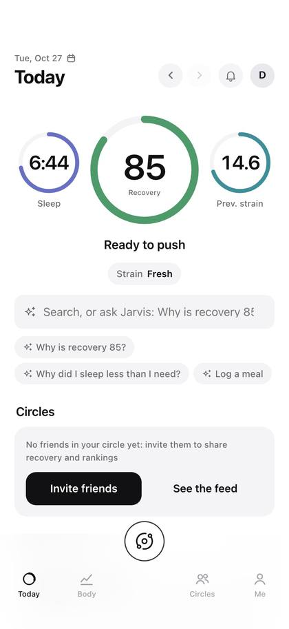
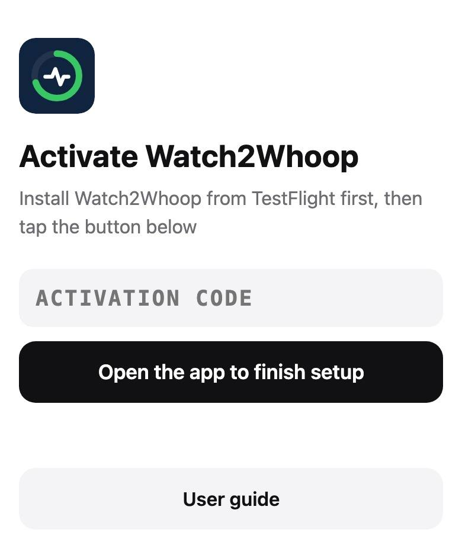
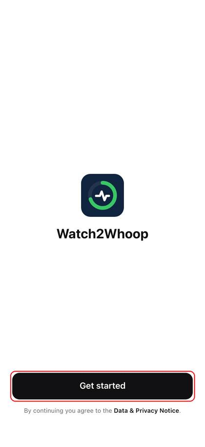
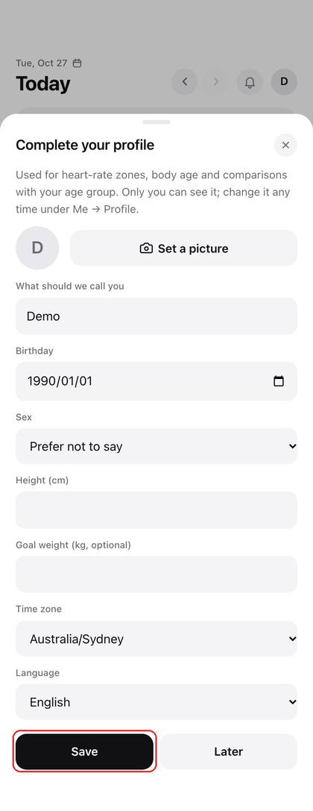
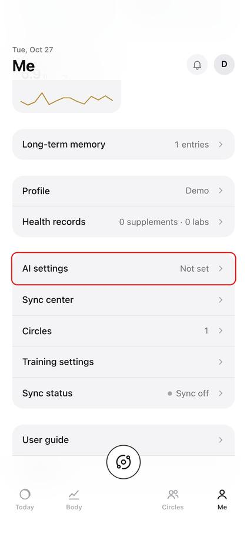
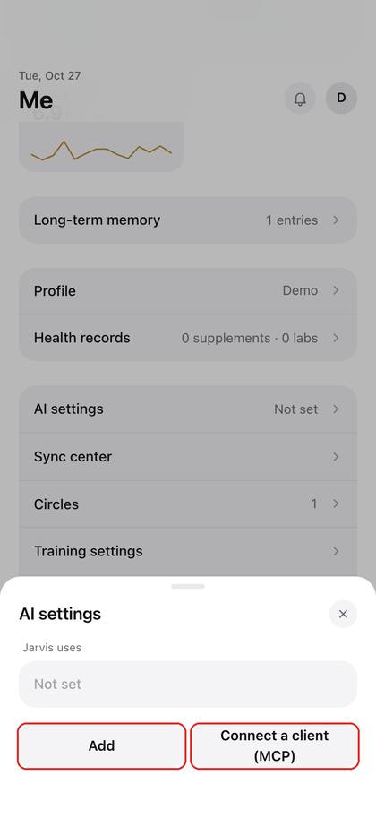
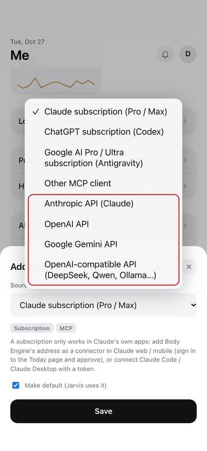
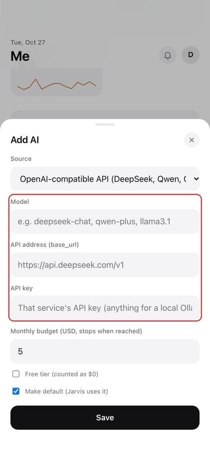
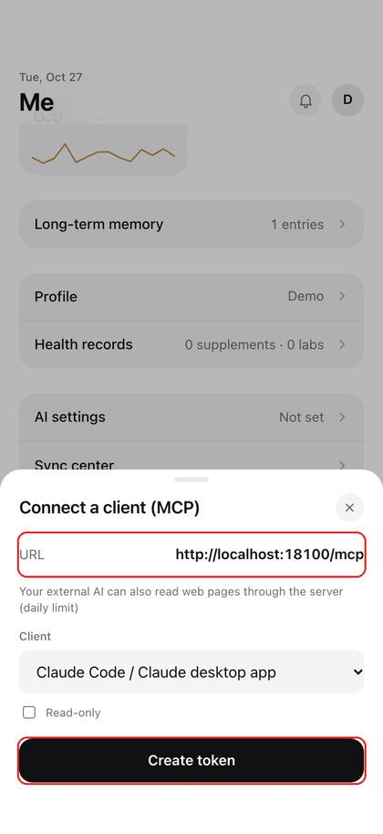
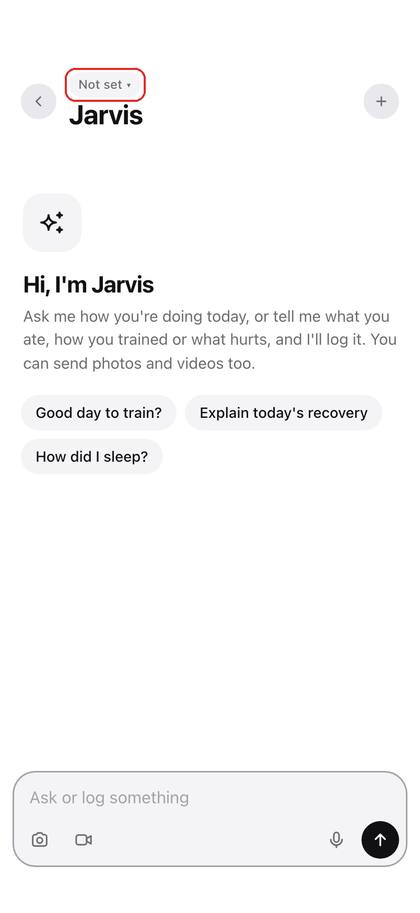

# Watch2Whoop Handbook

[中文](tester-handbook.md) · English

<!-- W2W:HELLO -->

**Watch2Whoop is a body database for your AI.** Your Apple Watch data flows in automatically and becomes recovery, sleep and strain scores; every meal, workout and lab report you mention is stored, and your AI can pull it up and analyse it at any time.

**You need an AI.** There are no input boxes and no "log" buttons here: what you ate, how you trained, your weight, lab reports, anything that feels off — you **tell your AI**, by typing, speaking, a screenshot or a photo, and it logs it for you. The pages are only for looking at charts and scores.

The scores are based on medical research literature. They are a lifestyle guide and **not a medical device**: don't use them to diagnose or treat anything, and see a doctor if you feel unwell.

Features marked "in beta" are being opened in batches: if you can't see one in your app yet, it hasn't reached you — there is nothing to set up.

## Contents

- [How to use: just talk to your AI](#how-to-use-just-talk-to-your-ai)
- [Before you start](#before-you-start)
- [Set up the app](#set-up-the-app)
- [Connect your AI (the core)](#connect-your-ai-the-core)
- [Talk to Jarvis](#talk-to-jarvis)
- [Pages at a glance](#pages-at-a-glance)
- [Sync center](#sync-center)
- [Friends and circles](#friends-and-circles)
- [When something goes wrong](#when-something-goes-wrong)
- [FAQ](#faq)

## How to use: just talk to your AI

**One rule: whatever you want to log or ask, say it to your AI.** No buttons to find, no forms to fill in; type, speak, send a photo or a screenshot. The AI reads your data, logs things and does the maths; the pages just show the results. Haven't connected an AI yet? See "Connect your AI" first.

Here are some real-world requests. Use them as they are or in your own words.

**Meals**

- (photo of lunch) Log my lunch
- Breakfast: two eggs, a glass of unsweetened soy milk, a slice of wholemeal bread
- Dinner was the same as yesterday
- I only ate half the rice at that meal, fix it
- Delete the entry I just logged by mistake
- How much protein am I still short today? What should I have for dinner?
- Save "egg and oats breakfast" as a quick meal
- Just had a glass of water (water log, in beta)

**Training and plans**

- Plan next week's training for me, 4 days a week
- My recovery is poor today, swap in something lighter
- I'm busy on Wednesday, move leg day to Thursday
- Chest today: bench press 4×8 60 kg, incline dumbbell press 3×10 20 kg
- My shoulder hurts, stop giving me overhead presses
- I can't do this exercise, swap in a similar one
- How many times did I train this week? Which muscle group am I neglecting?

**Weight, sugar, supplements, labs**

- Weight this morning 78.4
- (photo of the scale) Log this
- How much added sugar have I had today? How much is left?
- I take one fish-oil capsule and 5 g of creatine a day, add them
- I've stopped the fish oil
- (photo of a lab report) Enter these results
- How has my uric acid trended over the last few tests?

**Recipes, products and shopping**

- Suggest a few high-protein, low-fat dinners
- Log one serving of "tomato chicken pasta"
- Save this recipe: (paste the recipe)
- (photo of a price tag or receipt) Save this to my products
- Make a shopping list from this week's menu
- Bought the milk and eggs, tick them off the list
- What can I cook for dinner with what's at home? The milk expires next Wednesday (At home, in beta)

**Understand your scores, plan your day**

- How's my recovery today? Should I train?
- Why is my recovery score so low today?
- How did I sleep last night? When should I go to bed tonight?
- How is my body age calculated? How can I improve it?
- How much more strain can I take today?

**Reviews and reports**

- Give me this week's report
- Compared with last month, how have my weight and sleep changed?
- Which habits have affected my recovery the most lately?
- Note: headache this afternoon, had a coffee

**Don't know how something works, data looks wrong, found a bug?** Just say so too — see "When something goes wrong".

## Before you start

**Watch2Whoop is used in the iPhone app only** (your Apple Watch data syncs through it). The iPhone web version (Safari, "Add to Home Screen") is retired and the computer browser is no longer maintained separately; opening the web version points you to the app.

- **Activation link**: a link (or QR code) your admin sends to you alone. Don't forward it. It can be reused: after switching phones or reinstalling the app, just tap it again.
- **TestFlight invitation email**: sent to your Apple ID email address.
- **An AI**: see "Connect your AI".

## Set up the app

### ① Install the app

Open the TestFlight invitation email → "View in TestFlight" → install TestFlight from the App Store as prompted → "Accept" → "Install".

### ② Tap the activation link

On your iPhone, tap the activation link from your admin (or scan the QR code with the camera) → "Open the app to finish setup" → when "Open in Watch2Whoop" pops up, tap "Open".

<!-- W2W:SETUP -->

Server, health sync and Today page sign-in are all set up in one go — **no codes to type**.

### ③ Allow Health access

"Turn On All" → "Allow". Read-only; nothing is written to Health.

*This screenshot is the iOS system sheet, captured on an iPhone set to Chinese; yours appears in your iPhone's language.*

### ④ Get started

Tap "Get started" → fill in your profile → "Save". The Data & Privacy Notice and the Jarvis AI Notice in the small line below the button open in full.

 

### ⑤ Connect your AI

See the next section, "Connect your AI".

### ⑥ Wait for the first sync

The first sync pulls the last 90 days and takes a few minutes to a quarter of an hour: keep the app open and the phone unlocked. After that the app syncs in the background on its own.

### ⑦ Read older history (optional)

During setup you can pick "Last 90 days" (default) or "All history". To get older data later: "Me" → "Phone sync" → "Read range" → "All history". The app reads Health directly, no export file needed; a lot of data can take from tens of minutes to a few hours: keep the app open and the phone unlocked, and if it stops it carries on the next time you open the app. The Today page shows "Importing history x%". If you have the Sync center (in beta), choose the range under "Re-sync now" there — see "Sync center".

## Connect your AI (the core)

Once the app is set up (steps above), tap "Me" at the bottom → "AI settings" at the very bottom. Pick one of three ways.

 

"Jarvis uses" at the top of "AI settings" picks which AI is active (the fallback AI is always there); you can also tap the name at the top of the chat to switch. If your own AI is disabled or deleted, Jarvis falls back to the fallback AI automatically.

### Option 1: Jarvis fallback AI (the easiest)

No account to sign up for; it works as soon as it's enabled. It runs on DeepSeek, about ¥3 a month; what's left is shown as a percentage in "AI settings" and in the chat. When you use it, your body data is sent to DeepSeek for processing; the Jarvis AI Notice says so, and you agreed to it when you tapped "Get started". You can withdraw at any time under "AI settings".

### Option 2: your own API key

"AI settings" → "Add" → under "Source" pick the provider you have a key for (for DeepSeek or Qwen choose "OpenAI-compatible API"; for a free Google AI Studio key tick "Free tier") → fill in the model, API endpoint, API key and monthly budget → "Save".

 

The key is uploaded once and afterwards only its last 4 characters are shown; it stops automatically when the monthly budget is used up. The Gemini free tier has request limits, so you may have to wait; on the free tier Google may also use what you send to improve its products — if that bothers you, use a paid key or another option.

### Option 3: your Claude / ChatGPT / Google AI subscription

For people who use the Claude desktop app / Claude Code, Codex, or Antigravity on a computer. "AI settings" → "Add" → choose "Claude subscription", "ChatGPT subscription" or "Google AI Pro / Ultra subscription (Antigravity)" → "Save" → "Connect a client (MCP)" → pick the client → "Create token", then follow the 3 on-screen steps on your computer.

**Claude web / mobile and ChatGPT (developer mode) need no token**: add the address shown at the top of "Connect a client (MCP)" as a connector there; it opens the Today page, check the app name and the return address, then tap "Approve". Connected apps are listed under "Connect a client (MCP)" and can be disconnected at any time. Personal ChatGPT plans may only be able to read, not write, for now.

Google AI Pro / Ultra: use Antigravity (desktop app, IDE or the `agy` CLI; Antigravity's free tier works too, with lower limits). Gemini CLI no longer accepts subscription sign-in since 2026-06-18 and only works with a paid Gemini API key. The Gemini web / mobile app's "custom apps" are open to users in the US only, so they cannot connect for now.

The token is shown only once; when you no longer need it, "Revoke" it in the same place.

## Talk to Jarvis

At the bottom centre of every page is a round Jarvis icon button, with no text on it. Tapping it, holding it and the 4 keys it opens all start there.

**Tap once**: a light runs once round the button and brings out 4 keys, always in the same places:

| Key | What it does |
|---|---|
| Chat | Opens the full chat page |
| Voice | No need to keep holding: starts recording straight away; tap "Done" when you've finished |
| Photo | Opens the camera; the photo you take goes straight to Jarvis, handled as "log this meal from a photo" |
| Quick log | A half sheet: your 3 most-used quick meals, "workout done as planned", weight (it only fills the box; add the number, then send), and water 250 ml if you have the water feature. One tap sends it to Jarvis to log |

Tap the button again, or the empty space beside it, to close the menu.

**Hold to talk**: no need to open the menu first. Hold the icon button for about half a second and it starts recording, with a waveform and a timer on screen (up to 60 seconds):

- Let go when you're done: it turns your speech into text.
- Slide up-left to "Cancel" and let go: the recording is thrown away and nothing is sent.
- Slide up-right to "Lock" and let go: locked, so you can take your finger off and keep talking; tap "Done" when you're finished.

The text appears first under "Check the text". **You can fix any mistakes, and nothing goes to Jarvis until you tap "Send"**; "Cancel" or a tap on the dimmed area beside it sends nothing. It also corrects look-alike words using your own exercises, quick meals, supplements, recipes and product names (it only reads your own data and keeps nothing).

**Half-sheet answers**: for what you send by voice, photo or quick log, Jarvis's answer rises from the bottom as a half sheet (as tall as its content, at most 80% of the screen), with the same cards as the chat page; what you said shows as a bubble with a waveform icon and the length. Tap "Continue" or drag it up to go to the full chat page (still the same conversation); drag it down or tap the dimmed area to close it. Reopen it within 10 minutes and you carry on with the same conversation.

That is how it works with the Jarvis fallback AI. If you picked your own AI (an API key or a subscription), the icon button just looks different: one tap opens the chat page, there is no menu, and you can't hold the icon button to talk. If no AI is set up yet, it points you to "AI settings".

> You: (photo of lunch) Log my lunch
> AI: Logged to today's lunch: about 150 g of rice, about 120 g of steamed fish, stir-fried greens… about 620 kcal and 38 g of protein in total. Tell me if a portion is off and I'll fix it.
> You: (screenshot of a lab report) Enter these
> AI: Entered 12 results from 18 October: uric acid 430 μmol/L (high), ALT 45 U/L…
> You: Legs today, 50 minutes, squat 5×5 100 kg
> AI: Done: legs, 50 minutes, squat 5 sets × 5 reps at 100 kg.
> You: How's my recovery today? Should I train?
> AI: Recovery is in the middle band and sleep was short. Go ahead with the plan, but do one or two fewer sets on leg day.

For logging, the AI does it straight away and tells you what it logged; if it's wrong, say so and it fixes or undoes it. **Deleting and undoing** ask you to confirm first, and only run when you tap confirm.

**Cards (in beta)**: Jarvis's answers can carry small tappable cards, so you don't have to dig through the pages:

- Food card: progress rings for calories and protein; tap any entry you just logged to change the portion or delete it, and undo a mistake right away; also suggested meals, recipes, quick meals and the shopping list.
- Workout card: today's planned exercises.
- Metric cards: recovery, strain, stress, body age, weight, labs, the weekly report and more as small charts, compared with the previous period.

Three buttons next to the input box:

| Button | What it does |
|---|---|
| 📷 Photo | Take a photo or pick from the library, up to 8 at a time (meals, the scale, lab reports, watch screenshots) |
| 🎬 Video | Pick a video; up to 8 frames are extracted, and any speech in it is transcribed into the input box first |
| 🎤 Hold to talk | Hold to speak, release to transcribe (up to 60 seconds). With the Jarvis fallback AI it works like the icon button: slide up-left to cancel, up-right to lock, and the text shows first under "Check the text" for you to fix, sent only when you tap "Send"; with your own AI the text goes into the input box so you can check and fix it before sending, and sliding up cancels |

Speech is transcribed on the server, never sent to a third party, and the recording is deleted right after. In the app, iOS asks for the microphone the first time you hold to talk: choose Allow. If you chose Don't Allow, the page says the microphone is off; tap Open Settings and turn the microphone on. How it differs between app versions:

| App version | How voice works |
|---|---|
| 1.0.6 | Holding the icon button is the same as a tap, so it only opens the menu; the "Voice" key opens the half sheet and says recording isn't available here. Use the 🎤 dictation key on the keyboard: tap the input box, then the 🎤 on the keyboard |
| 1.0.7 and later | Holding the icon button, the "Voice" key and the 🎤 in the chat page are all transcribed on the server; the result shows first, you can edit it, and it is sent only when you tap "Send" |
| A later version | Adds recognition on the phone itself, with words appearing as you talk instead of after you let go; it isn't released yet |

Whenever the page says recording isn't available here, use the 🎤 dictation key on the keyboard, whatever the app version.

## Pages at a glance

What the pages at the bottom and "Me" contain (features in beta may not be there for you yet).

**Today**

- Your recovery, sleep and strain scores and the day so far; tap any metric or card for what it is, how to read it and how it compares with your own usual.
- Tap the date at the top to look back at any day.
- Tapping the sleep card opens that night in detail: stage timeline, what makes up the sleep score, and a comparison with your usual (in beta).
- The bell at the top right is Notifications (in beta): an in-app list; "Notification settings" has push by type and quiet hours.

**Trends**

- Long-term changes in recovery, sleep, heart rate variability (HRV), resting heart rate, weight, strain and more, from 7 days to a year, compared with the previous period.
- Metrics are grouped by category, and categories can be collapsed (in beta).
- The "Behavior impact" card: how things from your journal such as coffee, alcohol or stress affect the next day's recovery (in beta).

**Food**

- What you've eaten today, calorie and protein progress, recipes, quick meals, water (in beta).
- "My diet profile": your targets, limits and a sample day.
- The "Shopping" segment: this week's list (tap to tick off what you bought), the product library (size, price, nutrition per 100 g, health flags) and "At home" (in beta).
- Once the Friends page is open to you, Food moves into a segment of the "Log" page.

**Log**

- The training calendar: watch workouts and strength logs together, graded by intensity.
- The exercise library: demo pictures, tips, similar alternatives.
- Today's planned exercises (tips, suggested weights, banned-exercise warnings) with set-by-set logging, and "Add to plan" on an exercise's page (in beta).
- The muscle load map: which muscle groups you've worked too much or too little (in beta).
- If you've used Hevy, look for "Import from Hevy" under "Me" to bring your workouts in (in beta).

**Friends** (in beta)

- Circles, member cards and leaderboards — see "Friends and circles".

**Me**

- Your profile (picture, language, goal weight and so on) and AI settings.
- Long-term memory: what your AI remembers about you; you can read it and delete things.
- Health records: supplements, labs, body events.
- Feedback, sync center, user guide, settings.

## Sync center

"Sync center" under "Me" (in beta; needs app 1.0.7 or newer) puts the old "Phone sync", "Data updates" and "Data status" on one page:

- **Overall state and permissions**: see at a glance whether data is syncing; if a type of Health permission is missing, tap "Ask for Health access again", or "Open Settings" and follow the steps to the iPhone's Settings → Health → Data Access & Devices → Watch2Whoop.
- **Compare each type**: the date of the newest sample on the phone next to the newest on the server. "Not recorded" means the phone has none of this type (or no permission), "Not synced" means the phone has it but the server hasn't received it yet, "Synced" means it has arrived. VO₂ max only appears after outdoor activity.
- **Re-sync now**: pick the last 7 / 30 / 90 days, all history, or a number of days of your own; the app reads that range again and the server recalculates your scores. All history warns you first how long and how much battery it takes; keep the app open and the phone unlocked while it runs.

If it isn't open to you yet, the same things are spread over "Phone sync" and "Data status" under "Me".

## Friends and circles

The Friends page (in beta) lets you and your family or friends see each other's status, and **each person decides what to share**.

- **Circles**: create your own, or join someone else's with an invite code. The circle owner chooses how long a code is valid (from 1 day to forever) and can cancel or reset it at any time.
- **What you share**: you tick it yourself when you join. Scores (recovery, sleep, strain), workouts and nutrition adherence are ticked by default; detailed food, weight, labs, supplements, journal and long-term memory are not. You can change what you share or leave a circle at any time, and it takes effect immediately. **ECGs are never shared in circles.**
- **Member cards**: each person's status today plus a recovery bar for the last 7 days labelled by weekday; tap a day for that day's recovery, sleep and strain. What isn't shared shows "Not shared", and a person who hasn't synced today shows "Not synced". The card at the top, "What friends see", is you as your circle sees you right now. Tapping a card opens that person's read-only page, with only what they share with you.
- **Nicknames** (in beta): on a member card, "⋯" → "Set nickname" gives that person a name only you can see; it shows on cards, leaderboards and the feed, with their original name in small print next to it.
- **Leaderboards** compare you with your own baseline, not who has the bigger number. The **Feed** (in beta) shows circle members' workout posts of the day, likes and comments; posts appear automatically only for people who share "Workouts" with the circle.
- **Pictures** (in beta): upload your profile picture under "Me" → "Profile"; a circle owner can upload a logo for the circle.

From app 1.0.7 the first visit to the Friends page asks whether it may send notifications; you can say no and everything else still works, there just won't be push.

## When something goes wrong

Go in this order; most problems are solved by the first step.

### Step 1: ask Jarvis

Not sure how something works, the data looks wrong, a number makes no sense — ask your AI first. It can see your data, so most questions get answered on the spot.

- Why is today's step count lower than on my watch?
- Why didn't last night's sleep sync?
- What does "strain" on this page mean?
- How does this feature work?

### Step 2: check the Sync center

Data isn't updating, or one type stays empty: open "Me" → "Sync center" (if you don't have it yet, look at "Phone sync" and "Data status"), see which type is "Not recorded" or "Not synced" and whether a permission was turned off, then tap "Re-sync now". iPhone doesn't allow reading Health data while locked, so opening the app and keeping the phone unlocked for a few dozen seconds also catches it up.

### Step 3: send feedback

If you think it's a bug, or you want something that doesn't exist yet, just tell your AI: "this is a bug", "I wish it could…". The AI turns it into a report with the personal details removed (no health values, names or emails), sends it to the developers, and tells you its number (FB-number).

- Follow it under "Me" → "Feedback": Received, Seen by the developers, On the to-do list, Fixed… and you can withdraw a report the developers haven't seen yet.
- In "Feedback" you can choose how your AI reports: "Report automatically" (the default), "Ask me first" or "Off".
- Reports carry no screenshots. If you want to add something, tell the AI what happened and what you expected.

For account matters, the activation link and deleting your data, ask your admin.

## FAQ

**How do I log things?** Tell your AI — see [How to use: just talk to your AI](#how-to-use-just-talk-to-your-ai). There's no input box on the pages on purpose.

**Stuck at "Enter the 8-character invite code"**: you don't need to type it. Go back to the home screen and tap the activation link again; the app sets itself up.

**The activation link doesn't open the app**: first make sure Watch2Whoop is installed through TestFlight (without the app, the activation page shows the install steps); open the link in Safari, not directly inside WeChat (in WeChat, choose "Open in browser" first). No TestFlight invitation e-mail: ask your admin to add your Apple ID as a tester.

**Data isn't updating**: see step 2 of "When something goes wrong": open the app and keep the phone unlocked for a few dozen seconds; iPhone doesn't allow reading Health data while locked, and it catches up once unlocked.

**Used to sync with a Shortcut**: once the app syncs properly, delete the health-sync automations under Shortcuts → "Automation" to avoid duplicates and errors. The iPhone web version and Shortcut syncing are retired; the old handbook (Chinese) is kept only as an archive: [here](archive/tester-handbook-web-shortcut.md).

**Chinese or English interface**: it follows your phone's language by default. To change it: "Me" → "Profile" → "Language", pick 中文 or English. Your AI answers in that language too.

**Can I look at things without a network?** (in beta) Offline, the Today page shows the data last saved on your phone; water, weight and workout sets are kept on the phone and sent in order once you're back online. Chatting with the AI needs a network.

**New phone / reinstalled the app**: tap the same activation link again; your consent and profile carry over.

**Can I use these scores to diagnose anything?** No. The algorithms are based on medical research literature, but this is a lifestyle guide, not a medical device, and it can't diagnose or treat anything; if you feel unwell, see a doctor.

**Privacy**: only you can see your data; see the Data & Privacy Notice for details. When you use an AI, the conversation is sent to the AI service you chose.

**Delete your data**: ask your admin.

<!-- W2W:FOOTER -->
