# Watch2Whoop Handbook

[中文](tester-handbook.md) · English

<!-- W2W:HELLO -->

**Watch2Whoop is a body database for your AI.** Your Apple Watch data flows in automatically and becomes recovery, sleep and strain scores; every meal, workout and lab report you mention is stored, and your AI can pull it up and analyse it at any time.

**You need an AI.** There are no input boxes and no "log" buttons here: what you ate, how you trained, your weight, lab reports, anything that feels off — you **tell your AI**, by typing, a screenshot or a photo, and it logs it for you. The pages are only for looking at charts and scores.

> Screenshots in this edition still show the Chinese interface; they will be replaced with English ones once the English interface ships.

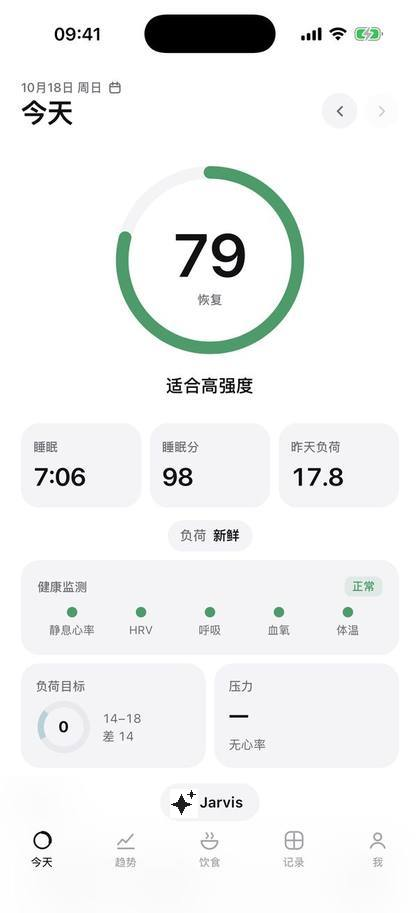

## Contents

- [How to use: just talk to your AI](#how-to-use-just-talk-to-your-ai)
- [Before you start](#before-you-start)
- [Set up the app](#set-up-the-app)
- [Connect your AI (the core)](#connect-your-ai-the-core)
- [FAQ](#faq)

## How to use: just talk to your AI

**One rule: whatever you want to log or ask, say it to your AI.** No buttons to find, no forms to fill in; type, speak, send a photo or a screenshot. The AI reads your data, logs things and does the maths; the pages just show the results. Haven't connected an AI yet? See "Connect your AI" first.

Here are some real-world requests. Use them as they are or in your own words.

**Meals**

- (photo of lunch) Log my lunch
- Breakfast: two eggs, a glass of unsweetened soy milk, a slice of wholemeal bread
- Dinner was the same as yesterday
- I only ate half the rice at that meal, fix it
- Delete the entry I just logged by mistake
- How much protein am I still short today? What should I have for dinner?
- Save "egg and oats breakfast" as a quick meal

**Training**

- Plan next week's training for me, 4 days a week
- My recovery is poor today, swap in something lighter
- I'm busy on Wednesday, move leg day to Thursday
- Chest today: bench press 4×8 60 kg, incline dumbbell press 3×10 20 kg
- My shoulder hurts, stop giving me overhead presses
- How many times did I train this week? Which muscle group am I neglecting?

**Weight, sugar, supplements, labs**

- Weight this morning 78.4
- (photo of the scale) Log this
- How much added sugar have I had today? How much is left?
- I take one fish-oil capsule and 5 g of creatine a day, add them
- I've stopped the fish oil
- (photo of a lab report) Enter these results
- How has my uric acid trended over the last few tests?

**Recipes and shopping**

- Suggest a few high-protein, low-fat dinners
- Log one serving of "tomato chicken pasta"
- Save this recipe: (paste the recipe)
- Make a shopping list from this week's menu
- Bought the milk and eggs, tick them off the list
- What can I cook for dinner with what's at home?

**Understand your scores, plan your day**

- How's my recovery today? Should I train?
- Why is my recovery score so low today?
- How did I sleep last night? When should I go to bed tonight?
- How is my body age calculated? How can I improve it?
- How much more strain can I take today?

**Reviews and reports**

- Give me this week's report
- Compared with last month, how have my weight and sleep changed?
- Which habits have affected my recovery the most lately?
- Note: headache this afternoon, had a coffee

### Something wrong or found a bug? Ask your AI too

Not sure how something works, the data looks wrong, a number makes no sense — ask your AI first. It can see your data, so most questions get answered on the spot.

- Why is today's step count lower than on my watch?
- Why didn't last night's sleep sync?
- What does "strain" on this page mean?
- I think this is a bug: (screenshot)

If it looks like a bug, give the AI the screenshot and what happened; it will turn it into a clear description you can forward to your admin. Later the AI will report bugs to the developers directly.

## Before you start

**On iPhone, Watch2Whoop is used through its app; on a computer, in a browser.** The iPhone web version (Safari, "Add to Home Screen") is retired; opening it there points you to the app.

- **Activation link**: a link (or QR code) your admin sends to you alone. Don't forward it. It can be reused: after switching phones or reinstalling the app, just tap it again.
- **TestFlight invitation email**: sent to your Apple ID email address.
- **An AI**: see "Connect your AI".

## Set up the app

### ① Install the app

Open the TestFlight invitation email → "View in TestFlight" → install TestFlight from the App Store as prompted → "Accept" → "Install".

### ② Tap the activation link

On your iPhone, tap the activation link from your admin (or scan the QR code with the camera) → "Open the app to finish setup" → when "Open in Watch2Whoop" pops up, tap "Open".

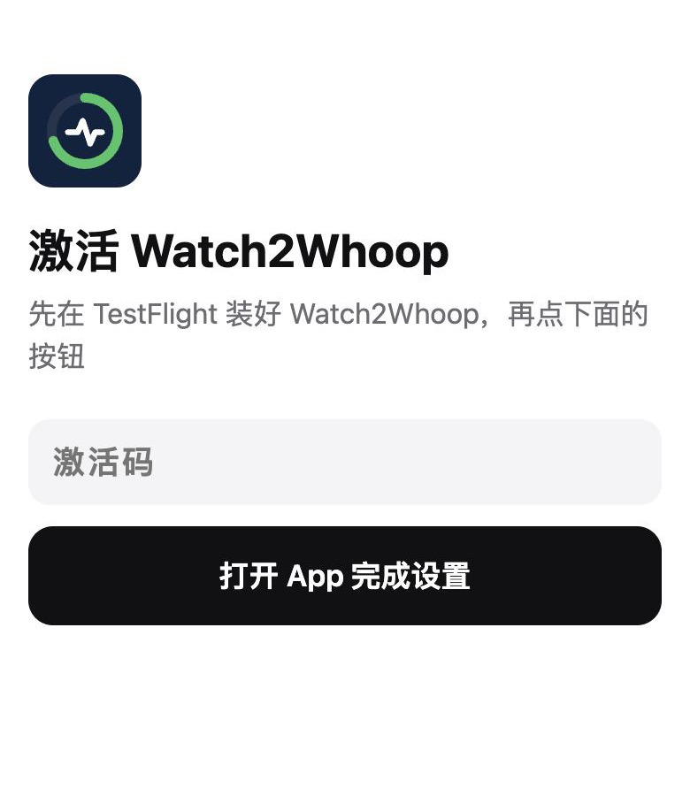

<!-- W2W:SETUP -->

Server, health sync and Today page sign-in are all set up in one go — **no codes to type**.

### ③ Allow Health access

"Turn On All" → "Allow". Read-only; nothing is written to Health.

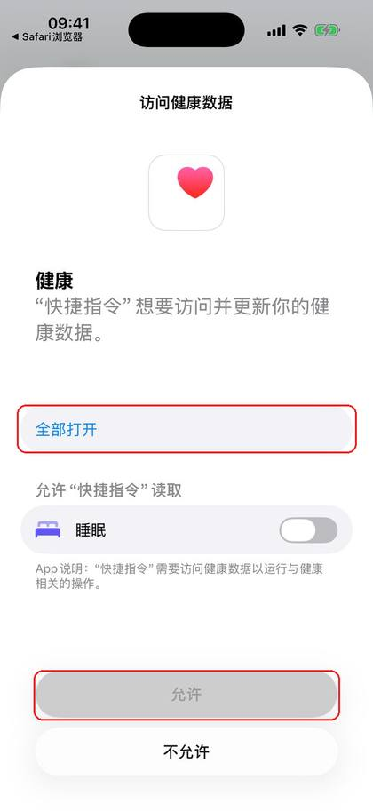

### ④ Consent

Tick the consent box → "Agree and continue" → fill in your profile → "Save".

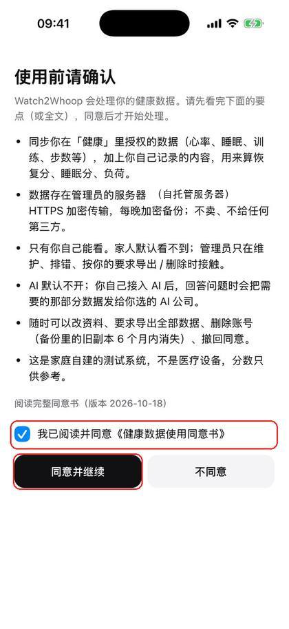 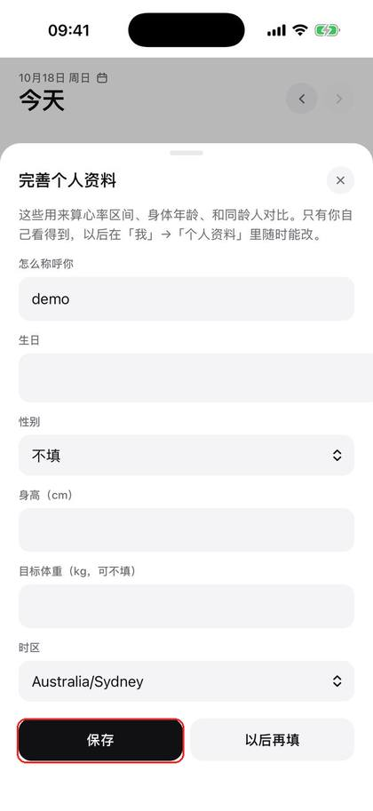

### ⑤ Connect your AI

See the next section, "Connect your AI".

### ⑥ Wait for the first sync

The first sync pulls the last 90 days and takes a few minutes to a quarter of an hour: keep the app open and the phone unlocked. After that the app syncs in the background on its own.

### ⑦ Read older history (optional)

During setup you can pick "Last 90 days" (default) or "All history". To get older data later: "Me" → "Phone sync" → "Read range" → "All history". The app reads Health directly, no export file needed; a lot of data can take from tens of minutes to a few hours: keep the app open and the phone unlocked, and if it stops it carries on the next time you open the app. The Today page shows "Importing history x%".

### On a computer

Open `body.example.com/app` in a browser. The first time: opening your activation link on the computer signs you in right away; you can also sign in with an e-mail code.

## Connect your AI (the core)

Once the app is set up (steps above), tap "Me" at the bottom → "AI settings" at the very bottom. Pick one of three ways.

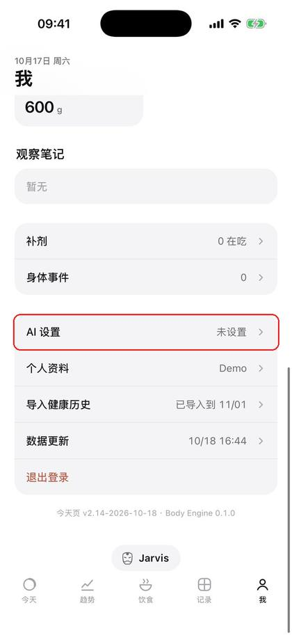 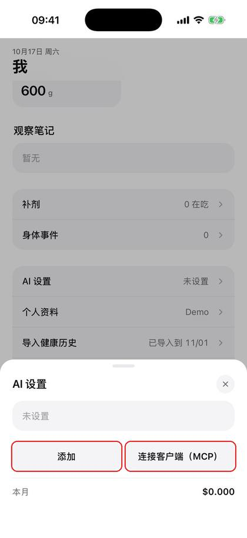

"Jarvis uses" at the top of "AI settings" picks which AI is active (the fallback AI is always there); you can also tap the name at the top of the chat to switch. If your own AI is disabled or deleted, Jarvis falls back to the fallback AI automatically.

### Option 1: Jarvis fallback AI (the easiest)

No account to sign up for; it works as soon as it's enabled. It runs on DeepSeek, about ¥3 a month. The first time you use it, it asks whether you agree to send your body data to DeepSeek for processing; it only works after you agree.

### Option 2: your own API key

"AI settings" → "Add" → under "Source" pick the provider you have a key for (for DeepSeek or Qwen choose "OpenAI-compatible API"; for a free Google AI Studio key tick "Free tier") → fill in the model, API endpoint, API key and monthly budget → "Save".

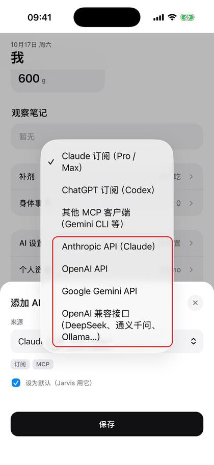 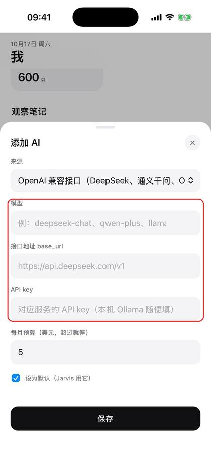

The key is uploaded once and afterwards only its last 4 characters are shown; it stops automatically when the monthly budget is used up. The Gemini free tier has request limits, so you may have to wait; on the free tier Google may also use what you send to improve its products — if that bothers you, use a paid key or another option.

### Option 3: your Claude / ChatGPT / Google AI subscription

For people who use the Claude desktop app / Claude Code, Codex, or Antigravity on a computer. "AI settings" → "Add" → choose "Claude subscription", "ChatGPT subscription" or "Google AI Pro / Ultra subscription (Antigravity)" → "Save" → "Connect a client (MCP)" → pick the client → "Generate token", then follow the 3 on-screen steps on your computer.

Google AI Pro / Ultra: use Antigravity (desktop app, IDE or the `agy` CLI; Antigravity's free tier works too, with lower limits). Gemini CLI no longer accepts subscription sign-in since 2026-06-18 and only works with a paid Gemini API key. The Gemini web / mobile app's "custom apps" are open to users in the US only, so they cannot connect for now.

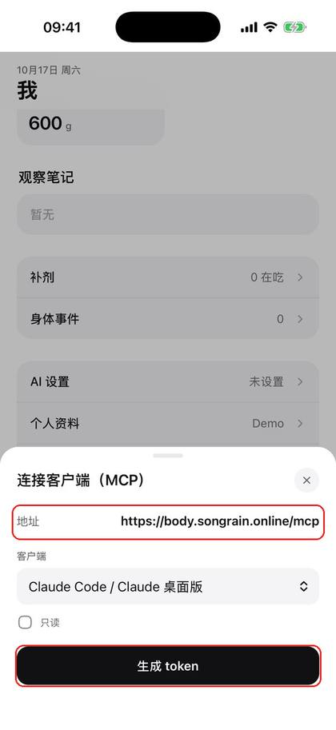

The token is shown only once; when you no longer need it, "Revoke" it in the same place.

### Chat with Jarvis in the app

Tap "Jarvis" at the bottom of any page to start a chat. If no AI is set up yet, it points you to "AI settings".

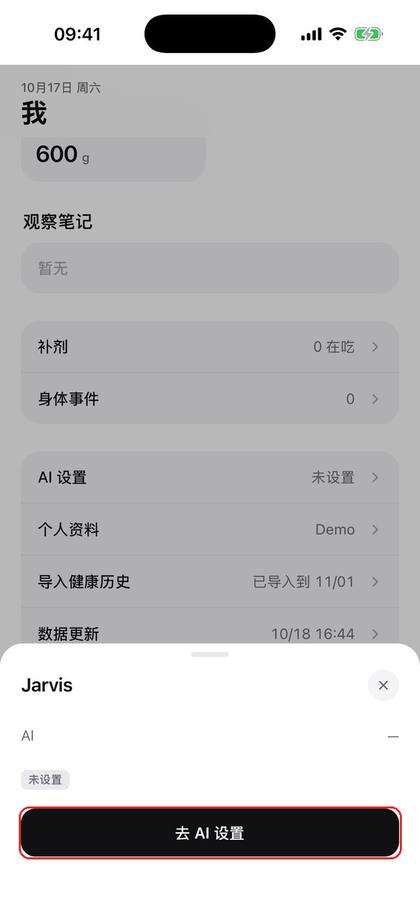

> You: (photo of lunch) Log my lunch
> AI: I see about 150 g of rice, about 120 g of steamed fish, stir-fried greens… about 620 kcal and 38 g of protein in total. Log it as today's lunch?
> You: (screenshot of a lab report) Enter these
> AI: I read 12 results: uric acid 480 μmol/L (high), ALT 41 U/L… Enter them as the labs from 18 October?
> You: Legs today, 50 minutes, squat 5×5 100 kg
> You: How's my recovery today? Should I train?

Before writing anything, the AI asks you to confirm; nothing is logged until you do.

Three buttons next to the input box:

| Button | What it does |
|---|---|
| 📷 Photo | Take a photo or pick from the library, up to 8 at a time (meals, the scale, lab reports, watch screenshots) |
| 🎬 Video | Pick a video; up to 8 frames are extracted, and any speech in it is transcribed into the input box first |
| 🎤 Hold to talk | Hold to speak, release to transcribe (up to 60 seconds); the text goes into the input box so you can check and fix it before sending; slide up to cancel |

Speech is transcribed on the server, never sent to a third party, and the recording is deleted right after. **If 🎤 does nothing, or says recording isn't available here**: tap the input box and use the 🎤 dictation key on the keyboard — it works just as well.

## FAQ

**How do I log things?** Tell your AI — see [How to use: just talk to your AI](#how-to-use-just-talk-to-your-ai). There's no input box on the pages on purpose.

**Stuck at "Enter the 8-character invite code"**: you don't need to type it. Go back to the home screen and tap the activation link again; the app sets itself up.

**The activation link doesn't open the app**: first make sure Watch2Whoop is installed through TestFlight (without the app, the activation page shows the install steps); open the link in Safari, not directly inside WeChat (in WeChat, choose "Open in browser" first). No TestFlight invitation e-mail: ask your admin to add your Apple ID as a tester.

**Data isn't updating**: open the app and keep the phone unlocked for a few dozen seconds; iPhone doesn't allow reading Health data while locked, and it catches up once unlocked.

**Used to sync with a Shortcut**: once the app syncs properly, delete the health-sync automations under Shortcuts → "Automation" to avoid duplicates and errors. The iPhone web version and Shortcut syncing are retired; the old handbook (Chinese) is kept only as an archive: [here](archive/tester-handbook-web-shortcut.md).

**New phone / reinstalled the app**: tap the same activation link again; your consent and profile carry over.

**Privacy**: only you can see your data; see the consent form for details. When you use an AI, the conversation is sent to the AI service you chose.

**Export / delete your data**: ask your admin.

<!-- W2W:FOOTER -->
