# AI 优先、功能随使用长出来：app UI 重构方案（v0.4，2026-10-25）

> 依据：[`ui-ai-first-research.md`](ui-ai-first-research.md)（同类产品调研）、现有今天页（`body_engine/src/body_engine/web/static/`）、
> [`ios-native-plan.md`](ios-native-plan.md)（#255，SwiftUI 原生化，已确认）、[`circles-redesign.md`](circles-redesign.md)（#269，圈子重构）。Issue：#279。
> **预览（以此为准）**：用线上现有的样式表和真实页面组件做的 7 个页面截图，第 13.1 节；做法见 [`ui-ai-first/preview.py`](ui-ai-first/preview.py)。交互流程原型 [`ui-ai-first/prototype.html`](ui-ai-first/prototype.html) 只用来看流程（第 1 天、模块上首页），它的样式不代表最终视觉。
> 这一版只有设计，不改线上代码。第 12 节是决定点：**D1–D11 负责人 2026-10-25 已全部按推荐通过；D13 定为并排三环；D12、D14 作废（视觉不变）。**
>
> v0.2 按负责人的两条修正改写：
> 1. 用户第一天就导入完整的 Apple 健康历史，趋势、基线、恢复分从第一天起都算得出来，所以**解锁不按「数据攒够了」来卡**；渐进是为了控制注意力和学习负担，不是控制数据。
> 2. 圈子是核心功能和推广抓手，**保持一级入口**，首页也要有圈子的露出和邀请入口。
>
> v0.3 按负责人的修正：今天页保持原来的风格，**一进来先看到恢复 / 睡眠 / 负荷三个核心分数的圆环**，放在最上面；AI 的晨报、重点、圈子、模块都排在圆环区下面。
>
> **v0.4 负责人决定：视觉保持当前线上的风格不变**（颜色、字体、卡片、图标、底栏外观都沿用现在的 `web/static` 样式）。v0.3 试过的全息 HUD、石墨精工两套视觉和底栏动态方案都不采用（D12、D14 作废，相关截图已删除）。今天页核心区定为**并排三环**（D13），用现在的环形样式和配色。这次重构**只改信息架构和交互**：结构、顺序、入口、交互方式。

## 0. 摘要

- **新范式一句话：打开 app 最上面是恢复 / 睡眠 / 负荷三个圆环，下面是「今天的 1–3 件事 + 圈子」，记录和提问都通过 Jarvis；首页上的模块由你的关注、Jarvis 在数据里的发现、你和 Jarvis 的互动决定，其他功能一个不锁，在「全部功能」里随时能看。**
- **底栏 5 格**：今天 · 身体 · Jarvis（中间的圆键，不变）· 圈子 · 我。饮食、记录变成模块和二级页。
- **今天页最上面是圆环区**：恢复（大环，居中）+ 睡眠、负荷（小环，两侧），用现在的环形样式和配色；环下是现在的状态词和负荷状态；AI 的东西都在下面，不取代它。
- **视觉不变**：颜色、字体、卡片、图标、底栏外观全部沿用现在的样式，只改结构、顺序、入口和交互（第 7 节）。
- **第 1 天**：导入历史 → Jarvis 给一份「你的身体概况」（3 个最重要的发现）→ 问你最关心什么（多选）→ 按回答和发现摆首页（3 个模块）→ 首页。
- **什么决定首页上有什么**（第 4 节）：① 关注点；② 数据里值得说的事（拐点、异常、里程碑），Jarvis 带出对应模块；③ 互动：问过的、Jarvis 用过的模块固定下来；④ 主动探索：「全部功能」随时打开任何模块；⑤ 使用天数只管节奏：每天最多主动介绍 1–2 个新模块。
- **不堆也不藏**（第 5 节）：首页最多 6 个模块，每个模块标出「为什么在这里」（关注 / 发现 / 用过 / 固定）；所有指标在「身体」页从第一天就全部打开，按关注展开、其余折叠成一行摘要；「全部功能」显示每个模块的状态（首页 / 看过 / 新），没有锁、没有进度条。
- **指标三层**：首页只有 3 个数；「身体」页里「你关注的」展开、其余分组折叠；每个指标点开是一眼 → 趋势 → 原始数据。
- **圈子**：一级 tab（里面按 #269 的方案：圈子切换条 + 成员 / 动态 / 排行榜）；首页常驻一张圈子卡（新动态、本周排行、邀请好友），没有圈子的人看到邀请卡。只改入口和布局，不动圈子接口。
- **和原生化一起做，不做两遍**：服务端出「首页布局」接口（服务器驱动），网页先按新设计做（开关 `ui_ai_first`），1.1.0 的原生今天直接做新设计。
- 工作量：服务端 6–8 人日，网页 12–16 人日（两期），原生并进 #255。

---

## 1. 问题和目标

**问题**（现状清单见调研第 0 节）：

1. **太多**：今天页约 13 张卡，趋势约 36 张图，「我」15 行以上，底栏最多 6 格。同类产品首页 3–4 个核心数，Oura 从 5 个 tab 合到 3 个（调研第 4、6 节）。
2. **数据第一天就全在，但没有人告诉你先看什么**：导入历史后所有卡片同时有数，新用户和老用户看到的一样多，分不清重点。
3. **AI 是一个按钮，不是主角**：产品定位是「身体数据层 + AI 脚手架，记录靠和 AI 对话」，但页面结构还是传统仪表盘。

**目标**：

1. 打开 app 3 秒内知道今天的状态和要做的 1–3 件事。
2. 所有「记」和「问」都通过 Jarvis；页面负责「看」。
3. 首页随使用变化：先放你关心的，Jarvis 发现值得说的事时再带出新的；每次只多一点，并且由 Jarvis 说明为什么。
4. 不藏东西：任何功能第一天就能打开，老用户不丢任何东西。
5. 圈子随时可达，分享和拉新一步就到。
6. 新设计直接作为 SwiftUI 原生页面的依据。

**不变的原则**：只有 iOS app 一个客户端；界面只放数字 / 图表 / 短标签，长文字留在接口里给 AI；中英双语；每个接口按用户鉴权；健康阈值放在 `params.py` 并写出处；心电图永不进圈子。

---

## 2. 新的交互范式：AI 是主入口和调度者

### 2.1 三个动作，三个位置

| 动作 | 位置 | 内容 |
|---|---|---|
| **说**（记、问、改计划） | 底栏中间的 Jarvis 键（现有 `jarvis_orbit`：点开 对话 / 语音 / 拍照 / 快记，按住直接说话，半屏回答） | 所有写操作：记饭、记训练、记体重、喝水、日记、化验单拍照、补剂、改计划 |
| **看今天** | 今天页 | 一句晨报 + 3 个核心数 + 重点 1–3 件 + 圈子卡 + 我的首页（模块）+ 今天的记录 |
| **看深入** | 身体页 | 核心 3 项的趋势 → 你关注的 → 全部指标（折叠）；每个指标三层 |

页面上几乎不放输入表单。现有的输入（快捷记餐、喝水加减、体重输入框、训练逐组）保留在模块页里给习惯点按的人，但不出现在今天页首屏。

### 2.2 AI 怎么调度界面

1. **在对话里出卡片**（已有：`show_card`，约 25 种）。按 ChatGPT Apps SDK 的边界收紧：一张卡只做一件事、最多两个按钮、能点开全屏（调研第 2.1 节）。
2. **把模块带到首页**（新）：Jarvis 第一次替你用某个功能、或在数据里发现值得说的事时，对话卡片下多一个「放到首页」按钮；回到今天页时模块带「新」标记出现。
3. **整理首页**（新工具 `manage_modules`）：「把喝水放到首页」「首页太乱了」→ 固定 / 移走 / 排序。普通写工具，不弹确认，可撤销。
4. **主动但有终点**：晨报一句 + 重点最多 3 件，没有「更多」（像 Pulse 一样有终点，调研第 2.1 节）。推送沿用现有 `notify`，不新增类型。

### 2.3 不同的 AI 怎么参与

| 用户的 AI | 卡片 | 「用过」怎么算 | 怎么带出模块 |
|---|---|---|---|
| Jarvis（托底 AI / 自己的 API key，页内对话） | 有 | 工具调用成功（`assistant_audit` 记了所有渠道） | 对话里出卡片 + 「放到首页」 |
| 订阅类（Claude / ChatGPT 客户端，远程 MCP） | 没有 | 同上，渠道 `mcp:<客户端>` | `get_briefing` 里的 `ui.suggest` 让 AI 说一句；用户下次打开 app，模块带「Claude 用过」标签出现 |
| 身体管家（Remote Control） | 没有 | 同上 | 同上 |

「用过」是服务端从工具调用记录里算的，和用哪家 AI 无关，符合「AI 可换、数据沉淀」的定位。

---

## 3. 信息架构

### 3.1 底栏：今天 · 身体 · Jarvis · 圈子 · 我

```
┌─────────────────────────────────────┐
│ 10月25日 周日                         │
│ 今天                                 │
│   ◯7:12      ◯◯ 72 ◯◯      ◯6.0      │ ← 圆环区：恢复大环居中，睡眠 / 负荷两侧
│   睡眠          恢复          负荷     │    点开 = 三层详情
│        适合高强度 · 负荷 新鲜          │ ← 现在的状态词和负荷状态
│ ✦ 恢复 72 · 适合练腿              ›  │ ← 晨报一句（点开 = 问 Jarvis）
│ 重点 · 3 件                          │
│   练腿 · 45 分钟          0/10  ›    │
│   00:30 前上床            00:30 ›    │
│   蛋白质还差              46 g  ›    │
│ 圈子                                 │
│   跑步搭子 · 3 条新 · 本周排行第 2      │ ← 常驻；没有圈子 = 邀请卡
│   [邀请好友] [看动态]                  │
│ 我的首页 · 5            （最多 6 个）  │
│   [饮食 用过] [训练 用过]              │ ← 每个标出为什么在这里
│   [入睡目标 关注] [HRV 发现]           │
│   [ ✦ Jarvis 发现：体重 3 周没变 ]     │ ← 发现卡（同时最多 1 张）
│ 今天的记录 · 全部 ›                   │ ← 有记录才出现
│ 全部功能 · 24 个，随时能看             │
├─────────────────────────────────────┤
│  今天   身体   ( ◎ Jarvis )   圈子   我 │
└─────────────────────────────────────┘
```

- **圈子是一级 tab**：负责人要求圈子是核心功能和推广抓手，入口不能藏。圈子 tab 里面完全按 [`circles-redesign.md`](circles-redesign.md)（圈子切换条 + 成员 / 动态 / 排行榜 + 邀请），和 circles-redesign 会话的 P1（`circles_by_circle`，按圈子分开显示成员）、P2（`circle_prefs`）对齐；这次只改入口和首页的露出，**不动圈子的数据接口**。底栏圈子图标在有新动态时带红点。
- **首页的圈子卡**：在「重点」下面、模块上面，常驻，不计入 6 个模块的上限，用户不能从首页移走（可以在圈子设置里静音，静音后卡片只剩邀请按钮）。内容：当前圈子名、新动态数、本周排行（相对自己基线的恢复 / 负荷排名，沿用现有排行榜）、最新一条动态、「邀请好友」「看动态」两个按钮。没有圈子的人看到「和朋友一起看恢复和排行」+「邀请好友」「输入邀请码」。
- **为什么是 5 格**：Jarvis 是中间的圆键，两边各两格最平衡。AI 不占 tab、做成随处可达的按钮，是 WHOOP / Oura / Fitbit 的共同做法（调研第 6 节）。「今天」「身体」对应 Oura 的 Today / Vitals；「圈子」是我们的增长入口；「我」放设置和全部功能。
- **「记录」不是 tab**：今天页底部「今天的记录」（有记录才出现，最多 3 条）→「全部」打开记录页（按天的时间线，筛选 训练 / 饮食 / 身体 / 日记）；「我」里也有入口；回看过去某天沿用「点日期开月历」。
- **「饮食」不是 tab**：当天摄入、喝水、快捷记录、每餐推荐、食谱、采购变成模块和模块页。

### 3.2 每个现有内容去哪

| 现在 | 新位置 |
|---|---|
| 今天：恢复圈 + 睡眠 / 睡眠分 / 昨天负荷 | 今天：3 个核心数（恢复 / 睡眠 / 负荷），睡眠分进睡眠详情 |
| 今天：负荷状态 chip、活动 | 身体；「活动」模块 |
| 今天：健康监测、压力、负荷目标 | 模块；健康监测异常时**临时**上首页 |
| 今天：提醒 | 并进「重点」 |
| 今天：睡眠卡（阶段图） | 睡眠的三层详情 |
| 今天：入睡目标、训练与饮食、快捷记餐、肌肉负荷、日记 | 模块 |
| 趋势：指标 6 组约 36 张、睡眠段、报告段 | 身体：核心 3 → 你关注的 → 全部指标（折叠组，和 `trends_v2` 的分组一致）；睡眠详情页；「周报」模块 |
| 饮食 tab | 「饮食」「喝水」「食谱」「采购」模块；饮食档案进 我 → 健康档案 |
| 记录 tab | 「训练」「日记」模块页；记录页（时间线） |
| 朋友 tab | **圈子 tab（一级）** + 首页圈子卡 |
| 我：身体年龄 | 「身体年龄」模块 |
| 我：状态卡、近况、长期记忆 | 我 → AI 设置 → Jarvis 记得的 |
| 我：补剂 / 事件 / 化验 / 训练记录 | 我 → 健康档案（化验、补剂也是模块，可放首页） |
| 我：AI 设置、手机同步、手册、新手引导、设置、退出 | 我，加「全部功能」「全部记录」两行 |
| 心电图、逐拍 HRV | 身体 → 全部指标 → 深入（scope `ecg`，永不自动上首页、永不进圈子） |

---

## 4. 首页怎么随使用变化

数据第一天就全在，所以这里不叫「解锁」，叫**「带到首页」**：所有模块第一天就能在「全部功能」和「身体」里打开，变化的只是首页上放什么、Jarvis 先介绍什么。

### 4.1 模块的状态

| 状态 | 意思 | 用户看到的 |
|---|---|---|
| 新 | 还没被介绍过、没打开过 | 「全部功能」里标「新」；随时能点开 |
| 看过 | 打开过或被介绍过，不在首页 | 在所属页面（身体 / 记录 / 我）里正常显示 |
| 首页 | 固定在首页，带原因标签（关注 / 发现 / 用过 / 固定） | 今天页「我的首页」 |
| 临时 | 当天的异常或提醒带出来的，第二天自动消失 | 今天页最前面，黄色描边 |

### 4.2 五种信号

| # | 信号 | 例子 | 效果 |
|---|---|---|---|
| 1 | **关注点**：第一次对话或资料里问出来的（可多选，随时改） | 选「睡得更好」→ 入睡目标、睡眠规律；选「减脂」→ 饮食、体重、活动 | 第一天摆首页的依据；以后新模块按关注排序 |
| 2 | **数据里值得说的事**：拐点、异常、里程碑（规则发现，见 4.3） | HRV 连续 2 周下降 → HRV 模块；体重 3 周平台期 → 体重模块；第 100 次训练 → 训练 | Jarvis 带着发现介绍模块，卡片上「放到首页 / 先不用」；异常类直接临时上首页 |
| 3 | **互动**：问过什么、Jarvis 用过哪个模块 | 第一次记饭 → 饮食；问「我压力大吗」→ 压力；录化验单 → 化验 | 立刻放到首页并标「新」（对话里可选「不用」） |
| 4 | **主动探索**：「全部功能」、身体页、搜索、对 Jarvis 说「把 X 放到首页」 | 任何模块 | 立刻打开，不用等 |
| 5 | **使用天数**：只管节奏 | — | Jarvis 每天最多**主动**介绍 1–2 个新模块（2、3 带出的都算），不是门槛 |

**关注点 → 首页模块**（第一天的默认，规则在 `ui/params.py`，可调）：

| 关注 | 首页先放 |
|---|---|
| 减脂 | 饮食、体重、活动 |
| 增肌 | 训练、饮食、肌肉负荷 |
| 睡得更好 | 入睡目标、睡眠规律 |
| 训练和恢复 | HRV · 静息心率、负荷目标、训练负荷 |
| 健康指标 | 健康监测、化验、身体年龄 |

多选时按「发现」优先、再按关注的顺序取，第一天最多 3 个（剩下的进「Jarvis 接下来会介绍的」队列）。没选（跳过）就按 3 个发现对应的模块摆。

### 4.3 「发现」从哪来

规则发现（不调 AI，免费、稳定、可解释），全部基于现有的计算结果：

| 发现 | 来源 | 带出的模块 |
|---|---|---|
| HRV 状态从平衡变低 / 连续 N 天低于基线 | `trends` 的 HRV 状态 | HRV · 静息心率 |
| 生病风险、健康监测超出个人范围 | `trends` 生病风险、`health-monitor` | 健康监测（临时） |
| 负荷过高 / 过低（TSB、ACWR） | `trends` 训练状态 | 训练负荷、负荷目标 |
| 入睡时间不规律、睡眠债累积 | 睡眠规律、睡眠债 | 睡眠规律、入睡目标 |
| 体重平台期 / 趋势变化 | 体重序列 + 饮食差额 | 体重 |
| 化验某项超出参考范围 / 比上次变差 | `records/lab_history.py` | 化验 |
| 行为和次日恢复的关联变得显著 | 日记分析（`journal_regression`） | 行为影响 |
| VO₂max、身体年龄明显变化 | `vo2max`、`healthspan` | VO₂max、身体年龄 |
| 里程碑：第 N 次训练、连续 N 天达成入睡目标 | 训练日历、入睡目标 | 对应模块 |

阈值放在新的 `ui/params.py`，写清楚引用了哪个现有参数（`trends/params.py`、`scores` 等）。每条发现带一个短标签（≤12 字，例如「HRV 2 周 −12%」）和给 AI 的长文字；同一条发现 14 天内不重复说。

**刚导入大量历史时**：用最近 90 天算发现，按「严重程度 × 和关注点的相关度」排序，第一天只说 3 个（身体概况），其余进队列，之后每天最多 1–2 个。

### 4.4 今天页的内容和顺序

1. **圆环区**（始终在最上面）：恢复大环居中、睡眠和负荷小环在两侧（现在的 `.ring` 样式，恢复按分区上色，睡眠 `--sleep`，负荷 `--train`）；环下是现在的状态词和负荷状态 chip。
2. **晨报一句**（1 行，规则生成：恢复状态词 / 当天最重要的发现）。
3. **重点 1–3 件**：来源按优先级：临时异常和高级别规则提醒 → 今天的训练 / 负荷目标 → 入睡目标 → 饮食差额（记过饭的人）→ 第一天的「说说你今天吃了什么」。同一来源一天最多 1 件；做完划掉，不补新的。
4. **圈子卡**（常驻）。
5. **我的首页**：临时的（最前）→ 固定的（用户顺序，最多 6 个）→ 发现卡（同时最多 1 张）。
6. **今天的记录**（有记录才出现）。
7. **「全部功能 · 24 个，随时能看」**一行。

**没有空卡片**：没数据的模块不放首页；核心数没数据时显示原因（「昨晚没戴表」），不显示「—」。

### 4.5 Jarvis 怎么介绍

- 一次一个，一张卡 + 两三句话：卡片就是模块本身（复用 `show_card`），按钮「放到首页」（主）、「先不用」（次）。选「先不用」= 状态变「看过」，在所属页面里能看到。
- 介绍词和你自己的数据挂钩（「体重 3 周没怎么变，这 3 周平均每天比目标多吃 180 kcal」），由服务端给模板 + 数字（`ui.suggest[].intro`），任何 AI 都能照着说，托底 AI 不需要额外调用。
- 时机：打开 Jarvis 时的第一条；或点首页的发现卡；外部 AI 在下一次 `get_briefing`。

### 4.6 新用户第 1 天

1. 登录 → 同意书 → app 导入 Apple 健康历史（现有：首次 90 天 + 全部历史导入）。现有的 3 屏介绍缩成 1 屏。
2. 导入完成后 Jarvis 自动打开（大半屏）：
   - 一张「已导入」卡（几年数据、几晚睡眠、几次训练）；
   - **「你的身体概况」：3 个最重要的发现**，每个一张卡（领域、一句标签、一个大数、一个小图），例如「HRV 近 2 周下降 12%」「平均 01:24 入睡，周末再晚 1 小时」「每周 4 次训练，最近偏累」；
   - **「你最关心哪些？」**：5 个关注点多选（减脂 / 增肌 / 睡得更好 / 训练和恢复 / 健康指标），可以跳过，以后在 我 → 资料 或对 Jarvis 说都能改；答案写进资料和长期记忆（现有工具）；
   - Jarvis 说一句「首页先放这 3 个，其他功能都在全部功能里」。
3. 关掉对话就是首页：核心 3 个数（第一天就有真实的恢复分）、重点（来自发现）、圈子邀请卡、3 个模块（带「新」）。
4. 对没有历史数据的人（新手表）：概况换成「先戴一晚，明早给你第一份报告」，恢复显示「校准中」（现有逻辑），关注点照问。

### 4.7 看别人的数据时

通过共享查看别人（切换查看的人、圈子成员卡片）时：首页模块 = 对方首页上的模块 ∩ 对方给我的 scope；没有发现卡、没有待办，晨报换成对方的状态词。

---

## 5. 老用户和导入了大量历史的新用户：不堆也不藏

两种人的共同点是**什么数据都有**。目标是首页不堆，同时不让人觉得「功能被藏起来了」。

**不堆**

- 首页最多 3 个核心数 + 3 件重点 + 圈子卡 + 6 个模块（临时的另算）。超过 6 个时，Jarvis 问「要把哪个收起来？」并建议最久没点的那个；不会自己偷偷收。
- 身体页从第一天就全部打开，但只展开「核心 3」和「你关注的」；其余按 恢复 / 睡眠 / 负荷 / 压力 / 长期 / 行为影响 折叠成一行，每行一个摘要（「恢复 8 项 · HRV 下降，其他正常」）。现有 `trends_v2` 的折叠组可以直接复用。
- 新模块的主动介绍每天最多 1–2 个，导入的历史再多也一样。

**不藏**

- **没有锁**：不出现锁图标、「解锁」字样、进度条；任何模块第一天就能打开。
- **「全部功能」三处可达**：今天页底部一行、「我」第一屏、对 Jarvis 说。里面按领域列出全部 24 个，带状态（首页 / 看过 / 新）和「什么时候会被带到首页」，顶部有搜索。
- **每个首页模块标出原因**：右上角一个小标签：关注 / 发现 / 用过 / 固定。用户知道为什么是这几个，也就知道还有别的。
- **「Jarvis 自动整理首页」开关**（默认开）：关掉后首页只由用户自己固定，Jarvis 只在对话里建议、不再自动放。
- 首页任何模块长按 → 移走 / 换位置；全部功能里任何模块 → 放到首页。
- 设置、数据导出、删除账号、撤销记录、AI 设置、同意书永远在「我」里，和模块无关。

**老用户迁移**（推荐）：

- 全部模块标「看过」（不再一个个介绍），首页固定最近 30 天点过或 AI 用过的（最多 6 个，原因标「常用」= 用过）；关注点从现有资料和长期记忆里推断（目标体重 → 减脂，等），推断不出就在第一次打开时问一句。
- 第一次打开新版时 Jarvis 出一张卡：「新版首页：放了你最近常用的 5 个，其他都在『全部功能』；想全部放回来说一声」，按钮「好的」/「看全部功能」；同时给一份「身体概况」（最近 90 天的 3 个发现），老用户也能感受到新的交互。
- 「最近 30 天点过」用现有的页面埋点（`BodyHooks` 的 `page` 事件、运营统计）算，算不出来按「有数据就固定」兜底。

---

## 6. 指标分层

| 层 | 在哪 | 指标 |
|---|---|---|
| **L1（3 个）** | 首页 | 恢复、睡眠（时长）、负荷 |
| **L2 你关注的** | 首页模块 / 身体页展开 | 按关注点：例如睡得更好 → 睡眠规律、入睡目标、睡眠债；训练和恢复 → HRV、静息心率、负荷目标、TSB |
| **L3 全部** | 身体页折叠组 | 约 36 项，和现在的趋势页一样（含呼吸率、血氧、手腕温度、生病风险、心率区间、ACWR、VO₂max、身体年龄、行为影响；心电图 / 逐拍需要 scope `ecg`） |

分层不按时间卡，第一天就能展开任何一组。

**每个指标的三层详情**：

1. **一眼**：大数字 + 单位 + 一个状态标签（好 / 平衡 / 下降…，颜色只表示好坏方向）。
2. **趋势**：30 天折线 + **你的基线带**（均值 ± 1 SD，和 `trends_v2`、Oura Vitals 一样对个人范围，调研第 4 节），可切 7 / 30 / 90 天 / 1 年。
3. **原始数据**：按天的表：日期、值、来源设备、数据问题（`flags`），默认收起。

下面两个按钮：「问 Jarvis 为什么」（带上这个指标的 `ai_prompt`，复用 `explain`）、「固定到首页」。

---

## 7. 数据展示规范

> **视觉不变**（负责人 2026-10-25）：本节只规定「放什么、放多少」，样式全部沿用现在的 `app.css` / `ai.css` / `jarvis-entry.css`：卡片 `.card`、分区 `.section`、列表 `.group` / `.item`、标签 `.badge`、环 `.ring`、底栏 `.tabbar` + Jarvis 圆键。新增的东西（重点列表、圈子卡、原因标签、全部功能列表）只用现有的类拼，不新增颜色、字体和图标风格。

### 7.1 卡片

| 类型 | 用在 | 内容上限 |
|---|---|---|
| 圆环区 | 首页最上面 | 恢复大环（约 164 pt）+ 睡眠 / 负荷小环（约 92 pt），都是现在的 `.ring`；环下状态词 + 负荷状态 chip |
| 重点行 | 首页重点 | 图标 + ≤12 字标签 + 一行 ≤12 字副标签 + 一个数 |
| 模块卡（2 列） | 首页「我的首页」 | 标题 + 原因标签 + **一个大数** + 一个小图 + 最多一行小字 |
| 圈子卡（整宽） | 首页 | 圈子名 + 新动态数 + 头像 + 排行一行 + 最新一条 + 两个按钮 |
| 发现卡 | 首页 / 对话 | 领域 + ≤12 字标签 + 一个大数 + 一个小图 |
| 趋势卡（整宽） | 身体页 | 标题 + 均值 + 一张图 + 「vs 上期」一行 |
| 对话卡片 | Jarvis | 一件事、最多 2 个按钮、可点开全屏 |

### 7.2 数字和文字

- 每张卡**只有一个主数字**，字号是标签的 1.6 倍以上，等宽数字（`tabular-nums`），单位小一号、灰色。
- 文字只用标签：中文 ≤ 6 字、英文 ≤ 2 个词（重点和发现的标签 ≤ 12 字）；一句话以上的解释只在 Jarvis 里。
- 变化量写成「+5」「−12%」并说明比较对象（「vs 上 30 天」「基线 59」）。

### 7.3 颜色

- 只用现有 `app.css` 的颜色：`--good` / `--mid` / `--bad`（好坏）、`--sleep`（睡眠）、`--train`（负荷 / 训练），不新增颜色。
- **颜色只表示好坏方向或类别，从不单独表达数值**；有颜色的地方旁边一定有数字或标签（调研第 4 节）。
- 一张卡最多一个强调色。原因标签（关注 / 发现 / 用过 / 固定）用现在的 `.badge.plain`；全部功能里的状态用 `.badge.good`（首页）/ `.badge.plain`（看过）/ `.badge.mid`（新）。
- 浅色 / 深色沿用现在的两套 token。

### 7.4 图表

| 数据 | 图 |
|---|---|
| 0–100 的分、0–21 的负荷 | 环 |
| 一段时间的连续值（HRV、恢复、体重） | 折线 + 个人基线带 |
| 每天 / 每周的量（睡眠时长、负荷） | 柱，最后一根实色、其余半透明 |
| 目标进度（热量、喝水、负荷目标） | 横条 |
| 是 / 否的一串天（入睡目标达成、本周训练） | 点阵 |
| 睡眠阶段 | 堆叠条 / 睡眠图 |

不用饼图、3D、双 Y 轴。迷你图不画坐标轴。原生端用 Swift Charts 的 `LineMark` + `AreaMark`（基线带）、`BarMark`、`RuleMark`，环用自定义 `Shape`。

### 7.5 动效

- 沿用现在的动效：页面元素的 `rise` 入场、环的描弧、Jarvis 键的四键弹出（#53 / #258）。模块放到首页时用现在的 `rise` 淡入；减少动态效果时关掉。
- 原生端用 `matchedGeometryEffect` 让对话里的卡片「飞」到首页的位置（网页版只淡入）。

### 7.6 视觉（v0.4 决定：不变）

v0.3 试过两套新视觉（全息 HUD、石墨精工）、今天页核心区的 5 种版式和底栏的 3 个动态方案（仪表组 / 弧形条 / 视差景深）。负责人看过后决定：**都不采用，保持当前线上的视觉风格**；核心区用并排三环（D13）；底栏外观保持现在的样子（4 个 tab + 中间浮起的 Jarvis 圆键），只是 tab 换成 今天 · 身体 · 圈子 · 我。相关截图和脚本已从仓库删除（git 历史里还有）。

---

## 8. 技术方案

### 8.1 服务端（服务器驱动的布局，网页和原生共用）

- **模块注册表** `body_engine/src/body_engine/ui/params.py`：模块 key、所属页、领域、关注点映射、带出它的工具（「用过」）、带出它的发现、介绍模板（中英）、卡片 spec（复用 `ai/cards*.py` 的 builder）。
- **发现** `ui/findings.py`：纯函数，输入是现有接口算好的结果（`trends` 的 status、`health-monitor`、睡眠规律、体重序列、化验历史、训练日历），输出 `[{key, module, severity, label, ai_text}]`；阈值在 `ui/params.py` 并写出处。
- **关注点**：资料里加 `focus`（多选，5 个值），`PATCH /v1/users/{user}/profile` 已有，加字段即可（迁移加一列）；AI 能通过现有的资料工具改。
- **表** `ui_modules`（新迁移）：`user_id, module_key, state (new/seen/pinned/hidden), pin_order, reason (focus/finding/used/user/migration), reason_detail, introduced_at, last_opened_at`；`ui_findings`：已说过的发现（14 天去重）。`GRANT SELECT TO grafana_ro`。
- **计算**：发现并进每小时批处理（#266 的 `batch.py`，只算变了的用户，幂等）；「用过」在工具执行成功处（写 `assistant_audit` 的同一处）查「工具 → 模块」映射，工具返回里加 `ui.pinned`（`compact.py` 省略空字段，不增加 token）；临时模块在规则提醒 / 健康监测异常时标记。
- **接口**：
  - `GET /v1/users/{user}/home`：首页布局（晨报、核心 3、重点、圈子卡的摘要〔读现有圈子接口，不改它〕、模块列表 + 原因 + 卡片数据、发现卡 1 张、今天的记录）。可以并进 #255 第 1 期已经做好的 `boot` 接口，一次往返。
  - `GET /v1/users/{user}/overview`：第一天的「身体概况」（3 个发现 + 导入统计）。
  - `GET /v1/users/{user}/modules`：全部功能（24 个 + 状态 + 原因）；`PUT /v1/users/{user}/modules/{key}`：放到首页 / 移走 / 排序；`PUT /v1/users/{user}/modules` 的 `auto_arrange`。只能改自己的。
- **AI**：`get_briefing` 加 `ui.suggest`（最多 1–2 个，带介绍词）；新工具 `manage_modules`（description 短，遵守 `tests/test_briefing.py` 的工具定义总长度预算）；两份 system prompt（`ai/system_prompt.md`、`assistant/CLAUDE.md`）各加一条「有 `ui.suggest` 时先用卡片介绍，一次一个；第一次对话先给身体概况再问关注点」。
- **双语**：标签、介绍词走 `i18n.py` 的 `L()`，`X-Body-Lang` 选语言；给 AI 的文字仍是中文。

### 8.2 网页

- 新今天页、身体页、记录页、全部功能页、第一天的概况对话；`RENDER_today` / `RENDER_trends` 在开关下换成读 `/home`；现有卡片 HTML（`window.BodyCards`）复用为模块页。
- 底栏 5 格；饮食 tab 隐藏，入口变成模块页；朋友 tab 改名「圈子」并固定显示（现在 `friends` 开关关着时隐藏，新设计里始终显示，没有圈子的人看到邀请页）；圈子页内部不动（随 #269 演进）。
- Jarvis 卡片下的「放到首页」按钮（`ai.js`）。
- `tests/test_i18n.py` 照常检查双语；新增 `tests/test_ui_modules.py`（关注映射、发现规则、节奏、迁移、权限、工具映射）。

### 8.3 开关

- `ui_ai_first`：新首页 / 身体页 / 底栏 / 第一天概况。按现在的规则（上线即全员，开关只做紧急关闭），关掉 = 现在的页面。
- `ui_modules`：服务端计算和接口，先于页面上线（发现和「用过」先只记录，用来检查发现规则的数量和质量）。
- 原生的 `native_today` 等沿用 #255。

---

## 9. 和 SwiftUI 原生化（#255）、圈子重构（#269）的关系

**原则：新设计就是原生页面的设计，不先把旧页面原生化一遍。**

| #255 原计划 | 调整后 |
|---|---|
| 3.1 原生今天 | **原生新今天**：晨报 + 核心 3 + 重点 + 圈子卡 + 模块卡 + 今天的记录，数据来自 `/home` 一个接口。卡片种类少了，估计 8–10 人日（原 10–15） |
| 3.2 记录、3.3 趋势 | **身体**（Swift Charts，三层详情）+ **记录**（时间线），1.2.0 |
| 3.4 饮食 | 变成模块页，先留 WebView（从原生模块卡点进去打开 WebView 页面），1.3.0 |
| 3.5 我 | 「我」+ 全部功能，1.3.0 |
| 朋友 / 圈子（#255 说放最后或一直 WebView） | **圈子 tab 一级入口**，页面先留 WebView（在线功能，随 #269 的 P1 / P2 演进）；首页的圈子卡在 1.1.0 就是原生的（数据来自 `/home`） |
| 3.6 Jarvis | 不变（1.4.0）；第一天的概况对话和「放到首页」按钮先在网页版做 |

- **网页先做**：服务端（8.1）全部 + 网页新页面。部署就能给所有人用，不用等发版，也能在 1.1.0 之前用两三周的真实数据调发现规则。
- **原生做什么**：1.1.0 的原生今天直接按新设计；第 7 节同时是 SwiftUI 组件规范：`CoreDial`、`FocusRow`、`CircleCard`、`ModuleCard`、`FindingCard`、`TrendCard`。没原生化的模块点开 = 常驻 WKWebView 打开对应页面（#255 第 5.3 节）。
- **和 #269 对齐**：圈子 tab 内的结构、圈子切换、角色、邀请链都按 `circles-redesign.md`；首页圈子卡显示「当前圈子」（#269 的置顶圈 / 最近用过的圈），不做跨圈排行（和 #269「全部」视图不提供跨圈排行一致）。只读现有的圈子接口，不新增、不修改。
- **时间**：#255 排的 1.1.0 是约 12-06。网页版新首页约 11-15 前上线，原生团队同时照原型画 SwiftUI。

---

## 10. 分期、工作量

| 期 | 内容 | 端 | 估计 | 开关 |
|---|---|---|---|---|
| P0 | 本文档 + 调研 + 原型（这个 PR） | 文档 | — | — |
| P1 | 模块注册表、关注点字段、发现规则、`ui_modules` / `ui_findings` 迁移、批处理 + 工具调用两处计算、`/home` `/overview` `/modules` 接口、`manage_modules` 工具、briefing `ui.suggest`、老用户迁移脚本、测试 | 服务端 | 6–8 人日 | `ui_modules` |
| P2 | 网页新首页（晨报、核心 3、重点、圈子卡、模块卡 + 原因标签、发现卡、今天的记录）、5 格底栏、全部功能页、第一天概况对话、Jarvis「放到首页」、动效、双语 | 网页 | 7–9 人日 | `ui_ai_first` |
| P3 | 身体页（核心 → 你关注的 → 全部折叠、三层详情）、记录页时间线、饮食改成模块页 | 网页 | 5–7 人日 | `ui_ai_first` |
| P4 | 原生新今天（1.1.0）→ 身体 + 记录（1.2.0）→ 我 + 模块页（1.3.0）→ Jarvis（1.4.0） | iOS | 并进 #255（今天页少 3–5 人日） | `native_*` |
| P5 | 看漏斗（发现 → 介绍 → 放到首页 → 7 天内点过）调发现规则和关注映射 | 运营 | 持续 | — |

**衡量**（用现有的按用户统计，不改同意书）：第 1 天完成概况对话的比例、选了关注点的比例、新用户第 7 天还在用的比例、每人每天和 Jarvis 说话的次数、发现被「放到首页」的比例、全部功能的打开率（太高说明首页没放对）、首页圈子卡的邀请点击和邀请成功数。

## 11. 风险

| 风险 | 应对 |
|---|---|
| 老用户觉得功能被拿走了 | 不锁任何东西；迁移卡片 + 「全部功能」三处可达 + 每个模块标原因 |
| 发现说得太多、像推销 | 每天最多 1–2 个；同一发现 14 天不重复；「先不用」后同一模块 30 天不再主动介绍 |
| 发现规则误报（例如一次感冒导致 HRV 下降） | 只用现有已经校验过的状态（HRV 状态、生病风险等）；P1 先只记录两周再上页面 |
| 首页被圈子卡挤占 | 圈子卡固定高度、不计入模块上限；可在圈子设置里静音成只剩邀请按钮 |
| 外部 AI（MCP）不出卡片 | `ui.suggest` 让 AI 说一句；app 里模块带「Claude 用过」标签 |
| 和 #255、#269 排期冲突 | 网页先上；首页圈子卡只读现有接口；原生团队按原型画 |

---

## 12. 要负责人决定的点

> 负责人 2026-10-25：**D1–D11 全部按推荐通过**；D12、D14 作废（视觉和底栏外观不变）；D13 定为并排三环。

| # | 问题 | 推荐 |
|---|---|---|
| D1 | 底栏 | **5 格：今天 · 身体 · Jarvis · 圈子 · 我**；饮食、记录变成模块和二级页 |
| D2 | 首页圈子卡 | **常驻**，在「重点」下面，不计入模块上限，内容 = 当前圈子的新动态 + 本周排行 + 邀请；没有圈子 = 邀请卡；只能静音，不能从首页移走 |
| D3 | 第一天的流程 | **导入 → 身体概况（3 个发现）→ 选关注点（多选，可跳过）→ 首页 3 个模块**；3 屏介绍缩成 1 屏 |
| D4 | 关注点的选项 | 减脂 / 增肌 / 睡得更好 / 训练和恢复 / 健康指标（5 个，多选） |
| D5 | Jarvis 用过的模块是否自动放到首页 | **自动放上并标「新」**，对话卡片上可选「不用」；首页最多 6 个，超过时 Jarvis 问收哪个 |
| D6 | 每天主动介绍几个新模块 | **最多 2 个**（发现 + 互动合计），用户主动打开的不受限 |
| D7 | 发现、晨报、重点用规则还是每天调 AI 生成 | **规则**（免费、稳定、可解释；托底 AI 每人每月 ¥3 不够每天生成），点开时才由 AI 解释 |
| D8 | 老用户迁移 | 全部标「看过」、首页固定最近 30 天用过的（最多 6 个）、第一次打开给迁移卡 + 身体概况 |
| D9 | 「Jarvis 自动整理首页」开关默认开还是关 | **默认开**，在全部功能顶部能关 |
| D10 | 先网页还是直接原生 | **网页先做**（开关 `ui_ai_first`），1.1.0 的原生今天直接按新设计 |
| D11 | 外部 AI（Claude / ChatGPT 通过 MCP）用过的工具算不算「用过」 | **算**：看的是数据层的工具调用，和用哪家 AI 无关 |
| D12 | 视觉方向 | **作废**：保持当前线上的视觉风格（第 7.6 节） |
| D13 | 今天页核心区版式 | **已定：并排三环**（恢复大环居中，睡眠 / 负荷两侧，现在的环形样式和配色） |
| D14 | 底栏动态方案 | **作废**：底栏外观保持现在的样子 |
| D15 | 可在手机上点的预览（线上页面加开关 `ui_ai_first`，只给负责人自己打开） | **单独做一个 PR**：先做不依赖新服务端的部分（第 13.2 节），约 4–5 人日 |

---

## 13. 预览

### 13.1 现有样式下的新结构（以此为准）

用线上现有的样式表和真实页面组件做的：在本机起一套 Quick Start（合成数据，开关和线上一致），浏览器打开真实的今天页（用这个分支的 `web/static`），再由 [`ui-ai-first/preview-compose.js`](ui-ai-first/preview-compose.js) 把真实页面已经渲染好的组件（环、卡片、分区、列表、Jarvis 圆键）按新的信息架构重新排列；新增的部分只用现有的样式类。截图脚本 [`ui-ai-first/preview.py`](ui-ai-first/preview.py)。数据是 Quick Start 的合成数据，演示账号还没有圈子，所以圈子卡显示的是邀请卡。

| 现在的今天页（对照） | 新的今天页（并排三环） | 今天页往下 | 身体 |
|---|---|---|---|
| 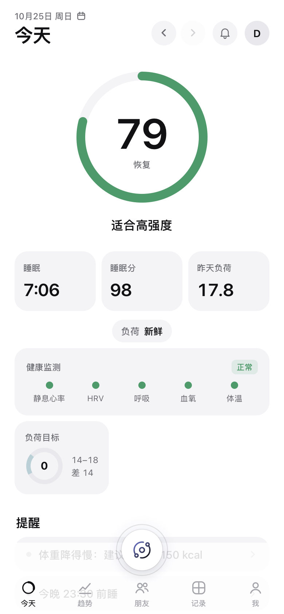 | 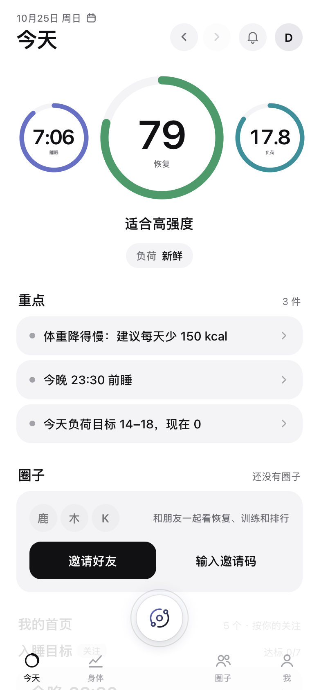 | 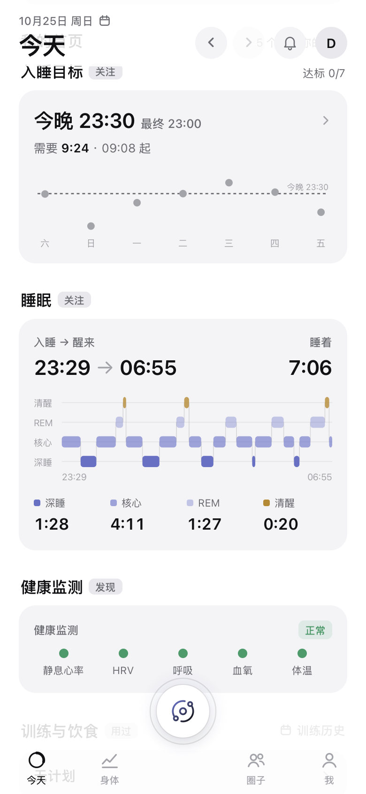 | 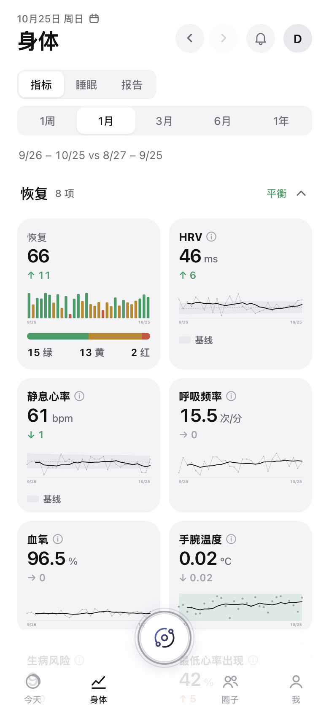 |

| Jarvis（四键弹出不变） | 圈子（一级 tab） | 我 | 全部功能 | 饮食（二级页） |
|---|---|---|---|---|
| 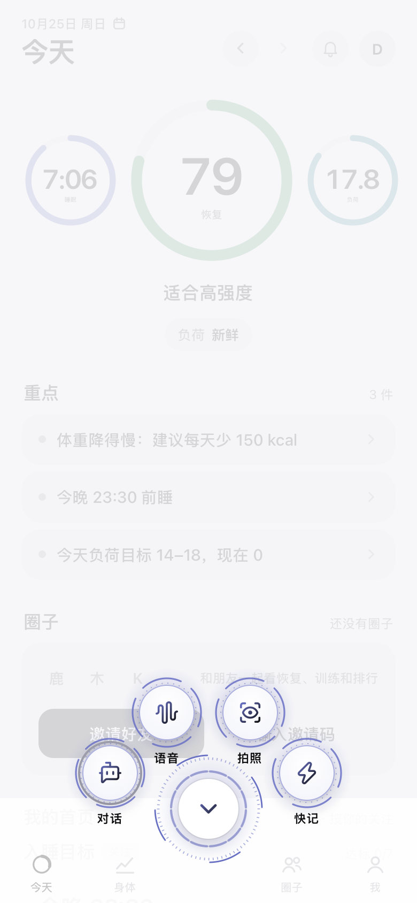 | 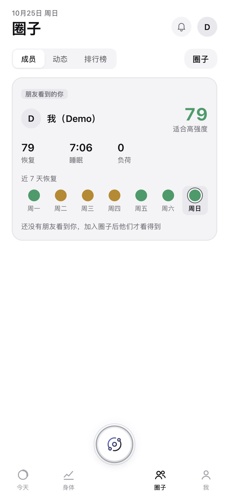 | 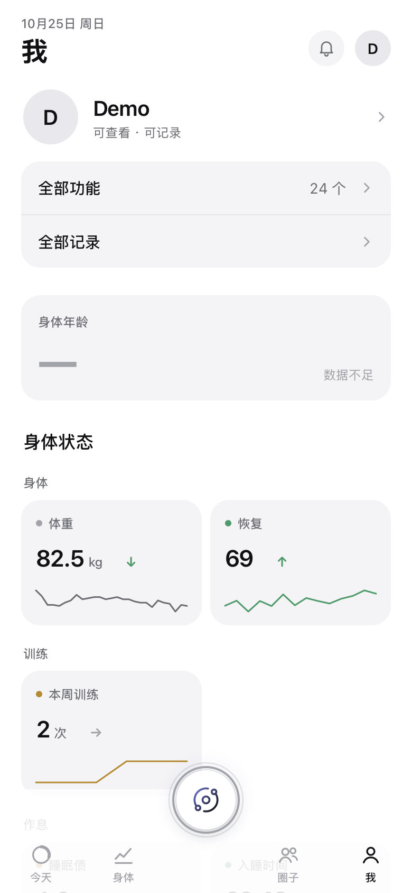 | 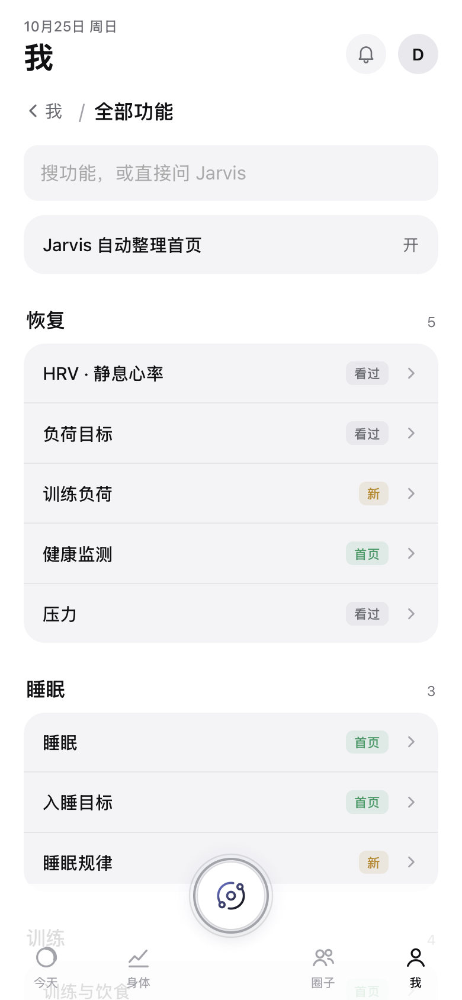 | 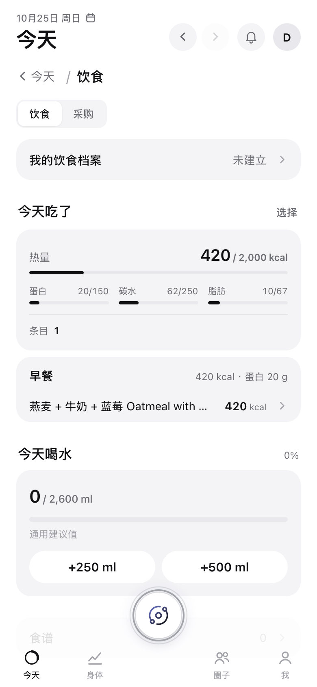 |

要点：底栏是现在的样子，只是 tab 变成 今天 · 身体 · 圈子 · 我（Jarvis 圆键在中间，四键弹出不变）；今天页把现在的大环拆成并排三环，去掉了和环重复的三块数字，提醒并进「重点」，下面是常驻的圈子卡和「我的首页」（每块带原因标签）；身体页就是现在的趋势页，只是按关注展开、其余折叠；记录、饮食从底栏移到二级页，「我」里多了「全部功能」「全部记录」。

### 13.2 可在手机上点的预览（D15）

负责人希望在手机上点一点：在线上页面加开关 `ui_ai_first`，只给自己的账号打开。这一步要改线上代码，不放在这个文档 PR 里，建议单独开 PR，分两段：

1. **不依赖新服务端的部分（约 4–5 人日）**：5 格底栏、今天页并排三环、重点（现有提醒 + 负荷目标 + 入睡目标）、圈子卡（读现有圈子接口）、「我的首页」先按「有数据 + 最近用过」在页面里摆、「全部功能」页、记录 / 饮食改成二级页。开关打开时生效，关掉就是现在的页面。
2. **依赖 P1 服务端的部分**：关注点、发现、模块状态（第 8.1 节），第 1 天的概况对话，Jarvis「放到首页」。

### 13.3 交互流程原型（只看流程）

单文件 [`ui-ai-first/prototype.html`](ui-ai-first/prototype.html)，浏览器直接打开（合成数据），演示第 1 天、Jarvis 用过的模块上首页、Jarvis 发现带出模块这几段流程。**它的样式是早期的草图，不代表最终视觉**，最终视觉以第 13.1 节为准。截图由 [`ui-ai-first/shoot.py`](ui-ai-first/shoot.py) 生成：

| 第 1 天：身体概况 | 选关注 | 首页按关注摆好 | Jarvis 记了喝水 | 「喝水」上首页 | Jarvis 发现 |
|---|---|---|---|---|---|
| 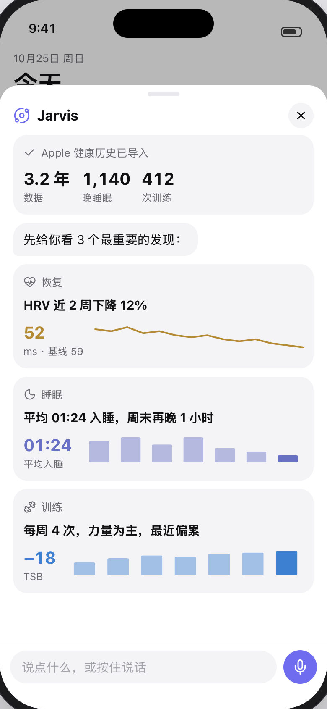 | 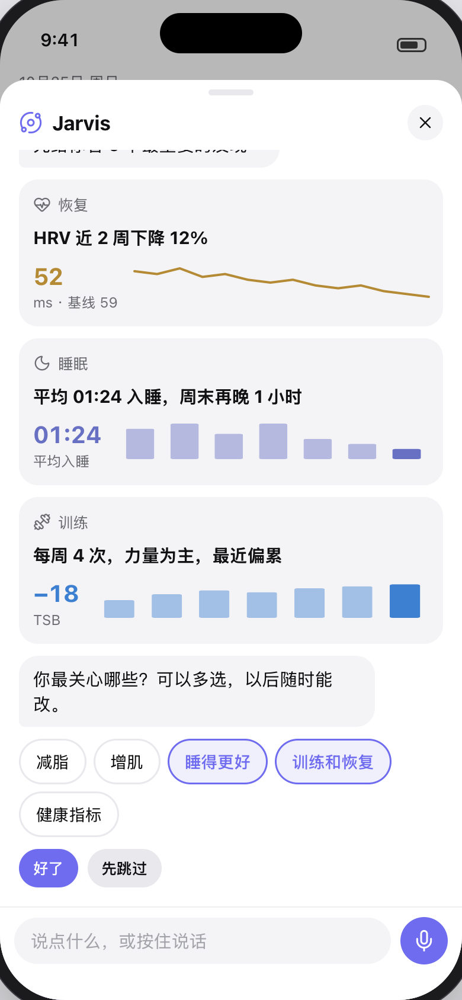 | 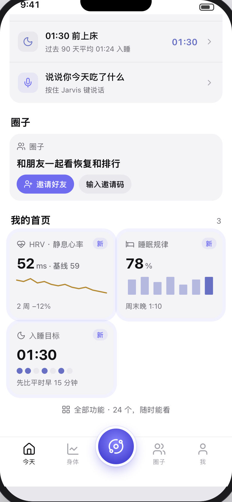 | 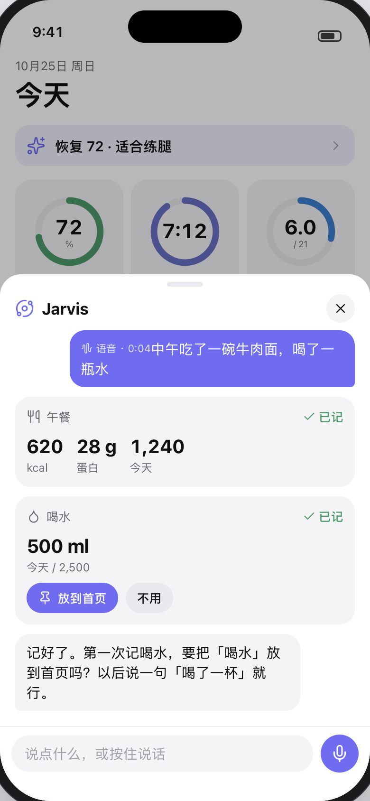 | 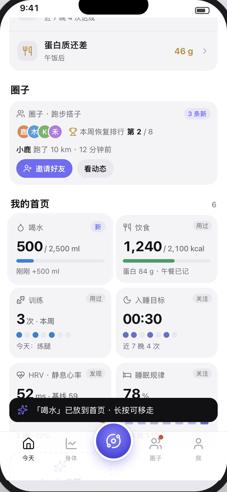 | 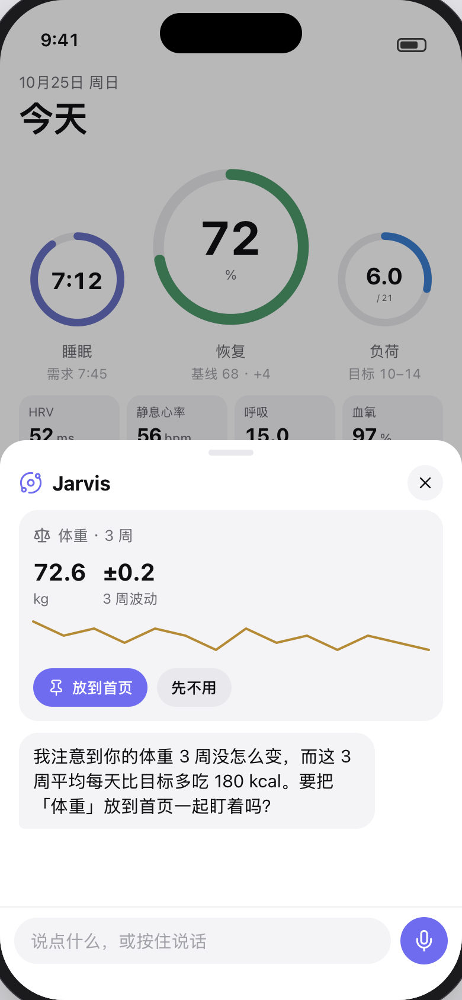 |

其他：`04-week2-today.jpg`、`05-veteran-today.jpg`、`09-circles.jpg`、`10-all-features.jpg`。原型和预览里的人名、数字都是虚构的示例，不来自任何真人。

---

## English summary

**AI-first UI (#279), design only, v0.2.** Users import their full Apple Health history on day 1, so trends, baselines and recovery exist from the start: nothing is gated by data. Progressive disclosure here manages attention and learning, not data.
**Paradigm**: open the app to three core numbers (recovery, sleep, strain), one to three things to do today and your circles; logging and questions go through Jarvis; what sits on Today is decided by (1) the user's focus (asked in the first conversation), (2) things worth saying in the data (rule-based findings: turning points, anomalies, milestones — Jarvis brings the matching module), (3) interaction (what the user asked, which modules the AI used — any AI, from the tool-call audit), (4) the user's own exploration ("All features", nothing locked), with (5) days of use only pacing proactive introductions (at most 1–2 per day).
**Day 1**: history import → "your body at a glance" (three findings) → "what do you care about?" (multi-select) → Today laid out with three modules.
**Navigation**: five slots: Today · Body · Jarvis · Circles · Me. **Circles stay a first-level tab** (inside it follows `circles-redesign.md`, same APIs), and Today always carries a circles card (new posts, weekly ranking, invite) or an invite card.
**Neither cluttered nor hidden**: at most six modules on Today, each tagged with why it is there (focus / found / used / pinned); Body shows every metric from day 1 with the user's focus expanded and other groups folded into one-line summaries; "All features" lists all 24 modules with their state (on Today / seen / new), no locks or progress bars; an "auto-arrange" switch lets users take over.
**v0.4**: owner approved D1–D11. **The visual style stays exactly as it is in production** (colours, fonts, cards, icons, tab bar look from `web/static`); the HUD / graphite looks and the tab bar motion concepts tried in v0.3 are dropped (D12, D14 void). Today's core is three rings side by side in the current ring style (D13). Only structure, order, entry points and interaction change. The preview in section 13.1 is the real page (Quick Start, synthetic data) with its real components rearranged; a clickable preview behind a `ui_ai_first` flag is proposed as a separate PR (D15).
**Implementation**: server-driven layout shared by web and native (`ui/params.py`, `ui/findings.py`, tables `ui_modules` / `ui_findings`, `GET /home`, `/overview`, `/modules`, `manage_modules`, `ui.suggest` in the briefing); web first behind `ui_ai_first`; the SwiftUI Today in 1.1.0 (#255) is built to this design. Owner decisions D1–D11 are in section 12; the prototype and screenshots are in `docs/ui-ai-first/`.
