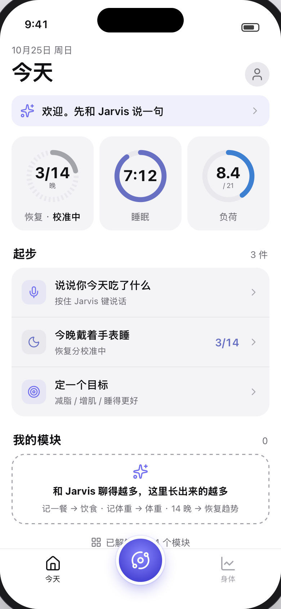
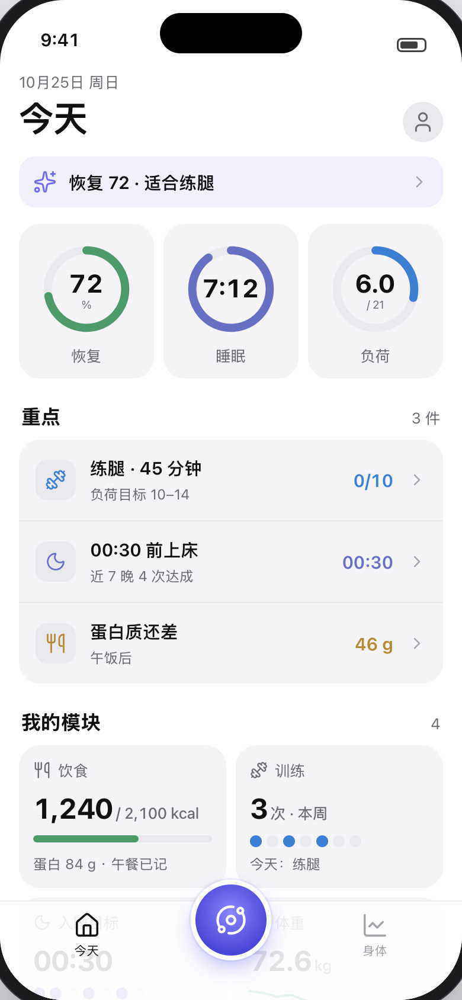
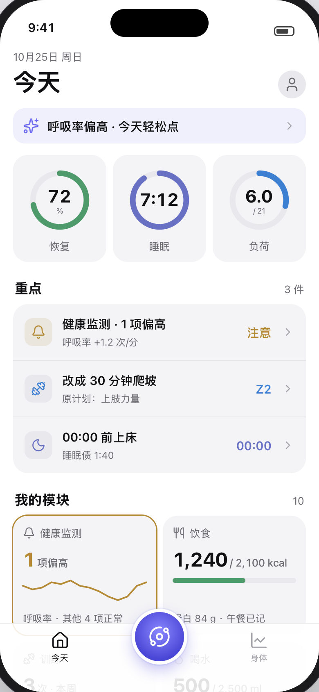
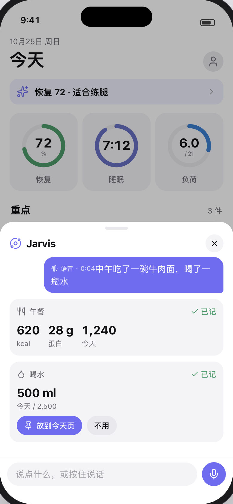
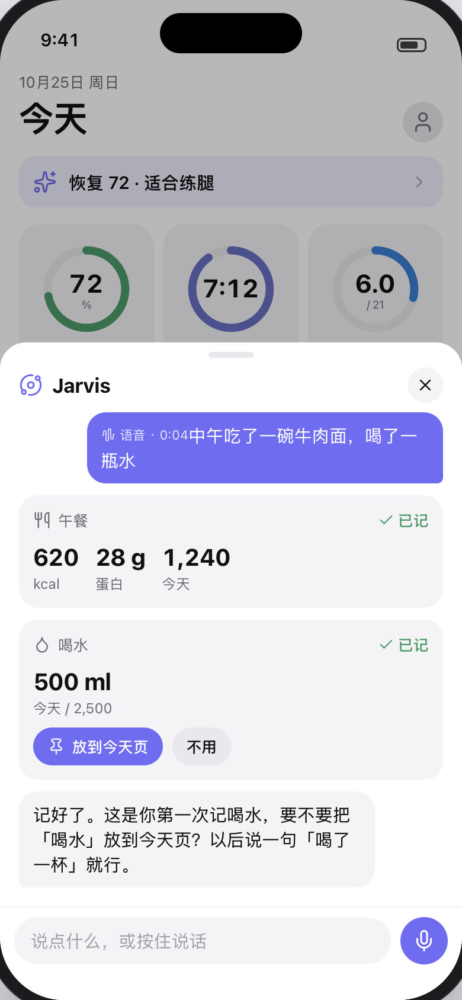
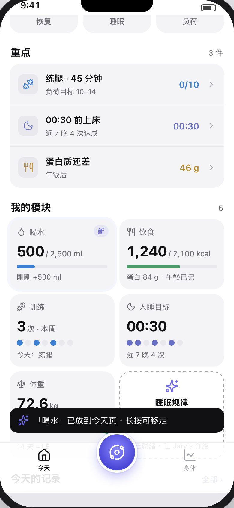
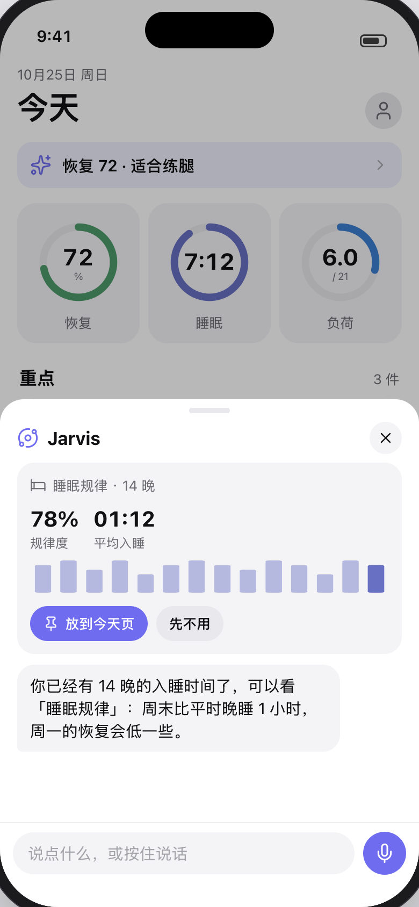
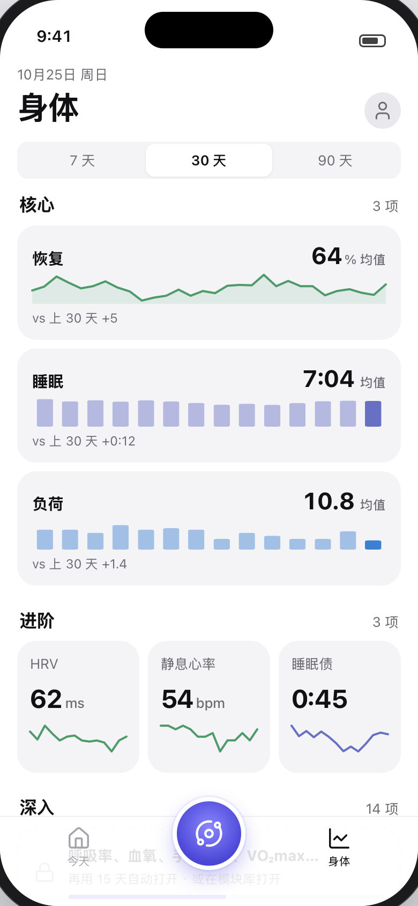
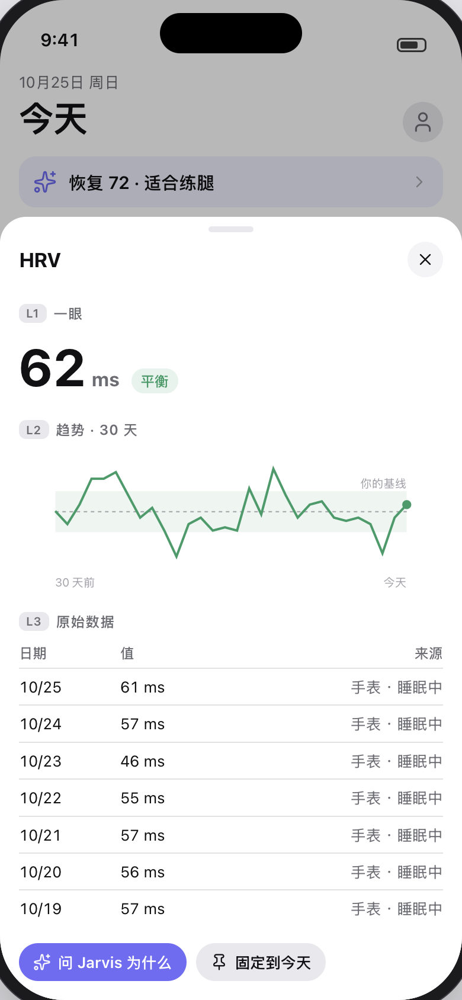

# AI 优先、功能随使用长出来：app UI 重构方案（v0.1，2026-10-25）

> 依据：[`ui-ai-first-research.md`](ui-ai-first-research.md)（同类产品调研）、现有今天页（`body_engine/src/body_engine/web/static/`）、
> [`ios-native-plan.md`](ios-native-plan.md)（#255，SwiftUI 原生化，已确认）。Issue：#279。
> 可点击原型：[`ui-ai-first/prototype.html`](ui-ai-first/prototype.html)（单文件，合成数据，直接用浏览器打开）；截图在 [`ui-ai-first/`](ui-ai-first/)。
> 这一版只有设计，不改线上代码。第 11 节是要负责人决定的点。

## 0. 摘要

- **新范式一句话：打开 app 先看到「今天最重要的 3 个数 + 1–3 件事」，其他一切通过 Jarvis 说出来；Jarvis 用过的功能，才在页面上「长出来」，并由 Jarvis 介绍。**
- **底栏从 6 格减到 3 格**：今天 · Jarvis（中间的圆键，不变）· 身体。「我」放到右上角头像，「记录」是今天页里的一段和一个二级页，饮食、朋友变成模块。
- **模块化**：现在今天页 / 趋势 / 饮食 / 我 上的约 60 块内容整理成 24 个模块。每个模块有四种状态：未解锁 → 就绪 → 已解锁 → 在今天页上。解锁靠四类条件：**数据够了**、**AI 用过**、**用的天数**、**发生了某件事**；用户随时能手动固定，或者在「我 → 模块」里一键全部打开。
- **节奏**：AI 用过的模块马上出现；只是数据够了的模块进「就绪」队列，**每天最多由 Jarvis 介绍 1 个**，两周大约长出 8–10 个，不会一下全堆出来。
- **指标三层**：新手只看恢复 / 睡眠 / 负荷 3 个数；进阶（HRV、静息心率、睡眠债、负荷目标、压力…）14 天数据后逐个出现；深入（呼吸率、血氧、手腕温度、心率区间、VO₂max、身体年龄…）30 天或手动打开。每个指标点开都是三层：一眼 → 趋势 → 原始数据。
- **和原生化一起做，不做两遍**：服务端出「模块清单 + 今天页布局」接口（服务器驱动），网页先按新设计做一版（开关 `ui_ai_first`），验证后 **1.1.0 的原生今天直接做新设计**；原生迁移顺序改成 今天 → 身体 → 记录 / 我 → 模块页 → Jarvis。
- **老用户**：不重走新手期。按已有数据和用过的功能重算，有内容的模块都解锁，今天页只固定现在常用的几块，其余在「身体」和模块库里；「显示全部模块」一键回到全部展开。
- 工作量：服务端 4–5 人日，网页 12–16 人日（两期），原生部分并进 #255 已排的工作量（今天页原生化少做约 3–5 人日，因为卡片少了）。

---

## 1. 问题和目标

**问题**（现状清单见调研第 0 节）：

1. **太多**：今天页约 13 张卡，趋势约 36 张图，「我」15 行以上，底栏最多 6 格（今天 / 趋势 / 朋友 / 饮食 / 记录 / 我 + Jarvis 键）。同类产品首页 3–4 个核心数，Oura 已经从 5 个 tab 合到 3 个（调研第 4、6 节）。
2. **新用户和老用户看到的一样多**：第一天就有 36 张趋势图，大部分显示「—」或「基线不足」。
3. **AI 是一个按钮，不是主角**：产品定位是「身体数据层 + AI 脚手架，记录靠和 AI 对话」，但页面结构还是传统仪表盘，Jarvis 只是浮在上面的一个键。
4. **重点不清**：每块的视觉权重差不多，用户分不清今天该看什么。

**目标**：

1. 打开 app 3 秒内知道今天的状态和要做的 1–3 件事。
2. 所有「记」和「问」都通过 Jarvis；页面负责「看」。
3. 功能随使用逐步出现：用得越多、数据越多，看得越细；每次只多一点，并且由 AI 告诉你它是什么。
4. 老用户不丢东西：任何模块都能找到、能固定、能全部打开。
5. 新设计直接作为 SwiftUI 原生页面的依据。

**不变的原则**：手机优先（只有 iOS app 一个客户端）；界面只放数字 / 图表 / 短标签，长文字留在接口里给 AI；中英双语；每个接口按用户鉴权；健康阈值放在 `params.py` 并写出处。

---

## 2. 新的交互范式：AI 是主入口和调度者

### 2.1 三个动作，三个位置

| 动作 | 位置 | 内容 |
|---|---|---|
| **说**（记、问、改计划） | 底栏中间的 Jarvis 键（现有 `jarvis_orbit`：点开 对话 / 语音 / 拍照 / 快记，按住直接说话，半屏回答） | 所有写操作都从这里来：记饭、记训练、记体重、喝水、日记、化验单拍照、补剂、改计划 |
| **看今天** | 今天页 | 一句晨报 + 3 个核心数 + 1–3 件事 + 我的模块 + 今天的记录 |
| **看深入** | 身体页 | 核心 3 项的趋势 → 进阶 → 深入；每个指标三层 |

页面上几乎不放输入表单。现有的输入（快捷记餐按钮、喝水加减、体重输入框、训练逐组）保留在模块页里给习惯点按的人，但不再出现在今天页首屏。

### 2.2 AI 怎么调度界面

AI 不只回答问题，还决定页面上出现什么。具体有四种动作，都走现有的工具和卡片机制：

1. **在对话里出卡片**（已有：`show_card`，约 25 种）。按 ChatGPT Apps SDK 的边界收紧：一张卡只做一件事、最多两个按钮（一主一次）、能点开全屏（调研第 2.1 节）。
2. **让模块长出来**（新）：AI 第一次替你用某个功能（例如第一次记喝水），工具返回里带 `ui.unlocked: ["water"]`，卡片下面多一个「放到今天页」按钮；回到今天页时这个模块带着「新」标记长出来。
3. **介绍就绪的模块**（新）：数据够了的模块进「就绪」队列，每天最多一个由 Jarvis 在合适的时候介绍（用户打开 Jarvis 时，或点今天页上的虚线卡片）。
4. **整理页面**（新工具 `manage_modules`）：用户说「把喝水放到首页」「首页太乱了」，AI 固定 / 移走 / 排序模块。这是普通写工具，不是删除类，不弹确认，可以撤销。

### 2.3 不同的 AI 怎么参与

| 用户的 AI | 卡片 | 「AI 用过」怎么算 | 怎么介绍新模块 |
|---|---|---|---|
| Jarvis（托底 AI / 自己的 API key，页内对话） | 有 | 工具调用（`assistant_audit` 已记所有渠道） | 在对话里出卡片 + 「放到今天页」 |
| 订阅类（Claude / ChatGPT 客户端，远程 MCP） | 没有（它们的界面我们控制不了） | 同上，审计 channel 是 `mcp:<客户端>` | `get_briefing` 里加 `ui.new` 一项，AI 会说一句；用户下次打开 app，模块带「Claude 用过」的小标签出现 |
| 身体管家（Remote Control） | 没有 | 同上 | 同上 |
| 还没配 AI | — | — | 今天页「起步」里第一件事就是「连接你的 AI / 和 Jarvis 说一句」 |

所以「AI 用过」是服务端从工具调用记录里算的，**和用哪家 AI 无关**，这正好符合「AI 可换、数据沉淀」的定位。

### 2.4 主动，但有终点

- **晨报一句**：今天页最上面一行，例如「恢复 72 · 适合练腿」「呼吸率偏高 · 今天轻松点」。规则生成（复用 `recovery_word`、健康监测、规则提醒），不调 AI，点开进 Jarvis 并带上这句话作为上下文。
- **重点 1–3 件**：今天该做的事，规则排序（见第 4.4 节），每件一个图标 + 不超过 12 个字的标签 + 一个数。做完划掉。**最多 3 件，没有「更多」**，像 Pulse 一样有终点（调研第 2.1 节）。
- **推送**：沿用现有 `notify`，不新增推送类型；新模块的介绍不推送，只在打开 app 时出现。

---

## 3. 信息架构

### 3.1 底栏：今天 · Jarvis · 身体

```
┌─────────────────────────────────────┐
│ 10月25日 周日                    (我) │ ← 头像 = 「我」
│ 今天                                 │
│ ✦ 恢复 72 · 适合练腿              ›  │ ← 晨报一句（点开 = 问 Jarvis）
│ (恢复 72) (睡眠 7:12) (负荷 6.0)       │ ← 3 个核心数，点开 = 三层详情
│ 重点 · 3 件                          │
│   练腿 · 45 分钟          0/10  ›    │
│   00:30 前上床            00:30 ›    │
│   蛋白质还差              46 g  ›    │
│ 我的模块 · 4                         │ ← 固定的 + 临时出现的 + 就绪（虚线）
│   [饮食 1,240] [训练 3 次]            │
│   [入睡目标]   [体重 72.6]            │
│   [ ✦ 睡眠规律 · 就绪 ]               │
│ 今天的记录 · 全部 ›                   │ ← 有记录才出现
│ 已解锁 12 / 24 个模块                 │ ← 进模块库
├─────────────────────────────────────┤
│   今天        ( ◎ Jarvis )      身体   │
└─────────────────────────────────────┘
```

- **为什么是 3 格**：Oura 3 个 tab、Gentler Streak 3 个、Fitbit 4 个（调研第 1 节）；Jarvis 已经是中间的圆键，两边各一格最平衡。AI 不占 tab、做成随处可达的按钮，也是 WHOOP / Oura / Fitbit 的共同做法。
- **「我」进头像**：设置、AI 设置、健康档案、圈子、模块库都是低频，放头像里是 iOS 常见做法（App Store、健康 app 都是）。
- **「记录」不是 tab**：今天页底部「今天的记录」（有记录才出现，最多 3 条）→「全部」打开记录页（按天的时间线，筛选 训练 / 饮食 / 身体 / 日记）。「我」里也有入口。回看过去某天沿用现在的「点日期开月历」。
- **备选（第 11 节 D1）**：4 格 + Jarvis（今天 · 身体 · Jarvis · 记录 · 我）。更接近现在，改动小，但又回到「东西多」。

### 3.2 每个现有内容去哪

| 现在 | 新位置 |
|---|---|
| 今天：恢复圈 + 睡眠 / 睡眠分 / 昨天负荷 | 今天：3 个核心数（恢复 / 睡眠 / 负荷），睡眠分进睡眠详情 |
| 今天：负荷状态 chip、活动（步数 / 活动 / 锻炼） | 身体 → 进阶；活动三项合成「活动」模块 |
| 今天：健康监测、压力、负荷目标 | 模块（数据够了解锁）；健康监测异常时**临时**出现在今天页 |
| 今天：提醒 | 并进「重点」 |
| 今天：睡眠卡（阶段图） | 睡眠的三层详情 |
| 今天：入睡目标、训练与饮食、快捷记餐、肌肉负荷、日记 | 模块 |
| 趋势：指标 6 组约 36 张 | 身体：核心 3 → 进阶 → 深入，分组和现在的 `trends_v2` 折叠组一致 |
| 趋势：睡眠段、报告段 | 睡眠详情页；「周报」模块 |
| 饮食：当天摄入、喝水、快捷记录、每餐推荐 | 「饮食」「喝水」模块（模块页里有快捷记录和每餐推荐） |
| 饮食：食谱、采购、饮食档案 | 「食谱」「采购」模块；饮食档案进 我 → 健康档案 |
| 记录：训练（本周、建议、历史月历） | 「训练」模块页；历史月历在记录页 |
| 记录：日记 | 「日记」模块；行为影响在 身体 → 深入 |
| 我：身体年龄 | 「身体年龄」模块 |
| 我：状态卡、近况、长期记忆 | 我 → Jarvis 记得的（AI 设置下面） |
| 我：补剂 / 事件 / 化验 / 训练记录 | 我 → 健康档案（化验、补剂也是模块，可固定到今天页） |
| 我：AI 设置、手机同步、手册、新手引导、设置、退出 | 我（头像），顺序不变 |
| 朋友 tab | 「圈子」模块 + 我 → 圈子；圈子重构（#269）的页面结构不变，只是入口变了 |
| 心电图、逐拍 HRV | 身体 → 深入（scope `ecg`，**永不自动上今天页，永不进圈子**） |

---

## 4. 渐进解锁规则

### 4.1 模块的状态

```
未解锁 ──条件满足──▶ 就绪 ──Jarvis 介绍 / 用户点开──▶ 已解锁 ──固定──▶ 在今天页上
   │                                              ▲                 │
   └──── AI 用过 / 用户手动打开 / 显示全部 ─────────┘     ◀──移走──────┘
临时：事件触发（异常、提醒），只在当天出现在今天页，第二天自动消失
```

| 状态 | 用户看得到吗 | 在哪 |
|---|---|---|
| 未解锁 | 在模块库里，显示条件和进度条（例如「14 晚 HRV · 还差 4 晚」） | 我 → 模块 |
| 就绪 | 今天页一张虚线卡片「睡眠规律 · 已就绪 · 让 Jarvis 介绍」（同时最多 1 张） | 今天页、模块库 |
| 已解锁 | 在它所属的页面（身体 / 记录 / 我）里正常显示 | 所属页面、模块库 |
| 在今天页上 | 今天页「我的模块」 | 今天页 |
| 临时 | 当天在今天页最前面，带黄色描边 | 今天页 |

**锁住的东西永远告诉用户怎么解**，并且有「显示全部模块」一键全开（调研第 3.1 节：锁住不说明是渐进解锁最常见的坑）。**设置、数据导出、删除账号、撤销记录、AI 设置、同意书永远不锁。**

### 4.2 四类解锁条件和节奏

| 条件 | 例子 | 生效 |
|---|---|---|
| **AI 用过**（任何渠道的工具调用成功） | 第一次 `log_food` → 饮食；第一次记喝水 → 喝水；`add_lab_results` → 化验 | **立刻**解锁，并默认放到今天页（带「新」，用户可以说「不用」） |
| **数据够了** | 14 晚 HRV → HRV / 负荷目标；21 天负荷 → 训练负荷；14 天里 3 次力量训练 → 肌肉负荷 | 进就绪队列 |
| **用的天数**（用户打开过 app 的天数，不是数据天数） | 第 8 天 → 周报；第 30 天 → 深入指标 | 进就绪队列 |
| **发生了** | 加入圈子 → 圈子；健康监测异常 → 临时上今天页；规则提醒 → 进重点 | 立刻 |
| **用户主动** | 模块库里点「固定」；说「把压力放到首页」；打开「显示全部」 | 立刻 |

**节奏规则**：

- 就绪队列按优先级（下表「顺序」列）排，**每天最多介绍 1 个**；用户当天没打开 Jarvis 也没点虚线卡片，就留到第二天。
- 「数据够了」是门槛，「用的天数」是节奏：app 首次同步 90 天历史的人第一天就满足大部分数据条件（和 Athlytic 一样没有校准期，调研第 1.4 节），但仍然每天只介绍一个，所以**两周大约长出 8–10 个**，不会第一天全堆出来。
- 今天页「我的模块」最多 6 个固定（不含临时和就绪）；超过时 Jarvis 问「要把哪个收起来？」并给出最久没点的那个。
- 7 天内一次都没点过的「AI 自动放上来」的模块，Jarvis 会在介绍下一个模块时顺便问要不要收起（不会自己偷偷收）。

### 4.3 模块清单

门槛数字来自现有代码（`packages/openbodyscore/src/openbodyscore/params.py`、`trends/params.py`、`insights/healthspan_params*.py`），实现时集中到新的 `ui/params.py`，写明出处，可调。

| # | 模块 | 所属页 | 解锁条件 | 门槛出处 | 顺序 |
|---|---|---|---|---|---|
| — | 恢复 / 睡眠 / 负荷（核心 3） | 今天 | 始终；恢复分没出来时显示「校准中 n/14 晚」 | 恢复要 14 晚 HRV（`MIN_BASELINE_NIGHTS`） | — |
| 1 | 饮食 | 记录 | AI 用过 `log_food` / `log_meal_template` / `log_recipe` | — | AI |
| 2 | 喝水 | 记录 | 第一次记喝水 | — | AI |
| 3 | 训练 | 记录 | 有 1 次训练（手表同步或 AI 记的） | — | 1 |
| 4 | 体重 | 身体 | 第一次记体重（AI 或体重秤同步） | — | AI |
| 5 | 入睡目标 | 今天 | AI 用过 `set_sleep_goal`；或 14 晚里入睡时间波动大时就绪 | 睡眠规律参数 | 2 |
| 6 | 负荷目标 | 今天 | 恢复分出来 | 14 晚 HRV | 3 |
| 7 | HRV · 静息心率 | 身体 | 14 晚 HRV | `MIN_BASELINE_NIGHTS` | 4 |
| 8 | 活动（步数 / 活动 / 锻炼） | 身体 | 7 天步数 | — | 5 |
| 9 | 睡眠规律 | 身体 | 14 晚入睡时间 | `CHRONO_MIN_NIGHTS = 10`，取 14 | 6 |
| 10 | 周报 | 身体 | 用满第一周（第 8 天）且有 5 天数据 | — | 7 |
| 11 | 压力 | 身体 | 14 天心率基线 | `MIN_BASELINE_DAYS = 14` | 8 |
| 12 | 健康监测 | 身体 | 14 天基线；异常时临时上今天页 | 同上，`MIN_TEMP_BASELINE = 5` | 9 |
| 13 | 肌肉负荷 | 记录 | 14 天里 3 次力量训练 | — | 10 |
| 14 | 训练负荷（CTL / ATL / TSB） | 身体 | 28 天里 21 天有负荷 | `MIN_TRIMP_DAYS = 21` | 11 |
| 15 | 日记 | 记录 | AI 用过 `log_journal` | — | AI |
| 16 | 食谱 | 记录 | AI 用过 `create_recipe` / `log_recipe` | — | AI |
| 17 | 采购 | 记录 | AI 用过采购相关工具 | — | AI |
| 18 | 化验 | 身体 | AI 用过 `add_lab_results` | — | AI |
| 19 | 补剂 | 我 | AI 用过 `add_supplement` | — | AI |
| 20 | VO₂max | 身体 | 手表测到 VO₂max | — | 12 |
| 21 | 身体年龄 | 身体 | 步数 + 睡眠够天数 | `healthspan_params` 的 `MIN_DAYS` | 13 |
| 22 | 行为影响 | 身体 | 30 天日记 | `journal_regression` | 14 |
| 23 | 深入指标（呼吸率、血氧、手腕温度、生病风险、心率区间、ACWR、恢复指数…） | 身体 | 用满 30 天，或手动打开 | — | 15 |
| 24 | 圈子 | 我 | 加入或建了圈子（开关 `friends`） | — | 事件 |

心电图 / 逐拍 HRV 不在模块里：它们在 身体 → 深入，需要 scope `ecg`，永不自动出现在今天页。体态照片（#174）等以后的新功能都按这张表登记，**新功能默认是「AI 用过才解锁」**，除非有理由放进始终显示。

### 4.4 今天页的内容和顺序

1. **晨报一句**（1 行）。
2. **核心 3 个数**（恢复 / 睡眠 / 负荷）：始终。
3. **重点 1–3 件**：规则排序，来源按优先级：
   1) 临时事件：健康监测异常、生病风险、规则提醒（`rules/`）里级别高的；
   2) 今天的训练计划 / 负荷目标；
   3) 入睡目标；
   4) 饮食差额（蛋白质 / 热量，只在记过饭的人）；
   5) 新用户的「起步」三件（见 4.6）。
   同一来源一天最多 1 件；做完划掉，不补新的。
4. **我的模块**：临时出现的（最前）→ 固定的（用户顺序）→ 就绪的虚线卡片（最多 1 张）。
5. **今天的记录**：有记录才出现，最多 3 条，「全部」进记录页。
6. **「已解锁 n / 24 个模块」**一行，进模块库。

**没有空卡片**：没数据的模块不出现；核心 3 个数没数据时显示「校准中」或「没戴表」的原因，而不是「—」。

### 4.5 Jarvis 怎么介绍新模块

- 一次只介绍一个，一张卡 + 两三句话：卡片就是模块本身（复用 `show_card` 的对应卡），按钮最多两个：「放到今天页」（主）、「先不用」（次）。选「先不用」= 已解锁、不固定，在所属页面里能看到。
- 介绍词由服务端给（`ui.new[].intro`，规则模板 + 用户自己的数），任何 AI 都能照着说；托底 AI 不需要额外的模型调用。
- 介绍的时机：用户打开 Jarvis 时（作为开场的第一条）；或点今天页的虚线卡片；外部 AI（MCP）在下一次 `get_briefing` 时。
- 文案原则：说「你已经有 14 晚的入睡时间了，可以看睡眠规律」这种**和用户自己的数据挂钩**的话，不说功能介绍。

### 4.6 新用户第一天

- 登录 → 同意书 → 现有 3 屏介绍改成 **1 屏 + 一次对话**：参考 Fitbit 的开场对话（调研第 1.9 节），Jarvis 问目标、作息、训练习惯，答案写进资料和长期记忆（现有工具），可以跳过。
- 今天页：核心 3 个数（有历史数据就直接有恢复分，没有就「校准中 n/14 晚」）+ **起步 3 件事**：「说说你今天吃了什么」「今晚戴着手表睡」「定一个目标」，每件点开都是 Jarvis。
- 「我的模块」只有一张说明卡：「和 Jarvis 聊得越多，这里长出来的越多」。
- 身体页只有核心 3 项和两张锁住的卡（恢复趋势、进阶 / 深入），带进度。
- 底栏从第一天就是 3 格，不再渐进出现（太少了没有必要）。

### 4.7 老用户迁移

| 方案 | 做法 | 优点 | 缺点 |
|---|---|---|---|
| A. 全部解锁 + 全部固定 | 和现在一样多 | 零意外 | 新设计等于没做 |
| **B. 按数据和用过的功能重算（推荐）** | 条件已满足的模块全部「已解锁」（不进就绪队列，不再一个个介绍）；今天页只固定**最近 30 天点过或 AI 用过**的模块，最多 6 个；其余在所属页面里 | 老用户东西都在，首页变清爽 | 少数人要找一下东西放哪了 |
| C. 重走新手期 | 从第 1 天开始 | 体验一致 | 老用户会觉得功能被拿走了 |

方案 B 的细节：上线后第一次打开，Jarvis 出一张卡「新版首页：今天只放你常用的 5 个，其他在 身体 和 我 → 模块；想全部放回来说一声」，按钮「好的」/「全部显示」。「显示全部模块」随时能在 我 → 模块 打开。「最近 30 天点过」用现有的页面埋点（`BodyHooks` 的 `page` 事件、运营统计）算，算不出来的按「有数据就固定」兜底。

### 4.8 看别人的数据时

通过共享查看别人（`#who` 切换、圈子成员卡片）时：模块 = 对方已解锁的模块 ∩ 对方给我的 scope；不出现就绪卡片、不出现重点里的待办，晨报换成对方的状态词。渐进解锁只针对「我自己的页面」。

---

## 5. 指标分层

| 层 | 何时出现 | 指标 |
|---|---|---|
| **L1 新手（3 个）** | 第一天 | 恢复、睡眠（时长）、负荷 |
| **L2 进阶（约 9 个）** | 各自数据够了，按 4.3 的顺序由 Jarvis 介绍 | HRV、静息心率、睡眠债、睡眠规律、负荷目标、训练负荷（TSB）、压力、活动、体重 |
| **L3 深入（约 14 个）** | 用满 30 天或手动打开 | 呼吸率、血氧、手腕温度、生病风险、恢复指数、睡眠效率、深睡 / REM、夜醒、心率区间、有氧分钟、ACWR、VO₂max、身体年龄、行为影响（另有心电图 / 逐拍，scope `ecg`） |

**每个指标的三层详情**（原型「HRV」详情，截图 10）：

1. **一眼**：大数字 + 单位 + 一个状态标签（好 / 平衡 / 偏高…，颜色只表示好坏方向）。
2. **趋势**：30 天折线 + **你的基线带**（均值 ± 1 SD，和 `trends_v2`、Oura Vitals 一样对个人范围，调研第 4 节），可切 7 / 30 / 90 天。
3. **原始数据**：按天的表：日期、值、来源设备、数据问题（`flags`），默认收起。

下面固定两个按钮：「问 Jarvis 为什么」（带上这个指标的 `ai_prompt`，复用 `explain`）、「固定到今天」。现有讲解弹层的文字（是什么、怎么看、建议）不再直接展开，改成问 Jarvis 时由 AI 讲，或在三层下面折叠一个「是什么」。

身体页的结构：范围切换（7 / 30 / 90 天）→ 核心 3 项（各一张趋势卡）→ 进阶（3 列小卡）→ 深入（列表，未解锁时一张带进度的锁卡）。

---

## 6. 数据展示规范

### 6.1 卡片

| 类型 | 用在 | 内容上限 |
|---|---|---|
| 核心表盘 | 今天页 3 个数 | 一个环 + 一个数 + 一个 2 字标签 |
| 重点行 | 今天页重点 | 图标 + ≤12 字标签 + 一行 ≤10 字副标签 + 一个数 |
| 模块卡（2 列） | 今天页「我的模块」 | 标题 + **一个大数** + 一个小图（进度条 / 7–14 天迷你线 / 点阵）+ 最多一行小字 |
| 趋势卡（整宽） | 身体页 | 标题 + 均值 + 一张图 + 「vs 上期」一行 |
| 对话卡片 | Jarvis | 一件事、最多 2 个按钮、可点开全屏（调研第 2.1 节） |
| 锁卡 / 就绪卡 | 未解锁、就绪 | 虚线边框 + 条件 + 进度条；就绪卡带 AI 色的 ✦ |

### 6.2 数字和文字

- 每张卡**只有一个主数字**，字号是标签的 1.6 倍以上，等宽数字（`tabular-nums`），单位小一号、灰色。
- 文字只用标签：中文 ≤ 6 字、英文 ≤ 2 个词；一句话以上的解释只在 Jarvis 里。首屏文字面积目测不超过数字和图表的一半。
- 变化量写成「+5」「−0.8」并说明比较对象（「vs 上 30 天」），不用「较好 / 较差」这类词。

### 6.3 颜色

- 沿用现有 `app.css` 的语义色：`--good`（好）、`--mid`（注意）、`--bad`（差），`--sleep`（睡眠）；新增 `--strain`（负荷，蓝）和 `--ai`（AI，紫，和 Jarvis 键一致）。
- **颜色只表示好坏方向或类别，从不单独表达数值**；有颜色的地方旁边一定有数字或标签（色盲、NN/g，调研第 4 节）。
- 一张卡最多一个强调色；AI 色只用在 Jarvis 相关的东西上（晨报、就绪卡、「新」标签、AI 记的来源标记）。
- 浅色 / 深色两套，原型里两套都有（截图 13 是深色）。

### 6.4 图表

| 数据 | 图 |
|---|---|
| 0–100 的分、0–21 的负荷（一个值在范围里的位置） | 环 |
| 一段时间的连续值（HRV、恢复、体重） | 折线 + 个人基线带 |
| 每天 / 每周的量（睡眠时长、负荷、有氧分钟） | 柱，最后一根实色、其余半透明 |
| 目标进度（热量、喝水、负荷目标） | 横条 |
| 是 / 否的一串天（入睡目标达成、本周训练） | 点阵 |
| 阶段（睡眠阶段） | 堆叠条 / 睡眠图 |

不用饼图、3D、双 Y 轴。迷你图不画坐标轴；趋势卡标首尾日期和基线。原生端用 Swift Charts 的 `LineMark` + `AreaMark`（基线带）、`BarMark`、`RuleMark`（目标），环用自定义 `Shape`。

### 6.5 动效

- 模块长出来：从小到大 + 一圈 AI 色的光晕（0.9 s，原型的 `grow`）；就绪卡不动。
- 减少动态效果打开时全部关掉（和 `jarvis-entry.js` 一致）。
- 原生端用 `matchedGeometryEffect` 让对话里的卡片「飞」到今天页的位置（网页版不做，只淡入）。

---

## 7. 技术方案

### 7.1 服务端（服务器驱动的布局，网页和原生共用）

- **模块注册表** `body_engine/src/body_engine/ui/params.py`：每个模块的 key、所属页、条件（类型 + 门槛 + 出处）、优先级、介绍模板（中英）、对应的卡片 spec（复用 `ai/cards*.py` 的 builder）。
- **表** `ui_modules`（新迁移）：`user_id, module_key, state (locked/ready/open/pinned/hidden), pin_order, unlocked_at, unlocked_by (data/ai/time/event/user/migration), unlocked_via (工具名 / 渠道), introduced_at, last_opened_at`。主键 `(user_id, module_key)`。`GRANT SELECT TO grafana_ro`（看解锁漏斗）。
- **计算**：
  - 数据 / 天数条件：并进每小时批处理（`hourly-batch`，#266 的 `batch.py`），只算变了的用户；幂等。
  - AI 用过：在工具执行成功处（`assistant/` 的 `run_tool` 统一入口，审计写 `assistant_audit` 的同一处）查「工具 → 模块」映射，第一次时写 `ui_modules`，工具返回里加 `ui.unlocked`（`compact.py` 省略空字段，不增加 token）。
  - 事件：规则提醒、健康监测异常在生成时标记临时模块。
- **接口**：
  - `GET /v1/users/{user}/home`：今天页要的布局：晨报、核心 3、重点、模块列表（key + 状态 + 顺序 + 卡片数据）、就绪 1 个、今天的记录。可以并进 #255 第 1 期已经做好的 `boot` 接口，一次往返。
  - `GET /v1/users/{user}/modules`：模块库（全部 24 个 + 条件 + 进度）。
  - `PUT /v1/users/{user}/modules/{key}`：固定 / 移走 / 排序 / 隐藏；`PUT /v1/users/{user}/modules` 的 `show_all`。只能改自己的。
- **AI**：`get_briefing` 加 `ui.new`（最多 1 个，带介绍词）；新工具 `manage_modules`（description 要短，遵守 `tests/test_briefing.py` 的工具定义总长度预算）；两份 system prompt（`ai/system_prompt.md`、`assistant/CLAUDE.md`）各加一条「有 `ui.new` 时先用卡片介绍，一次一个」。
- **双语**：介绍词、标签走 `i18n.py` 的 `L()`，`X-Body-Lang` 选语言；给 AI 的文字仍是中文。

### 7.2 网页

- 新今天页、身体页、记录页、模块库，`app.js` 里的 `RENDER_today` / `RENDER_trends` 在开关下换成读 `/home`；现有卡片的 HTML 函数（`window.BodyCards` 已经抽出来给 Jarvis 卡片用）直接复用为模块卡的「点开后」页面。
- 底栏 3 格 + 头像进「我」；饮食、朋友 tab 在开关下隐藏，入口变成模块页（`goPage`）。
- Jarvis 卡片下的「放到今天页」按钮（`ai.js`）。
- `tests/test_i18n.py` 照常检查双语；新增 `tests/test_ui_modules.py`（条件、节奏、迁移、权限、工具映射全覆盖）。

### 7.3 开关

- `ui_ai_first`：新今天页 / 身体页 / 底栏。按现在的规则（2026-10-24 起上线即全员，开关只做紧急关闭），关掉 = 现在的页面。
- `ui_modules`：服务端计算和接口（先开，只记录不显示，可以先看两周的解锁数据再开页面）。
- 原生的 `native_today` 等沿用 #255 的设计。

---

## 8. 和 SwiftUI 原生化（#255）的关系

**原则：新设计就是原生页面的设计，不先把旧页面原生化一遍。**

| #255 原计划 | 调整后 |
|---|---|
| 3.1 原生今天（恢复圈、三块数字、健康监测、负荷目标、睡眠、提醒、训练卡、饮食卡、快捷记餐） | **原生新今天**：晨报 + 核心 3 + 重点 + 模块卡（2 列网格）+ 今天的记录；数据全部来自 `/home` 一个接口（一个文档）。卡片种类少了，估计 8–10 人日（原 10–15） |
| 3.2 记录、3.3 趋势 | **身体**（Swift Charts，三层详情）放 1.2.0 先做；**记录**（时间线）同版本，比原来的训练逐组页简单 |
| 3.4 饮食 | 变成模块页，先留 WebView（从原生今天页的模块卡点进去打开 WebView 页面），1.3.0 再原生 |
| 3.5 我 | 头像里的「我」+ 模块库，1.3.0 |
| 3.6 Jarvis | 不变（1.4.0），网页版的「放到今天页」按钮先做 |

- **网页先做什么**：服务端（7.1）全部；网页版新今天 / 身体 / 记录 / 模块库；Jarvis 卡片的「放到今天页」。这样**部署就能给所有人用**、不用等发版，也能在 1.1.0 之前用两三周的真实使用数据调门槛。
- **原生做什么**：1.1.0 的原生今天直接按新设计；模块卡的样式规范（第 6 节）同时是 SwiftUI 组件的规范：`CoreDial`、`FocusRow`、`ModuleCard`、`TrendCard`、`LockedCard`。未原生化的模块点开 = WebView 打开对应页面（#255 第 5.3 节的常驻 WKWebView）。
- **时间**：#255 排的 1.1.0 是约 12-06。网页版新今天要在约 11-15 前上线（给两到三周数据和反馈），原生团队同时可以照原型开始画 SwiftUI。

---

## 9. 分期、工作量

| 期 | 内容 | 端 | 估计 | 开关 |
|---|---|---|---|---|
| P0 | 本文档 + 调研 + 原型（这个 PR） | 文档 | — | — |
| P1 | 模块注册表、`ui_modules` 迁移、条件计算（批处理 + 工具调用）、`/home` `/modules` 接口、`manage_modules` 工具、briefing `ui.new`、老用户迁移脚本、测试 | 服务端 | 4–5 人日 | `ui_modules` |
| P2 | 网页新今天页（晨报、核心 3、重点、模块卡、就绪卡、今天的记录）、3 格底栏 + 头像、模块库、Jarvis「放到今天页」、长出来的动效、双语 | 网页 | 7–9 人日 | `ui_ai_first` |
| P3 | 身体页（核心 → 进阶 → 深入、三层详情）、记录页时间线、饮食 / 朋友改成模块页、开场对话代替 3 屏介绍 | 网页 | 5–7 人日 | `ui_ai_first` |
| P4 | 原生新今天（1.1.0）→ 身体 + 记录（1.2.0）→ 我 + 模块页（1.3.0）→ Jarvis（1.4.0） | iOS | 并进 #255（今天页少 3–5 人日） | `native_*` |
| P5 | 看解锁漏斗（解锁 → 介绍 → 固定 → 7 天内点过）调门槛和顺序 | 运营 | 持续 | — |

**衡量**（用现有的按用户统计，不改同意书）：新用户第 7 天还在用的比例、每人每天和 Jarvis 说话的次数、模块介绍后被固定的比例、7 天没点过就被收起的比例、「显示全部」的使用率（太高说明藏多了）。

## 10. 风险

| 风险 | 应对 |
|---|---|
| 老用户找不到东西 | 方案 B 迁移 + 迁移卡片 + 「显示全部」+ 模块库；任何模块都能固定 |
| 节奏太慢，有人想马上看全部 | 「显示全部模块」一键全开；说「把压力放出来」立刻打开 |
| AI 自动放到今天页太多 | 默认放上来但上限 6 个；7 天没点 Jarvis 会问要不要收起 |
| 没配 AI / AI 不可用的人什么都长不出来 | 数据和天数条件照样生效；起步第一件是连接 AI；托底 Jarvis 默认可用 |
| 外部 AI（MCP）不出卡片，用户不知道多了模块 | `ui.new` 让 AI 说一句；app 里模块带「Claude 用过」标签 |
| 和 #255 的排期冲突 | 网页先上线；原生团队按原型画，接口在 P1 定死 |
| 服务端批处理变慢 | 只算有变化的用户（#266 的增量机制）；条件都是现成字段的计数 |

---

## 11. 要负责人决定的点

| # | 问题 | 推荐 |
|---|---|---|
| D1 | 底栏 | **3 格：今天 · Jarvis · 身体**，「我」放头像，记录 / 饮食 / 朋友变成页面或模块。备选：4 格 + Jarvis（今天 / 身体 / 记录 / 我） |
| D2 | AI 用过的模块是自动放到今天页，还是只进模块库让用户自己固定 | **自动放上并标「新」**，对话卡片上可以选「先不用」；上限 6 个，7 天没点 Jarvis 会问要不要收起 |
| D3 | 节奏：数据够了的模块每天最多介绍几个 | **每天 1 个**；AI 用过、用户主动、事件触发的不受限 |
| D4 | 老用户迁移 | **方案 B**：按数据和用过的功能重算，不重走新手期；今天页只固定最近 30 天用过的（最多 6 个）；迁移卡片 + 「显示全部」 |
| D5 | 晨报一句和重点 1–3 件用规则还是每天调 AI 生成 | **规则**（免费、稳定、可解释，托底 AI 每人每月 ¥3 不够每天生成）；点开时才由 AI 解释 |
| D6 | 朋友从 tab 降为模块 | **降为模块**：有圈子的人自动固定「圈子」模块，我 → 圈子也有入口；圈子重构（#269）的页面不变 |
| D7 | 新用户的引导 | **1 屏介绍 + Jarvis 开场对话（可跳过）**，代替现在的 3 屏介绍 + 小贴士 |
| D8 | 先网页还是直接原生 | **网页先做**（开关 `ui_ai_first`，部署即生效），1.1.0 的原生今天直接按新设计做 |
| D9 | 上线方式 | 按现在的规则（上线即全员，开关只做紧急关闭），但 `ui_modules` **先只记录两周**再开页面，用真实数据检查门槛 |
| D10 | 外部 AI（Claude / ChatGPT 通过 MCP）用过的工具也算「AI 用过」吗 | **算**：解锁看的是数据层的工具调用，和用哪家 AI 无关 |

---

## 12. 原型

单文件 [`ui-ai-first/prototype.html`](ui-ai-first/prototype.html)，用浏览器直接打开（不连服务器，全是合成数据），左边切换三种用户状态和两段演示。截图由 [`ui-ai-first/shoot.py`](ui-ai-first/shoot.py)（Playwright + WebKit）生成。图标都来自 Lucide（ISC），从官方仓库取的 SVG 路径。

| 新用户第 1 天 | 使用 2 周 | 老用户 |
|---|---|---|
|  |  |  |

**Jarvis 记了喝水 → 「喝水」长出来**

| 说一句 | 对话里的卡片 + 「放到今天页」 | 回到今天页，模块长出来 |
|---|---|---|
|  |  |  |

**就绪模块由 Jarvis 介绍、身体页、三层详情**

| 就绪模块的介绍 | 身体（2 周） | 三层详情（HRV） |
|---|---|---|
|  |  |  |

其他截图：`04-day1-jarvis.jpg`（第一天的 Jarvis 建议）、`09b-day1-body.jpg`（第一天的身体页）、`11-week2-record.jpg`（记录页时间线）、`12-week2-modules.jpg`（模块库：今天页上 / 已解锁 / 就绪 / 未解锁 + 显示全部）、`13-veteran-today-dark.jpg`（深色）。

原型里的数字都是随机生成的示例，不来自任何真人。

---

## English summary

**AI-first UI with progressive unlocking (#279), design only.** New paradigm: opening the app shows today's three core numbers (recovery, sleep, strain) and one to three things to do; everything else is said to Jarvis, and a module "grows" onto the page only after the AI has used it (or the data is ready), introduced by Jarvis.
**Navigation** shrinks from up to six tabs to three slots: Today · Jarvis (the existing centre key) · Body; Me moves to the avatar, the log becomes a section of Today plus a page, Food and Friends become modules.
**Modules**: about 60 current blocks become 24 modules with states locked → ready → open → pinned (plus same-day "temporary" ones for alerts). Triggers: AI used it (any channel, from the tool-call audit; immediate, pinned with a "new" tag), data is sufficient (thresholds from the existing scoring parameters, e.g. 14 nights of HRV), days of use, events, or the user (pin, or "show all modules"). Ready modules are introduced at most one per day, so about 8–10 appear in two weeks. Locked modules always show their condition and progress; settings, export, deletion and undo are never locked.
**Metric tiers**: 3 for beginners, about 9 "advanced" as data allows, about 14 "deep" after 30 days or on request; every metric opens in three layers: glance → 30-day trend against your baseline band → raw daily data with sources.
**Display rules**: one main number per card, short labels only, colour only for direction or category and never alone, rings for scores, lines with baseline bands, bars for amounts.
**Implementation**: server-driven layout shared by web and native (module registry `ui/params.py`, table `ui_modules`, `GET /home`, `GET/PUT /modules`, `manage_modules` tool, `ui.new` in the briefing); web first behind `ui_ai_first`, and the SwiftUI Today in 1.1.0 (#255) is built straight to this design instead of porting the old page.
**Existing users** (recommended): recompute from their data and used features, keep everything unlocked, pin only what they used in the last 30 days, offer "show all".
Owner decisions D1–D10 are in section 11. The clickable prototype (synthetic data) and screenshots are in `docs/ui-ai-first/`.
